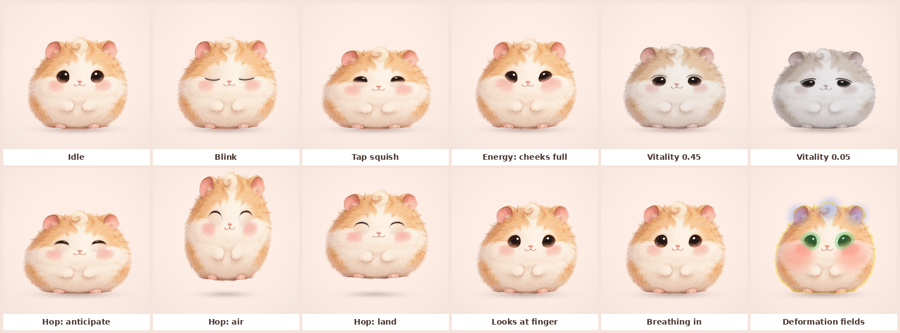

# Companion motion proof

A dependency-free WebGL 2 proof that one AI illustration of Pofu can feel
alive through procedural motion and a single deformation shader. The spec
and the reasoning are in
[docs/design/companion-motion.md](../../../docs/design/companion-motion.md);
the Swift port is `PofuCompanion` in `Packages/PofuKit`.



Animated: [media/pofu-motion.webp](media/pofu-motion.webp) (13 s, 20 fps,
0.7 MB).

## Usage

Open `index.html` in a browser (it runs from `file://`). Tap Pofu, move the
pointer, and use the sliders and buttons. `?capture=1` disables the clock
for deterministic captures through `window.pofu.advance(seconds)`.

## Files

| File | Purpose |
|---|---|
| `index.html` | The proof: motion model (springs, breathing, blinks, hops) and the fragment shader (inverse warps, lids, vitality grade, contact shadow). |
| `pofu-hamster.png` | The founder's GPT Image hamster, keyed out to alpha. |
| `pofu-hamster-lids.png` | The lid plate: the same art with fur painted over the eyes. |
| `pofu-hamster-data.js` | Both images as WebP data URIs (WebGL cannot read `file://` textures). |
| `tools/key_background.py` | Keys a flat background and painted ground shadow out of a concept. |
| `tools/make_lid_plate.py` | Builds the lid plate (stand-in for the `eyes-closed` variant). |
| `tools/embed_images.py` | Regenerates `pofu-hamster-data.js`. |
| `tools/slice_sprite_sheet.py` | Slices, registers, and checks a GPT Image sprite sheet. |
| `tools/capture.js`, `tools/strip.py` | Playwright frame capture and the frame strip. |

## Rebuild the media

```sh
cd design/prototypes/companion-motion
python3 tools/key_background.py /path/to/hamster.png pofu-hamster.png
python3 tools/make_lid_plate.py pofu-hamster.png pofu-hamster-lids.png
python3 tools/embed_images.py
node tools/capture.js stills /tmp/pofu-stills 480
node tools/capture.js sequence /tmp/pofu-seq 360
ffmpeg -framerate 20 -i /tmp/pofu-seq/f%04d.png -vf scale=320:320 \
  -c:v libwebp_anim -quality 72 -loop 0 media/pofu-motion.webp
```

## Iteration log

- **v1:** everything worked on the first render except the faces. Blinks
  slid fur from above the eye over it, which painted peach "eyeshadow"
  arcs; sleepy lids read as bored, the trap the 2D rig and the 3D spike
  both hit.
- **v2:** sad lids tilt down toward the outer corner; lid fur sampled from
  a thin strip at the rim. Critique: stretched vertical streaks.
- **v3:** lid fur from a radial fan, then from translated fur with its low
  frequencies swapped. Critique: still a visible disc and a brightness
  mismatch.
- **v4:** a lid plate (harmonic fill of the eye plus borrowed fur
  detail), revealed in place. Seamless, because the plate equals the base
  everywhere else. This is the case for the `eyes-closed` image variant in
  the asset contract.
- **v5:** softened tap and landing squash (the second landing flattened
  Pofu into a pancake) and clamped squash to the range the art survives.
