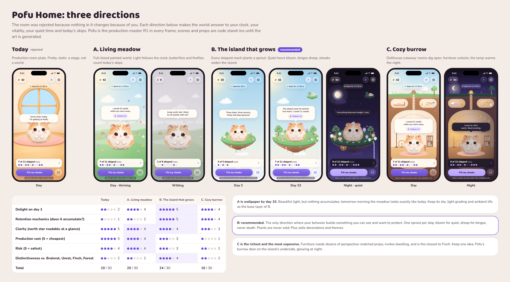

# Home directions: mockups

Three radically different Home directions, plus the rejected room as a
baseline, as animated, dependency-free HTML in an iPhone 17 frame
(402 × 874 pt). Analysis, scores, recommendation and the art request list:
[`docs/design/home-directions.md`](../../../docs/archive/home-directions.md).

| Page | Direction | States (`?preset=`) |
|---|---|---|
| `index.html` | All three live, side by side, with the score table | `?sheet=1` renders the static comparison sheet |
| `a-meadow.html` | A. Living meadow | `day`, `golden`, `night`, `wilting` |
| `b-island.html` | **B. The island that grows (recommended)** | `day` (day 23), `early` (day 2), `night`, `wilting` |
| `c-burrow.html` | C. Cozy burrow, upgraded | `day`, `night`, `wilting` |
| `today-room.html` | Baseline: the production room plate, as specified today | `day` |

Other queries: `bare=1` (device only), `labels=0` (hide the stand-in label).
Tap Pofu to squish.

## What is real and what is a stand-in

| Element | Status |
|---|---|
| Pofu | **Production art:** master R1 (`design/art/masters/pofu-hamster-base-v1/`), trimmed and downscaled to `assets/pofu.webp`. Breathing, squish and the cheek bulge are code. |
| Room plate (baseline only) | **Production art:** `design/art/plates/room-v1/room-plate-a.png`. |
| Neighbor bunny | Concept art from the UX prototype. |
| Skies, hills, island, plants, burrow, props | **Stand-ins** drawn in SVG and CSS, labeled on every screen. They prove composition, layering and motion, not the final look. |
| Chrome | Proposals for the SwiftUI and Liquid Glass versions (`home.css`); Nunito stands in for SF Pro Rounded. |

## Files

- `home.css`, `home.js`: the shared frame, chrome (glass), Pofu component and state presets.
- `tools/render.js`: Playwright renderer. `node tools/render.js screenshots --all` renders every preset and the comparison sheet; then optimize with `pngquant --quality 70-92 --speed 1 --force --ext .png screenshots/*.png`.
