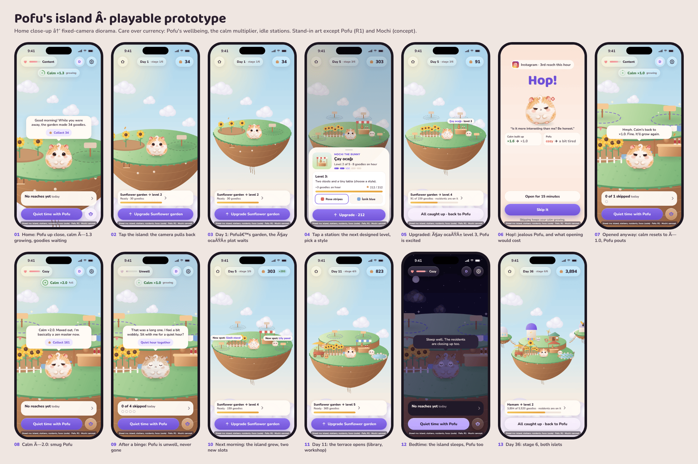

# Island game: playable prototype

Pofu's island as a dependency-free single page in an iPhone 17 frame
(402 × 874 pt): Home close-up, a tap that pulls the camera back to a
fixed-camera diorama, residents running stations while you are away, the
calm multiplier, Pofu's wellbeing, station upgrades along designed level
ladders, island expansion, and Pofu's emotional range. Design and numbers:
[`docs/product/game-design.md`](../../../docs/product/game-design.md).

Open `index.html` in a browser. The side panel simulates what happens
off-screen (a resisted reach, a quiet hour, a reach for Instagram, a
binge, bedtime, the next morning) and jumps to days 5, 11 and 36.
Inside the device: tap the island or the island button to zoom out, tap a
station to upgrade it, tap Pofu to boop him. `?bare=1` shows the device
only; `?labels=0` hides the stand-in label.

## What is real and what is a stand-in

| Element | Status |
|---|---|
| Pofu | **Production art:** master R1, trimmed to `assets/pofu.webp`. Breathing, squish, and **all faces** (jealous, pout, smug, excited, proud, unwell, sleepy) are code overlays standing in for the face-edit kit (GDD §10). |
| Mochi | Concept art from the UX prototype. |
| Island, stations and their five levels, Simit, Bulut, Fındık, particles | **Stand-ins** drawn in Canvas. They prove layout, scale, the camera, the level ladder, and motion, not the final look. |
| Chrome | Proposals following the design language; Nunito stands in for SF Pro Rounded. |
| Numbers | Mirror `tools/sim/island_economy.py` (costs, rates, calm, wellbeing). Time is compressed by the panel buttons. |

## Files

- `index.html`, `island.css`, `game.js`: the page, styles, and the whole prototype.
- `tools/render.js`: Playwright renderer. `node tools/render.js` writes
  every state and `overview.png` to `screenshots/`; then
  `pngquant --quality 70-92 --speed 1 --force --ext .png screenshots/*.png`.
