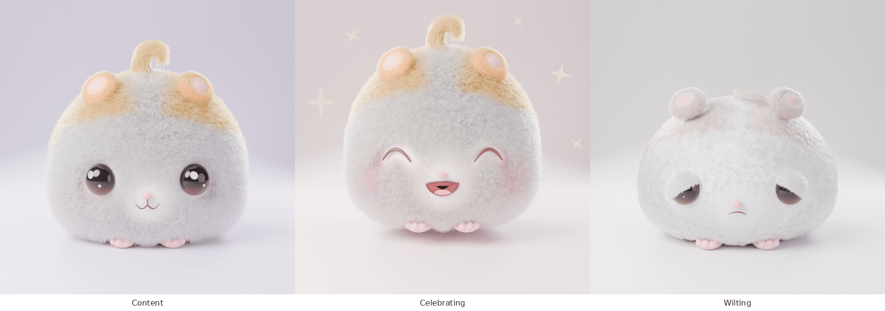
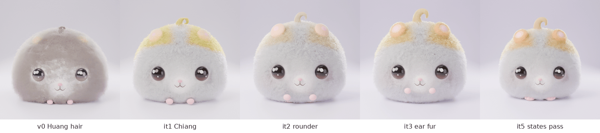
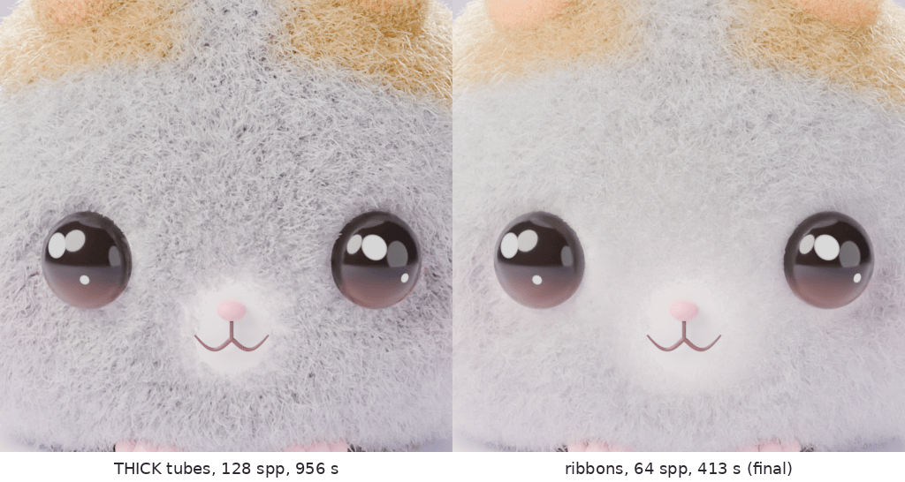
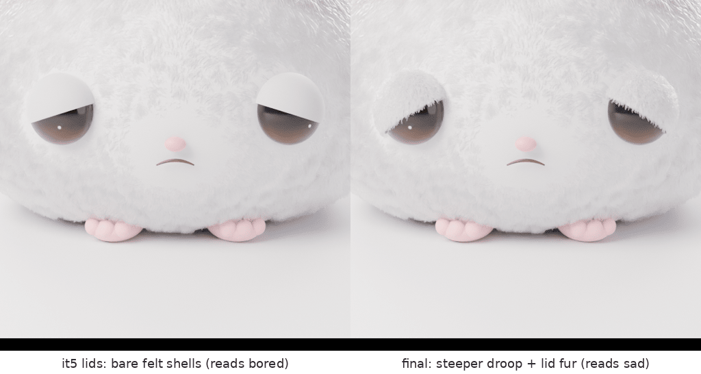
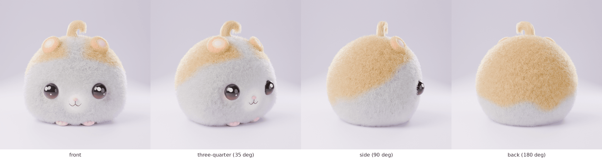
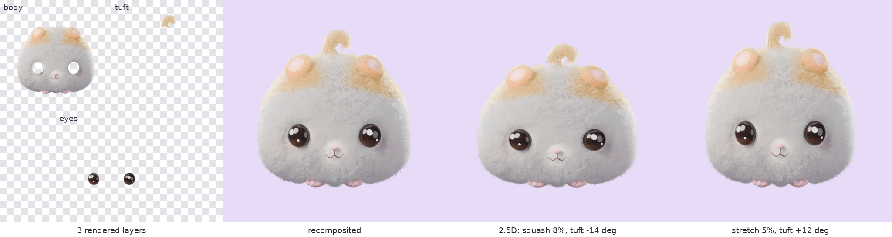

# Pofu 3D feasibility spike

**Question:** can we produce a premium, plush-toy-quality 3D Pofu entirely
procedurally (Blender Python API, headless Linux, no artist), and should 3D
become the rendering direction?

**Short answer:** yes, the look is achievable, and it is a big step up
from the current vector rig. But shipping it as real-time 3D is not
realistic for us. The viable path is **3D as the source of truth, shipped as
pre-rendered layers and stills (hybrid, option c)**. See
[Recommendation](#recommendation).



## Verdict

- **Compared with the current code-drawn vector rig:** 3D wins clearly. It
  is a different league of premium: tactile, collectible, and it photographs
  like a product.
- **Compared with a *well-made* 2D illustration style:** 3D wins on these
  points, but not on all:
  - **Material.** Pofu's core mechanic is fur that gets fluffier or
    matted. Real fur makes that mechanic physically legible in a way flat
    art can only suggest.
  - **Consistency from any angle.** One model gives every view, state, and
    marketing shot for free (see the turntable).
  - **Agent-maintainable.** There is no illustrator on the team; this whole
    character is about 1,100 lines of script.

  2D still wins on these:
  - **Motion freedom.** Smears, extreme squash, and instant interactivity.
  - **Size.** Kilobytes vs. megabytes.
  - **Iteration speed.** Milliseconds vs. minutes per frame.
  - **Expressive range.** A top illustrator or Rive animator would match
    the premium feel *in motion*, which 3D stills cannot.
- **Net:** 3D is the better *identity and still-image* direction for Pofu
  and is realistically achievable by us. Whether it is the better *living
  companion* depends on 2.5D motion feeling alive, which this spike did not
  prove. That is the next spike.

## What is here

| File | Purpose |
|---|---|
| `pofu_hamster.py` | Builds the whole scene from nothing and renders one still. No `.blend`, textures, or assets. |
| `render_layers.py` | Hybrid-pipeline proof: renders body, tuft, and eyes as separate transparent layers, plus the tuft pivot. |
| `renders/` | Final renders, turntable, iteration strip, comparisons, and layer proof. All are quantized PNGs under 0.5 MB each. |

## How to run

```sh
# Official Blender build as a Python module (includes OpenImageDenoise).
python3.13 -m venv .venv && .venv/bin/pip install bpy==5.2.3 numpy
.venv/bin/python pofu_hamster.py --state content --out content.png \
    --res 1024 --samples 128
# Fast look-dev preview (ribbon hair, looser adaptive sampling):
.venv/bin/python pofu_hamster.py --state wilting --out w.png --res 400 \
    --samples 24 --preview
# Turntable angle, fur density:
.venv/bin/python pofu_hamster.py --state content --view 35 --density 0.5
```

`--state` is one of `content`, `celebrating`, `wilting`. It also runs with a
Blender binary: `blender -b -P pofu_hamster.py -- --state content`.

### Toolchain finding

Ubuntu's `apt install blender` gives Blender 4.0.2 **built without
OpenImageDenoise**. Without a denoiser, fur needs several times more samples,
so that build is a poor fit. The official `bpy` wheel from PyPI (Blender
**5.2.3 LTS**, `cp313`, matches the container's Python 3.13) works headless,
includes OIDN, and renders with Cycles on CPU. EEVEE was not tried: it needs
a GPU context, and fur depends on Cycles' curve rendering anyway.

## How the character is built

- **One analytic surface.** The body is a deformed ellipsoid `P(d)`,
  evaluated for unit directions: cheek pouches, a soft flattened sitting
  base, a bottom-heavy "melt", and volume-preserving squash. The body mesh,
  every feature position, and every fur root use the same function, so
  features always sit on the body, in any pose.
- **Fur is generated strand by strand in numpy** (roughly 300k body strands,
  7 points each, plus 14k for the tuft and about 10k on the ears) and written into
  a native hair `Curves` object. Particle hair was rejected: combing needs
  particle-edit mode, which is unreliable headless, and it gives less
  control. Per strand we control:
  - length (short velvet face, fluffy cheek pouches, short underside)
  - lift angle (airy vs. lying flat)
  - a comb field (face fur flows away from the nose, body fur down and back)
  - frizz and clumping (soft locks vs. matted)
  - color (cream base, golden-peach cap with a white forehead blaze,
    airbrushed blush, vitality drain)
- **Hair shading:** Principled Hair BSDF, **Chiang** model, direct coloring
  from the per-strand attribute, darker roots, lighter tips. Huang went gray;
  a plain Principled BSDF on strands looked like a shag rug. Chiang's multiple
  scattering desaturates and yellows pale colors, so strand colors pass
  through a calibrated `hair_color()` transform (found with a 4-variant sweep).
- **Features:**
  - Eyes are flattened domes with low reflectance and two *painted*
    highlights in the shader (designer-toy style). A fully glassy dome
    mirrored the pastel studio and turned milky gray.
  - Happy eyes and the mouth are tapered NURBS tubes mapped onto the
    surface; the open smile is a filled cavity with a tongue.
  - Sad lids are shader-masked felt shells whose lid line droops towards the
    outer corner.
  - Ears are ellipsoids with a velvet pile and a bare pink inner ear. Feet
    have toe beans.
  - The tuft is a lock swept along a curling centerline with a moving
    cross-section frame, so it stays full through the curl.
- **Studio:** pastel cyclorama, large disc key, cool fill, two rim lights
  for the fur halo, soft top light. AgX view transform, 66 mm lens, f/2.8.
- **States** are parameter presets (`STATES`), mirroring `PofuPose` in the
  [character bible](../../../docs/brand/character.md): `vitality`, `fluff`,
  `squash`, `melt`, `hop`, `eye_mode`, `eye_open`, `lid_tilt`, `gaze_y`,
  `sparkle`, `mouth`, `blush`, `tuft_perk`, `sparkles`, `backdrop`.

## Iteration log (honest critique)



Previews were 400–512 px at 16–32 samples (15–65 s each). Each one was
inspected and critiqued before the next change.

- **v0, smoke test (Huang hair model).** It already read as a fluffy
  hamster, which was encouraging.
  - *Critique:* the fur was dull gray instead of cream, the peach cap was
    invisible, the eyes were milky gray, and the tuft and ears were lost in
    the fur.
  - **Shading A/B (4 variants):** attribute-as-emission proved the
    per-strand colors arrive correctly. **Chiang** gave luminous white
    plush; Huang went gray; Principled BSDF on strands looked like a shag
    rug; the Standard view transform blew out. Chiang won.
- **it1: Chiang, rounder features.**
  - *Critique:* charming for the first time. But the peach turned lemon
    yellow; the tuft read as a **bag-handle loop**; the ears looked like
    pink pom-poms stuck on the forehead; the blush was invisible; the front
    paws were buried; the light was flat.
- **it2: rounder body, stronger key/fill ratio, tuft rebuilt** as a lock
  with a moving cross-section frame.
  - *Critique:* better form, but the peach was overcorrected to beige, the
    tuft read as a stiff fruit stem, and the ears looked like smooth
    plastic caps.
  - **Color calibration sweep (4 variants)** to find a strand-color
    transform that lands on golden peach through Chiang scattering.
- **it3: velvet fur on the ears, calibrated colors.**
  - *Critique:* the ears read correctly. **But the front paws read as a
    second pair of blush cheeks** and the hind feet were buried. The front
    paws were dropped; the feet were pushed forward and got toe beans.
- **it4: first pass on all three states.** A positional-argument bug first
  produced comically giant toe beans. After the fix:
  - *Critique:* all states read instantly.
  - Celebrating: the hop cropped the tuft; bald pale discs remained around
    the closed eyes; the sparkles looked like white paper cut-outs.
  - Wilting: the matted fur clumped into round lumps that read as
    **"cauliflower or cottage cheese", too close to unhealthy**. The lids
    looked like pale shells.
- **it5: state fixes.** Matted fur became flat, elongated locks; lids got
  the fur tone; the happy eyes only shorten fur along the arc; more
  headroom; a wider open smile; smaller gold sparkles.
  - *Critique:* the states hold up and wilting stays sad, not sick.
- **Full quality, attempt 1 (1024 px, 128 samples, THICK curves, 956 s).**
  The eyes, nose, mouth, and feet held up beautifully, but **the fur got
  worse**: true 3D tubes resolved into coarse gray wire with dark gaps,
  closer to mohair than to plush.
- **Full quality, attempt 2 (ribbons, 340k thinner strands, lighter roots,
  64 samples, 428 s).** Soft, white, plush pile.
  - *Critique:* slightly cool and gray, and the tuft read as a smooth
    sculpted croissant. Final pass: warmer key light, +0.17 exposure, a few
    flyaway strands in the tuft.
  - At 64 samples, OIDN smooths individual fibers slightly ("airbrushed").
    That suits plush, but it costs some fiber crispness.

  

- **Wilting final, attempt 1.** At 1024 px the bare felt lids read as
  smooth shells, and the shallow slant made Pofu look **bored or
  unimpressed, not sad**. This is the same trap the 2D rig hit in v0.1. The
  fix was a steeper outer droop plus short fur grown on the visible lid.

  

Remaining weaknesses in the finals, stated plainly:

- The tuft is still the least convincing element. It reads as a styled
  lock, not as loose plush fur.
- The fur in the shadowed lower half drifts towards gray rather than
  shaded cream.
- The blush is subtle at app size.
- The wilting state's flattened fur reads more "damp felt" than "matted
  plush" up close. The "drain" shows mostly as lost peach and a cooler
  scene; the fur itself only goes slightly gray.
- There is no secondary motion or physics; these are stills.

All of these are tunable, but each round costs minutes of render time.

## Render times

Machine: this container, **4 CPU cores, CPU only** (Cycles, OIDN).
Times are pure render times; scene build plus fur generation adds 4–7 s.

| Render | Settings | Time |
|---|---|---|
| Smoke test | 400 px, 16 spp, 30% fur density | 13 s |
| Look-dev previews (it1–it3) | 512 px, 32 spp | 63–66 s |
| State previews (it4–it5) | 400 px, 24 spp | 12–37 s |
| Full quality, attempt 1 (THICK curves) | 1024 px, 128 spp | 956 s |
| **Final: content** | 1024 px, 64 spp, ribbons | **413 s** |
| **Final: celebrating** | 1024 px, 64 spp, ribbons | **450 s** |
| **Final: wilting** | 1024 px, 64 spp, ribbons | **219 s** |
| Turntable views (35°, 90°, 180°) | 640 px, 48 spp | 139–148 s each |
| Layer proof (3 layers) | 512 px, 48 spp | not timed separately |

Rule of thumb: about 7 min per final 1024 px still and about 2.5 min per
640 px frame on this CPU. An M1 Pro GPU (Metal Cycles) should be several
times faster; this was not measured.

## More renders



Hybrid-pipeline layer proof (`render_layers.py`). Separated layers lose
the floor contact shadow and the bounce light from the backdrop, so the
app needs its own shadow layer:



Single states at 1024 px: [content](renders/pofu-3d-content.png),
[celebrating](renders/pofu-3d-celebrating.png),
[wilting](renders/pofu-3d-wilting.png).

## In-app pipeline assessment

Pofu appears at roughly 180–300 pt in the app (540–900 px at @3x), plus
widgets, Live Activities, the shield screen, notifications, and marketing.
For reference, the current code-native vector rig (ADR-0006) costs well under
100 KB and can be parameterized without limit.

### (a) Pre-rendered loops per state (HEVC with alpha or image sequences)

- **Quality:** the best of the three. What you see in `renders/` is what
  ships.
- **App size:** HEVC with alpha (AVFoundation, iOS 13+) at 640 px, 30 fps,
  3 s loops: about 0.5–1 MB per clip. Fur is high-frequency detail and
  compresses worse than flat art. A realistic set needs about 25 clips (8
  idle loops, transitions through a neutral hub pose, tap reactions, a
  celebration), so **about 12–25 MB**. PNG or HEIC sequences cost 10–30x
  more, so they are not an option beyond stills.
- **Render cost:** about 2.5 min per 640 px frame on this 4-core CPU
  (measured, see Render times), so about 4 CPU-hours per 3 s loop and
  **about 100–200 CPU-hours** for the set (the high end allows for the
  extra samples motion needs). Apple-silicon GPUs (Metal Cycles) or
  a cloud render farm cut this by roughly 10–30x. This is fine for a
  release, but painful when iterating.
- **Flexibility: poor.** Vitality becomes a few discrete steps with
  crossfades instead of a continuous value. No gaze tracking, no
  interruptible springs, and blinks are baked into loops. Every cosmetic or
  prop multiplies the clip count (combinatorial explosion). It also
  contradicts the core principle of the character bible ("built from
  parameters, not drawings").
- **Temporal stability risk:** the OIDN denoiser works per frame. On fur,
  low-sample frames shimmer in motion, so animation needs higher samples
  (2–4x cost) or temporal denoising. This was not tested in this spike.

### (b) Real-time RealityKit (or SceneKit) with a USDZ model

- **Fur fidelity is the deal-breaker.** This look comes from roughly 320k path-traced
  hair strands with multiple scattering. Mobile real-time has no hair BSDF;
  we would rebuild the fur as shell layers (16–32 offset shells with a noise
  alpha texture, through a `CustomMaterial` or ShaderGraph surface shader)
  plus fins or hair cards for the fuzzy silhouette, with baked normal and AO
  maps. Done well, that reaches maybe 60–70% of this look. It reads as
  "game fuzz" (velvet), not a collectible plush, and the tuft and silhouette
  fluff lose the most.
- **App size:** small (USDZ plus textures, about 2–6 MB).
- **Flexibility: maximal.** Continuous parameters, blend shapes, a spring
  tuft, gaze following the finger, and physics squish.
- **Cost and risk: highest.** This needs a technical artist with real-time
  fur experience (weeks of work). SceneKit was deprecated by Apple in 2025,
  so it would be RealityKit, where custom fur shading is the least mature.
  Overdraw from shells on an always-visible companion costs battery. Widgets
  and Live Activities cannot run RealityKit, so we would *still* need
  pre-rendered stills. The agent cannot verify real-time look or
  performance in this Linux environment.

### (c) Hybrid: 3D-rendered layers animated in SwiftUI (2.5D)

- Render Pofu as separate transparent layers with correct occlusion:
  - fur body in a few vitality/fluff variants
  - eyes (open, half-lid, happy arcs, closed)
  - mouths, blush
  - the tuft (a separate layer with a pivot)

  SwiftUI then does the motion with springs: squash and stretch, breathing,
  and hops are transforms of the body layer; blinks and expressions swap
  feature layers; the tuft rotates about its root with follow-through; and
  vitality crossfades between body variants. `render_layers.py` proves the
  layer split works with fur, including holdout occlusion and the tuft pivot
  (see `renders/pofu-3d-layers.png`).
- **Quality:** close to (a) for the front view. Small head turns need a few
  extra angles.
- **App size:** about 40–60 layers at @3x as HEIC/PNG: **about 4–10 MB**.
- **Flexibility: good.** It keeps most of the `PofuPose` parameter model.
  `vitality` becomes a crossfade rather than a true continuous morph; true
  3D rotation is out.
- **Widgets, Live Activities, shield, notifications:** use the same
  renders as stills, which is a natural fit.
- **Risks:**
  - Seams between layers: features sit *in* fur, so each feature layer must
    carry its own contact shading.
  - Raster scaling during squash limits stretch to about ±12% before the
    fur visibly stretches.
  - Every new pose or cosmetic is a re-render, but because the whole
    character is a script, a re-render is a command, not an artist's day.

### Recommendation

1. **Adopt the 3D look as Pofu's visual source of truth**, rendered
   procedurally from `pofu_hamster.py`. It is clearly more premium,
   tactile, and ownable than the vector rig, and it is reproducible by the
   agent with no illustrator.
2. **Ship it as the hybrid (c)**: layered renders animated by SwiftUI
   springs, plus stills for widgets, Live Activities, and the shield. Use
   pre-rendered loops (a) only for one or two hero moments (the
   celebration, onboarding) where the motion justifies the bytes.
3. **Do not pursue real-time 3D (b)** for v1. It is the most expensive path
   and gives the worst result for this specific character, whose appeal is
   the fur.
4. Before committing, record the change as an ADR that amends ADR-0006
   (the companion stops being a pure vector rig), and run a short
   **motion spike**: a 2 s tuft and squash test in SwiftUI on the
   founder's iPhone 17 using `render_layers.py` output, to judge whether
   2.5D motion feels alive enough.

### Main risks

- **Iteration speed.** A final-quality frame costs minutes on CPU, not
  milliseconds. Look-dev needs a fast preview path (already in the script)
  and ideally GPU rendering on the founder's M1 Pro.
- **Consistency.** This is solved by construction: every image comes from
  one script and one seed. That is the main advantage over AI image tools.
- **Who maintains it.** The script is about 1,100 lines of Python and
  Blender API. The agent can maintain it; a human tech artist could too.
  Blender API changes across major versions will need small fixes; pin the
  `bpy` version.
- **Motion quality ceiling.** 2.5D motion is believable for squash,
  breathing, blinks, and tuft follow-through, but not for turning, walking,
  or holding props. Props need separate layers or an artist.
- **Uncanny or realism creep.** More realism is not better. The painted eye
  highlights, simple mouth, and pastel studio are what keep this a toy and
  not a rodent. Guard that in reviews.
- **Brand change.** Lilac (bible v0.1) becomes cream and peach. The
  character bible and color tokens need an update if the founder approves.

