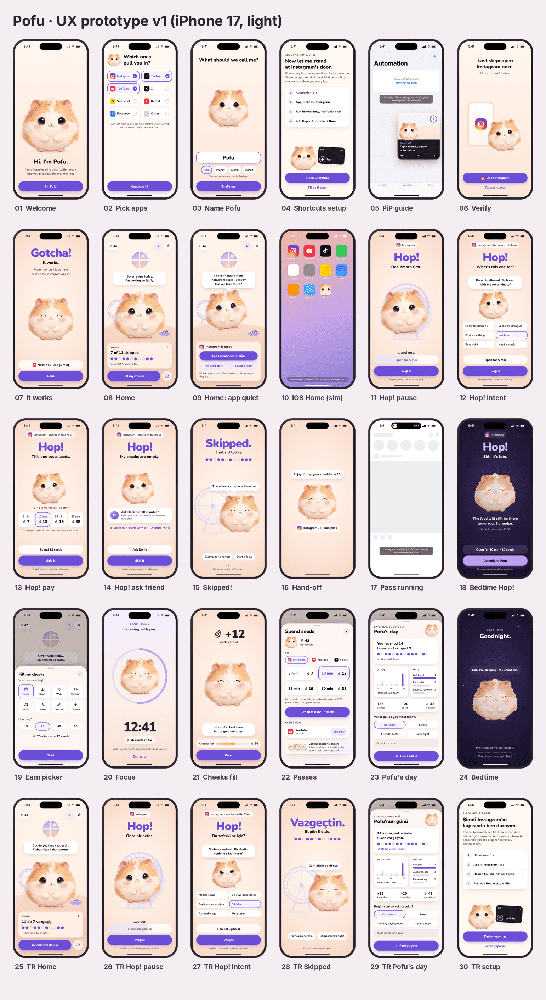
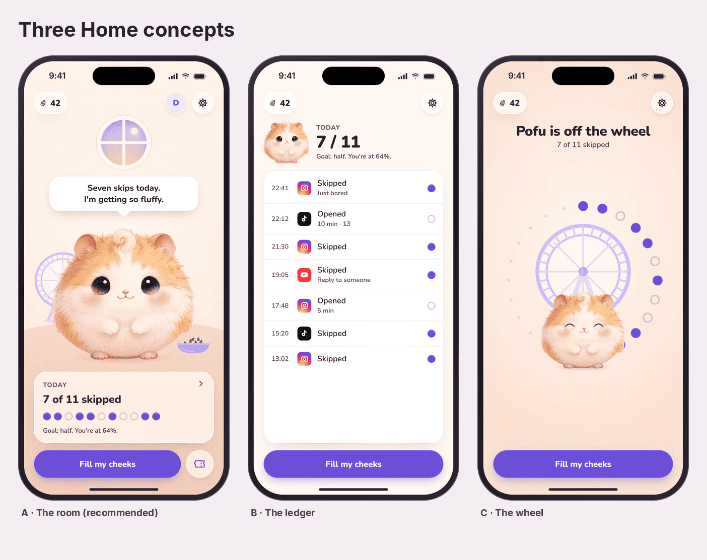

# Pofu UX prototype

A clickable, high-fidelity prototype of Pofu's core loop in an iPhone 17
frame (402 × 874 pt), in English and Turkish. Dependency-free: one
`index.html` plus assets. Companion to the
[information architecture](../../../docs/product/ux/information-architecture.md)
and [user flows](../../../docs/product/ux/user-flows.md); where the
prototype and the flows differ, the flows are the source of truth for copy
and behaviour.

## Usage

Open `index.html` in a browser. The panel on the right jumps to any screen
and switches language.

| Query | Effect |
|---|---|
| `?screen=<id>` | Start on a screen (ids below) |
| `?lang=tr` | Turkish copy |
| `?bare=1` | Device only, no panel |
| `?static=1` | No animation; every screen shows its final state (for screenshots) |
| `?reason=3`, `?balance=5` | Pre-select an intent reason; set the seed balance |

**The core loop, clicked through:** `springboard` (a simulated Home Screen)
→ tap Instagram → Hop! (each tap climbs a rung: pause, intent, pay, ask a
friend) → **Skip it** celebrates, **Open** hands off with a pass that counts
down in the Dynamic Island → tap the home indicator to return to the Home
Screen. From Home: **Fill my cheeks** → focus session (time runs fast) → the
cheeks-fill moment; the ticket button opens the passes store; the Today card
opens the evening recap, which leads to bedtime and the night Hop!.

| Group | Screen ids |
|---|---|
| Onboarding | `onb-welcome`, `onb-apps`, `onb-name`, `onb-setup`, `onb-pip`, `onb-verify`, `onb-gotcha` |
| Core | `home`, `home-quiet` |
| Hop! | `springboard`, `hop-pause`, `hop-intent`, `hop-pay`, `hop-friend`, `hop-skipped`, `hop-handoff`, `app-sim`, `hop-night` |
| Earn and spend | `earn`, `focus`, `focus-done`, `store` |
| Evening | `recap`, `bedtime` |
| Concepts | `concept-ledger`, `concept-wheel` (Home A is `home`) |

`tools/render.js` renders screenshots with Playwright and audits tap
targets (`node tools/render.js --audit`).

## What is real and what is placeholder

| Element | Status |
|---|---|
| Copy (EN and TR) | Real, authored for the product. Mirrors `user-flows.md`. |
| Layout, hierarchy, type scale, colour, spacing | Real proposals, ready to port to `PofuDesignSystem`. |
| Economy numbers | Real: prices are computed with the v0 formula (`⌈min × 1.25^k × night⌉`). |
| Motion | Real intent, approximated: springs are generated as true damped-spring curves and exported as CSS `linear()` easings; SwiftUI will use `.spring(duration:bounce:)`. |
| Pofu artwork | **Placeholder.** The hamster concept image with the background keyed out. Expressions (blink, sleep, happy eyes, tired lids, cheek pouches) are prototype overlays painted in CSS on top of a single drawing. They prove the states read, not how they should be drawn. |
| Font | Nunito (OFL, bundled) stands in for SF Pro Rounded, which cannot ship in a web page. Metrics differ slightly. |
| Haptics, sound, Live Activity, PiP | Specified in the flows; simulated or omitted here. |
| App icons on the simulated Home Screen | Simplified stand-ins for recognition only. |

## Design decisions embodied here

1. **One home, no tab bar.** Pofu's room is the only root; everything else
   is a sheet or a full-screen cover (see IA §2).
2. **Beads are the north star.** One bead per reach: filled violet for a
   skip, an empty ring for an open. Shape and fill both differ, so it is
   never colour alone. Raw count first, percentage second.
3. **The way out is always in the same place.** On every Hop! rung, the
   large violet button at the bottom is **Skip it**. Opening is always
   visible one step above it, never hidden, never shamed.
4. **Friction is visible, not hidden.** On the pause rung, the "Open for
   5 min" button fills like a progress bar during the breath, so the user
   sees exactly how long the wait is.
5. **The wheel is the feed.** In Hop!, Pofu sits in a spinning hamster
   wheel (the pull of the feed). Skipping makes Pofu hop off while the wheel
   coasts to a stop. On Home the wheel stands idle in the corner.
6. **Cheeks are the wallet.** The balance is shown first in Pofu's cheeks
   (four pouch levels), second as a number.
7. **Night is a different room.** Bedtime Hop! keeps the same layout but
   becomes deep plum, sleepy, and quiet, and shows the night price.

## Tokens used

| Token | Value | Contrast | Use |
|---|---|---|---|
| `cream` | `#FFF8F2` | | App background |
| `peach` / `peach-2` | `#FDEDE5` / `#F9DCCD` | | Scenes, Hop! background (from the illustration) |
| `ink` | `#2A2130` | 14.7:1 on cream | Primary text |
| `ink-2` | `#4E424B` | 9.1:1 on cream | Secondary text |
| `ink-3` | `#665962` | 6.3:1 on cream, ≥ 4.6:1 on the darkest peach | Tertiary text, footnotes |
| `violet` | `#6C4FD8` | 5.6:1 with white; ≥ 4.7:1 on peach and tints | Accent, primary buttons, beads, Hop! |
| `lilac` | `#B9A2FF` | 8.0:1 with plum text | Night accent, wheel |
| `plum` | `#1D1630` → `#3A2C5C` | | Night background |

Type scale (iOS text styles at the default size): hero 64, large title 34,
title 1 28, title 2 22, title 3 20, headline 17, body 17, callout 16,
subheadline 15, footnote 13, caption 12. Spacing on a 4-pt grid; screen
margins 20; card radius 24–26; buttons 56 (primary) and 52 (secondary)
tall with fully rounded ends; every tap target ≥ 44 pt (audited).

## Critique log

Each pass rendered every screen with Playwright and reviewed the
screenshots as a design director would. Findings and fixes:

### Pass 1: first full render

| # | Finding | Fix |
|---|---|---|
| 1 | **Home:** a dead band of empty floor between Pofu and the Today card; Pofu floated instead of standing in a room. | Re-staged the scene: horizon at Pofu's feet, Pofu larger and lower, bubble above the head. |
| 2 | **Home:** the beads showed 8 skips while Pofu said "Seven skips today". Data and voice must never disagree. | Fixed the fixture; the Turkish card uses the same count. |
| 3 | **Hop! and Skipped:** the wheel rendered off-centre (an absolutely positioned SVG inside a zero-size wrapper). | Wheel and bowl are block-level; positioned by their wrappers. |
| 4 | **Skipped:** the bead row floated at the bottom, disconnected from the count it explains; three suggestion chips wrapped onto two lines. | Beads moved directly under "That's 8 today." (the new bead drops in there); two suggestions on one line. |
| 5 | **Bedtime Hop!:** "Shh, it's late." as a 64-pt hero wrapped to two lines and lost the Hop! brand moment. | "Hop!" stays the hero on every rung; the night line becomes the question. |
| 6 | **Typography:** orphans everywhere ("in?", "once.", a lone "9." in the recap). | `text-wrap: balance` on all titles, body copy, and bubbles. |
| 7 | **Dynamic Island:** the pass countdown showed a crop of one eye, and the island collided with the status icons. | Face crop recentred; island width reduced. |
| 8 | **Primary buttons:** a dark seed icon on violet had poor contrast and added noise. | Removed icons from primary buttons. |
| 9 | **Bedtime:** the speech bubble tail stayed white on a dark bubble. | Dark bubble variant. |
| 10 | **Recap:** reflection chips wrapped with an orphan; the bottom of the sheet was empty. | 2 × 2 chip grid plus an optional one-word note. |
| 11 | **Earn picker:** seven activities left a hole in a 4-column grid. | Added **Music** (the vision names music practice) to make eight. |
| 12 | **Setup:** the eyebrow "Step 1 of 1" was meaningless. | "About a minute, once" / "Bir dakika, bir kere". |
| 13 | **PiP guide:** the floating window covered the very button it described. | Moved to where iOS parks PiP; the label no longer overflows. |
| 14 | **Seed icon** read as a coffee bean at small sizes. | Stronger, lighter stripes and a centre stripe: a sunflower seed. |
| 15 | **Art:** the source illustration's fur was cut flat at the right edge. | Feathered the cut edge when keying out the background. |

### Pass 2: story, language, and honesty

| # | Finding | Fix |
|---|---|---|
| 1 | **"Never mind" is ambiguous.** It can be read as "never mind *you*, let me in", the opposite of its intent, on the most important button in the product. | **Skip it** / **Vazgeç**. *Vazgeç* is iOS's own Turkish "Cancel", so it reads as "cancel the open", and it matches the celebration "Vazgeçtin." The flows and IA were updated. |
| 2 | **Skipped:** Pofu was still sitting inside the wheel after skipping, which contradicts the story. | Pofu now hops *off* the wheel to the right; the wheel coasts to a stop behind. |
| 3 | **Home:** the top third was an empty peach wall. | A round storybook window with an evening sky above Pofu. |
| 4 | **Turkish morphology:** "11 isteğin 7'sinde" hard-codes a suffix that changes with the number (7'sinde, 9'unda, 3'ünde). | Added a small locative helper (`trLoc`, checked against 0–100): the card reads "11'de 7 vazgeçiş"; the recap uses suffix-free phrasing. |
| 5 | **"1st reach this hour"** on the very first reach is noise. | The chip shows only the app name on the first reach. |
| 6 | The pay rung said "3rd open in 3 hours, so prices are up", but escalation counts **paid** passes, not reaches. A false explanation of a price is a trust bug. | "You bought a pass 2 hours ago, so prices are up a bit." |
| 7 | Long Turkish intent chips wrapped ("Birine cevap vereceğim"). | "Mesaja cevap". |
| 8 | Deleting the automation had no screen. | Added **Home: app went quiet** (`home-quiet`) with the three honest answers from the flows. |
| 9 | The neighbors teaser said "Friends of Pofu", breaking our own rule that "friends" means real people. | "A bunny, a kitten, and a chinchilla move in next door as you skip." |

### Pass 3: audits and live click-through

| # | Finding | Fix |
|---|---|---|
| 1 | **Contrast:** tertiary text `#7D6F78` was 3.6:1 on the darkest peach behind Hop! footnotes. | `ink-3` darkened to `#665962` (≥ 4.6:1 everywhere it appears); `ink-2` darkened to keep the hierarchy. |
| 2 | **Tap targets:** sheet close buttons were 36 pt. | 44-pt hit area, same 34-pt visual. Audit: 26 screens, 0 targets under 44 pt. |
| 3 | **Live click-through** (animated, not static): the intent chips could not be tapped; a pointer-events rule meant for Home leaked into Hop!. | Scoped the rule. |
| 4 | **Live click-through:** a 5-minute free pass handed off with "I'll tap your shoulder in 10". | Hand-off copy and the Dynamic Island countdown use the actual pass length. |

### Known weaknesses (not fixed, on purpose or for lack of art)

- **Expressions are overlays.** Happy and sleepy eyes read well; tired lids
  and cheek pouches are only suggestions. The cheeks-fill moment needs real
  layered art to land (see below).
- **The hand-off screen is sparse.** It is on screen for 0.6 s; a static
  screenshot exaggerates the emptiness. A better version shows Pofu waving
  while the app icon zooms toward the user.
- **Light mode only**, and Dynamic Type was checked only at the default
  size. The layouts are flex-based, but AX sizes need their own pass in
  SwiftUI.
- **Concept C (the wheel)** is a sketch, not a finished design.

## Home: three concepts

| | A. The room (recommended) | B. The ledger | C. The wheel |
|---|---|---|---|
| Idea | Pofu lives in a small storybook room; the day is one card of beads. | A timeline of every reach today, with reasons and outcomes. Pofu is a small avatar. | The day is a ring of beads around the hamster wheel; Pofu sits beside it. |
| Strengths | Emotion first: you come to see *someone*. Glanceable. Calm, finite, no scrolling. Grows naturally with decor, seasons, and visiting neighbors. | Maximum honesty and insight; great for the founder's own analysis. Easy to build. | The most ownable visual metaphor; the day literally fills the wheel. |
| Weaknesses | Less information on the surface; insight lives one tap away in Today. Needs good illustration to shine. | Turns Pofu into a dashboard and makes the app a log of failures to read. Invites dwelling. Weak character. | Hard to read at a glance (where does the day start?); the wheel means doomscrolling, so filling it with *skips* mixes the metaphor. |
| Verdict | **Ship.** | Use its timeline inside the Today sheet (Plus: history). | Keep the visual for a widget or the weekly recap, not Home. |

## What UX needs from the art bible

The prototype shows which states the illustration has to support. Ask the
art pipeline for these as aligned layers on one canvas:

1. **Base body** in four vitality looks (thriving, content, tired, wilting:
   fluff volume and saturation, never sick).
2. **Eyes:** open, blink (closed), happy arcs, sleepy, half-lidded, wide
   (curious), plus gaze left and right.
3. **Cheek pouches** at four fill levels (empty, snack, full, stuffed) as
   separate layers that sit on the silhouette, so they can bulge outward.
4. **Mouth:** smile, "o", open laugh, chewing (two frames, for "nom").
5. **Paws:** resting, holding cheeks, waving, holding a seed.
6. **Poses:** sitting, crouch (pre-hop), mid-hop stretch, landing squash,
   curled asleep, sitting inside the wheel, standing beside the wheel.
7. **Props:** hamster wheel (with a spin-blur variant), seed bowl, a single
   sunflower seed (also the currency icon), the round window, bedtime
   blanket.
8. A **flat app-icon** and a **16-pt silhouette** that still read as Pofu.
