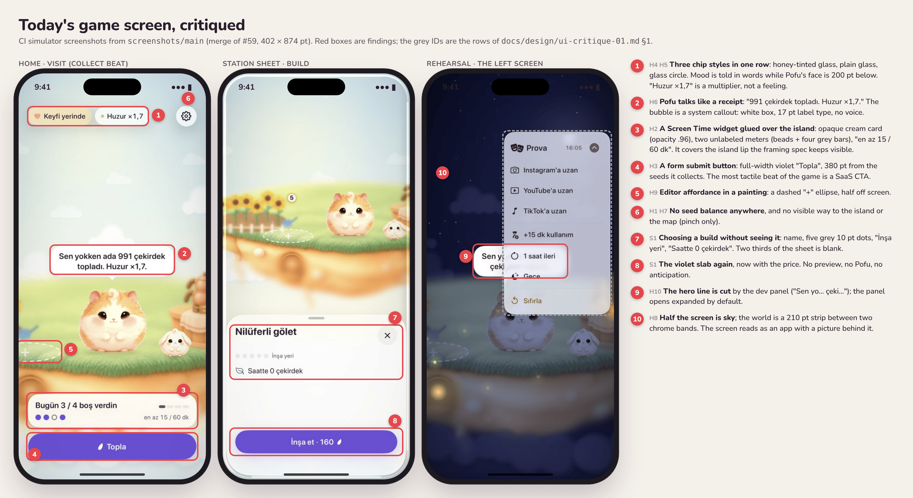
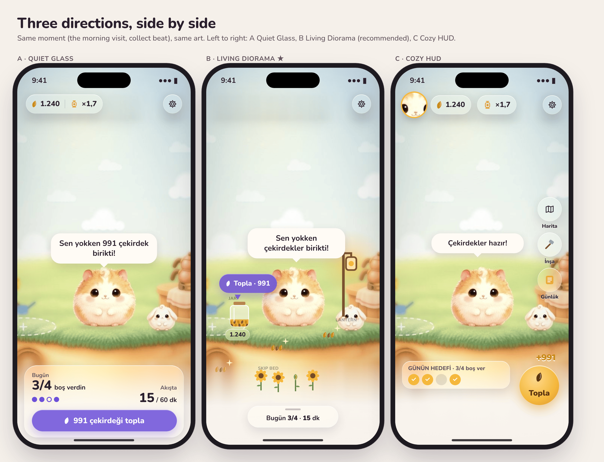
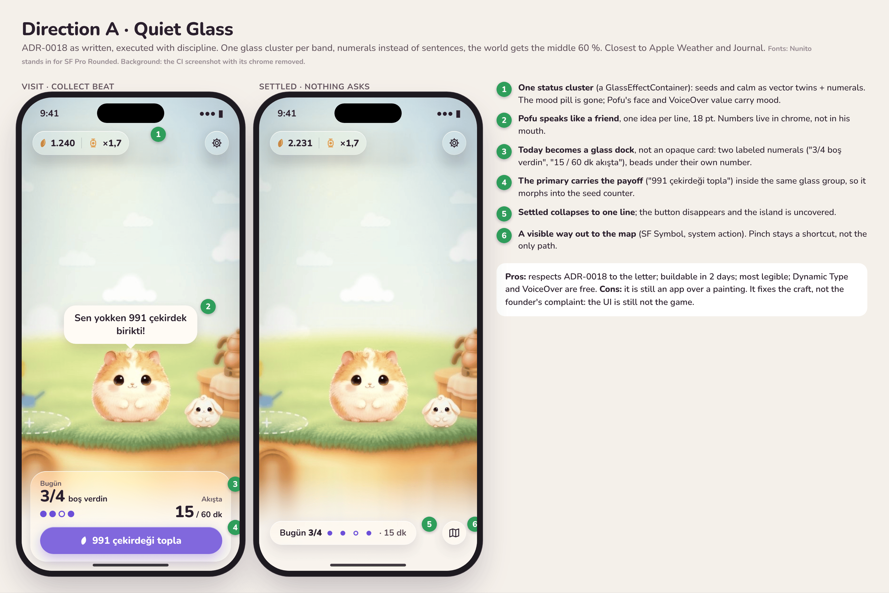
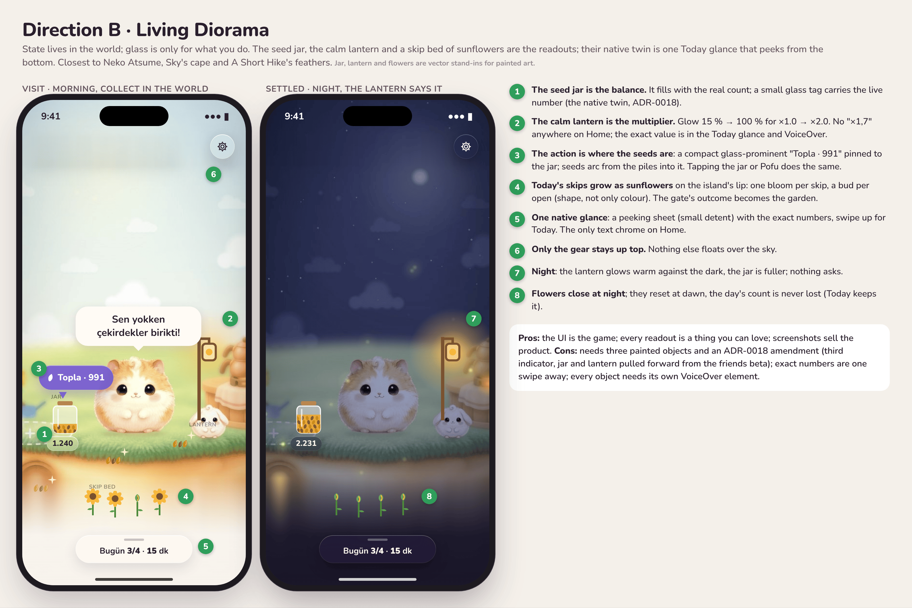
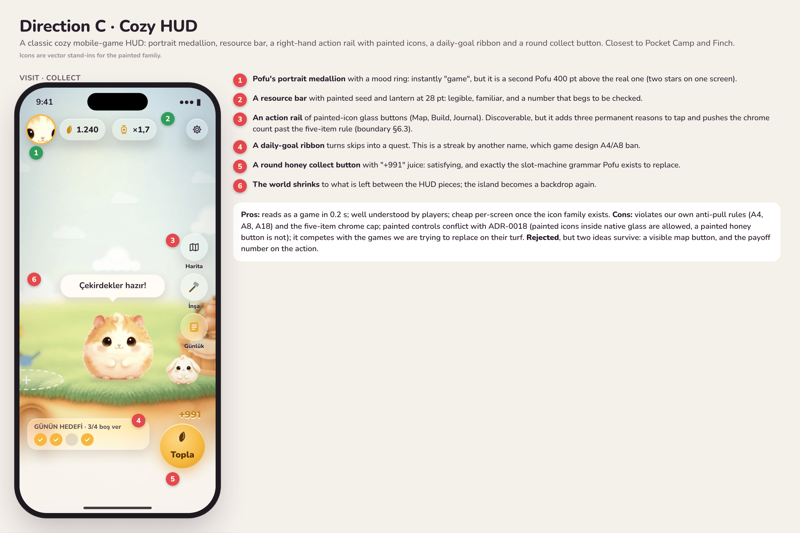

# UI Critique 01: The Game Screen Is Not Yet the Game

> **Archived 2026-11-06: superseded by [UI system v2](../design/ui-system-v2.md) and [experience v1](../design/experience-v1.md).**
> Kept for the reasoning (why Home is a game screen); do not build on it.

_Status: proposal for the founder. Last updated: 2026-11-02._
_Reviewed: `main` at #59 (look-dev), CI screenshots on the orphan branches
`screenshots/main` and `screenshots/feat-rehearsal-mode` (iPhone 17
simulator, 402 × 874 pt). Read with [ADR-0018](../adr/0018-visual-system-v1.md),
the [design language](design-language.md), the [interaction spec](interaction-spec.md),
the [app and game boundary](../product/app-game-boundary.md) and
[gate v2](../product/ux/gate-v2.md). Mockups: [`ui-critique-01/`](ui-critique-01/),
their source in [`ui-critique-01/mockup-src/`](ui-critique-01/mockup-src/)._

## 0. The verdict in one paragraph

The founder is right. The left screen of the Rehearsal review (Home, the
game screen behind the Prova panel) is **a utility app with a painting
behind it**. The art is the best thing in the product and the UI treats it
as wallpaper: a row of three unrelated chips on top, an opaque Screen Time
widget and a full-width violet form button on the bottom, a speech bubble
that reads like a receipt, and between them a 210 pt strip of world. The
game's own currency is not on screen, the way to the island and the map is
a hidden pinch, and the most tactile beat of the loop (collecting seeds) is
a submit button 380 pt away from the seeds. None of this is a coding
accident. It follows from three rules we wrote ourselves: "content is never
glass, cards are solid" (design language §8), "the jar and the lantern wait
for the friends beta" (ADR-0018 amendment), and "prototypes stay rough
until W4" (iteration plan). The first rule is wrong for a game, the second
deferred exactly the pieces that make the UI the game, and the third is no
longer true: Rehearsal mode puts this screen in the founder's hand every
day. The recommendation is **Direction B, Living Diorama** (§3): state
lives in the world (jar, lantern, a skip bed of sunflowers), glass is only
for what you do, and one native glance carries the exact numbers.

## 1. The critique

Severity: **S1** breaks the product's promise or a platform rule, **S2**
reads as amateur or utility, **S3** polish. File references are to `main`
at #59.

### 1.1 Home (the Rehearsal "left screen")

`Packages/PofuKit/Sources/PofuWorld/Home/WorldHome.swift`, screenshots
`01-home-visit-*`, `02-home-settled-*`, `07-prova-panel-light`.

| # | Sev | Finding | Where |
|---|---|---|---|
| H1 | S1 | **The game's currency is invisible.** There is no seed balance on Home in any state except the 1.5 s collect moment (the `SeedCounterPill` replaces the button, then vanishes). The only other place a number appears is the build button's price inside a sheet. A game that hides its score from its main screen is not legible as a game; ADR-0018's amendment itself says "when the jar is built, Home must also expose the seed count natively". Until then, nothing does. | `WorldHome.swift` 186–219, 484–507 |
| H2 | S1 | **The bottom third is a Screen Time widget glued over the island.** `TodayCard` is a cream card at 96 % opacity with a drop shadow (line 435): a dashboard tile, not glass and not world. It carries two different metrics with two different unlabeled encodings, and **pairs them diagonally**: the skip headline ("Bugün 3 / 4 boş verdin") sits next to four grey 14 × 6 pt bars that actually belong to the *time* metric (`GuardedSteps`, 451–463), while the skip beads sit next to "en az 15 / 60 dk". "En az" (at least) is honest-measurement jargon leaking into the UI. The card also covers the island's front lip that review 01 placed at 686 pt. | `WorldHome.swift` 407–464 |
| H3 | S1 | **Collecting seeds is a form submit.** A full-width 52 pt violet `glassProminent` "Topla" (190–209) is the single most "SaaS" object on screen, and it sits at the bottom edge while the seeds are in the world. In every good idle and cozy game the collect gesture happens *on the thing that produced it* (Neko Atsume's gifts in the yard, Pocket Camp's items on the ground). The seed flight to a button is backwards: seeds fly away from the world into chrome. | `WorldHome.swift` 186–219, 243–250 |
| H4 | S2 | **The top band is three different components pretending to be a row.** A honey-tinted glass capsule (`WellbeingPill`, tinted decoratively, which design language §8 forbids: "tint glass only for the one primary action"), a plain glass capsule with an 8 pt colour-only dot (`CalmChip`), and a 44 pt glass circle. They are not in a `GlassEffectContainer`, so they do not merge or morph. | `WorldHome.swift` 159–164, 279–355 |
| H5 | S2 | **Mood is told, not shown.** "Keyfi yerinde" in a pill, 450 pt above the hamster whose face, pose and fur already say it. That is a utility-app reflex (label the state) inside a character product whose whole art budget exists to show it. | `WorldHome.swift` 279–317 |
| H6 | S2 | **Pofu talks like a receipt.** "Sen yokken ada 991 çekirdek topladı. Huzur ×1,7." A character does not speak a multiplier. The bubble itself is a white rounded rectangle with 17 pt headline text (`SpeechBubble`), visually the same object as an iOS callout; no display tier, no personality in the type. | `WorldStrings.swift` 102, `PofuComponents.swift` 205 |
| H7 | S1 | **No visible way to the island or the map.** At the Home framing the framing control is hidden (`showsFramingControl` is false when `projectedFraming == .home`, 117–119). The only way out is a pinch, which the founder has no reason to try. A game with three places and one hidden door. | `WorldHome.swift` 113–147 |
| H8 | S2 | **Half the screen is empty sky.** Pofu's feet sit at 69 % height (per spec), the plate's horizon at 437 pt, and the chrome bands eat the rest: the world gets about 210 pt of 874, the sky about 330 pt with nothing in it. The spec's numbers were right for proportion and wrong for composition: the top half has no job. | `IslandFraming.swift`, review 01 §1 |
| H9 | S2 | **An editor affordance inside a painting.** The open build slot is a dashed white ellipse with a plus, half off the left edge at Home. It reads as Figma, not as a place on an island. | `IslandScene.swift` 582–613 |
| H10 | S1 | **Rehearsal hides the hero line.** The Prova panel opens expanded by default (`isPanelExpanded = true`) and its 228 pt card sits over Pofu's bubble ("Sen yo… çeki…"). The founder's daily review surface is the one place where the game's only line of character is cut off by a dev tool. | `RehearsalStage.swift` 26, `RehearsalPanel.swift` 25–43 |
| H11 | S2 | **The settled state is a sticker.** "Ada sensiz de çalışıyor." in a cream capsule at 82 % opacity (210–219): the third material on the screen (glass, solid card, translucent card). | `WorldHome.swift` 210–219 |
| H12 | S2 | **Dark mode's primary reads as disabled.** At night the accent becomes `violet-300` with `night-950` text: a pale lilac slab, which in iOS grammar says "disabled". | screenshot `01-home-visit-dark` |

### 1.2 Island and map framings

`StationSheet.swift` (the picker lives here), `IslandScene.swift`,
screenshots `03-island-*`, `07-map-*`.

| # | Sev | Finding | Where |
|---|---|---|---|
| I1 | S2 | **The framing control is a tab bar for a camera.** "Ev · Ada · Harita" is a custom segmented control in a glass capsule with a solid violet pill and 36 pt rows, **below the 44 pt minimum** (`minHeight: 36`, line 225). It frames a continuous zoom as three tabs; the interaction spec calls the chrome "a readout of the camera", which a tab bar is not. | `StationSheet.swift` 204–243 |
| I2 | S2 | **The island floats in 60 % dead space.** At the Island framing the island occupies the middle 40 %; the bottom 35 % is white fog with one "Ayçiçeği" chip floating near the home indicator. It looks unfinished, not airy. | screenshot `03-island-light` |
| I3 | S2 | **The terrarium rim reads as a rendering bug.** The thin white rounded rim inset from the screen corners (look-dev C, on by default) looks like a mis-sized device frame in every Island and Map screenshot. A signature needs a reason the player can feel; this one needs explaining. | `WorldLook.swift` 23–41, `WorldLight.swift` 163 |
| I4 | S2 | **Pofu on the map is a paw print.** ADR-0018 §4 says a 30 pt *vector Pofu pin*; the code uses `pawprint.fill` in a violet disc. A paw is any pet app. | `IslandScene.swift` 748–760 |
| I5 | S3 | **Locked islands are grey bowls with padlock pills.** Nothing teases what is there; the lock is the content. Monument Valley shows progress with doors that are part of the world, not padlock glyphs. | screenshot `07-map-light` |

### 1.3 Station sheet and resident card

| # | Sev | Finding | Where |
|---|---|---|---|
| S1 | S1 | **Choosing a build without seeing it.** The build sheet shows the name, five grey 10 pt dots, "İnşa yeri", "Saatte 0 çekirdek" and a violet "İnşa et · 160". No picture of the next level, no Pofu, no anticipation. Two thirds of the sheet is blank white. The decision moment of the game is the plainest screen in the app. | `StationSheet.swift` 18–142 |
| S2 | S2 | **A white sheet over a painting.** At the medium detent the sheet's background is opaque system white, so the world (which the interaction spec keeps "live" behind it) is hidden under a utility surface. | screenshot `04-station-build-light` |
| S3 | S2 | **Glass over an opaque card.** `ResidentCard` paints a 95 % opaque cream background *and* a `glassEffect` on the same shape (178–179): the glass cannot refract anything, and the card gets the cost of both. The "Tezgâha git" button is grey glass inside it (glass on glass, which §8 forbids). | `StationSheet.swift` 177–186 |
| S4 | S3 | **"Build spot" is a state label, not a promise.** The first level of an empty slot should name what it becomes ("Nilüferli gölet") and show it, not say "İnşa yeri". | `StationSheet.swift` 91 |

### 1.4 The shield replica

`App/Rehearsal/ShieldReplicaView.swift`, shared copy in
`PofuCore/ScreenTime/ShieldCopy.swift`. Apple's shield template fixes the
layout (icon, title, subtitle, two buttons), so the critique is about what
we control: copy and icon.

| # | Sev | Finding |
|---|---|---|
| SH1 | S2 | **The subtitle answers its own title, then dumps stats.** "Güne akışla mı başlıyoruz?" / "Güne akışla başlamayalım. Huzur ×1,4. Bugün 2 / 3 boş verdin." Three registers in two lines: a question, a rebuttal of the question, and two metrics. One thought per surface: the title asks, the subtitle gives one reason to skip (what the island loses), no multiplier. |
| SH2 | S3 | **The icon is 60 pt of fur in 40 % empty cream.** At 60 pt the painted Pofu is legible, but the shield is the product's most-seen surface and it shows a passport photo. The pose should match the moment (the "hop at the door" pose, arms up), which is an art edit, not a layout change. |
| SH3 | S3 | The Rehearsal badge and the fake home indicator are honest and fine. Keep them. |

### 1.5 Hop! (from code; no CI screenshot yet)

| # | Sev | Finding | Where |
|---|---|---|---|
| HP1 | S1 | **Hop! sits on a flat wash, not the world.** The boundary doc says the gate lands on "the Hop! cover over the world backdrop"; the code paints `PofuColor.dayWash` / `nightWash`. The moment the user chooses the island over the feed is the one moment the island is not on screen. | `HopView.swift` 69–74 |
| HP2 | S1 | **Room-era exits survive.** The skipped state still offers "Start a focus" and "Back to my room" (`HopOutcomes.swift` 55, 60, 178). The boundary doc (§1 row 3, §3.3) replaced them with one finite ritual, "Pofu'yla bir dakika". These buttons send the user into dead features and contradict the game. | `HopOutcomes.swift` |
| HP3 | S2 | "Calm ×1.4 · growing" as footnote text (line 30) is the multiplier again, at the emotional peak. | `HopOutcomes.swift` 30 |

### 1.6 Onboarding and settings (from code)

| # | Sev | Finding |
|---|---|---|
| O1 | S2 | **Onboarding never shows the world.** Four steps put `CompanionView` alone on a cream canvas (`OnboardingView.swift` 132, 219, 284, 365). The first impression is "a hamster app", not "a hamster who keeps an island". The welcome should open on the island at the Home framing with Pofu waking up; the native permission steps stay native. |
| O2 | S3 | "Hi, I'm Pofu." / "Hi, Pofu" is the generic mascot opener of every habit app. |
| ST1 | — | **Settings is right.** A native `Form` with sections is exactly what a frame should be. The only fix: the Rehearsal switch belongs under a "Developer" section with a footer, not between product settings. |

### 1.7 Cross-cutting

- **Typography has no voice.** Every string on Home is SF Pro Rounded at
  15–17 pt (subheadline, headline). The display tier exists (`pofuDisplayFont`)
  and is used only for "Hop!". A game screen needs a numeral voice (the seed
  count, "3/4") and a speaking voice (Pofu's lines) that differ from the
  label voice. Baloo 2 was cut (fine), but SF Pro Rounded **Heavy** at
  28–34 pt for numerals is free and unused on Home.
- **Three materials on one screen** (glass chips, a solid card, a
  translucent capsule) and two more in sheets. Apple's own apps over rich
  imagery use one material family per layer.
- **Violet everywhere.** The design language says violet means "you can tap
  this". On Home it is the button, the beads, the build-level dots, the
  segmented pill and the map pin. When everything is violet, violet stops
  meaning anything, and the warm world gets a cold SaaS accent in its
  centre.
- **Motion gaps.** Chrome only cross-fades (`.opacity`, 130–146). There is
  no arrival beat (the camera settling on Pofu as he looks up), the seed
  counter has no home to fly back to, the Today card never morphs, and the
  bubble's scale-in is the same for every line. The interaction spec
  designs all of this; Home implements none of it yet.
- **Performance is a design problem now.** The look-dev frame times show
  14–15 fps while the camera moves and 24 fps settled with the look on
  (`screenshots/main/frame-times.txt`). The simulator is not a phone, but a
  game whose UI is the world cannot ship chrome fixes on top of a camera
  that stutters. Measure on device on membership day 1.
- **Accessibility.** The framing control is 36 pt tall (I1); the calm dot
  is colour-only (green vs grey, H4); `GuardedSteps` and the beads are
  hidden from VoiceOver and only partly restated in the card's label; the
  resident card's button is glass on glass. The good parts: Reduce Motion
  is respected throughout, every control has a label.

### 1.8 What reads as "utility app" and what reads as "game"

| Utility (today) | Game (what it should become) |
|---|---|
| Labeled pills for mood and calm | Pofu's face for mood, a lantern's glow for calm |
| A dashboard card for today | Today's skips as something that grows on the island |
| A full-width submit button | Tap where the seeds are; seeds fly *into* something you own |
| A three-tab segmented control | A camera you move, with one visible way out to the map |
| A settings-style sheet to build | A preview of what you are about to build, then the pop |
| Numbers in Pofu's mouth | Feelings in Pofu's mouth, numbers in a glance |

## 2. Reference study

Sources are linked; where a source does not say something directly, the
observation is ours and marked _(obs.)_.

| Reference | What it does | What Pofu does not |
|---|---|---|
| **Alba: A Wildlife Adventure** (ustwo games) | The phone camera is an in-world object; a small HUD appears only when an animal is centred, telling you whether it is logged ([Keengamer guide](https://www.keengamer.com/articles/guides/alba-a-wildlife-adventure-beginners-guide/)). Built portrait-first for one thumb ([ustwo, environment art](https://ustwogames.co.uk/news/the-environment-art-of-alba-a-wildlife-adventure/)). | Chrome appears *because of* what you look at, then leaves. Pofu's chrome is permanent regardless of what you look at. |
| **A Short Hike** | Stamina is a row of golden feathers you collect in the world; the meter *is* the collectible ([Mechanics of Magic critical play](https://mechanicsofmagic.com/2026/07/17/critical-play-walking-simulators-owen-sample/)). | Our seeds are collected in the world and then vanish into a number nobody sees (H1). |
| **Sky: Children of the Light** | Cape energy is shown on the character's cape: symbols glow when charged and go dark when spent, readable by other players at a glance ([Sky wiki, Cape](https://sky-children-of-the-light.fandom.com/wiki/Cape)). | We put state in pills *next to* the character instead of *on* the world (H5). |
| **Monument Valley 1–2** (ustwo) | A minimal UI system; the sequel's first screen invites you to begin instead of listing menus, and progress is shown through doors in the level, not bars ([UX Collective on MV2](https://uxdesign.cc/beyond-beauty-best-usability-practices-from-monument-valley-2-fca37ef7c498), [Game Developer](https://gamedeveloper.com/design/designing-the-surprise-mobile-game-hit-i-monument-valley-i-)). | Our progress is dots and bars in sheets (S1, I5). |
| **Alto's Odyssey** | Zen Mode removes scores and coins; the title screen fades its menu away to leave the landscape unobstructed ([AppleInsider](https://appleinsider.com/articles/18/02/27/review-altos-odyssey-for-ios-heads-down-the-mountain-as-an-excellent-sequel-to-altos-adventure), [App Store](https://apps.apple.com/ca/app/id1182456409)). | Our settled state still keeps a card and a capsule over the world (H2, H11). Settled should be Zen. |
| **Townscaper** (Oskar Stålberg) | A deliberately narrow interaction model; Stålberg argues a score makes you "stop watching the actual world you're building, and start watching the score counter" ([PC Gamer interview](https://pcgamer.com/townscapers-developer-on-how-its-radically-casual-design-is-inspiring-a-new-wave-of-low-stress-builders-to-adapt-the-blueprint)). | The warning cuts both ways for us: hide the score and the game is illegible (H1); make it a big counter and it becomes the thing you watch (Direction C). The answer is a score that is part of the world: a jar. |
| **Tiny Glade** | A slim toolset on a minimal toolbar; reviewers frame it as a toy ([PC Gamer review](https://www.pcgamer.com/games/city-builder/tiny-glade-review)). _(obs.)_ Building happens directly in the scene with immediate visual feedback; there is no "confirm" screen. | Our build is a confirm screen with no preview (S1). |
| **Neko Atsume** | The yard is the whole screen; cats leave gifts in the yard and you accept them there ([Neko Atsume wiki, Game Menu](https://nekoatsume.fandom.com/wiki/Game_Menu)). The camera can capture the yard without UI. | Our payout is a bottom button, not a thing waiting in the world (H3). |
| **Pokémon Sleep** | Reviewers note the bottom quarter is reserved for buttons and the rest goes to the scene, and the UI is never overwhelming ([TechRadar](https://www.techradar.com/gaming/my-sleep-has-gotten-worse-since-playing-pokemon-sleep-but-i-still-wont-stop)). _(obs.)_ Snorlax's size on the main screen is the progress readout. | We put progress in text; the island's growth is not yet the readout of anything on Home. |
| **Finch** | A self-care pet with a cozy-game aesthetic chosen to ease "guilt-debt" ([Pratt IxD critique, 2025](https://ixd.prattsi.org/2025/09/design-critique-finch-ios-app-2/)); critics also call many pages cluttered ([Pratt IxD critique, 2026](https://ixd.prattsi.org/2026/02/design-critique-finch-self-care-pet-ios-app/)). | The cautionary tale for Direction C: a game HUD on a wellbeing app accretes clutter and obligations. |
| **Animal Crossing: Pocket Camp** | Mobile-reworked UI around animal requests ([Nintendo Life](https://www.nintendolife.com/news/2017/10/feature_our_first_steps_in_animal_crossing_pocket_camp)); friends hidden in a slide-out under the bells counter ([Tech Advisor](https://www.techadvisor.com/article/730614/animal-crossing-pocket-camp-tips-for-iphone-android.html)). | Shows the cost of a resource bar: things get hung off it until it is a menu. |
| **Kind Words** (Popcannibal) | One room, letters and stickers that become 3D toys in the room ([itch.io](https://popcannibal.itch.io/kindwords)); the sequel redid its UI for accessibility ([Gematsu](https://gematsu.com/2023/12/kind-words-2-lofi-city-pop-announced-for-pc)). | Rewards become objects in the space you live in. Our builds do that; our daily skips do not. |
| **Apple Weather (iOS 26)** | Dropped the bottom bar for floating Liquid Glass buttons over the full-bleed sky ([MacRumors iOS 26 guide](https://macrumors.com/guide/ios-26-liquid-glass)); _(obs.)_ data modules sit on a translucent material over the animated sky, never on opaque cards. | Our data module (Today) is an opaque card (H2); our design language forbids the material Apple uses for exactly this. |
| **Liquid Glass guidance** | Glass is for controls and navigation without obscuring content ([HIG, Materials](https://developer.apple.com/design/human-interface-guidelines/materials)); scroll edge effects dissolve content under glass to keep titles legible ([WWDC25 219, Meet Liquid Glass](https://nonstrict.eu/wwdcindex/wwdc2025/219/)). Reviewers flagged legibility when glass is too clear ([TechRadar](https://www.techradar.com/phones/apples-liquid-glass-redesign-in-ios-26-is-cracking-heres-why-thats-a-good-thing)). | We use glass for decoration (tinted mood pill) and avoid it where Apple uses a material (the data readout). Exactly inverted. |
| **Apple Music, Photos, Journal (iOS 26)** | _(obs.)_ One floating glass cluster per edge, content full-bleed under it, and the cluster *morphs* (Music's mini player into the tab bar, Photos' toolbar on selection). Journal keeps rich imagery as cards in content and glass only in the toolbar. | Our chrome items are separate shapes that fade; none morph (H4, motion gaps). |

**What the best of them share:** (1) the state you care about is a thing in
the world, not a label beside it; (2) chrome appears because of what you are
doing and leaves when you stop; (3) the payout happens where it was
produced; (4) one material per layer; (5) the calm state shows almost no UI.

## 3. Three directions for the game screen

Each mockup is the morning visit (collect beat) on the real CI art with the
baked chrome removed. Vector shapes stand in for painted objects. Fonts:
Nunito stands in for SF Pro Rounded.

### A. Quiet Glass (ADR-0018 as written, executed properly)

One glass cluster per band. Top: seeds and calm as vector twins with
numerals in one `GlassEffectContainer`, the gear beside it; the mood pill
goes (Pofu's face and a VoiceOver value carry it). Bottom: Today becomes a
**glass dock** with two labeled numerals ("3/4 boş verdin", "15 / 60 dk
akışta"), and the primary lives inside the same container carrying its
payoff ("991 çekirdeği topla"), so it morphs into the seed counter. Settled
collapses the dock to one line and adds a visible map button.

- **For:** no ADR change; buildable in two days; most legible; Dynamic
  Type and VoiceOver come free.
- **Against:** it fixes the craft, not the complaint. It is still an app
  over a painting.

### B. Living Diorama (recommended)

State lives in the world; glass is only for what you do.

- **The seed jar is the balance.** It stands on the lawn by Pofu, fills
  with the real count, and wears a small glass tag with the live number
  (the native twin, on the object rather than in a top bar).
- **The calm lantern is the multiplier.** Glow 15 % → 100 % for ×1.0 →
  ×2.0. No "×1,7" anywhere on Home; the exact value is in the glance and in
  VoiceOver.
- **Today's skips grow as a sunflower bed** on the island's lip: one bloom
  per skip, a closed bud per open (shape, not only colour). The gate's
  outcome becomes the garden, which is the product's thesis in one image.
  The bed closes at night and starts fresh at dawn; the count is never lost
  (Today keeps it).
- **The action is where the seeds are.** Seed piles glint under the
  stations and by Pofu; a compact glass-prominent "Topla · 991" is pinned
  to the jar, and tapping the jar or Pofu does the same. Seeds arc from the
  piles *into the jar*.
- **One native glance:** a peeking sheet at the bottom ("Bugün 3/4 · 15
  dk"), swipe up for Today with the exact numbers. Only the gear stays on
  top.
- **Navigation:** the map is one tap on the peeking glance's trailing edge
  or a pinch; the framing control appears only when the camera leaves Home.

**ADR-0018 amendments it needs** (argued, not assumed):

1. **Three world indicators, not two.** The jar, the lantern, and the skip
   bed. The rule's purpose (indicators never the only path, never controls)
   stays: each has a native twin in the glance and in VoiceOver, and none
   is a control except as a shortcut for the visible "Topla".
2. **Pull the jar and the lantern forward from the friends beta to W4**,
   with stand-in vector art now and painted art in the W1 batch. Deferring
   them was the decision that produced H1 and H5.
3. **Design language §8: data readouts over the world may be glass**
   (Apple Weather's pattern). "Content is never glass" stays true for
   paragraphs and art, not for a two-number readout floating over a scene.

- **For:** the UI is the game; every readout is something to love; the App
  Store screenshot sells the product without a caption.
- **Against:** three painted objects and their states to make; exact
  numbers are one swipe away; each object needs its own accessibility
  element and Dynamic Type has to scale the tags; the art bible must keep a
  calm zone for the jar and the bed.

### C. Cozy HUD

The classic cozy mobile HUD: a portrait medallion with a mood ring, a
resource bar with painted seed and lantern icons at 28 pt, a right-hand rail
of glass buttons with painted icons (Map, Build, Journal), a "daily goal"
ribbon, and a round honey "Topla" with "+991".

- **For:** reads as a game in a fifth of a second; players already know it.
- **Against:** a second Pofu on screen (two stars), seven chrome items
  against the boundary's five, a daily-goal ribbon that is a streak by
  another name (game design A4, A8), a resource counter that begs checking
  (A18), and a painted honey button that ADR-0018 rightly forbids. It
  competes with the games we are replacing on their own turf.
- **Rejected,** but two ideas survive into B: a visible way to the map, and
  the payoff number on the action.

### Recommendation

**B, Living Diorama**, built on A's discipline. A's fixes are the
prerequisites anyway (one material per layer, numerals, a glance, a visible
exit), so the path is: ship A's structural fixes now, then replace A's
status cluster with the jar and the lantern and the dock's beads with the
sunflower bed at W4. If the founder dislikes B on the phone, A is the
fallback and nothing is wasted.

## 4. Prioritized fix list

Each line is one iteration of at most two days, one question, one check
(iteration plan rules). No Swift is changed by this document.

### Now (Rehearsal is the founder's daily surface, so "rough until W4" no longer holds for Home)

| # | Change | Fixes | Check |
|---|---|---|---|
| N1 | Rehearsal panel starts collapsed (`isPanelExpanded = false`); the pill sits in the top-left safe corner, never over Pofu's bubble | H10 | Screenshot `07-prova-panel` shows the whole bubble |
| N2 | Copy pass: Pofu's lines carry no multipliers or numbers except the seed payoff; the shield subtitle gives one reason; Hop! skipped drops "Calm ×" | H6, SH1, HP3 | Every Pofu line ≤ 2 lines at default size, no "×" in any bubble |
| N3 | Replace "Start a focus" and "Back to my room" with the boundary's single "Pofu'yla bir dakika" and a swipe-up hint | HP2 | No room-era string reachable from Hop! |
| N4 | Home top band: one `GlassEffectContainer` with seeds + calm (SF Symbol stand-ins), gear beside it; remove `WellbeingPill`, move mood to Pofu's accessibility value | H1, H4, H5 | Seed count visible in every Home state; VoiceOver reads mood on Pofu |
| N5 | Today card → glass dock: two labeled numerals, beads under the skips, time under the time; primary inside the same container with its payoff | H2, H3 (partly), H11 | Each metric has its number next to its encoding; one material in the bottom band |
| N6 | A visible map button at Home (SF Symbol, glass circle); framing control rows to 44 pt | H7, I1 | A first-time tester reaches the map without being told |

### W4 (Home with batch 01 art)

| # | Change | Fixes | Check |
|---|---|---|---|
| W4a | ADR-0018 amendment (three indicators; jar and lantern at W4; glass readouts) and design language §8 edit | — | Founder approves on the phone mock |
| W4b | The seed jar on the lawn with its glass tag; collect flies seeds into the jar; tap the jar or Pofu to collect | H1, H3 | Collect never moves the eye away from the world |
| W4c | The calm lantern (glow from calm); remove the calm numeral from Home | H5 | Calm readable from the lantern in a 1 s glance test |
| W4d | The sunflower skip bed; the dock becomes the peeking glance | H2 | Today's skips readable without reading text |
| W4e | Station sheet v2: next-level preview art at the top, the price as a seed-jar delta, sheet on a translucent material at medium detent | S1, S2, S4 | The founder can tell what he is building before tapping |
| W4f | Hop! over the world backdrop (Pofu at the door, the island blurred behind) | HP1 | The island is on screen at the moment of choice |
| W4g | Build slots as painted footprints (a stake and string), not a dashed ellipse; Pofu's vector pin on the map | H9, I4 | No dashed vector outline in any world screenshot |
| W4h | Decide the terrarium rim by A/B on device; drop it if it reads as a frame bug to two people | I3 | Two uninformed viewers |
| W4i | Camera frame rate on device before any new chrome work | perf | ≥ 55 fps settled, ≥ 45 fps moving on iPhone 17 |

### W5–W6 (feel and Glass++ production)

- Morphs: the dock into Today, the seed tag into the collect counter; an
  arrival beat (Pofu looks up as the camera settles); per-line bubble
  timing (W5).
- Painted jar, lantern and bed states; painted domain icons with vector
  twins inside the glance and sheets (W6).
- Onboarding opens on the island (O1) once the world is the first
  impression we want.

## 5. Self-critique

- The mockups are drawn over 460 px CI screenshots, so they are soft; they
  test composition and hierarchy, not finish. Glass is approximated with a
  CSS blur and is clearer than Liquid Glass will be.
- B's sunflower bed is the boldest idea here and the least tested: four
  reaches fit; twelve may not. If a day has more than eight reaches, the bed
  needs a rule (bloom clusters) that we have not designed.
- B moves exact numbers one swipe away. If the dogfood week shows the
  founder opening Pofu to check "3/4", the glance has to become visible at
  0 taps, which pulls B back toward A.
- Onboarding, Hop! and Settings were critiqued from code: CI does not yet
  screenshot them. Adding them to the screenshot test is part of N1–N3.
