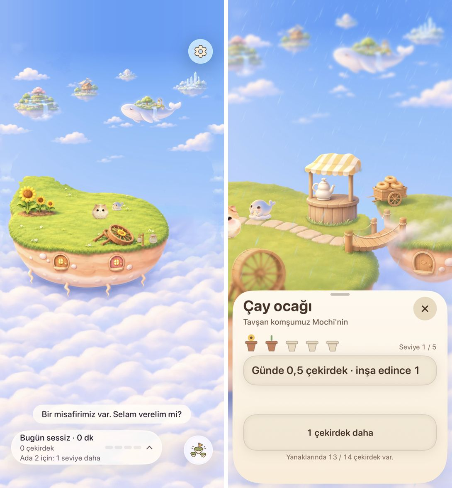
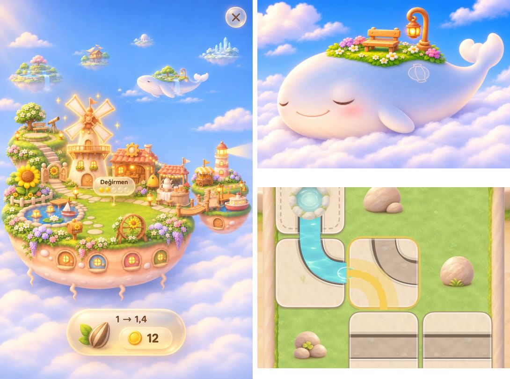
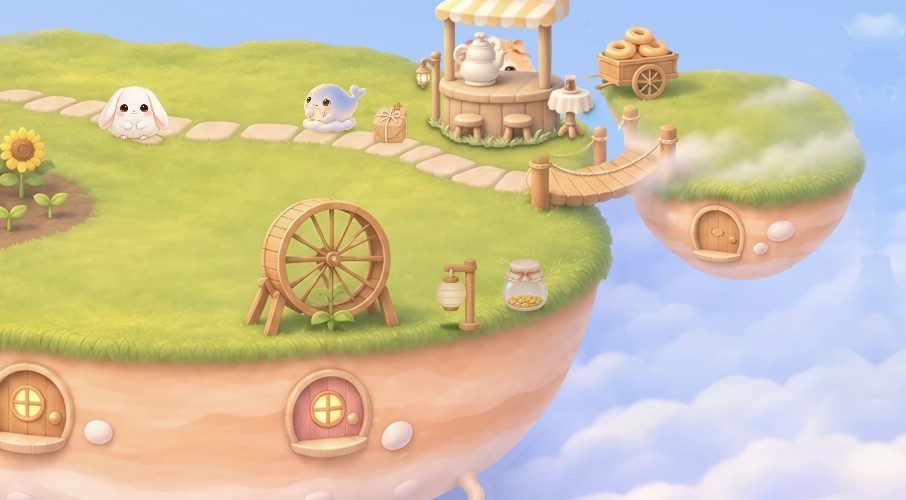
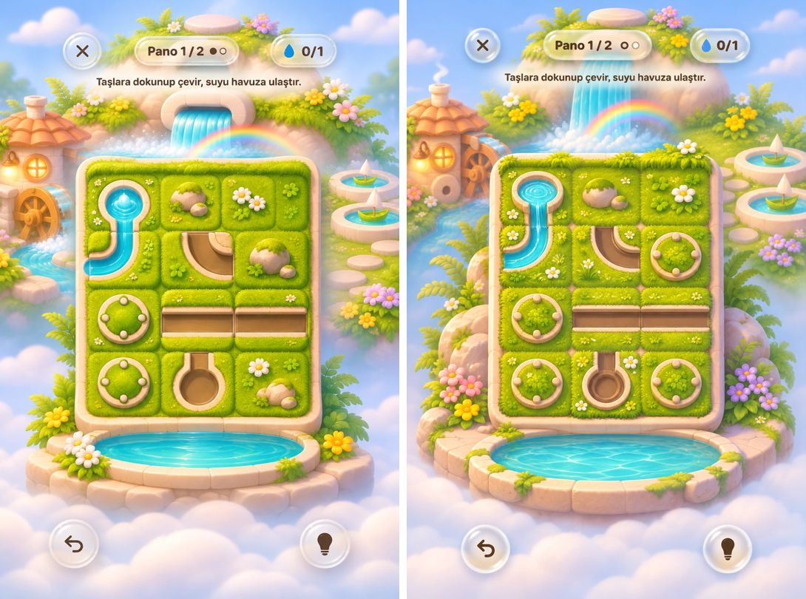

# Pofu genel değerlendirme, 1. tur (23 Kasım 2026)

Eren, bu sayfa senin için. Ayrıntılı ve kanıtlı hali (İngilizce):
[assessment-2026-11-23.md](assessment-2026-11-23.md). Aşağıdaki her şeyi
koddan ya da gerçek uygulama karelerinden kontrol ettim; emin
olmadıklarımı açıkça yazdım.

## Kısaca

Pofu aslında iki şey: bir Ekran Süresi kapısı ve boyanmış bir dünya. Üç
haftadır emeğin neredeyse tamamı dünyaya gitti ve dünya en iyi halinde
gerçekten güzel. Ama uygulamanın var olma sebebi olan kapı bugüne kadar
hiçbir telefonda çalışmadı. Bu hafta Apple tarafı açılıyor; bence hafta
ona ve senin beğenmediğin üç ekrana ait.

## Durum

**İyi olan**
- 10. seviyedeki ana ada projenin en güzel şeyi. Yakın kamerada Pofu iyi
  duruyor.
- Kod sağlıklı: yaklaşık 1.660 test, main'de son 15 CI koşusunda hata
  yok.
- Kural kodda tutuyor: çekirdek hiçbir yerde ekran süresi satın almıyor.
- Ekran Süresi tarafı yazılmış durumda: izin, uygulama seçimi, kalkan,
  "Pofu'yla aç" bildirimi, 3 dakikalık bakış.

**Eksik olan**
- Kapı hiç gerçek cihazda denenmedi. İlk gün senaryosunda 28 madde var
  ve hiçbirinin sonucunu bilmiyoruz.
- 17 Kasım'dan beri uygulamada oyuncunun hissedeceği hiçbir şey
  değişmedi. Bu sürede 190 konsept işi üretildi, hiçbiri uygulamaya
  karara dönüşmedi. Açık bekleyen 9 pofu, 59 pofu-art PR'ı var.
- Beğenmediğini söylediğin ekranlar aynen duruyor (aşağıdaki kare):
  istasyon menüsü, kodla çizilmiş dümdüz dere tahtası, adanın ekranın
  üst yarısında kalması, boş menüler.

- Dünya hareketsiz bir resim: Pofu yer değiştirmiyor; sakinler resmin
  parçası, sadece yerinde zıplıyor; on sakinden yalnız ikisinin (Mochi,
  Fındık) repliği var. Ada ortam sesi varsayılan olarak kapalı, müzik
  yok, Pofu'nun sesi hazır ama pakete girmemiş.

## En önemli sorunlar

1. **Kapı kanıtlanmadı.** En büyük bilinmeyen bu. Ayrıca şunu buldum:
   bugünkü ana ekranda "İzinler" ve "Kazan" menülerini açan hiçbir düğme
   yok. Yani gerçek sürümde açtığın 5 dakikalık izni göremez ve erken
   bitiremezsin. İlk gün senaryosunun 10. maddesi bu yüzden
   uygulanamıyor. Küçük bir iş, üyelikten önce düzeltilmeli.
2. **TestFlight için Apple'ın ayrı onayı gerekiyor** (Family Controls
   Distribution) ve haftalar sürdüğü söyleniyor. Kendi telefonunda
   üyeliğin ilk günü çalışır; başkasına vermek için başvuruyu ilk gün
   yapmak lazım.
3. **Gerçek sürüm ayrı bir uygulama sayılıyor**, yani adan baştan
   başlayacak. Kurmadan önce bil.
4. **Konsept yöntemi işi durdurdu.** "Sen seçene kadar kod yok" kuralı,
   88 ve 102 karelik turlar ve senin vize haftaların birleşince bir
   hafta karar çıkmadı.
5. **Konseptler neden cafcaflı çıktı.** Sen bir fikrin sade resmini
   istedin; Codex her kareyi bitmiş reklam görseli gibi, en yüksek
   doygunlukta ve en dolu haliyle çizdi. Bizim istemlerimiz de her
   karede bütün ekranı, bütün süsleriyle tarif ediyordu. İkinci tur, sen
   daha yorum yapmadan sıraya girdi; en az 10 işi sonradan
   söylediklerine ters (arkadan Gezgin, 4-7. seviyeler, masa).
6. **Codex "sınırsız" değil.** Son bir haftada altı teslimatta kota
   hatası var; en beğendiğin blokların üretim turu (152) hiç kare
   veremedi.

## Dört konu, senin yorumlarına göre

- **Dere tahtası:** yön neredeyse seçilmiş. Tek belirsizlik aşağıda
  (soru 3). Yeni tahta konsepti gerekmiyor; gereken, beğendiğin
  blokların takım olarak çizilmesi.
- **Seviye paneli:** Codex'ten arayüz istemeyi bırakalım. Senin de
  dediğin gibi cam, uygulamada denenmeli. İkinci turda kafandakine yakın
  bir şey var (soldaki kare: istasyonun yanında küçük bir hap).
- **Gezgin:** ikinci turda kuyruklu, pofuduk bir balina zaten var
  (sağ üst). Seçmek için elimizdeki yeter.
- **Ada ve gölet:** yeni varyant değil, üç kareye senin bakman lazım.

- **Pofu arkada kalırsa görünür mü?** Bunu konseptle değil uygulamanın
  kendisiyle cevapladım: Pofu çay ocağının arkasına geçince sadece
  kulakları görünüyor (çaydanlığın üstünde). Gölet alçak olduğu için
  orada sorun olmaz.

## Önerdiğim yol

**0. Üyelikten önce (bugün - 25 Kasım):** ilk günü çalışır hale
getirmek. Açık izni ana ekranda küçük bir cam hap olarak göstermek ve
oradan bitirebilmek; ilk gün senaryosunu düzeltmek; bekleyen PR'ları ve
eski dokümanları temizlemek.

**1. Cihaz günleri (25-27 Kasım):** üyelik, aynı gün Apple başvurusu,
gerçek sürümü telefona kurmak, 28 maddeyi denemek. Bu bitene kadar
başarısız bir maddenin önüne hiçbir iş geçmez. Yanında tek bir kol
çalışır: istasyon kartının iki gerçek cam hali ve Codex'te bloklar.

**2. Kapı sağlam olduktan sonra, sırayla:**
1. İstasyon kartı (telefonda sen seçersin).
2. Dere tahtası, seçtiğin yönde, boyanmış bloklarla.
3. Ana ekran kompozisyonu: ada daha aşağıda ve daha büyük.
4. Hayat: Pofu ve sakinler birkaç nokta arasında zıplayarak yer
   değiştirir; diğer sekiz sakine replik; ortam sesi açık; Pofu'nun
   sesi.
5. En son: Sefer ve Gezgin bir sistem olarak, ve müzik.

**Kim ne yapar:** sen üyelik, Mac başında 1-2 saat ve aşağıdaki
sorular. Ana oturum cihaz gününde seninle, temizlik ve dokümanlar. Bir
ajan kapı düzeltmeleri, bir ajan istasyon kartı. Codex: bloklar (152
yeniden), küçük 3. tur, sonra Gezgin'in üç seviyesi. Aynı anda 2-3 ajan
yeter.

**Konseptler bundan sonra:** konu başına tek telefon sayfası, en çok
altı kare, önerim işaretli. Codex nesne çizer (blok, balina, ada
adımları, küçük işaretler); arayüz uygulamada, gerçek camla denenir.

## Sorular

Her birinde önerim başta. Kısa cevap yeter ("1 evet, 3 soldaki" gibi).

1. **Apple üyeliği.** Başvuru yapıldı mı? Mac başında 1-2 saati hangi
   gün ayırabilirsin?
   *Önerim: üyelik aktif olduğu ilk gün; TestFlight başvurusu da aynı
   gün.*
2. **Sıra.** Önce kapı gerçek telefonda, sonra beğenmediğin üç ekran,
   sonra hareket ve ses, en son Sefer ve müzik.
   *Önerim: evet.*
3. **"board-dial t2" hangisi?** İlk turda iki ayrı dial karesi var.
   Soldaki (dial-big t2) mi, sağdaki (dial-fall t2, arkada şelale ve
   gökkuşağı) mi?
   *Önerim: soldaki. Daha sakin; beğendiğin kabarık bloklarla birlikte.*

   
4. **Seviye paneli.** İstasyonun yanında duran küçük cam kart mı, alttan
   açılan panel mi?
   *Önerim: istasyonun yanında küçük cam kart. İki halini uygulamada
   yapıp telefonuna gönderelim; alttan panel olmasın.*
5. **Ada seçme ekranı nereden açılsın?**
   *Önerim: ikisi de. Asıl kapı Gezgin'e dokunmak; sağ alttaki düğme de
   düz yol olarak kalsın. Sefer'le birlikte yapılır, şimdi değil.*
6. **Pofu bir şeyin arkasında kalınca.**
   *Önerim: Pofu kendinden yüksek hiçbir şeyin arkasında durmasın;
   gölet alçak olduğu için önde kalabilir. Kontur ya da saydamlık
   hilesi yok.*
7. **"Kazan" (onur seansı) ve "İzinler".** İkisi de bugün açılamıyor.
   *Önerim: onur seansını tamamen çıkaralım; izin ana ekranda küçük bir
   cam hap olarak görünsün.*
8. **Karakter hareketi.**
   *Önerim: yürüme çizimi yok. Pofu ve sakinler birkaç nokta arasında
   zıplayarak yer değiştirsin.*
9. **Ses ve müzik.**
   *Önerim: ortam sesi varsayılan açık ve Pofu'nun sesi şimdi; müzik
   kapı ve üç ekrandan sonra, seninle konuşarak.*
10. **Konsept sunumu.**
    *Önerim: konu başına tek sayfa, en çok altı kare; arayüz
    Codex'te değil uygulamada.*

Cevaplarınla 2. tur kesin sırayı ve görev dağılımını yazar.
