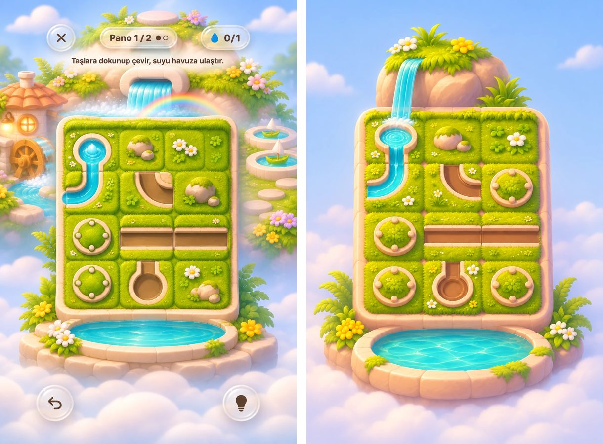

# Pofu genel değerlendirme, 2. tur: yol (24 Kasım 2026)

Eren, bu sayfa senin için. Ayrıntılı hali (İngilizce):
[assessment-2026-11-24-path.md](assessment-2026-11-24-path.md). İlk
turdaki bütün önerileri onayladın; bu sayfa onları sıraya ve işe
çeviriyor. Senden istediğim çok az şey var, en altta.

## Yol, beş satırda

1. **Kapı telefonda.** Üyelik açıldığı ilk gün Mac başında 1-2 saat;
   aynı gün TestFlight için Family Controls başvurusu. Hazırlık şu an
   bitiyor (ana ekranda açık izni gösteren küçük cam hap, "Kazan"ın
   çıkması, ilk gün senaryosunun düzeltilmesi).
2. **Üç ekran.** İstasyon kartı (iki cam hâli telefonunda), ana ekranda
   adanın yeri, dere tahtası senin seçtiğin yönde ve boyanmış bloklarla.
3. **Hareket ve ses.** Ortam sesi varsayılan açık, Pofu'nun sesi;
   sonra Pofu ve sakinler zıplayarak yer değiştiriyor, kartı açılan
   herkesin söyleyecek sözü oluyor.
4. **Sefer ve Gezgin, sonra müzik.** Kapı ve üç ekran bitince, önce
   seninle konuşarak.
5. Üyelik tarihinin belirsiz olması hiçbir şeyi bekletmiyor: 2 ve 3
   bugünkü ücretsiz derlemede ve CI karelerinde ilerliyor. Apple'ı
   bekleyen tek şey TestFlight.

## Ne göreceksin, ne zaman

| Ne zaman | Ne |
|---|---|
| Üyelik günü | Kapı kendi telefonunda; ana ekranda izin hapı |
| Hazırlık birleşince, bir gün içinde | İki istasyon kartı aynı derlemede: **Etiket** (istasyonun yanında, kuyruklu küçük kart) ve **Hap** (istasyonun altında, dokununca yerinde açılan hap). Ayarlar'dan değiştirirsin. Alttan çıkan menü tamamen gidiyor. Aynı günlerde ana ekranda ada daha aşağıda, genç ada daha büyük |
| Codex teslim ettikçe (günler) | Tek telefon sayfası: senin seçtiğin tahtanın sade hâli; tahtanın parçaları; kart için üç küçük seviye işareti; Gezgin'in üç seviyesi |
| Parçalar seçilince | Dere tahtası yeni görünümüyle oynanır hâlde |
| Ardından | Sessiz olmayan bir ana ekran, Pofu'nun sesi, yer değiştiren ve konuşan karakterler |
| Sonra, seninle | Sefer'in planı ve müzik üzerine ilk konuşma |

## Bilmen gereken üç şey

**Tahta.** Seçtiğin `dial-big` ile 3. turda sadeleştirdiğimiz tahta
aslında aynı tahta; fark, seninkinde karoların ayrı ayrı durması.
Küçük bir Codex işi bu farkı kapatıyor.

Tahtaya tek bir kural koyuyorum: **dönen parça yuvarlak bir kadrandır,
dönmeyen parça düz bloktur.** Böylece neye dokunabileceğini resim
kendisi söyler ve senin sevdiğin kadranlar süs olmaktan çıkıp oyunun
kendisi olur.

**Codex.** Kuyruk boş kalmıyor: dört küçük iş, toplam 30 görsel, her
biri yoldaki bir adıma bağlı. Senin 10. maddendeki yöntemle: arayüzü
uygulamada, gerçek camla deniyoruz; Codex yalnızca görmen gereken
şeyleri boyuyor (bir ekranın bütün kompozisyonu ve tek tek parçalar).
Cam, panel, düğme boyamıyor. Konsept turları tur olarak bitti.

**İlk turda yanıldığım yerler.** Kontrol edince beşi yanlış çıktı,
hiçbiri sırayı değiştirmiyor: ana ekranın eski çizimi oyuncunun
karşısına çıkmıyor (yalnızca ölü kod); sakinler resme gömülü değil, ayrı
katman (yani yer değiştirmeleri için yeni çizim gerekmiyor); CI süre
sınırına yakın değil; Pofu'nun zıplama sesi zaten uygulamada, eklenecek
beş ses daha var.

## Senden gereken

1. **Kart.** Telefonunda ikisine bak: Etiket mi, Hap mı? *Önerim:
   Etiket.*
2. **Seviye işareti.** Codex üç küçük işaret boyayacak (filizli saksı,
   yaprak, küçük çiçek); tek sayfada göstereceğim. *Önerim: yaprak.
   Kartın üzerindeki boyutta en net okunan o. Çekirdek olmasın: çekirdek
   zaten fiyatı gösteriyor.*
3. **Gün.** Üyelik açıldığı ilk gün Mac başında 1-2 saat. Açılana kadar
   bir cevap gerekmiyor.

Gerisine stüdyo kendisi karar veriyor ve sana sonradan haber veriyor.
