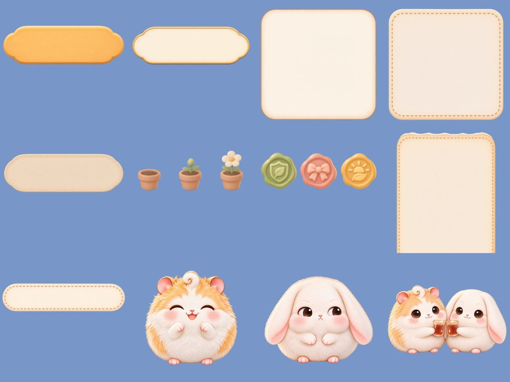
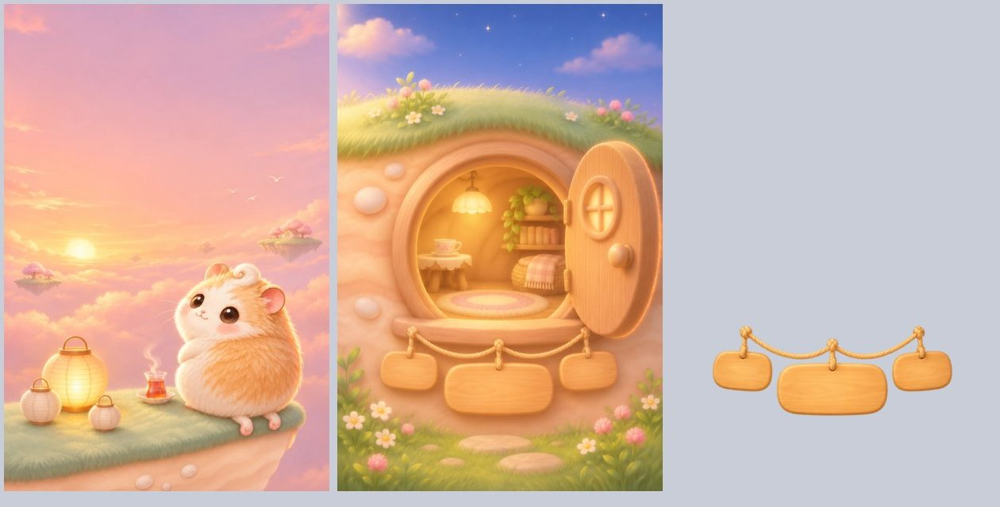
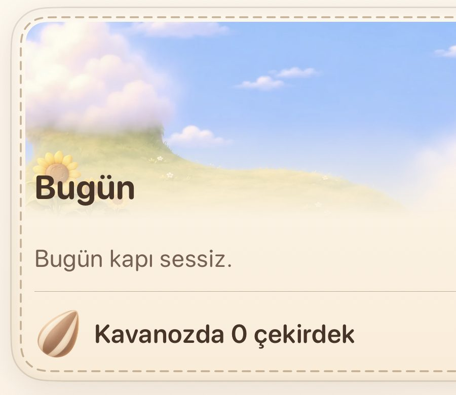
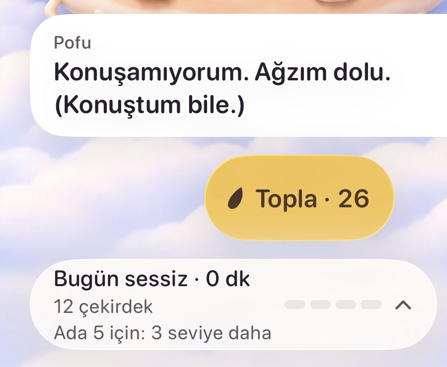
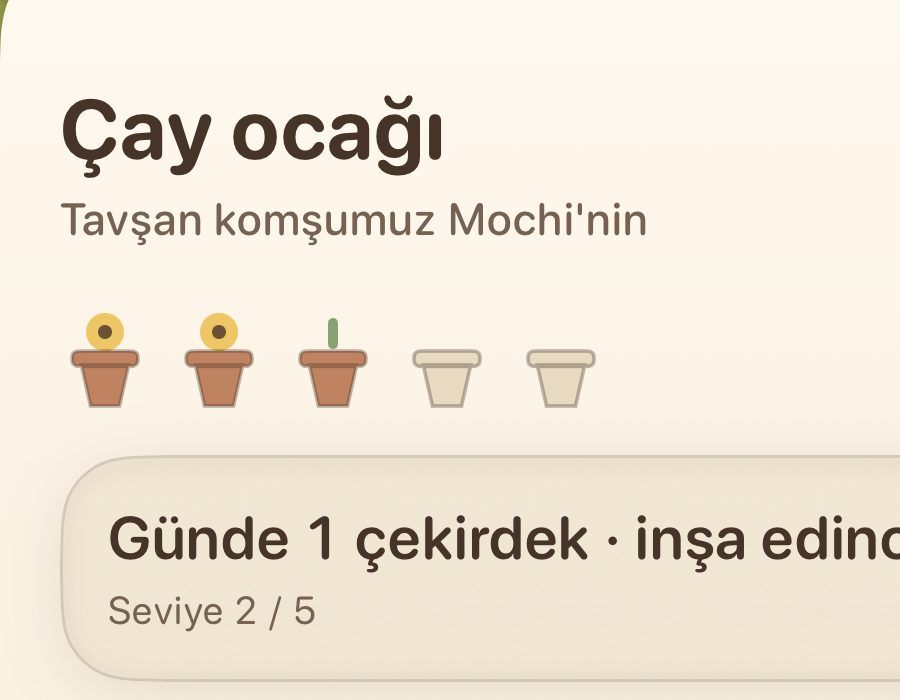
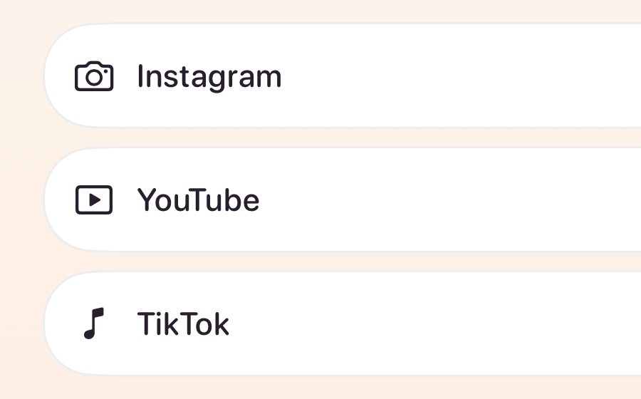
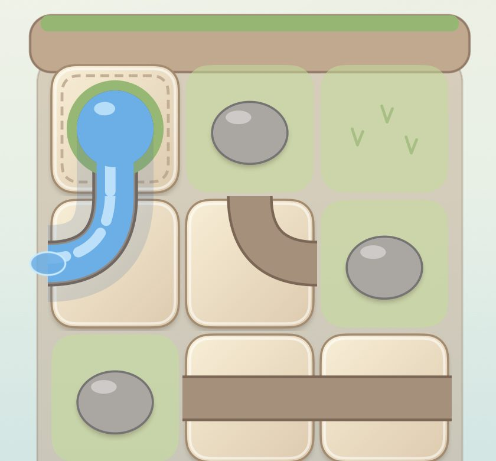

# Asset system v1: one visual language, shipped everywhere

**Status:** proposal for the lead (2026-11-14). Author: Fable, on the brief
`docs/studio/briefs/fable-2026-11-14-asset-system.md`. Not merged until the
lead has read it.

**Read for this:** the neutral inventory
(`docs/research/asset-inventory-2026-11-14.md`, PR #443, code at `dbcfd82`),
frames from `screenshots/main` at `8a981ab`, the masters under `design/art/`
in this repository and in `pofu-art` (`origin/main` at `5e4cc29`),
[UI v3](ui-v3.md), [the Door](the-door.md), ADR-0018, 0020, 0022, 0023 and
0025, and `pofu-art`'s `AGENTS.md`, `QUEUE.md` and `QUEUE-LOG.md`.

**What I looked at, and at what size.** At device size (1206 x 2622), in
1:1 crops: `path-d05-0900` (Home), `path-sheet-today`, `path-sheet-station`,
`path-onboarding-apps`, `path-game-flow-stage1`, `path-d06-map-0900`. Only at
460 x 1000 (the branch holds no larger copy): `20-gate-1200`, `19-shield-day`,
`16-menu-settings-light`, `sprite-08-resident-card-light`,
`look-celebration-card`, `breath-2-hold`, `payoff-door-day-10`,
`visitor-v1-day`. Judgements on the second group are about layout and
material, not about edges or sharpness. Painted masters looked at: twelve kit
and sticker masters on one sheet, the batch-46 duo icon sheet, the round-door
root and plaques, the batch-48 pier take, and Pofu's base against two
stickers and a shield medallion.

## The finding that shapes everything

**Most of what the code calls "missing" is already painted.** It stopped one
step before the app.

The inventory lists the names the code asks for and no bundle holds. I
checked each against `design/art/`:

| Name the code asks for | Painted master | Where it is |
|---|---|---|
| `ui-plaque-honey`, `-bare`, `-cream`, `-cream-pressed` | yes | `design/art/ui/` (this repository) |
| `ui-plaque-honey-pressed` | **no** | never painted |
| `ui-sheet-paper-v3` | yes | `design/art/ui/` |
| `ui-sheet-paper-v3-night` | yes | `pofu-art` only |
| `ui-card-stitched`, `ui-card-linen` | yes (night twins in `pofu-art` only) | `design/art/ui/` |
| `ui-bubble-paper` (+ `ui-bubble-tail`) | yes (night in `pofu-art` only) | `design/art/ui/` |
| `ui-chip-felt`, `-selected` | yes | `design/art/ui/` |
| `ui-toast-strip`, `ui-groove-wood` | yes | `design/art/ui/` |
| `seal-resist` | yes, as one sheet of three seals (`ui-seals`) | `design/art/ui/`, not sliced |
| `ui-pip-pot` (empty, bud, bloom) | yes, as one sheet | `design/art/ui/`, not sliced |
| `sticker-*` (13) | 11 of 13 (`simit-happy` and `findik-happy` were never promoted) | `design/art/masters/` |
| `door-mochi`, `door-findik`, `material-moss` | yes | `design/art/masters/` (collage era; the plates now paint the doors) |
| `flow-tile-*` | 3 of 7 (`straight`, `source`, `mouth`; `gate` in `pofu-art` only) | `design/art/ui/` |

Seventeen UI masters exist only in `pofu-art` and were never brought here:
the seven night pieces, the five round-door layers, `ui-stamps`,
`ui-tab-ribbon`, `ui-flow-frame-caglayan`, `ui-flow-tile-gate`,
`ui-face-disc-v2-night`.

_Twelve of the masters above, on one sheet: honey and cream plaques, the
bubble, the stitched card, the felt chip, the pot pips, the wax seals, the
sheet paper, the toast strip, and three stickers. None is in a bundle._

So the gap between the founder's goal and today's app is not mainly a
painting gap. UI v3 already chose the material family and Codex already
painted most of it; the queue log marks those batches DONE at "lead picks",
and nothing tracks the steps after a pick. The first rule of this system is
therefore about the last mile, and the Codex plan below is small.

## 1. The visual language and its families

One sentence: **the world is a painting; everything laid over it is an
object from that world, lit by the same upper-left light, made of paper,
linen, honey wood, clay, felt, wax or ink; words and numbers are always live
text.** This is UI v3 principle 1 and 2 and ADR-0020; this document keeps
them and adds the families UI v3 does not cover.

| Family | What it is | The bar (a frame or a take) | How it sits with the painted world |
|---|---|---|---|
| **World** (plates, sky sets, characters) | The island at each stage and hour, the sky, the residents | `path-d05-0900` at 1:1; `home-plate-full-l5-day` | It is the reference. Nothing else may look sharper, flatter or cooler than it |
| **Materials** | Paper (sheets, cards, bubbles), linen (stats), honey wood (the verb), cream wood (the quiet verb), clay (round buttons, tiles), felt (chips), wax and ink (marks) | `ui-plaque-honey`, `ui-card-stitched`, `ui-seals` masters; in app, `today-card` crop below | Resizable painted faces (3-slice, 9-slice) under live text. Same light as the plates, matte, no outline |
| **Glass** | Native iOS material | none of ours | Kept only where the system owns the surface (alerts, pickers, the shield). Not a Pofu material: a round button is clay, not a glass disc |
| **Light** | Glows, halos, shafts, fireflies, the breath ring | `light-night-home`, `breath-2-hold` | Painted glow sprites for things that sit in the world; code for anything that pulses, grows or follows a timer |
| **Bubbles and cards** | One speech bubble, one card, one sheet, one toast | `look-celebration-card` (stitched tag under the island) and the Today day card | The bubble grows from the speaker's mouth; a card hangs from or rests on the world, never floats as a white panel |
| **Icons** | Three tiers, see section 2 | The batch-46 duo sheet (shipped as `paint-duo-*`); `paint-icon-seed` for painted objects | Duo glyphs sit on clay or paper; painted mini-objects are small props |
| **Stickers** | Full-body poses of Pofu and the residents, 64 pt and up | `sticker-pofu-happy`, `sticker-duo-tea` masters | Guests inside a paper card or bubble; never on bare sky |
| **Emoji** | Head-only faces, 20 to 40 pt, for inline use (a row, a chip, a widget, a notification line) | none yet: a new kind, piloted | Cut from the same character model as the stickers, so a face in a row and the body on the island are one animal |
| **Widgets** | The player's own island outside the app | none yet: a new kind, piloted | A crop of the player's current plate at their stage and hour, with Pofu from the sticker family and live text |
| **The Door** | One place with states (the-door.md): the round door, later the pier and the halo isle | the round-door root (`ui-gate-door-scene`), below | A plate-like scene with registered layers; the plaques are the kit's honey and cream plaques on a rope |

_Left: the batch-48 pier take (a direction, with Pofu painted in). Middle:
the round-door root, picked and layered in batch 58. Right: its plaque
layer. The app's Hop screen draws none of these; it draws a postcard and
code capsules (`20-gate-1200`)._

**Pofu is on-model across families.** I compared the base master with two
stickers and a shield medallion: the same fur hue (about 25 degrees), the
same saturation (0.41 to 0.43), the same curl, eyes and blush. The sticker
set can ship as painted.

## 2. Usage rules

### 2.1 What is painted, what stays code

| Thing | Painted | Code | Why |
|---|---|---|---|
| Surfaces the app owns (buttons, sheets, cards, bubbles, chips, toasts) | the face, as resizable art | size, press, focus, layout | ADR-0020: native behaviour, painted material; Dynamic Type must reflow, so no fixed-size pictures |
| Text and numbers | never | always | localisation in two native languages, Dynamic Type, VoiceOver |
| Anything that moves continuously (breath ring, water, seed flight, glow pulse, rain, cloud drift) | the sprite it moves, if it has one | the motion | a painted frame cannot follow a timer or Reduce Motion |
| Anything whose shape depends on data (the flow channel, progress fill, seeds in the jar, bead rows) | the bed it sits in (stone, groove, jar) | the data shape | generated pieces do not join at the pixel; two rounds of flow junction tiles failed for this reason |
| Pressed, disabled, focused, night | yes, one face each | the transition | ADR-0020 point 4. Night is a recolour edit of the picked day piece, never a fresh generation (batch 77 and 79 got all seven night pieces this way) |
| System surfaces (Apple's shield, permission alerts, the app picker, toggles, text fields) | no | system | we do not own them; a skin there breaks trust and accessibility |
| Lock-screen and tinted widget glyphs | no | vector | the system tints them to one colour |
| Developer and Rehearsal panels | no | SF Symbols | the player never sees them |

### 2.2 Icons: three tiers, one rule each

1. **Painted mini-objects** (`paint-icon-*`): nouns that exist in the world
   (seed, pot, tea, lantern, seal, letter, gift, hourglass, key). Drawn at
   28 pt and up, never tinted, never used as a button glyph.
2. **Duo glyphs** (`paint-duo-*`, the batch-46 style: cream fill, cocoa line
   of one weight, one honey or moss accent): every place and verb the app
   owns (home, island, map, settings, close, add, shield, undo, hint, pause,
   bell, the three target apps, paw, lock, sound, breath). They read at
   22 pt. Each keeps a vector twin so Increase Contrast and the tinted
   contexts have a fallback (ADR-0018's rule, kept).
3. **SF Symbols**: only disclosure marks inside native rows (chevron,
   checkmark) and everything in Rehearsal and developer screens.

A screen that shows a tier-3 symbol for a tier-2 meaning is a defect. Today
that is every app row in onboarding, the Hop chip, the Settings rows, the
map pin, the flow game's undo and hint, and the garden's pause.

The three target apps get our own duo glyphs (a camera, a play tile, a
note) beside their names. They never get brand logos.

### 2.3 One of each

- **One bubble:** `ui-bubble-paper` with `ui-bubble-tail` and a speaker tab
  (`ui-tab-ribbon`). Today there are four: Home's white card with a "Pofu"
  caption, the Today sheet's paper bubble with a tab, the resident card, and
  the Koke and Çağlayan overlays. All four become the one bubble.
- **One verb:** the honey plaque, for the one main action on a screen
  ("Topla", "Boş ver", "Devam", build). The cream plaque is the second
  action. A capsule in a flat colour is a defect.
- **One card:** stitched paper for rewards and days, linen for stats.
- **One round button:** a clay disc (`ui-face-disc-v2`) with a duo glyph.
  Not a glass circle.
- **One sticker and one emoji per character per mood.** A mood name means
  the same face everywhere (`PofuExpression`'s seven moods are the list).
- **Night is a light:** the paper turns lamplit at the hour the world does.
  System dark mode never picks a palette.

### 2.4 The last-mile rule

**An asset is done when it is in a device-size frame on `screenshots/main`,
and not before.** "Picked" is a middle state. Each asset moves through five
named states, and the state lives in one table (section 4.4): `painted`,
`picked`, `in_repo` (master in this repository), `in_bundle`, `in_frame`.
A hook in code whose asset is not `in_frame` appears in that table with the
reason; a hook that is in no table fails CI.

## 3. The quality bar

**The bar.** A screen passes when, in a 1:1 crop at device size, nobody can
tell where the painting ends and the interface begins: same light direction,
same softness of edge, same warm value range, no flat fill beside a painted
one, no system grey, white or blue.

The Today day card is the nearest thing in the app to that bar: a crop of
the player's own plate fading into stitched paper, a painted seed beside
live text.

### Ranked: what to replace, by how often the player sees it

| # | What | Where | What is wrong at 1:1 | Fix | Needs Codex |
|---|---|---|---|---|---|
| 1 | Home chrome: Pofu's line, "Topla", the today glance | every open; `path-d05-0900` | A white system card, a flat yellow capsule with a flat black seed, a white pill: three flat panels over the richest painting in the app | the one bubble, the honey plaque with the painted seed, a linen card | no: all painted |
| 2 | Home round buttons (gear, place control) | every open | Duo glyphs (good) on glass discs that read as pale blue stickers on the sky | clay disc under the glyph | no |
| 3 | Station sheet: pot pips, rate row, build button | every station tap; `path-sheet-station` | Flat vector pots with flat yellow discs for flowers, beside a title in painted style; grey-beige rounded boxes | `ui-pip-pot` slices, linen card, plaque (bare when it cannot be pressed) | no |
| 4 | App identity glyphs | onboarding, the Hop chip on every Door visit, Settings, passes | Thin SF Symbol line icons on white pills: the plainest thing in the app, on the screen that asks for trust | duo glyphs, felt chip, paper rows | **yes: duo sheet 2** |
| 5 | Flow game board | every Çağlayan round; `path-game-flow-stage1` | Entirely code-drawn: flat cream tiles, flat brown channels, grey ellipses for rocks, a flat blue bar for the pool. It looks like a wireframe next to the garden game | painted stone bed, rocks, grass, pool and frame (all exist); the channel carved by code | **yes: one blank stone** |
| 6 | The Door (Hop screen) | every "Açmam lazım" | A soft postcard, two capsules, an SF camera chip. The painted round door with its rope plaques is not in the app | the Door scene, when the App desk opens | **yes: night, hourglass, a second look** |
| 7 | Resident card | every resident tap | An SF smiley in a circle and a grey capsule button on a white popover | sticker, paper tag, plaque | 2 stickers to redo |
| 8 | Settings | rare | Paper header (good), then SF Symbols on white rows | duo glyphs; rows stay native (ADR-0020 point 3) | covered by duo sheets |
| 9 | Map pills and pin | each map visit | White pill, SF paw on a honey dot | paper tag on a string (`ui-tag-v3`), duo paw | covered by duo sheet 2 |
| 10 | Empty and waiting states | first days, quiet days | "Bugün kapı sessiz." is the whole of a quiet day; the bell step is an SF bell | the nine batch-63 vignettes, all picked, never produced | routine production batch |
| 11 | Celebration card | each level | Already an object in the world; drawn in code where the stitched card and pin ribbon exist | swap to the kit card | no |

Rows 1 and 3, at 1:1:

Rows 4 and 5:

**Weak, and not a painting problem.** The promoted round-door layers are
512 x 768 (batch 58 delivered at half scale to fit the upload cap). On a
1206 x 2622 screen that is a threefold enlargement. The takes are retained
at 1024 x 1536 as WebP q90 in `pofu-art`
(`design/art/takes/gate-door-repost-2026-11-06/`), so the Door's layers can
be re-delivered at full size without generating; the Door pilot already
edits the full-size take.

**Not ranked, on purpose.** Earn sheet icons: the inventory found no way to
reach the Earn sheet from `WorldHome`. The old Home chrome: flag off. The
Shortcuts setup guide: the free build's path, which gets no new work.

## 4. The Codex production plan

### 4.1 Codex's real pace and where it fails

From `QUEUE-LOG.md`:

- **Pace:** six deliveries are logged on 2026-11-12 (batches 76 to 81):
  39 generated jobs at two takes each, plus 13 promotes. I treat that as the
  ceiling of one day and plan at **20 jobs a day**.
- **First-round yield on new UI kinds is about two thirds:** batch 61 ran 34
  jobs; 23 day pieces were picked, the rest were redone.
- **Contract errors cost a whole batch:** all 13 stickers were skipped on
  the first run because the canvas and ground-line checks were a
  character's, not a sticker's. A pilot's first purpose is to test the
  contract, not the art.
- **Pieces that must join at the pixel fail:** flow junction tiles failed
  twice and were withdrawn. Paint one whole thing and cut it in code.
- **The upload cap shrinks art:** files over 600 KB are delivered at half
  scale. Any piece that fills the screen needs its delivery scale decided in
  the manifest.
- **The line stops for reasons outside the art:** the plan expired on
  2026-11-12 and resumed on 2026-11-14.

Codex is not the constraint. The return queue is 23 jobs (about a day); all
new work in this plan is about 55 jobs (about three days). The constraint is
the lead's review and the builders' last mile, which is why wave 0 comes
first and needs no Codex at all.

### 4.2 Waves, by what the player sees most

| Wave | What | Who | Codex jobs |
|---|---|---|---|
| **0. Ship what is painted** | Bring the 17 `pofu-art`-only masters here; slice `ui-seals`, `ui-pip-pot`, the duo sheet; bundle the kit faces and the 11 stickers; point Home chrome, the Station sheet, the resident card, the celebration card and the flow board at them | builders | 0 |
| **1. Pilots** (this PR's manifests) | One small batch per new kind: duo icons sheet 2, emoji, the flow stone, the Door, widgets | Codex, after the return queue | 10 |
| **2. Icons and faces** | Duo sheets 3 and 4 (Settings set, world set); the emoji set (Pofu's seven moods, three each for Mochi, Fındık, Simit and the goat); the two missing stickers; `ui-plaque-honey-pressed` | Codex, once the pilots are picked | about 12 |
| **3. Empty states** | The nine batch-63 picks as production pieces | Codex | 9 |
| **4. Home life gaps** | Only what a scout finds still drawing a code stand-in on the plate Home (section 7) | Codex | at most 6 |
| **5. The Door** | Full-size layers; night relight of each layer; then the second and third look, layered as batch 58 | Codex, when the App desk opens | about 18 |
| **6. Widgets** | Decided by the pilot and by the founder (section 6) | builders first | 0 to 6 |

Standing plate work (`docs/state/plates.yaml`: 205 of 302 cells unpainted)
continues underneath as the queue's step 6. It is the world family's own
plan and is not changed here.

### 4.3 A pilot before volume

Every new kind runs two or three jobs first, as an exploration (`x-` ids,
never promoted). The lead answers one written question per pilot at 1:1 and
only then writes the volume manifest:

| Pilot | The question it answers |
|---|---|
| `batch-88-duo-icons-pilot` | Does a second sheet match the shipped nine in line weight, corner and accent so the two can sit in one row at 22 pt? |
| `batch-89-emoji-pilot` | Do six head-only faces read at 20 pt, and is each still Pofu? Does the same recipe hold for a resident? |
| `batch-90-flow-stone-pilot` | Does a blank painted stone, with the channel carved by code, beat the code tile and sit with the three painted tiles? |
| `batch-91-door-pilot` | Does the round door hold as a night relight? Can a second look keep the plaques where the first has them? Does the hourglass read in Pofu's paws? |
| `batch-92-widget-pilot` | Does a painted small-widget scene beat a crop of the player's own plate? |

### 4.4 How a delivery reaches the app

1. **Codex** opens one PR per batch in `pofu-art` with takes, a contact
   sheet and `review.yaml`.
2. **Review (lead, within a day):** the contact sheet first, then each
   candidate at 1:1 at the size it will be drawn, on the surface it will sit
   on (a duo glyph on clay at 22 pt, a face at 20 pt, a plaque under live
   Turkish text at the largest Dynamic Type size).
3. **Pick:** recorded in the batch's `review.yaml`; merge the PR.
4. **Ingest:** `tools/art/ingest.py` brings the master and its content node
   here. Sheets are sliced at this step, by script, with the slice boxes
   committed.
5. **Bundle:** the file lands under the name the code's hook already asks
   for (`PofuKitArt`, `Sticker`, `PofuPaint`). No API change.
6. **Frames:** the screenshot run produces the device-size frame; the lead
   crops it at 1:1 against the bar in section 3. The founder sees it on his
   iPhone.
7. **State:** the asset's row moves to `in_frame`.

For step 7, a builder adds `docs/state/assets.yaml`, modelled on
`plates.yaml`: one row per hook name with `painted`, `picked`, `in_repo`,
`in_bundle`, `in_frame`, and a checker that fails when a hook in
`PofuKitArt`, `Sticker` or `PofuPaint` has no row. This is the one new
instrument the system needs; without it the next batch stops at "picked"
again.

## 5. Manifests

**First of their kind (written, in `pofu-art` on `chore/asset-system-pilots`):**
`batch-88-duo-icons-pilot`, `batch-89-emoji-pilot`,
`batch-90-flow-stone-pilot`, `batch-91-door-pilot`,
`batch-92-widget-pilot`: 10 jobs. Queue rows 0-a1 to 0-a5 sit after the
return queue, READY, in the order icons, flow stone, emoji, the Door, widget.
Each passes the pipeline's `plan`; the lead ports them to this repository's
`tools/imagegen/manifest/` when it next syncs.

**Routine, for the lead's builders to write after the pilots are picked:**

| Manifest | Jobs | Method that already exists |
|---|---|---|
| `duo-icons-production` | 2 to 3 sheets | the pilot's sheet recipe; glyph lists in section 2.2 |
| `emoji-production` | about 5 sheets | the pilot's recipe; `PofuExpression`'s seven moods; residents as batch 42's attachments |
| `stickers-redo` | `sticker-simit-happy`, `sticker-findik-happy` | batch 42 as written; they were skipped, not rejected |
| `ui-plaque-honey-pressed` | 1 | recolour edit of `ui-plaque-honey`, as batch 77's night pieces |
| `empty-states-production` | 9 | batch 63's picked takes as parents |
| `door-layers-full-size` | 0 generated | re-deliver batch 58's retained takes at scale 1.0 |
| `door-night`, `door-look-2`, `door-look-3` | about 18 | batch 58's root-then-layers method; the pilot's night recipe |
| `home-life-gaps` | at most 6 | batch 78's plate-visitor method |

## 6. Decisions

### Made here

| # | Decision | Set aside |
|---|---|---|
| 1 | Ship the painted kit and stickers before painting anything new for those families | Starting icon and emoji volume now: it would add to a pile that is not in the app |
| 2 | Three icon tiers; duo glyphs for every place and verb we own | All icons as painted objects: they fail at 22 pt and cannot be tinted. All SF Symbols: the current state |
| 3 | Our own duo glyphs for Instagram, YouTube and TikTok, never their logos | Brand logos: not ours to paint, and they would be the only foreign art in the app |
| 4 | Emoji are a separate head-only family for 20 to 40 pt; stickers stay full-body at 64 pt and up | Shrinking stickers: a full body at 20 pt is a blob |
| 5 | The flow board is a painted bed with a code-carved channel | A third round of generated junction tiles: the method failed twice |
| 6 | A widget shows the player's own plate, cropped by code, with a sticker or emoji Pofu; lock-screen glyphs are vector | A set of bespoke painted widget scenes: more art that shows nobody their island. The pilot paints one, to test this decision |
| 7 | The Door gets its night, its hourglass and one more look piloted now; volume waits for the App desk | Painting all three looks now: about 18 jobs for a screen nobody is building yet |
| 8 | Pressed, disabled and night faces are painted (ADR-0020 stands); night is always a recolour edit of the picked day face | Deriving states in code: cheaper, but the bare-wood disabled face is the kit's best idea and cannot be derived |
| 9 | "Done" means in a device-size frame; one state table and one checker | Trusting the queue log's DONE |
| 10 | Glass is not a Pofu material; round buttons are clay | Keeping glass discs over the world: they read as cold stickers on the sky |
| 11 | No painting for the Earn sheet, the old Home chrome, the Shortcuts guide or developer screens | Completeness for its own sake |

### Only the founder can decide

1. **Stickers and emoji outside the app.** Inside the app the set is small
   (13 stickers, about 20 faces). An iMessage sticker pack or a marketing
   set is a different size of job and a product decision. Which is it?
2. **Widgets.** No widget code exists, and the free build gets no new
   features. Are widgets a PofuLive feature he wants built? If not, the
   widget pilot is the end of that line.

Everything else in this document is the lead's to accept, change or drop.

## 7. Facts I did not gather (for a scout)

1. Device-size frames (1206 x 2622) of the Hop screen, the shield replica,
   Settings, the resident card, the celebration card, the garden round-end
   card and the breath state. `screenshots/main` holds them at 460 x 1000
   only.
2. Whether the code growth pieces (`GrowthArt`), the dandelion visitor, the
   help item, and the frog and ladybug stand-ins still draw on the plate
   Home, or are dead since ADR-0022. If dead, wave 4 is empty.
3. Whether lossless originals of batch 58's door layers survive anywhere
   (the retained 1024 x 1536 takes are WebP q90).
4. Why the live Pofu in the Today sheet (`path-sheet-today`, lower left)
   looks duller than the base master: a grade, a scale, or the frame.
5. Whether the Hop chip and the passes rows hold an application token (so
   Apple's own label could draw the app) or only a name.
6. The exact resizable insets the kit code expects for each `PofuKitArt`
   face, against the caps the batch-61 manifest painted.
