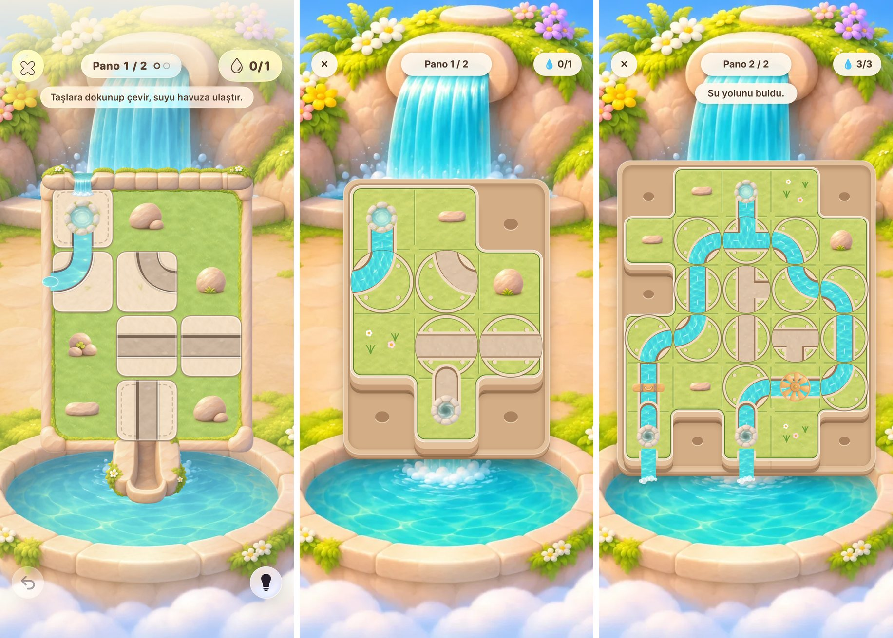
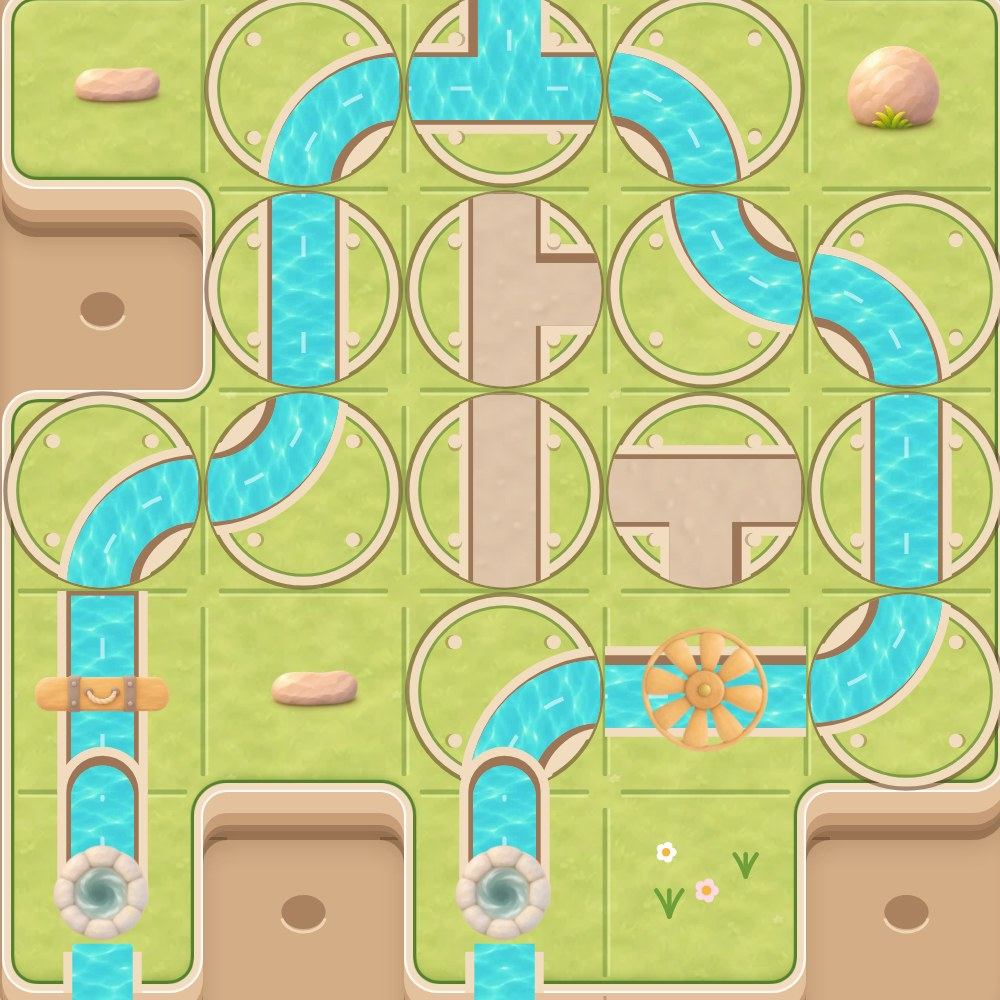
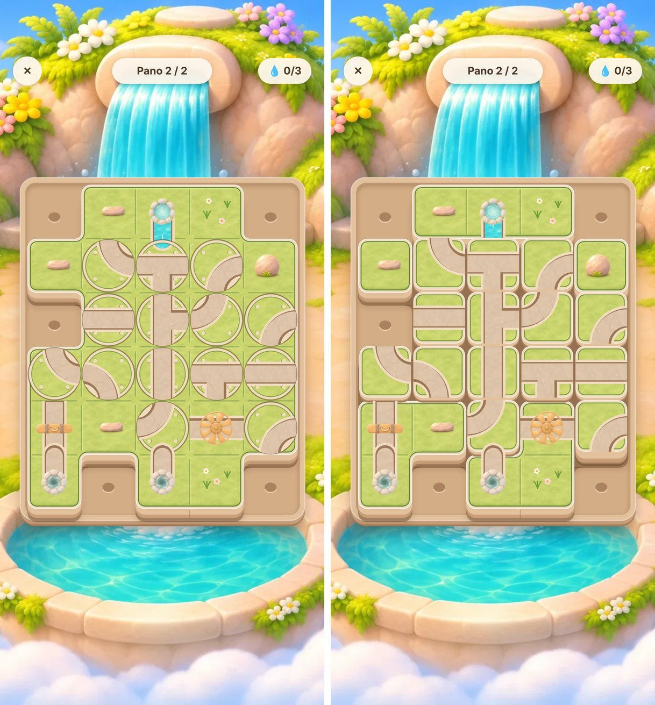
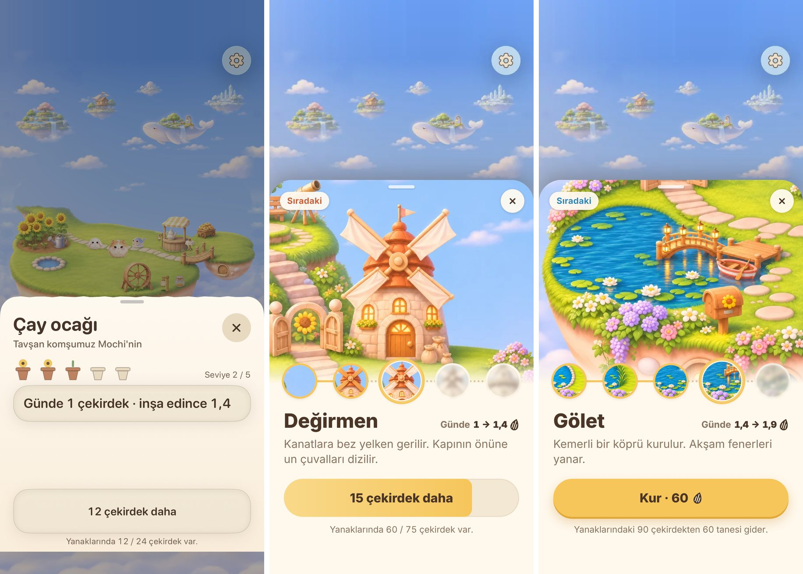
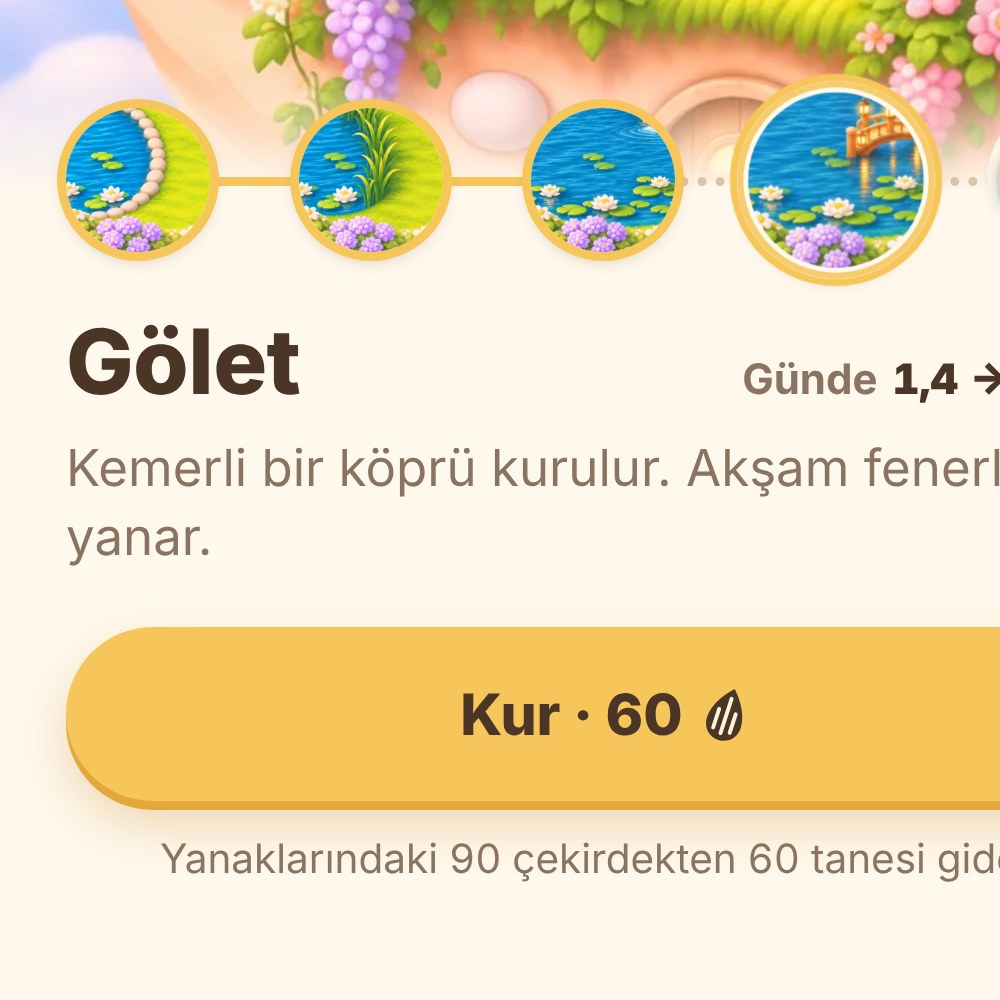

# The stream board as a tabletop toy, and the station sheet from scratch (v1)

**Status:** Fable's proposal and two web prototypes, 2026-11-17
(founder-input 39). Nothing in the app changes in this PR. The rules of the
stream game ([flow-game.md](flow-game.md)) and the economy
(`ArchipelagoCatalog.standard`) are untouched.

**Prototypes** (each one file, playable on a phone; the lead publishes them):

- `design/prototypes/board-toy/index.html`: the board. Tap a dial to turn
  it. Chips: Pano 1 / Pano 4, Çark / Tuş, Boşluk, Derz, Çöz.
- `design/prototypes/station-sheet/index.html`: the sheet. Tap a medallion,
  tap "Kur". Chips: Değirmen / Gölet, Sv 1 to 5, Çekirdek az.

Frames below are the prototypes rendered at 1206 x 2622 (headless Chrome,
3x), judged in 1:1 crops. They use the art that ships (the flow kit, the
home frame) and batch 134's plot plates; text is set in Inter there and in
SF Rounded on the phone.

## A. The stream board

### A.1 What the founder asked for, and what today's board lacks

His words: not a flat texture, a touch cartoonish, clearly designed as a
minigame, pieces that fit each other, a game played on a tabletop. His
drawing: every cell a raised block like a keyboard key, grass on top, stone
at the edges and sides; blocks side by side join into one; some cells empty.

Both grounds that ship (figure 1, left) are drawn from straight above with
no side faces. A (keycaps) has squares but no height; B (the lawn, my pick
on 2026-11-16) has no pieces at all. Neither is an object. That is the gap,
and it overrules my earlier pick: B answered "which cells can I turn", and
the drawing answers a larger question, "what is this thing".

_Figure 1. Left: today (stage 1, ground B). Middle: the toy, stage 1 at the
start. Right: the toy, stage 4 solved._

### A.2 The design

One object: **a stone tray with grass-topped blocks standing in it.**

| Part | What it is | Why |
|---|---|---|
| Block | One cell. A grass lid with a stone edge, stone sides 20 percent of a cell tall, seen from above and a little from the front, so the south face shows | His drawing. Height is what makes it a piece |
| Mass | Blocks that touch fuse: one lid, one stone edge round the whole shape, outer corners round, inner corners filleted. A pressed seam in the grass stays between cells ("Derz") | "Join into one big block", and the seam keeps it made of pieces. Toggle the seam to compare |
| Empty cell | A hole in the mass. The tray floor shows, with the north block's side face and a peg socket | "Some cells stay empty". The socket says a block could stand here: the grammar of a toy |
| Tray | A low stone board under everything, 9 pt wider than the grid, with its own side and shadow on the sand | It is what makes the board one thing set on a table, not tiles laid on the scene |
| Channel | Carved through the lid into stone: a stone lip, a shaded far wall, the bed 1.6 pt lower. Water fills it | The cut has depth, so dry and wet differ by shape, not only colour |
| Dial | **My addition.** A turning cell is a round stone-ringed dial set into its block, with four studs; the carving and studs turn, the block does not. It dips when tapped | See A.3 |
| Mouth | The channel runs to the block's edge and the water falls off the side into the pool | The pour is visible, with no separate spout piece |

What leaves the board: the stone frame, the lip kit and the spouts of #506
(the blocks carry their own stone, and the spring is a well in its own
block), and the cut-out rocks as cells. Rocks stay as dressing on plain
blocks, with tufts and small flowers.

_Figure 2. Stage 4 solved, a 1:1 crop of the device frame._

### A.3 Dial or key: the one open choice

_Figure 3. Left: dials (my pick). Right: keys (the drawing, read literally)._

If every block fuses, nothing says which cells turn. Two answers, both in
the prototype:

- **Dial (pick).** Round means it turns; square ground does not. The whole
  board stays one fused mass, as drawn. A disc can turn in its seat, which a
  square key cannot, so the motion is honest. Water crosses from dial to
  dial with no gap.
- **Key.** Each turning cell is its own keycap, 2.5 pt proud, with a gap
  round it; only the fixed cells fuse. Closer to "like a keyboard key", and
  the press is a real key press. Costs: more edges on a full board, and a
  thin break in the water at every gap.

The eye decides. Both are one constant apart in code.

### A.4 Which cells are empty

`#` (rock) and `.` (grass) are the same thing to the rules: nothing flows.
Today 55 of the eight boards' 56 inert cells are `#`, so "rock becomes empty" would
strip the boards bare. Proposal: empties are **authored**, one new glyph
(`o`) in `flow-boards.json`, picked by eye per board: corners and edge
cells first, so the silhouette stops being a rectangle; never more than a
third of the inert cells. Eight boards, about twenty minutes of work. The
solver treats `o` as rock. The prototype's two boards show the picks.

### A.5 Art

**No new Codex job is needed to ship this.** Everything in the frames is
code plus files already in the bundle (`flow-lawn`, `flow-channel`,
`flow-water`, `flow-spring`, `flow-outlet`, `flow-wheel`, `flow-gate`,
`flow-rock-cut*`). Batch 136 (lawn v3) is still the right job, unchanged:
the lid is that lawn, and the prototype tints the old one to stand in for
it. Move it back to READY when the founder says yes to the toy; not before.

Not proposed now, on purpose: a painted block or a painted target. The
shape is geometry (fused outlines, per board), which code does exactly and a
painter cannot repeat across eight boards.

### A.6 Build, if he says yes

One builder run, in `PofuGames/Flow`:

1. `FlowTile`: the `o` glyph (kind `empty`, inert); solver and library tests.
2. `FlowArt`: the mass outline per board (the prototype's `massPath` is the
   reference), the lid from a mask, sides, tray, seams; drawn once per board
   into one texture.
3. `FlowScene`: dials as their own nodes (ring, studs, channel), the tap dip,
   the mouth's fall; remove the edge, lip and spout nodes.
4. `flow-boards.json`: the empties.
5. Frames `path-game-flow-*` at 1:1 against figures 1 to 3.

Risks: iOS-only drawing compiles in CI only; the mask needs a
`CGContext` pass per board (cheap, once). Smallest cell on a 5-column board
is 67 pt, above the 44 pt touch target.

## B. The station sheet

### B.1 What is wrong with today's sheet

_Figure 4. Left: today. Middle: Değirmen at form 2, 15 seeds short. Right:
Gölet at form 3, ready to build._

It is a form: a name, five pots, "Seviye 2 / 5", a number, a button. It
answers "how much" three times and never shows the thing. And the number it
leads with is the same for every station (0.48 seeds a day per level,
`scaleACentiSeedsPerHourPerLevel`), so it cannot tell two stations apart.

### B.2 The design: the sheet is the picture of what you are about to build

Top to bottom:

1. **The picture.** The station's next form, painted, edge to edge across
   the top of the sheet (402 x 310 pt). A tag says which form it is:
   "Sıradaki", "Şimdi" or "Önceden".
2. **The ladder.** Five round medallions, each a crop of that station's own
   form. Built ones are ringed in honey and joined by a honey line; the next
   one pulses; the ones after are fogged, so they are promised, not shown.
   Tap a built one to look back at it. **This is the level gauge.** No
   sunflowers, no "Seviye 2 / 5" (VoiceOver still says "2. hâli").
3. **The name and one line.** The form's name, and one sentence that says
   what arrives ("Kanatlara bez yelken gerilir. Kapının önüne un çuvalları
   dizilir."). The rate sits small on the right: "Günde 1 → 1,4".
4. **One plaque.** "Kur · 60" in honey. Short of seeds, the plaque becomes
   its own gauge: it fills to what the cheeks hold and reads "15 çekirdek
   daha". Never a greyed button.
5. Building: the picture blooms from the old form to the new, the medallion
   pops, and the sheet turns to the form after.

_Figure 5. The ladder and plaque, a 1:1 crop._

Station-specific without special chrome: the picture and the five
medallions are the station. The only other per-station thing is one accent
colour (the tag). I would not paint frames or ornaments per station: they
would compete with the picture, and they are forty more jobs.

**One art source, three uses.** The form plates of #503 answer 5 (painted
in place on the island) are the island's art, the sheet's picture and the
medallions. The sheet needs no art of its own: the code crops. So this
sheet costs nothing beyond the ladders the island needs anyway.

### B.3 Names (#503 answer 3)

The founder's fear is right: forty names would include padding ("Kayıklı
Gölet", "Fırınlı Değirmen" are descriptions wearing a name). His 1, 3, 5
does not fit the forms, though: the largest change of noun is at **2**,
where the object becomes the building the station is named for (Rüzgâr
Gülü → Değirmen, Semaver → Çay Ocağı, Tezgâh → Atölye).

**Pick: a name changes only when the thing becomes a different thing: at 1,
2 and 5.** Form 1 has its humble name, forms 2 to 4 carry the station's
name, form 5 the landmark's. Forms 3 and 4 get the one sentence instead.
Three names a station, twenty-four in all, every one already in the #503
table and every one a word a person would say.

| | 1 | 2 to 4 | 5 |
|---|---|---|---|
| Değirmen | Rüzgâr Gülü | Değirmen | Büyük Değirmen |
| Gölet | Gölcük | Gölet | Nilüfer Gölü |
| Bahçe | Tarh | Bostan | Dev Ayçiçeği |
| Çay | Semaver | Çay Ocağı | Teras Çayhane |

Against: less to collect than five names. For: no name he has to wince at.

### B.4 States the prototype does not show

- **Not built yet (form 0):** the picture is form 1 with the tag "Sıradaki",
  all later medallions fogged, the plaque as usual.
- **Held by the island level:** the plaque's place holds the quiet line
  that ships today ("Ada 8 olunca açılır"); the next medallion keeps its
  fog.
- **Building:** the sheet drops to its compact detent as today; the picture
  is the island itself.
- **Garden's play door:** a text button under the plaque, as today.
- **A station with no ladder painted yet:** the picture is the crop of the
  island plate at that station, and the medallions are five stone dots,
  filled to the level. The sheet ships before the art does.

### B.5 Art and order

No sheet-only Codex job. The ladders are the #503 pipeline: batch 137
(READY) repairs windmill 1 and 2 and pond 1 to 3; in the prototype windmill
1 is the take the lead already failed, so its medallion is nearly empty
sky. After 137, one station at a time, in the order he meets them, never a
batch of thirty.

Build: one builder run on `StationSheet.swift` (SwiftUI, iOS-only, so CI
decides), with windmill and pond first and the fallback of B.4 for the
rest. The copy lines are drafts; the final ones go through `pofu-story`.

## C. Home's lasting change, Nazlı, and the way between islands

Kept to a decision note; nothing is built here.

**A premise to correct first.** The founder said the "every main island
changes home for good" system was lost. It was not lost from the canon:
`book-one.md` gives every main island an **EVE HEDİYE** row (Çağlayan: the
pool's fountain runs, and a small pool on Nazlı's back; Revontuli: one more
lantern on the bridge, an aurora jar for Nazlı; Emanet: a parcel on
Wednesdays, polished finds in the workshop, a teal plank; Mehtap: the
telescope on the hill, a moonstone). Çağlayan's fountain is even in code
(`IslandScene`, `gift-fountain`). What is lost is that **nobody is told**:
the gift has no moment and no place in the interface. So each gift already
goes to both, home and Nazlı; the choice he raised is not needed.

**Proposal 1: gifts live on the ladder.** A station that receives a gift
shows it as a sixth, differently shaped medallion at the end of its ladder
(Gölet: Çağlayan's fountain; the bridge: Revontuli's lantern; Atölye:
Emanet's finds; the hill: Mehtap's telescope). Fogged with "bir adadan
gelecek" until the island is healed; then lit, with "Çağlayan'dan". It
cannot be bought. This puts the lost system inside the screen he asked to
be redesigned, for one small view and no new art.

**Proposal 2: Nazlı is the door, in the same place everywhere.** #503
already moors her under Home's harbor. Extend it as he suggested: every
island has a berth at its lower right, and she waits there. Tapping her is
always the way out (to Sefer, or straight home). The player never looks for
a back button; he looks for her. Her back carries the gifts, so the journey
is visible on every island.

**Nazlı's shadow (answer 2):** before she arrives, residents speak of a
shadow that crossed the island; that is two or three lines for `pofu-story`
and one soft shadow passing over Home's lawn on the days before. Not
written here.

**Left out:** Sefer (he has not seen it), the island-level measure (mine,
not his), character movement (the lead's), and any art for C.

## Order of work

1. He looks at the two prototypes on his phone. Two choices: dial or key,
   and yes or no to the sheet.
2. Board: one builder run (A.6); batch 136 back to READY.
3. Sheet: batch 137 lands, then one builder run (B.5).
4. C: proposal 1 rides on the sheet's PR as a follow-up; proposal 2 waits
   for his view of Sefer.
