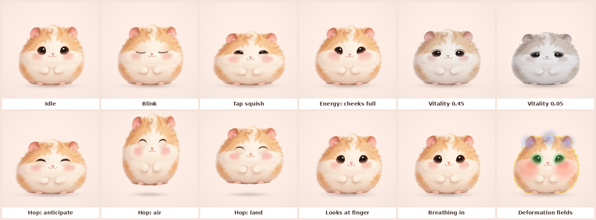

# Companion Motion System

_Status: proposal with a working proof (web) and a first Swift
implementation (`PofuCompanion`). Last updated: 2026-10-31._

**Question:** Pofu's visual source of truth is now a soft storybook
illustration made with GPT Image. How do we animate a still so Pofu feels
alive, not like a sticker, without an animator?

**Answer in one line:** treat the illustration as a *material*, not a
frame. Continuous life comes from procedural motion and a deformation
shader on one still; faces come from a handful of region variants edited
from that same still; discrete moments come from short GPT Image sprite
sheets. No video, no per-pose redraws.



Every frame above is the same single image (plus a lid plate). Animated:
[pofu-motion.webp](../../design/prototypes/companion-motion/media/pofu-motion.webp).
Try it: open
[`design/prototypes/companion-motion/index.html`](../../design/prototypes/companion-motion/index.html).

## 1. What "alive" means here

A character reads as alive when it passes five tests. Each one maps to a
mechanism, and the recommendation below covers all five.

| Test | What the eye checks | Mechanism |
|---|---|---|
| **It is never perfectly still** | Breathing, micro-sway, blinks, glances | Procedural, always running |
| **It has weight** | Squash on contact, overshoot, feet planted | Springs, ground-anchored transforms |
| **Parts lag the body** | Tuft and ears follow through | Shader region rotation on springs |
| **It reacts to me** | Squish on tap, looks at my finger, happy squint | Events into the same springs |
| **Its state is legible** | Thriving vs. tired vs. wilting at a glance | Continuous vitality mapping, no state swaps |

The bar in the [character bible](../brand/character.md): springs, not
easing; squash and stretch on every landing and tap; blinks every 3–6 s;
Reduce Motion respected; never grotesque.

## 2. Techniques compared

| | (a) Procedural transforms | (b) Shader deformation | (c) Expression variants | (d) Separately generated layers | (e) AI video | (f) Live2D / Spine | (g) GPT Image sprite sheets |
|---|---|---|---|---|---|---|---|
| What moves | Whole body | Any region, per pixel | Faces (eyes, mouth, cheeks) | Parts on pivots | Anything | Anything rigged | Anything, in ≤16 frames |
| Liveliness | Medium | High | High for faces | Medium-high | Very high, but canned | Very high | Medium (stepped) |
| Continuous with state | Yes | Yes | Crossfades | Yes | No | Yes | No |
| Consistency risk | None | None | Low with region compositing | **High** | High | None after rigging | Medium (drift, boil) |
| Who can make it | Agent | Agent | Founder (prompts) + agent | Founder + agent | Founder + paid tool | Rigging artist | Founder (prompts) + agent |
| Size per species | 0 | 0 | ~0.3 MB | ~1 MB | 5–25 MB | 1–3 MB | ~0.4 MB per action |
| Cost | Free | Free | Included in ChatGPT Pro | Included | Paid credits | Licenses + artist | Included |
| Verdict | **Core** | **Core** | **Core** | Derive layers from the base instead | Not now | Not now | **For discrete actions** |

### (a) Procedural transforms on a single still

Ground-anchored squash and stretch, breathing, sway, hops, a soft-body
lean (shear with the feet fixed), parallax.

- **Strengths:** zero assets, infinitely continuous, interruptible, tiny.
  This alone makes Pofu breathe and bounce convincingly (see "Inhale",
  "Tap squish", and the hop frames above).
- **Limits:** it moves the whole picture. Faces cannot change. Painted fur
  stretches visibly past roughly ±25% squash, so `SquashModel.range` is
  `-0.24...0.2`. A uniform scale reads as zoom; scales must be anchored at
  the feet and area-preserving, or Pofu looks like it inflates.
- **Rule:** never rotate a round character rigidly; shear it. A rigid tilt
  reads as a sticker on a hinge, a shear with planted feet reads as a soft
  body leaning.

### (b) Mesh or shader deformation of the still

SwiftUI's `distortionEffect` and `layerEffect` (iOS 17+) run a Metal
`[[stitchable]]` function per pixel. Every effect is written as an
**inverse map**: for each output pixel, where in the still do we sample?

What the proof does with one shader:

- **Cheek pouches (the energy mechanic):** a radial magnification centered
  just outboard of each blush, radius about 23% of the art width, so it
  also pushes the silhouette outward. Inflation follows a slightly bouncy
  spring, so filling the cheeks "gulps".
- **Tap dent:** an inverse bulge (pinch) at the finger, on a fast spring,
  together with the global squish.
- **Tuft and ear follow-through:** soft region rotation about the root,
  driven by springs that react to the body's velocity.
- **Fur ripple:** low-frequency noise displacement applied only on the
  silhouette's outer ring (from a blurred alpha in WebGL; from the body
  ellipse in Swift), so the outline breathes like fur in air.
- **Fake 3D turn:** a sphere-weighted shift: the front of the body moves
  more than the outline, so Pofu "turns" a few degrees toward the finger.
- **Vitality grade:** see section 4.

Limits, stated plainly:

- A shader can only move pixels that exist. It cannot close an eye
  (there is no lid under the iris) or open a mouth. That is what the
  variants are for.
- Magnification softens texture: past an inflation of about 0.6 the cheek
  fur turns blurry and the eyes get squeezed. The proof stops at 0.58.
- Cost is one full-layer pass per frame. For a 720×720 px layer that is a
  fraction of a millisecond on any A-series GPU, but it keeps the GPU
  awake; cap the timeline at 60 fps (done) and pause offscreen.
- **Toolchain risk (researched):** SwiftPM classifies `.metal` files as
  an Xcode-only file type (`FileRuleDescription.metal` is in
  `xcbuildFileTypes` in SwiftPM's `TargetSourcesBuilder.swift`). Xcode
  compiles them into `default.metallib` inside the package bundle;
  command-line `swift build` and `swift test` only copy the source. Xcode
  26 also ships the Metal toolchain as a separate component
  (`xcodebuild -downloadComponent MetalToolchain`). `PofuCompanion`
  therefore declares the shader as an explicit resource, checks for the
  compiled library at runtime (`CompanionShaders.isAvailable`), and falls
  back to a pure-SwiftUI cheek (a magnified, radially masked copy). The
  shader is not exercised by unit tests; it needs on-device review.
- Widgets and Live Activities render static snapshots; no shaders, no
  timelines. They use stills (section 6).

### (c) Expression variants from image edits

The same base image, edited by GPT Image with one change each (eyes
closed, happy arcs, mouth open). The pipeline never shows a variant
whole: it **registers** the variant to the base (sub-pixel translation and
scale from phase correlation of the alpha), then **composites only a
feathered region** (eyes, mouth, cheeks) over the base. Anything the model
redrew outside the region is discarded, so consistency outside the face
is guaranteed by construction.

- Eyes: blinks and sleepy, sad, and happy eyes are lids that reveal the
  eyes-closed variant above a procedural lid line and squash the visible
  band of the eye (a cartoon eye squash keeps the highlight and outline).
  The proof demonstrates this with a lid plate computed by
  `tools/make_lid_plate.py`, a stand-in for the real variant.
- Mouth: crossfade inside the mouth region, 80–120 ms, never a hard cut.
- **Iteration finding:** the first three attempts faked the lid from fur
  sampled near the eye (sliding, a radial fan, frequency swapping). All
  showed seams or streaks. Revealing a plate that equals the base outside
  the eye was seamless at once. That is the strongest argument in this
  document for asking the image model for an eyes-closed variant.

### (d) Layered parts generated separately

Body, eyes, mouth, ears, and tuft generated as separate transparent images.

- **Rejected as specified.** The model does not keep separately generated
  parts registered or stylistically matched, and each part loses the
  contact shading that makes it sit *in* the fur (the same seam problem the
  3D spike found with its layer split). Hidden areas (fur under the ears,
  skin under the eyes) never exist in a single generation.
- **Instead, derive layers from the base:** cut the region from the base,
  and inpaint what was underneath with an image-edit ("remove the tuft,
  continue the fur"). The tuft then moves as its own layer over a plate
  that is pixel-identical to the base elsewhere. Do this only if shader
  rotation of the tuft is not enough; in the proof it is.

### (e) AI video for hero moments

- **Sora is not an option.** OpenAI closed the Sora app and web on
  2026-04-26 and shut down the Sora 2 API on 2026-09-24; ChatGPT Pro does
  not include it.
- Veo, Kling, Seedance, and Higgsfield are paid per clip or by credits,
  with no budget now. Treat AI video as a distant, optional future.
- If it ever happens: generate on a flat chroma background (or with the
  tool's alpha output, if any), matte frame by frame, and fight fur-edge
  flicker; a seamless loop needs first-frame and last-frame conditioning
  plus a crossfade. HEVC with alpha (`AVAssetWriter`,
  `kCMVideoCodecType_HEVCWithAlpha`) at 640 px, 30 fps, 3 s is about
  0.5–1.2 MB per clip because fur compresses poorly. Video is canned: it
  cannot react, cannot show vitality continuously, and cannot be
  interrupted by a tap, so it fails three of the five aliveness tests.

### (f) Live2D or Spine rigging

- Both are excellent, both need a rigging artist, and neither can be
  authored by the agent.
- Live2D Cubism: Editor PRO is a subscription; the SDK is free to publish
  for individuals and small businesses under a revenue threshold (about
  ¥10 million a year) and needs a paid release license above it.
- Spine: one-time editor licenses (Essential about $69, Professional about
  $379; Enterprise above a revenue threshold); every app using a Spine
  runtime needs a Spine license. Official iOS runtime available.
- The art must be repainted in parts with hidden areas filled. Revisit
  when there is budget for an animator (as ADR-0006 said for Rive).
  Prices are from memory and must be verified before any decision.

### (g) GPT Image sprite sheets

GPT Image can produce a whole sequence in one image (for example a 4×4
grid) from a reference. Community reports, which match how these models
work, say a whole strip in one prompt drifts far less than frame-by-frame
generation, because the model plans the frames together.

- **Strengths:** real redrawing (mouth opens, ears flop, body changes
  shape), no animator, included in ChatGPT Pro, one prompt per action.
- **Weaknesses:**
  - **Resolution.** Cells share the canvas. A 1536 px sheet cut 4×4 gives
    384 px cells; Pofu at 240 pt needs about 720 px at @3x. So 4×4 suits
    widget-size motion and timing studies; hero actions should use 3×2
    (512 px cells) or 2×2 (768 px).
  - **Registration drift.** The character shifts a few pixels and changes
    size between cells. Fixed by the slicer (below).
  - **Palette drift and boil.** Fur strands are redrawn every frame. At
    8–12 fps, held on twos or threes, mild boil reads as hand-drawn life;
    strong boil reads as cheap. Region compositing (only the changing
    part, over the base) removes boil everywhere else.
- **Use for:** discrete, short, non-interactive actions: a yawn, a gulp
  with the cheeks stuffing, a happy wiggle at the top of the celebration,
  a sleepy nod. **Do not use for** blinks (procedural lids are better and
  cost nothing), hops (procedural, so they stay on springs), or anything
  that must react mid-action.
- **Playback:** 10 fps by default, each frame cross-dissolved into the
  next over its last third, while the procedural layer keeps breathing
  and squashing underneath at 60 fps. Body transforms are damped to half
  during a full-body sheet so the two motions do not fight.

## 3. Recommendation: a four-layer hybrid

1. **Continuous body layer (procedural, 60 fps, always on).** Breathing,
   sway, ground-anchored squash and stretch, hops, lean, contact shadow,
   all on SwiftUI-parameterized springs that keep momentum
   (`CompanionMotion`).
2. **Deformation layer (one Metal shader).** Cheek pouches driven by
   energy, tap dent, tuft and ear follow-through, fur ripple, and the
   vitality grade. It makes the still behave like a soft material.
3. **Face layer (region variants from image edits).** Eyes closed, happy,
   and sad; mouth open and "o". Composited only inside feathered region
   masks, with procedural lid lines for blinks and squints.
4. **Moments layer (GPT Image sprite sheets).** Two or three short
   actions at 10 fps, region-composited, registered and checked by
   `tools/slice_sprite_sheet.py`. No AI video.

Five bullets for the decision:

- One still is the material; motion is code. Consistency is solved by
  construction, because every frame is the same pixels.
- Vitality is continuous: a shader grade plus posture, never discrete
  state images.
- Faces change through masked variants of the same base, never through
  new generations.
- Discrete actions use single-prompt sprite sheets, registered to the base
  and gated by automated drift checks.
- Reduce Motion, widgets, and Live Activities use stills from the same
  set; nothing needs a second pipeline.

## 4. Vitality as continuous parameters

Vitality `v` in `0...1` (from `VitalityModel` in PofuCore) eases on a
critically damped spring (response 1.4 s), so a bad evening drains Pofu
visibly but never abruptly. Everything below is a function of `v`; no
image per state.

| Channel | Thriving (v = 1) | Wilting (v = 0) | Mapping |
|---|---|---|---|
| Saturation | 1.08 | 0.22 | `lerp(0.22, 1.08, v)` |
| Tint and light | Slightly warm | Cool ash, about 8% darker | multiply by `lerp((0.93, 0.93, 0.95), 1, v)`; warm lift above 0.7 |
| Fluff crispness | Fur strands sharpened | Fur softened (matted) | unsharp amount `lerp(-0.75, +0.55, v)` against mip-blurred fur |
| Silhouette wisps | All wisps | Faint wisps gone | alpha remap threshold `lerp(0.42, 0, v)` |
| Posture | Upright (no slump above 0.7) | 7% shorter, 3.5% wider, top sags | `SquashModel.slump` by `1 − smoothstep(0, 0.7, v)`; sag `0.09 (1 − v)` weighted to the top |
| Tuft and ears | Perky | Tuft droops 0.55 rad, ears 0.28 rad outward | spring targets |
| Breathing | 3.3 s, 1.6% | 4.6 s, 2.4% (sighs) | `BreathingCurve` |
| Blinks | Every 2.5–6 s | 40% less often | interval multiplier `lerp(1.4, 1, v)` |
| Lids | Open | 42% closed, outer corners down | `sleepy = 0.42 (1 − smoothstep(0.25, 0.75, v))`, `sadness = 1 − smoothstep(0.2, 0.6, v)` |
| Fur ripple | Full | 35% | `lerp(0.35, 1, v)` |
| Sway | Full | Half | `lerp(0.5, 1, v)` |

Two lessons from the 2D rig and the 3D spike apply here too: a straight
half-lid reads as bored, so sad lids must tilt down toward the outer
corners; and gray must stop at "tired plush toy", never "sick". The
wilting frame above was checked against that.

One optional variant, `matted`, can add texture-level matting: crossfade
it in by `smoothstep(0.35, 0.05, v)`. It is still continuous, because the
blend weight is.

**Energy** (cheek pouches) is the second continuous channel: inflation
`0.58 · energy` on an underdamped spring (response 0.55 s, damping 0.38),
so gaining energy overshoots into a visible gulp, and the blush deepens
with fill.

## 5. Asset contract

The founder generates these in ChatGPT (GPT Image), always **editing the
base image** (attach it, one change per request), never generating a
variant from scratch. The agent keys, registers, crops, compresses, and
writes the landmark JSON.

### Global rules

- **Canvas:** the largest portrait size the model offers (today
  1024×1536). Pofu centered, about 70% of the canvas width, feet resting
  on an invisible baseline at about 88% of the height, with empty space
  above for the tuft. The same canvas for every variant.
- **Background:** transparent. If the export is not transparent, a flat
  pastel (`#FDEDE5`) with **no ground shadow**; the app draws its own
  contact shadow so it can shrink during hops.
- **Camera and light:** front view, soft light from the upper left, no
  rim glow touching the edge of the canvas.
- **Format:** PNG, sRGB, 8-bit with alpha. The app ships HEIC or lossy
  WebP with alpha after review (about 5x smaller than PNG for fur).
- **Naming:** `pofu-<species>-<variant>.png`, lowercase, for example
  `pofu-hamster-eyes-closed.png`. Sprite sheets:
  `pofu-<species>-sheet-<action>-<cols>x<rows>.png`.
- **Landmarks (agent):** `pofu-<species>-rig.json` with ground point, eye
  ellipses, cheek centers and radius, blush, tuft center and pivot, ears,
  body ellipse, and region masks. `CompanionRig` is the Swift mirror.

### Required set (8 images)

| # | File | Purpose |
|---|---|---|
| 1 | `pofu-hamster-base.png` | Everything; the material |
| 2 | `pofu-hamster-eyes-closed.png` | Blinks, sleepy and sad lids, sleeping |
| 3 | `pofu-hamster-eyes-happy.png` | Happy ^ eyes (joy, celebration, petting) |
| 4 | `pofu-hamster-mouth-open.png` | Laugh, celebration |
| 5 | `pofu-hamster-mouth-o.png` | Curious "Hop!" at the intervention |
| 6 | `pofu-hamster-cheeks-full.png` | Reference for the pouch shader; optional blend at high energy |
| 7 | `pofu-hamster-matted.png` | Optional low-vitality texture blend |
| 8 | `pofu-hamster-sheet-celebrate-3x2.png` | The celebration flourish |

Later, as needed: `sheet-yawn-3x2`, `sheet-gulp-3x2`, `eyes-sad`
(only if procedural sad lids are not enough on device).

### Prompts

**1. Base** (regenerate the chosen concept on transparency, same design):

```
Recreate this exact character as a clean production asset: the same chubby
baby hamster "Pofu", identical design, proportions, colors, fur, face, tuft,
ears, and soft storybook painting style. Front view, sitting upright, calm
content expression, mouth closed in a small smile, eyes open. Centered on a
1024x1536 portrait canvas, about 70% of the canvas width, feet resting on an
invisible line at 88% of the height, empty space above the tuft. Fully
transparent background. No ground, no cast shadow, no glow, no text.
```

For every variant below, attach the base and start with this preamble:

```
Edit this exact image. Keep everything identical: the same character,
pose, size, position on the canvas, framing, lighting, fur strands,
colors, and transparent background. Do not redraw, move, or restyle
anything except the change below. The result must line up with the
original pixel for pixel outside the changed area.
```

**2. Eyes closed:**

```
Change: close both eyes gently and calmly, as if peacefully asleep. Each
closed eye is a thin, soft, slightly downward-curved dark line where the
lower edge of the eye was, with the eyelid area above it covered by the
same short cream fur as the surrounding face. No eyelashes sticking out,
no tears, no wrinkles. Nothing else changes.
```

**3. Eyes happy:**

```
Change: make both eyes happy closed arcs, the classic smiling ^ shape:
each eye becomes a thick, soft, dark upward-curved arc at the height of
the top of the original eye, with fur below it. The cheeks lift very
slightly. Nothing else changes.
```

**4. Mouth open:**

```
Change: open the mouth into a small, happy laugh: a soft rounded opening
under the nose with a hint of pink tongue, the same width as the current
smile. The muzzle fur moves only around the mouth. Nothing else changes.
```

**5. Mouth "o":**

```
Change: make the mouth a small round "o" of surprise and curiosity under
the nose, about a third the width of the current smile. Nothing else
changes.
```

**6. Cheeks full:**

```
Change: puff out both cheek pouches as if stuffed with seeds, so the
cheeks bulge outward and slightly down and the face looks rounder and
wider at cheek height. Keep the same blush, eyes, and expression. Do not
add any visible food. Nothing else changes.
```

**7. Matted:**

```
Change: make the fur look tired: flatter and smoother, lying close to the
body in soft damp clumps, with fewer fluffy wisps on the outline and
slightly duller colors. Same pose, same size, same face and expression.
Sad but still cute and clean, never dirty, wet, sick, or injured.
```

**8. Sprite sheet, celebration** (attach the base; one prompt):

```
Using the attached character as the exact reference, create a sprite sheet
of a single short animation: a 3x2 grid of 6 equal cells (3 columns, 2
rows) on a fully transparent background, read left to right, top to
bottom. The same character in every cell: identical design, colors, fur,
proportions, size, and front-facing camera, centered horizontally, with
the feet on the same baseline near the bottom of every cell. Leave empty
transparent margin around the character in every cell; nothing touches a
cell edge. No grid lines, no numbers, no text, no motion blur, no ground,
no cast shadow.

Animation, 6 frames, joyful celebration while staying seated:
1. content, eyes open, small smile;
2. eyes squeeze into happy ^ arcs, cheeks lift, mouth opens in a laugh;
3. tiny wiggle to the left, ears flop slightly right, tuft swings right;
4. tiny wiggle to the right, ears flop slightly left, tuft swings left;
5. arms raised a little in a cheer, biggest laugh, rosy cheeks;
6. settling back, happy ^ eyes, closed smile.
```

For a 4×4 sheet, keep the same wording with "a 4x4 grid of 16 equal
cells" and describe the frames in four rows of four. Prefer 3×2 or 2×2
for anything shown large.

### Sprite-sheet acceptance checks

`tools/slice_sprite_sheet.py SHEET --grid 3x2 --reference BASE --out DIR`
slices the grid, keys any background, registers each frame, and writes
registered frames, a contact sheet, and a JSON report.

Registration: each frame is scaled so the **body width** (the alpha extent
in the lower half, which arms, ears, and the tuft do not affect) matches
the base, then translated so the **baseline** (lowest opaque row) and the
body's horizontal center match. Hops belong to code, so the baseline is
locked on purpose.

| Check | Pass | Warn | Reject |
|---|---|---|---|
| Palette drift (CIE76 ΔE of mean Lab, opaque pixels, vs. base) | ≤ 4 | 4–8 | > 8 |
| Silhouette IoU vs. base after registration (hold frames) | ≥ 0.85 | 0.75–0.85 | < 0.75 |
| Baseline residual after registration | ≤ 1 px | | > 1 px |
| Scale correction vs. the sheet's median | within ±10% | | outside (the model resized the character) |
| Cell edges | clear | | any opaque pixel within 4 px of a cell edge (clipped) |
| Identity (human) | eyes, tuft, ears, markings match | | extra limbs, new markings, changed species |

Tested on a synthetic sheet with random ±6% scale and ±25 px offsets per
cell: registration restored IoU to 0.99 and the one recolored frame was
rejected at ΔE 14.8.

### Variant acceptance checks

- Register the variant to the base by phase correlation of alpha;
  residual offset must be ≤ 2 px and scale within ±2%, or regenerate.
- Outside the region mask, mean ΔE vs. base ≤ 3 (catches global
  re-rendering); the region is what gets composited anyway.
- Inside the region: no new features, the fur color at the mask's
  feathered edge within ΔE 4 of the base, so the seam disappears.

### Size budget per species

| Asset | Shipped as | Estimate |
|---|---|---|
| Base, 1024×1536 | HEIC or WebP with alpha | 250–400 KB |
| 5 face variants, cropped to their regions | HEIC or WebP | 20–60 KB each |
| Matted and cheeks-full (optional) | HEIC or WebP | 250–400 KB each |
| Sprite sheet 3×2, cropped to the changing region | HEIC or WebP | 200–500 KB |
| **Total** | | **about 1–2.5 MB** |

For comparison, the 3D spike's pre-rendered loops were estimated at
12–25 MB.

## 6. Where the pieces run

| Surface | What runs |
|---|---|
| App (home, intervention, celebration) | All four layers |
| Reduce Motion | Expressions and vitality change; no hops, sway, or ripple; breathing at 25% |
| Widgets, Live Activities, notifications, shield | Stills: base or a variant chosen by vitality band and energy, pre-composited by the app into the shared container |
| Marketing | Stills and screen recordings of the live companion |

## 7. Implementation

### Web proof (`design/prototypes/companion-motion`)

One WebGL 2 fragment shader, about 200 lines: screen pixel → inverse hop →
inverse lean (shear) → inverse squash and slump → sphere turn → poke dent
→ cheek bulges → tuft and ear rotation → eye lids (band squash plus lid
plate) → fur ripple → sample with mip-based crispness → blush, lash line,
vitality grade → contact shadow. The motion model on the CPU is the same
as `CompanionMotion` in Swift. Captured with Playwright under SwiftShader;
iterated five times (see its README).

### Swift (`Packages/PofuKit/Sources/PofuCompanion`)

| Type | Role |
|---|---|
| `CompanionSpring` | Spring with momentum, SwiftUI parameters, sub-stepped |
| `BreathingCurve`, `SquashModel`, `BlinkCurve`, `LidModel` | Pure motion math, unit-tested |
| `CompanionMotion` | Deterministic simulation: events and vitality in, `CompanionPose` out |
| `CompanionRig`, `CompanionArt` | Landmarks and ImageIO-decoded art from the bundle |
| `CompanionView` | `TimelineView` at up to 60 fps, transforms, lid plate mask, lash line, blush, haptic on tap, accessibility |
| `CompanionShaders`, `CompanionShaders.metal` | The distortion pass (cheeks, tuft, ripple) and its availability check |

Not yet ported from the web proof: the eye-band squash (Swift lids
occlude instead of squashing), the fur-crispness and wisp matting (Swift
uses saturation and brightness only), the tap dent, ear flicks, the
sphere turn, and gaze. Each is a `layerEffect` follow-up once the
`distortionEffect` path is verified on device.

## 8. Honest assessment

What already feels alive in the proof: breathing with planted feet, the
squish and its jiggle, the double hop with anticipation and landing, the
happy squint, the blink, the cheeks filling with a gulp, and the slow
drain to a gray, droopy, sad Pofu. Watching the 13-second loop, it reads
as a creature, not a sticker.

What does not yet:

- **The mouth never moves.** Until the mouth variants exist, laughs and
  "Hop!" are missing; this is the biggest remaining gap.
- **The lid plate is synthetic.** Close up, the closed lid is a little
  smoother than the painted fur. The real eyes-closed variant fixes it.
- **No turning, walking, or props.** 2.5D motion tops out at a few degrees
  of fake turn. Anything bigger is a sprite sheet or a rigging artist.
- **Resolution.** The placeholder is 522 px wide, below the 720 px Pofu
  needs at @3x; the base must come in at 1024 px or larger.
- **The Swift view has not been seen running yet.** CI proves it builds
  and the motion math is correct; the look must be judged on the iPhone,
  and the Metal path must be confirmed to load in an Xcode build.
- **Ownership.** Purely AI-generated art has weak copyright protection
  (see ADR-0010). The motion system, the rig, and the brand
  are ours; the art should get human edits before launch.

## 9. Decisions for the lead (ADR recommended)

[ADR-0010](../adr/0010-illustrated-hamster-art-direction.md) already makes
the illustration the source of truth and leaves the motion system "pending
validation". Its motion clause names AI video for hero moments; with Sora
gone and no video budget, this proposal replaces that part. Recommended
ADR (amending ADR-0010's motion clause):

- Motion is the four-layer hybrid: procedural body, one deformation
  shader, region-composited image variants edited from one base, and
  registered GPT Image sprite sheets for discrete actions. No AI video and
  no third-party animation runtime for v1.
- The asset contract in section 5 (canvas, transparency, naming, the
  eight images, prompts, and the acceptance checks) is binding for
  companion art, as part of the art bible.
- Metal shaders live in `PofuCompanion` with a runtime availability check
  and a SwiftUI fallback; CI may need
  `xcodebuild -downloadComponent MetalToolchain` if a future runner image
  drops the component.
