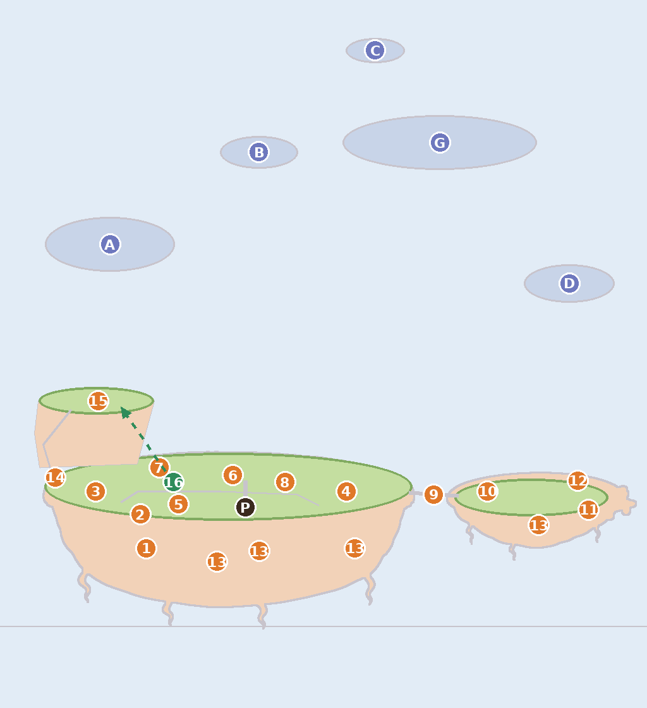

# Concept flows: one connected picture per subject

**Status:** lead design, 2026-11-07, from the founder's picks on the concept
board ([decisions](../product/decisions.md) §10.3, [founder log](../product/founder-input.md)
"2026-11-07 (midday)"). His point: every concept set so far was a row of
separate pictures, and things moved between them. A flow is one picture
painted once at its finished state and walked backwards, so nothing can
shift. This file holds the **shared rules** (§1) and the **home flow**
(§2). The four map islands (Çağlayan, Revontuli, Emanet, Mehtap) are in
the sibling file `concept-flows-islands.md` (batches 67-70). Codex: home
is `tools/imagegen/manifest/batch-66-home-flow.yaml`. Founder storyboard
(Turkish): [concept-flows/home-storyboard.jpg](concept-flows/home-storyboard.jpg).

## 1. Shared rules (every flow)

### 1.1 Anchors: fixed and movable

Every thing on an island has an **anchor**: an id and a world coordinate
(world units are points at camera scale 1, origin the lawn's centre, +x
right, +y toward the viewer; `IslandLayout.swift`, `home-layout.md` §3).

Consistency is judged **object by object, level by level**, not by one
blanket rule (founder, 2026-11-07, follow-up). Each flow gives every object
its own row: fixed or movable, why, and the levels where a move is allowed.

- **Landmarks never move:** land, towers, mills, lighthouses, houses,
  ponds, bridges, paths once laid, the round doors in the earth, the other
  islands in the sky. They change level, light and season, never place.
- **A small piece may move once,** at a big change, when the space needs
  it: a stall, a bench, crates, a decor item. The move is written in the
  object's row with its level and reason, painted in the edit of that
  level, and shown with an arrow on the storyboard.
- **Living things move all the time** (residents, critters, Gezgin in
  flight); that is animation, not layout.
- Anchor numbers live in code (`IslandLayout`, `IslandGrowth`); where a
  flow adds or moves one, it lists the code follow-up (home: §2.4).

### 1.2 Final first

1. **Paint the finished state first**, at the game camera, with its
   background (the root job).
2. **Every earlier stage is an edit of the next later one** that only
   removes, steps a station down a level, or adds a veil (fog, haze, a dim
   island). An edit never adds a new building; the one exception is a
   planned move (§1.1), where the edit puts the same piece back on its
   earlier spot. Removal is cumulative, so
   neighbouring stages always agree.
3. Every stage also attaches the final as its colour target, against the
   per-edit fading batch 03 showed (`edit_chroma`).
4. **Land alone and land with assets, one light.** The bare island (Job A
   of concept match (`docs/research/concept-match.md`, PR pending) §6) is an edit of the
   final that removes everything built. Props are cut as *stage minus
   bare* (ΔE > 6), so plate and props share light, haze and contact
   shadows and nothing looks pasted (the batch-60 doors).
5. **Light and weather are edits of the final** (golden, night, rain), the
   tuning targets for the colour script; in production, of the bare too.
6. **Concept first, then production.** These batches are explorations
   (`x-` ids, never promoted). After the founder's pick, a production batch
   repeats the same chain with real ids and is cut into layers.
7. **Staged parents.** An exploration parent is never promoted, so the
   manifest header tells Codex to stage the parent's pick locally at the
   path `approved:` resolves to, never committed. The chain then runs with
   the normal `edit_of`.

### 1.3 Camera and canvas

- **Home:** portrait 1024 × 1536, the phone's width at the whole-island
  framing (Q-7 C: whole island on open, one tap to come close). The phone is
  taller (402 × 874), so the app extends sky above and cloud sea below in
  code. The close framing crops the same picture; it is never repainted.
- **World to canvas:** `px = 512 + (x − 124) × 1.213`, `py = 890 + y × 1.213`.
  Home, bridge and İskele (x −247…495) fill 0.88 of the width; the home
  plate is 592 px wide; the lawn's centre sits at 58 % of the height; the
  cloud sea starts at y 1110 px. Guide: `design/art/templates/home-flow-guide.png`
  (drawn from the plate's own alpha and the anchors below; no text).
- Map islands keep their own camera (`concept-flows-islands.md`).

### 1.4 Background: never empty

Behind home stand the four map islands and Gezgin, at fixed spots, at every
level, hour and weather. Only their state changes (unlit and grey while
stuck, coloured with one small warm light once healed, on the story
timeline of `home-progression.md` §11.1). Spots are fractions of the home
canvas (centre x, centre y, width):

| Mark | What | Spot | Look at that size |
|---|---|---|---|
| A | Çağlayan | 0.17, 0.33, w 0.20 | tiered pools, a small silver fall |
| B | Emanet | 0.40, 0.235, w 0.12 | misty, a tall stilted bureau |
| C | Mehtap | 0.58, 0.13, w 0.09 | smallest and farthest, a moon-white dome |
| D | Revontuli | 0.88, 0.37, w 0.14 | cool pale, slender ice towers |
| G | Gezgin (Nazlı) | 0.68, 0.225, w 0.30 | gliding left to right; docks at world (520, −40) beside the pier |

Far things are lighter, softer and less detailed than home, never sharper.
They replace the generic `far-isle-1…3` of `FarSkyLayout` at the Home and
Island framings (§2.4). Seasons change in the game (grade and particles),
not their places.

### 1.5 Light targets

Set I1 (`batch-25-seasons`) is the colour target; measured like concept
match §2 (L\*a\*b\* boxes: sky top, subject centre, cloud sea bottom).

| State | Reference (take) | Targets |
|---|---|---|
| Day | I1 `x-season-summer` t2 | sky L\* 84, C 21; subject L\* 76, C 35; sea L\* 90 with a faint blue-lilac shade; darkest 5 % ≥ L\* 59 |
| Golden | I1 `x-season-summer-evening` t2 | pink-lilac sky L\* 74, C 32; subject 72 / 36; peach light, lilac shade; never orange |
| Night | `batch-22 x-gezgin-f2-night` t1, `batch-34 x-revontuli-stuck` t1 (I1 snow night agrees) | blue sky L\* 34-46, C 33 (never black); subject L\* 74-79 at **low chroma ~16** (moonlit); sea L\* 74-84 lilac-white; darkest 5 % ≥ L\* 28; blue-violet shadows (a +10…+16, b −32); warm light only at sources, in small pools |
| Rain | I1 `x-season-rain` t2 | lilac-grey sky; the island stays bright (earth L\* ~75); puddles, bowed sunflowers, fine soft rain |
| Seasons | I1 spring, autumn, snow | painted edits only where shape changes (`home-layout.md` §7) |

**Not the night target:** I5's Tam Çiçek night (subject chroma 37, darkest
5 % at L\* 20, every lantern bright) and I4's night key (subject L\* 53,
darkest 5 % at L\* 20). Concept match §5 tuned the night cell to I4's key;
the founder's pick asks for a lighter, quieter, less saturated night with
lifted darks, so the cell is re-tuned to the row above (lead follow-up).

## 2. Home flow: Ayçiçeği and İskele (E1, with E2's IL7 charm)

The final is the map's "Evin varacağı hal": Tam Çiçek (E1, `batch-34
x-home-tam-cicek` t4) laid onto the anchors. The plate keeps its shape; the
surface is repainted at six levels (IL1, IL2, IL3, IL6, IL7, IL8), the rest
are pieces; İskele joins on the right over a bridge (Q-8 C). Home opens a
little worse and heals over IL1-3 (Q-9 B). No characters are painted: the
app draws Pofu and the residents (a painted Pofu makes two, #265). The
roots stay as the plate has them; their redesign comes later.

### 2.1 Anchor map

One row per object. Numbers are the dots on the map and the storyboard;
"Move" is the only level where the object may change place.

| # | Object (id) | World | From | Rule | Why | Move |
|---|---|---|---|---|---|---|
| 1 | Pofu's round door (H1) | (−107, 80) | day 1 | fixed | a home in the earth, the plate's own door | never |
| P | Pofu's spot (C1) | (22, 27) | day 1 | fixed spot | Home's framing and speech bubble are built on it; he walks (animation) | never |
| 2 | the old wheel (W1, new) | (−115, 36) | day 1 | fixed | the story's first clue; it stays where he stopped it | never |
| 3 | garden (S1) | (−173, 6) | IL1 | fixed | landmark (the giant sunflower; the Su stream ends here) | never |
| 4 | tea stall (S2) | (154, 6) | IL2 | fixed | a stall, but it faces the bridge and carries the Çay ve simit scene; its footprint (108…200) clears the bridgehead (236), so space never asks | none planned |
| 5 | pond (S3) | (−65, 23) | IL4 | fixed | landmark, flat, never hides anything | never |
| 6 | workshop and its knoll (S4) | (6, −15); knoll (50, −50) | IL6 | fixed | a house on raised land | never |
| 7 | windmill and its knoll (S5) | (−90, −25) | IL8 | fixed | a tower | never |
| 8 | hive (S6) | (74, −6) | IL9 | fixed | Arı's home; the bees' loop is drawn from it | never |
| 9 | rope bridge (P2), İskele islet | (236, 8) → (300, 12); islet (395, 14) | IL3 | fixed | land and a crossing | never |
| 10 | bagel cart (S7) | (338, 6) | IL3 | fixed spot | a cart: from IL8 it rolls to the bridgehead and back in the Çay ve simit morning (animation), its spot stays | none in layout |
| 11 | pier (S8) | (470, 30) | IL5 | fixed | runs off the islet's lip; Gezgin moors beside it | never |
| 12 | lighthouse (S9) | (456, −8) | IL6 | fixed | a tower, the frame's right bookend | never |
| 13 | round doors H2 Mochi, H3 Fındık, H4 guest, H5 goat's shed | (40, 84), (165, 80), (−15, 98), (405, 50) | IL2, IL6, IL7 (first main island healed), IL3 | fixed | homes in the earth | never |
| — | path P1, lamps L1-L3, harbor bell L4 | `home-layout.md` §3.3 | IL2, IL6, IL3 | fixed | laid once | never |
| 14 | hill steps P3 and gate T0 | gate (−226, −12); steps (−228, −8) → (−242, −55) → (−205, −100) | IL9 | fixed | placed once where they stay visible (§2.4) | never |
| 15 | Tepe: lookout T1, season stage T2, add-ons T3/T4 | centre (−172, −112) | IL10 | fixed | land | never |
| 16 | **bench** (`decor-bench`, decor set 1) | D1 (−72, −6) → T1 (−150, −112) | IL7 | **movable once** | space: from IL8 the windmill's base stands right behind D1 and the bench crowds it; at Tam Çiçek the Tepe opens and Pofu's lookout needs his bench | **IL10**: it climbs to the Tepe; D1 is free for a new piece |
| — | awning lanterns D2, sailboat D3, mailbox D4 | (154, −52), (−40, 28), (−135, 31) | IL7 | fixed on their spots | each hangs on or sits against its station | never |
| — | festoon L5 | windmill cap → workshop eave → tea awning | IL8 | fixed | hangs from three fixed buildings | never |
| — | season set and visitor | D1 before IL10, T2 from IL10 | season | moves with the system | home-layout §7: the stage exists only from IL10 | IL10 (with the bench) |
| — | guest stall G1 | (398, −6) | first visit | appears and goes | stands only on a visit day; not painted in the flow | per visit |
| — | residents, frogs, bees, gulls; Gezgin in flight | — | — | living | animation, not layout | always |
| A-D, G | far islands and Gezgin's sky spot | §1.4 | day 1 / IL3 | fixed | the sky's landmarks | never |

**The old wheel** is the story map's first clue, "tozlu bir çark" (the
opening line: "Bir hamster çarkını durdurdu"). It stands on the front lip
right above Pofu's door and never turns again: tipped and dusty at IL1,
upright with a sprout at IL3, wrapped in a flowering vine at IL7, a young
sunflower growing through it at Tam Çiçek. Dressing on a fixed anchor, no
mechanic.

### 2.2 Level by level

Days and station levels follow the typical player (`home-progression.md`
§11.1) on the day each level is reached; a station that opens shows L1.
"Ref" is the closest existing image (board code, batch, job, take); only
its content is meant, its layout yields to the anchors.

| Level (day) | New, with anchor | Land, light, sky | Ref |
|---|---|---|---|
| IL1 (1) | garden L1 (3), Pofu's door (1), the wheel tipped and dusty (2) | **a little worse:** pale straw-green thin grass with bare patches, dusty earth, dim hazy light; İskele a soft shape in a fog bank; far islands faint, grey, unlit; no Gezgin | E1 `b31 x-island-il1` t2 |
| IL2 (2) | tea stall L2 (4), path P1, Mochi's door (13) | grass a step greener, light a step clearer; still fog on the right | E1 `b31 x-island-il4` t2 (tea corner) |
| IL3 (3) | the fog lifts: bridge (9), İskele, bagel cart L1 (10), goat's shed (13), bell; garden L3; a sprout at the wheel; Gezgin arrives (form 1) | **opening done:** full I1 day from here on | E1 `b34 x-home-il5` t2 (İskele on the right) |
| IL4 (4) | pond L1 (5) | — | E1 `b31 x-island-il4` t2 (pond) |
| IL5 (8) | pier L1 (11), stepping stones; garden L4, tea L3, cart L2, pond L2 | fireflies at night (code) | E1 `b34 x-home-il5` t2 (pier) |
| IL6 (13) | workshop L1 on its knoll (6), lighthouse L1 (12), Fındık's door (13), path lamps; tea L4, cart L3, pier L2 | knoll repaint; Çağlayan (A) healing | E1 `b31 x-island-il7` t2 (terrace, lighthouse) |
| IL7 (19) | decor spots: bench, awning lanterns, sailboat, mailbox; **flower borders and vines over the rim** (E2's IL7); guest door (13); pond L3; workshop and lighthouse L2; wheel in a flowering vine | borders repaint; Çağlayan lit, Revontuli (D) healing | E1 `b31 x-island-il7` t2 + E2 `b57 x-growth-il7` t1 |
| IL8 (32) | windmill L1 on its knoll (7), festoon; garden, tea, cart L5; pond L4; pier, workshop, lighthouse L3 | knoll repaint; Revontuli lit, Emanet (B) grey | E1 `b31 x-island-il10` t3 (windmill, lanterns) |
| IL9 (44) | hive L1 (8), steps and closed gate with a glow (14); pond L5; pier, lighthouse L4; windmill L3 | the Tepe waits inside a soft cloud (like İskele's fog); Emanet lit; Mehtap (C) grey; Gezgin still form 1 | E1 `b34 x-home-tam-cicek` t4 (gate) |
| **IL10 Tam Çiçek** (59) | the Tepe (15) with telescope and season stage; **the bench (16) climbs from the lawn to the lookout**; gate open; every station L5 (giant sunflower, tiled tea roof, kiosk, floating lanterns, gear sign, flagged lighthouse with its garden, ferry and bell, windmill with cap lanterns); sunflower through the wheel | the final: I1 day; all four far islands healed; Gezgin form 2 (after Mehtap's finale, day 45) | E1 `b34 x-home-tam-cicek` t4 |
| then: Tepe | the camera climbs to the Tepe (a framing, no new state) | — | E1 `b31 x-tepe` t1 |
| later: Altın Ada | all eight at mastery L10: the rim and lip turn gold at dusk (code grade), the telescope finds the last dark star | no job yet | E1 `b31 x-altin-ada` t2 |

The ceremony evening (residents gathered, every lantern lit) is code over
the golden and night edits (§1.5), not a painting.

### 2.3 The Codex batch (66)

| Job | Parent | What it does |
|---|---|---|
| `x-home-flow-final` | (root) | Tam Çiçek by day, whole island, far islands and Gezgin, from the guide |
| `x-home-flow-bare` | final | Job A: land, doors, sky and far islands only |
| `x-home-flow-golden`, `-night`, `-rain` | final | light states, recolour edits |
| `x-home-flow-il9` … `-il1` | final → il9 → il8 → … → il2 | each level, removing and stepping down |

14 generated jobs, 2 takes each (28 images), one track `all`. A failed level skips the levels below it. The chain is nine edits deep;
if the colour drifts by IL1, the fallback is to re-root IL5 to IL1 on the
bare island plus the final's props, not to regenerate.

### 2.4 Code follow-ups (when the build reaches them)

- `IslandGrowth`: the hill stones, gate and hilltop sit at x 92…114 (back
  right); `home-layout.md` put them behind the windmill at x −104, where
  the windmill hides them. This flow moves them to the lawn's **left tip**
  (row 14), under the Tepe, as the E1 final shows; both code and
  `home-layout.md` §3.3 follow.
- `IslandLayout.isles`: İskele at (395, 14) beside home, not (265, 320)
  (decisions H7); `IslandFraming.wholeStop` frames home plus İskele.
- `FarSkyLayout`: the four map islands and Gezgin at §1.4's spots.
- `IslandGrowth` path stones run along the front lip (y 34); P1 runs
  behind Pofu (y 6-24) as in `home-layout.md`. The concept follows P1.
- Night colour cell re-tuned to §1.5 (concept match §5 follow-up).
- New anchor W1 (the wheel); the bench's move D1 → T1 at IL10.
