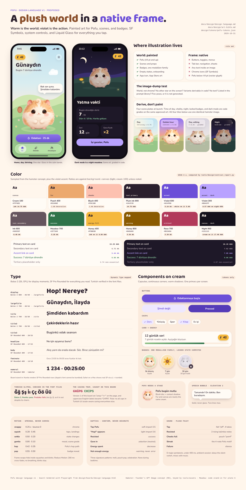
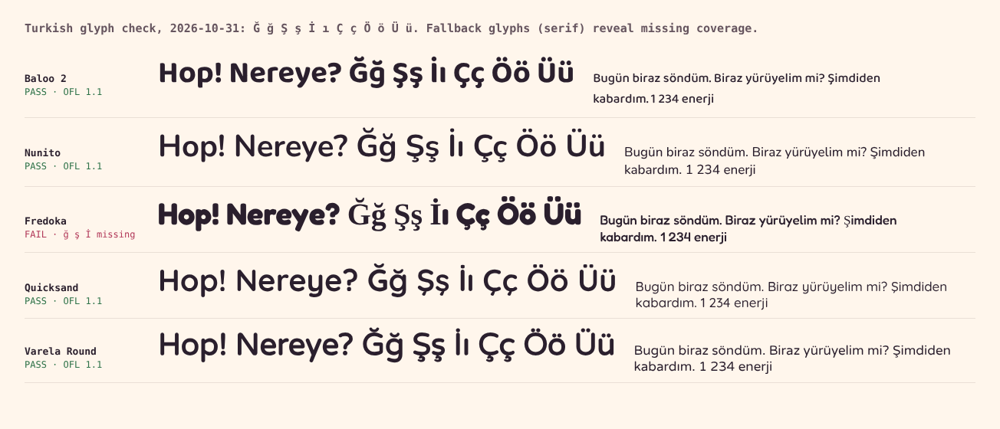

# Pofu Design Language

_Status: v1.0, proposed. Last updated: 2026-10-31._
_Companions: [art bible](art-bible.md) (how AI imagery is made),
[prompt library](prompt-library.md) (what to generate first),
[tokens](../../design/tokens/pofu-tokens.json) (the numbers),
[visual board](../../design/boards/design-language.png)._

This document defines how Pofu looks, moves, sounds, and feels, across the
whole app. It replaces the color section of the
[character bible v0.1](../brand/character.md) (lilac body colors are
obsolete now that Pofu is a cream and golden-peach hamster) and builds on
[ADR-0010](../adr/0010-illustrated-hamster-art-direction.md) (illustrated
hamster art direction).

## The idea in one line

> **A plush world in a native frame. Warm is the world; violet is the
> action.**

Pofu's world (the hamster, the meadow, the sky, the badges) is painted,
soft, and warm: cream, peach, blush. Everything you can _do_ (buttons,
toggles, links, selection) is a cool violet, drawn natively by iOS. The two
never mix: illustration is never a control, and a control is never painted.
That single rule is what keeps generated art from turning into an image
dump, and it gives the app a signature no competitor has: a warm storybook
scene held in a crisp, unmistakably Apple frame.

## 1. Principles

1. **Warm world, violet action.** Warm hues mean "Pofu and its world".
   Violet means "you can tap this". If a warm thing is tappable (Pofu
   himself, a badge), it says so through motion and haptics, not color.
2. **Illustration is the world; native is the frame.** Painted assets live
   in content. Navigation, controls, lists, sheets, and menus are SwiftUI
   and SF Symbols on Liquid Glass. See [section 2](#2-where-illustration-lives-and-where-it-never-does).
3. **One star per screen.** Every screen has at most one illustrated focal
   point, almost always Pofu. Supporting art (a badge row, an empty-state
   prop) is smaller and quieter. Two equal illustrations compete; that is
   how a screen starts to look like a sticker book.
4. **Derive states in code, not in art.** Locked badges, wilting tints, dark
   mode, pressed states, and night grading are computed from one approved
   asset. Every extra painted variant is a consistency risk and a
   maintenance cost.
5. **Soft surface, hard skeleton.** The softness is in the material (fur,
   radii, springs), never in the structure. Alignment, spacing, contrast,
   and hierarchy are as precise as in a banking app. Soft-and-sloppy is the
   most common failure of cute apps.
6. **Calm by default, joy by exception.** Most of the time Pofu breathes and
   blinks. Bounces, bursts, and sounds are rationed for real achievements,
   so they still mean something on day 90 (the character bible's "enthusiasm
   is rationed", applied to the whole app).
7. **Turkish first in layout.** Turkish words are long ("Odaklanıyoruz",
   "Ertelemeyelim"), and `i`/`İ`/`ı` break naive casing. Every layout is
   tested in Turkish at the largest Dynamic Type size before it ships.

## 2. Where illustration lives, and where it never does

### The three layers

| Layer | What it contains | Made with | Example |
|---|---|---|---|
| **World** | Pofu, scenes, props, badges, empty-state and onboarding art, the app icon | AI-generated, human-curated raster art governed by the [art bible](art-bible.md); animated in code | Home scene, Pofu's expressions, "First resist" badge |
| **Brand surfaces** | Cards, buttons, chips, the energy pill, progress rings, gradients | SwiftUI shapes and the tokens in this document | Primary button, streak card |
| **Chrome** | Navigation and tab bars, toolbars, sheets, menus, lists, forms, alerts, pickers, toggles | Native SwiftUI controls, SF Symbols, Liquid Glass | Settings, app picker, schedule editor |

### Illustration is used for

- **Pofu**, everywhere it appears at 44 pt or larger.
- **Scenes** behind Home, the check-in ("Hop!") moment, focus sessions, and
  bedtime.
- **Badges and milestone art** (achievements, streak milestones).
- **Empty states** (one illustration each, never more).
- **Onboarding** (one illustration per step).
- **The app icon**, the App Store screenshots, and marketing.
- **Stickers**: a closed set of small illustrated objects used inline in
  _content_ (the sunflower seed, the wheel, the tea glass, the simit). At
  most 12, listed in the art bible.

### Illustration is never used for

- **Buttons, toggles, segmented controls, sliders, text fields, menus, tab
  bar items, or navigation.** Raster controls break Dynamic Type,
  localization, dark mode, VoiceOver, pressed and disabled states, and
  Liquid Glass. This is also where AI-generated UI looks cheapest.
- **Text of any kind.** No words, numbers, or letters inside generated
  images. All text is live, localized, and accessible.
- **Icons in chrome.** Chrome icons are SF Symbols. The two brand glyphs
  that SF Symbols lacks (the sunflower seed for energy, the Pofu silhouette
  for tiny sizes) are drawn as **custom SF Symbols** in vector, so they
  scale, tint, and match text weight.
- **Pofu below 44 pt** (widgets' smallest sizes, Lock Screen, Live Activity
  compact, notifications): use the vector Pofu glyph. Painted fur turns to
  mush at 20 px.
- **Decorative filler**: no illustrated borders, frames, ribbons, or
  backgrounds behind lists and settings.

### The image-dump test

Before any new illustrated asset is generated, it must pass all five:

1. Is it **world**, not chrome? (If you can tap it to navigate or change a
   setting, it is chrome.)
2. Does the screen it lives on have **no other star**?
3. Can its variants be **derived in code** instead of painted? If yes, paint
   only the base.
4. Does it **contain no text**?
5. Is there a **place reserved** for it in the asset list of the
   [prompt library](prompt-library.md)? If not, add it there first, with a
   reason.

## 3. Color

### The palette

The palette is sampled from the approved hamster concept
([reference](../brand/assets/concepts/hamster-gpt-image.png)), plus
the violet accent the app already ships (`#6C4FD8`, in `AccentColor`).
Violet sits opposite golden-peach on the color wheel, which is why the
accent reads instantly against the warm world without fighting it.

| Family | Swatches | Role |
|---|---|---|
| **Cream** | `cream-50 #FFFBF5`, `cream-100 #FFF6EC`, `cream-200 #FBEBDD`, `cream-300 #F3DCC8` | Light-mode canvas and surfaces; Pofu's belly |
| **Peach** | `peach-300 #F4C7A4`, `peach-400 #ECA96E`, `peach-600 #D69069`, `peach-800 #8A4F2B` | Pofu's fur; decoration; never text (except `peach-800`) |
| **Blush** | `blush-200 #FDD9CF`, `blush-400 #FDC1B0`, `blush-500 #F6A290` | Cheeks, ears, stage discs behind small Pofu art |
| **Plum ink** | `ink-900 #2A1F2D`, `ink-700 #4A3B4A`, `ink-600 #66555F`, `ink-400 #8E7D88`, `ink-300 #A99AA3` | Text and icons. A warm plum-black that bridges Pofu's espresso eyes and the violet accent; never pure black |
| **Violet** | `violet-100 #EEE8FF`, `violet-300 #B9A2FF`, `violet-500 #8F74F0`, `violet-600 #6C4FD8`, `violet-700 #553BB8` | Interaction only |
| **Meadow** | `meadow-300 #8FD4A4`, `meadow-400 #8CC084`, `meadow-700 #2F7349` | The world's green; success |
| **Honey** | `honey-300 #F7C873`, `honey-400 #F5B83D`, `honey-800 #8A5A00` | Energy (sunflower seeds); warnings |
| **Rose** | `rose-300 #FF9EB5`, `rose-700 #B23A5A` | Critical and destructive (rare) |
| **Night** | `night-950 #15111C`, `night-900 #1E1828`, `night-800 #2A2236`, `night-700 #3A3048`, `mist-300 #B8A8B1`, `mist-500 #85768A` | Dark mode: a violet-plum night, never neutral gray |

### Semantic tokens

Use semantic tokens in code; primitives only inside the design system.

| Token | Light | Dark | Use |
|---|---|---|---|
| `background.canvas` | `cream-100` | `night-950` | Screen background outside scenes |
| `background.sunken` | `cream-200` | `night-950` | Grouped list background |
| `surface.card` | `cream-50` | `night-900` | Cards, list cells |
| `surface.raised` | `white` | `night-800` | Sheets, popovers |
| `text.primary` | `ink-900` | `cream-100` | Body and titles |
| `text.secondary` | `ink-600` | `mist-300` | Supporting text |
| `text.tertiary` | `ink-400` | `mist-500` | Placeholders, disabled, timestamps; never essential |
| `accent` | `violet-600` | `violet-300` | Buttons, links, selection, focus |
| `accent.pressed` | `violet-700` | `violet-500` | Pressed state |
| `accent.tint` | `violet-100` | `#2E2547` | Secondary buttons, selected chips |
| `text.onAccent` | `white` | `night-950` | Labels on accent fills |
| `success` | `meadow-700` | `meadow-300` | Resisted, completed |
| `warning` | `honey-800` | `honey-300` | Low energy, late-night pricing |
| `critical` | `rose-700` | `rose-300` | Destructive actions only; never for the user's behavior |
| `energy.fill` / `energy.onFill` | `honey-400` / `ink-900` | same | The energy pill |

### Contrast (WCAG 2.x, computed)

Generated by [`tools/design/contrast_report.py`](../../tools/design/contrast_report.py)
from the token file; the script fails if any pair drops below its minimum.
Every text pair meets **AA (4.5:1)**; primary text meets **AAA** in both
modes.

| Text / element | On | Light | Dark | Required |
|---|---|---|---|---|
| `text.primary` | `background.canvas` | 14.75 | 17.40 | 4.5:1 |
| `text.primary` | `background.sunken` | 13.53 | 17.40 | 4.5:1 |
| `text.primary` | `surface.card` | 15.29 | 16.15 | 4.5:1 |
| `text.primary` | `surface.raised` | 15.76 | 14.23 | 4.5:1 |
| `text.secondary` | `background.canvas` | 6.48 | 8.22 | 4.5:1 |
| `text.secondary` | `background.sunken` | 5.95 | 8.22 | 4.5:1 |
| `text.secondary` | `surface.card` | 6.72 | 7.62 | 4.5:1 |
| `text.secondary` | `surface.raised` | 6.93 | 6.72 | 4.5:1 |
| `text.tertiary` | `background.canvas` | 3.61 | 4.39 | 3:1 (non-essential) |
| `text.tertiary` | `background.sunken` | 3.31 | 4.39 | 3:1 (non-essential) |
| `text.tertiary` | `surface.card` | 3.74 | 4.07 | 3:1 (non-essential) |
| `accent` (as text) | `background.canvas` | 5.24 | 8.57 | 4.5:1 |
| `accent` (as text) | `background.sunken` | 4.81 | 8.57 | 4.5:1 |
| `accent` (as text) | `surface.card` | 5.44 | 7.95 | 4.5:1 |
| `accent` (as text) | `surface.raised` | 5.60 | 7.01 | 4.5:1 |
| `text.onAccent` | `accent` | 5.60 | 8.57 | 4.5:1 |
| `text.onAccent` | `accent.pressed` | 7.77 | 5.25 | 4.5:1 |
| `accent` | `accent.tint` | 4.70 | 6.57 | 4.5:1 |
| `success` | `background.canvas` | 5.35 | 10.74 | 4.5:1 |
| `success` | `surface.card` | 5.55 | 9.96 | 4.5:1 |
| `warning` | `background.canvas` | 5.54 | 11.93 | 4.5:1 |
| `warning` | `surface.card` | 5.75 | 11.07 | 4.5:1 |
| `critical` | `background.canvas` | 5.39 | 9.58 | 4.5:1 |
| `critical` | `surface.card` | 5.59 | 8.89 | 4.5:1 |
| `energy.onFill` | `energy.fill` | 8.86 | 8.86 | 4.5:1 |
| `decor.blush` | `background.canvas` | 1.46 | 9.29 | decorative only |
| `decor.peach` | `background.canvas` | 1.88 | 12.01 | decorative only |

What the numbers force:

- **Peach and blush can never carry meaning on cream** (1.9:1 and 1.5:1).
  They are decoration. Text in the warm family uses `peach-800` (6.1:1).
- **The energy pill needs its dark label.** Honey on cream is 1.7:1, so the
  pill's shape alone is not enough; the ink numeral and seed glyph carry it
  (8.9:1).
- **`text.tertiary` is not for reading.** 3.3–3.7:1 is fine for a
  placeholder, not for a sentence.
- **Pofu needs a stage.** Pofu's cream belly (`#FEF2E3`) is almost the
  canvas color (`#FFF6EC`). On plain cream, the silhouette dissolves.
  Pofu therefore always stands on a scene, or, in lists and cards, on a
  `blush-200` stage disc with a contact shadow.

### Color rules

- One accent. No second "brand" color for buttons. Green and honey are
  semantic, not decorative alternatives.
- Never signal state with color alone: a selected chip also gets a
  checkmark; a warning also gets an icon and words.
- Behavior is never "critical". Scrolling is not an error. `critical` is
  for deleting data.
- Dark mode is a **night meadow**, not inverted light mode: plum-violet
  surfaces, cream text, lilac accent. Pofu's art does not change in dark
  mode; the scene behind it does (see [section 12](#12-scenes-day-night-and-vitality)).
- **Swift port:** `PofuPalette` still holds the v0.1 lilac body colors.
  When the companion is rebuilt, port the semantic tokens above into
  `PofuDesignSystem` as asset-catalog colors with light and dark variants,
  and retire `body(vitality:)`; wilting becomes a code grade on the
  painted art ([section 12](#12-scenes-day-night-and-vitality)).

## 4. Typography

### Evaluation

Turkish coverage was **tested, not assumed**: each candidate's font files
were inspected for `ğ Ğ ş Ş ı İ ç Ç ö Ö ü Ü` and rendered side by side.

| Typeface | License | Turkish | Character | Verdict |
|---|---|---|---|---|
| **SF Pro Rounded** | Apple system font; free on Apple platforms, cannot be bundled elsewhere | Complete | Native, superb hinting, optical sizes, Dynamic Type, monospaced digits, zero bytes | **All UI text** |
| **Baloo 2** | SIL OFL 1.1, no Reserved Font Name | Complete | Chunky, warm, soft corners; matches plush art | **Display tiers only** |
| Nunito | SIL OFL 1.1 | Complete | Pleasant but too close to SF Pro Rounded to justify a dependency | Rejected: no distinction |
| Fredoka | SIL OFL 1.1 | **Fails: `ğ ş İ` missing** in the Google Fonts build (verified in the files) | Very charming | Rejected: Turkish is mandatory |
| Quicksand | SIL OFL 1.1 | Complete | Thin, geometric, fragile at small sizes | Rejected: wrong weight personality |
| Varela Round | SIL OFL 1.1, RFN "Varela" | Complete | Single weight | Rejected: one weight only |

### Decision (recommended; record in an ADR with the font file)

- **SF Pro Rounded** (`.fontDesign(.rounded)`) for everything a user reads:
  body, labels, buttons, lists, numbers. It is the native choice, scales
  perfectly with Dynamic Type, and costs nothing.
- **Baloo 2** (Bold and ExtraBold only) for **display moments**: in-content
  hero titles, onboarding headlines, celebration lines, empty-state titles.
  It is the one place the app's type gets a voice of its own. Navigation
  bar titles stay SF Pro Rounded, so the chrome remains purely native.
- **Fallback plan:** if Baloo 2 disappoints on the founder's iPhone,
  delete it; SF Pro Rounded Heavy covers every display role at zero cost.
  Nothing else in the system depends on it.

Baloo 2 needs two technical corrections before it ships:

1. **Cap height.** Baloo 2's cap height is 0.60 em versus about 0.70 em for
   SF Pro. At the same point size it looks 15 % smaller, so display sizes
   below are multiplied by 1.17 to match SF's optical size.
2. **Line height.** Baloo 2's vertical metrics (built for Devanagari) give
   a 1.6 em line box, which iOS honors. Subset the font to Latin and Latin
   Extended-A and rewrite `hhea`/`OS/2` metrics to about 1.2 em with
   `fontTools` (allowed under the OFL; ship the license text in the
   bundle). Without this, two-line headlines look double-spaced.

### Type scale and Dynamic Type mapping

Sizes are at the default (Large) content size; all styles scale with
Dynamic Type through their text style (`Font.custom(_:size:relativeTo:)`
for Baloo 2).

| Token | Face | Weight | Size / leading | Scales with | Use |
|---|---|---|---|---|---|
| `display` | Baloo 2 | ExtraBold | 46 / 48 | `.largeTitle` | Onboarding hero, celebration line. Capped at `.accessibility2` |
| `largeTitle` | Baloo 2 | Bold | 40 / 44 | `.largeTitle` | In-content screen title ("Bugün") |
| `title` | Baloo 2 | Bold | 33 / 38 | `.title` | Section heroes, empty-state titles |
| `title2` | Baloo 2 | Bold | 26 / 30 | `.title2` | Card titles in hero cards |
| `title3` | SF Pro Rounded | Semibold | 20 / 25 | `.title3` | Card titles |
| `headline` | SF Pro Rounded | Semibold | 17 / 22 | `.headline` | Row titles, emphasized body |
| `body` | SF Pro Rounded | Regular | 17 / 22 | `.body` | Pofu's lines, descriptions |
| `callout` | SF Pro Rounded | Regular | 16 / 21 | `.callout` | Secondary descriptions |
| `subheadline` | SF Pro Rounded | Medium | 15 / 20 | `.subheadline` | Chips, metadata |
| `footnote` | SF Pro Rounded | Regular | 13 / 18 | `.footnote` | Badge names, captions |
| `caption` | SF Pro Rounded | Medium | 12 / 16 | `.caption` | Timestamps, legal |
| `numeral` | SF Pro Rounded | Heavy, monospaced digits | 34 / 41 | `.largeTitle` | Energy balance, streak count, timers |

Rules:

- **Never all caps in Turkish.** Use sentence case everywhere. Where
  uppercasing is unavoidable, use locale-aware APIs
  (`uppercased(with: .current)`), or "istanbul" becomes "ISTANBUL" instead
  of "İSTANBUL".
- **Display text is short.** At most two lines; at accessibility sizes it
  may wrap to three. Body text is never capped.
- **Numbers use `numeral`** (monospaced digits), so counters do not jitter
  while animating.
- Max reading width 34 em; Pofu's lines are short anyway.

## 5. Layout and spacing

The existing 4-point scale (`PofuSpacing`: 2, 4, 8, 12, 16, 24, 32, 48)
stays.

- Screen margins: 20 pt (iOS standard readable margin), 16 pt inside cards.
- Vertical rhythm between sections: 32 pt; between related items: 12 pt.
- Touch targets: at least 44 × 44 pt, including Pofu himself.
- Home layout is **scene first**: the scene fills the screen edge to edge,
  Pofu stands on the lower third, and chrome floats in the scene's calm
  zones (see the composition rules in the [art bible](art-bible.md)).

## 6. Shape and radius

Everything is round, but with intent:

- **Continuous corners** (`RoundedRectangle(style: .continuous)`) always.
- **Capsules** for buttons, chips, and the energy pill: the shape language
  of a fluffball.
- **Concentric radii** (iOS 26): an inner shape's radius equals its
  container's radius minus the padding between them. With
  `PofuRadius.large` (24) and 16 pt padding, an inner image gets 8 pt.
  Prefer `ConcentricRectangle` / `.containerShape` where available.
- Radius tokens (existing): `small` 10 (thumbnails, inputs), `medium` 16
  (list groups, small cards), `large` 24 (cards, sheets), `extraLarge` 32
  (hero cards, scene windows).
- **Badges are circles**, always: one medallion silhouette for every
  achievement, so a wall of badges reads as a set.
- No sharp corners anywhere in Pofu's own art or UI; the only sharp edges
  are system ones.

## 7. Elevation

Three levels, warm shadows, never black:

| Level | Light mode | Dark mode | Use |
|---|---|---|---|
| 0 | Flat on canvas | Flat | Lists, inline content |
| 1 | `ink-900` at 6 %, y 2, blur 8, plus 1 pt hairline `ink-900` at 5 % | No shadow; `surface.card` is lighter than canvas | Cards |
| 2 | `ink-900` at 10 %, y 8, blur 24 | `surface.raised`, no shadow | Floating cards, Pofu's speech bubble |

- Sheets, menus, and popovers use system elevation and materials.
- **Contact shadows under Pofu** are drawn in code: an ellipse of
  `ink-900` at 12–18 %, blurred, that squashes when Pofu lands and shrinks
  when he hops. Painted art never includes a ground shadow.

## 8. Materials and Liquid Glass

Liquid Glass (iOS 26) is the frame through which the painted world is
seen. Rules:

- **Glass is for chrome that floats over the world:** the tab bar,
  toolbars, the floating action cluster on Home, sheets presented over the
  scene. That is where glass is beautiful: the meadow glows through it.
- **Content is never glass.** Cards, badges, and Pofu's speech bubble are
  solid surfaces (`surface.card`). Glass on glass, or glass carrying text
  paragraphs, is forbidden.
- **Tint glass only for the one primary action** in a floating cluster
  (`.glassEffect(.regular.tint(accent).interactive())` or
  `.buttonStyle(.glassProminent)`), never decoratively.
- **Group neighbouring glass** in a `GlassEffectContainer` so shapes morph
  together instead of stacking.
- **Scenes reserve calm zones** for glass: the top band and the bottom band
  of every plate are low-detail sky and grass ([art bible](art-bible.md)),
  so glass over them stays legible.
- **Reduce Transparency**: glass falls back to `surface.raised`; scenes stay.
- Off the scene (Settings, lists), use standard system backgrounds tinted
  with our canvas tokens; do not fake glass with blur views.

## 9. Iconography

- **SF Symbols for all chrome and UI icons.** Weight matches the adjacent
  text weight (Regular next to body, Semibold next to headlines); scale
  `.medium` by default.
- **Rendering mode:** `hierarchical` by default (one hue, depth through
  opacity); `palette` only for the energy seed (honey + ink); never
  `multicolor` (it brings Apple's colors, not ours).
- **Custom SF Symbols** (vector, all weights via the symbol template):
  `pofu.seed` (energy), `pofu.glyph` (Pofu's silhouette for 16–44 pt:
  round body, tuft, ears), `pofu.wheel`. These are drawn by hand from the
  approved art, not generated.
- **Stickers** (illustrated) appear only in content at 24 pt or larger:
  the seed in a celebration, the tea glass on a break card.
- **Symbol effects** follow the motion rules: `.bounce` on success,
  `.pulse` for "waiting on a friend", `.wiggle` never (it reads as an
  error).

## 10. Motion

Motion is where Pofu is alive. The character bible's rules (springs, squash
and stretch, follow-through, idle life) apply to the whole interface.

### Principles

1. **Springs, not curves.** Every UI motion is a spring; durations below
   are perceptual targets, not linear timings.
2. **The world is soft, the frame is crisp.** Pofu and the scene bounce;
   chrome uses `snappy` (no overshoot). A wobbling tab bar would feel broken.
3. **Hide swaps inside motion.** Painted expressions are separate frames
   ([section 13](#13-the-companion-how-art-and-motion-split-the-work)). Swap frames at
   the deepest point of a squash or a blink, where the eye accepts a
   change, and cross-fade over 120 ms.
4. **Motion paths live in code.** Pofu's hops use the companion's
   gravity simulation, and other hops use the `hop` spring; sprite sheets
   supply only the shape (anticipation, stretch, landing squash) in place.
5. **Rationed delight.** At most one celebration per user action; no
   celebration lasts longer than 1.2 s before settling.

### Tokens

Existing `PofuMotion` springs stay; two are added.

| Token | Spring | Use |
|---|---|---|
| `snappy` | duration 0.25, bounce 0 | Chrome, toggles, sheet content |
| `squish` | 0.28, bounce 0.45 | Taps on Pofu, button press, landings |
| `settle` | 0.50, bounce 0.20 | State changes settling |
| `gentle` | 0.90, bounce 0.10 | Mood shifts, scene grading |
| `hop` (new) | 0.42, bounce 0.35 | Stickers, badges, and seeds hopping (Pofu himself uses `CompanionMotion` physics) |
| `pop` (new) | 0.55, bounce 0.50 | Badge reveal, seed counter landing |

| Timing | Value |
|---|---|
| Blink | every 3–6 s at random; 2 closed frames (about 160 ms in all) |
| Breathing period | thriving 3.2 s, content 3.6 s, tired 4.6 s, focused 5.5 s, sleeping 6.0 s; scale amplitude 1.5–2.5 % |
| Frame-swap cross-fade | 120 ms |
| Tuft follow-through | 80 ms behind the body |
| Pause rung breathing guide | 4 s in, 6 s out, 2 cycles |
| Scene time-of-day blend | continuous with the clock; band edges blend over 30 min |
| Vitality change on app open | 2.0 s with `gentle` ("the meadow perks up") |
| Energy count-up | at most 1.0 s, at most 10 haptic ticks |

### Reduce Motion

Hops, parallax, particles, and squash become 200 ms cross-fades; breathing
stops (static pose); blinks stay (small and not vestibular); the scene
does not animate its grade.

## 11. Haptics and sound

### Haptics map

Haptics confirm, they do not decorate. SwiftUI `sensoryFeedback` where
possible; Core Haptics only for the three signature patterns.

| Moment | Feedback | Note |
|---|---|---|
| Tap Pofu | `.impact(flexibility: .soft, intensity: 0.5)` | Paired with squish |
| Long-press Pofu ("melt") | Custom: soft continuous, fading over 0.6 s | Signature |
| Check-in appears ("Hop!") | `.impact(weight: .light, intensity: 0.6)` | Gentle tap on the shoulder |
| Resisted | `.success` | Plus Pofu's celebration |
| Proceeded (pass granted) | `.selection` | Neutral: never punish |
| Energy earned | `.selection` ticks during count-up (max 10), `.success` at the end | |
| Energy spent | `.decrease` | |
| Cheeks full | Custom "pouch pop": sharp transient then soft tail | Signature |
| Focus start / end | `.start` / `.stop` | |
| Streak milestone, badge unlocked | Custom "celebration": three rising transients | Signature |
| Not enough energy | `.warning` | Never `.error`: the user did nothing wrong |
| Toggles, pickers, lists | System default | |

Never: haptics for passive updates, repeating haptic loops, or haptics
during the bedtime window other than the check-in itself.

### Sound principles

- **Plush foley.** Soft, acoustic, close: felt, wood, paper, a tiny
  kalimba. Nothing synthetic, nothing metallic, nothing that sounds like a
  notification from another app.
- **One key.** All tonal sounds sit in D major pentatonic, so any two can
  overlap without clashing. A four-note **Pofu motif** is the sonic logo;
  it plays only for streak milestones and the end of onboarding.
- **Pofu has no words.** Non-verbal squeaks and hums, short (under
  400 ms), never cloying, and never more than one per interaction.
- **Respect the room.** `AVAudioSession.Category.ambient`: obeys the
  silent switch and mixes with the user's music. A Sounds toggle in
  Settings; no sound at all during the bedtime window except the
  check-in's soft cue.
- **Silence for failure.** No error sounds. Shame has no soundtrack.
- **Designed with haptics.** Each signature haptic has a matching sound
  authored together (AHAP plus audio), so they land on the same frame.

| Moment | Sound |
|---|---|
| Tap Pofu | Felt "pff" (randomized from 4 takes) |
| Hop landing | Soft wooden "tok" |
| Resisted | Three rising kalimba notes |
| Energy tick / cheeks full | Seed click / pouch "pomf" |
| Focus start / end | One low bell / two notes, resolved |
| Streak milestone | The Pofu motif |

## 12. Scenes: day, night, and vitality

The Home scene shows two things without a single number: **what time it
is** and **how your week has been**. Time drives the light; vitality drives
the life in it.

### Time of day (local clock)

| Band | Hours | Sky (code gradient) | Plate | Life |
|---|---|---|---|---|
| Dawn | 05:30–08:00 | Peach to pale blue | Day plate, cool pink grade | Mist, first birds |
| Day | 08:00–17:30 | Pale blue to cream haze | `meadow-day` | Butterflies, drifting petals |
| Golden hour | 17:30–20:30 | Violet to coral to gold | `meadow-sunset` | Long shadows, warm rim light on Pofu |
| Night | 20:30–05:30 | Deep plum to indigo | `meadow-night` | Moon, fireflies; Pofu's burrow window glows |
| Bedtime overlay | Bedtime window (default 23:00–06:00, matching night pricing) | Night, dimmed 15 % | Night plate | Pofu sleeps; UI dims; check-in copy turns to whispers |

Bands use fixed clock times in v1 (no location permission needed, in line
with "private by construction"). Seasonal sunrise tables are a later
refinement.

### Vitality (from `PofuCore` mood bands)

| Mood band | Vitality | Scene treatment | Pofu |
|---|---|---|---|
| Thriving | ≥ 0.75 | Lush plate, full color, flowers open, most particles | Fluffiest, tuft upright, sparkle |
| Content | ≥ 0.50 | Lush plate, saturation 95 % | Relaxed, soft smile |
| Tired | ≥ 0.25 | Lush and wilting plates blended 50/50, saturation 80 %, light haze, flowers half closed; the wheel appears in the background | Half-lidded, fur slightly flat |
| Wilting | < 0.25 | Wilting plate, saturation 65 % (never below 55 %), soft overcast veil; flowers closed | Matted, deflated, sad but cute |

Rules:

- **Wilting is overcast, never stormy.** No rain, no dead plants, no
  darkness as punishment. Night is beautiful, not bad.
- **The wheel is a moment, not a sentence.** Pofu runs on the wheel only
  right after a pass expires (the doomscroll just happened), and steps off
  it, with a hop, the moment the user resists. The wheel never becomes a
  permanent guilt picture, and it is never a cage.
- **Derive, don't paint.** Launch needs four plates (day, sunset, night,
  day-wilting). Every other combination is a code grade: saturation, a
  color veil from the time band, particle density, and the lush/wilting
  cross-fade.

### Layer stack (back to front)

1. Sky: code gradient, interpolated with the clock.
2. Scene plate (lush and wilting cross-faded by vitality); split into far
   and near layers later for parallax.
3. Props: the wheel, the burrow, seasonal objects (sprites).
4. Particles (code): petals, pollen, fireflies; density by vitality.
5. Contact shadow (code).
6. Pofu (sprite frames, animated in code).
7. Chrome: Liquid Glass, in the plate's calm zones.

Widgets use the sky gradient plus a Pofu sprite (no plates, for size and
memory). The Lock Screen uses `pofu.glyph`.

## 13. The companion: how art and motion split the work

[ADR-0010](../adr/0010-illustrated-hamster-art-direction.md) makes the
illustrated hamster the source of truth with a hybrid motion system; the
companion motion spike (`PofuCompanion`, in review as PR #9) implements it.
This section is the art-side contract that keeps the two consistent:

- **One base image does most of the work.** Breathing, squash and stretch,
  hops (real gravity), lean, the tuft's follow-through, cheek pouches
  (a shader bulge driven by stored energy), blush, blinks, and the vitality
  grade are procedural on a single painted base. Its physics constants live
  in `CompanionMotion`; the UI springs in [section 10](#10-motion) are for
  everything else.
- **The base ships with a lid plate and landmarks.** The lid plate is the
  same image with the eyes painted out in fur, so the rig can reveal it for
  blinks and happy eyes. Landmarks (ground, eyes, cheeks, blush, tuft, body)
  are measured on the normalized output of the asset pipeline. Base and lid
  plate are processed as one group, so they stay pixel-aligned.
- **Painted expression variants** cover what procedural motion cannot fake:
  the curious "Hop!" mouth, sleeping, focused, and the matted fur of
  wilting. They are edits of the same master and are swapped inside a
  squash or a blink (motion principle 3).
- **Sprite sheets** are for short loops at small sizes and as key-pose
  references, not for the hero companion.
- **No video.** ADR-0010 reserved AI video for a few hero moments; Sora is
  discontinued and there is no budget for another tool, so hero moments
  are sprite sheets plus procedural motion. ADR-0010 should be amended to
  say so.

## 14. Core components

| Component | Spec |
|---|---|
| **Primary button** | Capsule, 52 pt tall (minimum 44), `accent` fill, `text.onAccent` label in `headline`; pressed: `accent.pressed` and `squish` to 97 %. Over scenes: `.glassProminent` tinted `accent`. One per screen. |
| **Secondary button** | Capsule, `accent.tint` fill, `accent` label. |
| **Card** | `surface.card`, radius 24 continuous, 16–20 pt padding, elevation 1. |
| **Chip** | Capsule, 32 pt tall, `subheadline`. Off: `surface.card` with hairline. On: `accent.tint`, `accent` label, and a checkmark symbol. |
| **Badge** | Illustrated circular medallion, 120 pt (64 pt in grids), name below in `footnote`. Locked: computed (grayscale, 35 % opacity on a `background.sunken` disc, `lock.fill` symbol). Unlock: `pop` plus a single shine sweep. |
| **Energy pill** | Capsule, `energy.fill`, `pofu.seed` glyph and `numeral` in `ink-900`. |
| **Pofu's speech bubble** | `surface.card`, radius 24, elevation 2, tail toward Pofu, `body` text, at most two lines. |
| **Stage disc** | `blush-200` circle behind small Pofu art in lists and cards, with a contact shadow. |

## 15. Accessibility checklist

- Every text pair in this document meets WCAG AA; run
  `python3 -I tools/design/contrast_report.py` after any token change.
- Dynamic Type up to AX5 for all body text; display styles cap at
  `.accessibility2` and wrap.
- VoiceOver: Pofu is one element with a mood label ("Pofu, content");
  scenes are decorative and hidden; badges announce name and state.
- Reduce Motion, Reduce Transparency, Increase Contrast (swap
  `text.secondary` to `ink-700`), Bold Text (SF honors it; Baloo uses
  ExtraBold) are all handled.
- No information in color alone; no information in illustration alone.

## 16. Decisions this document recommends

These are expensive to reverse and should each get an ADR (or an ADR
amendment) when the founder agrees:

1. **Amend ADR-0010: no AI video.** Hero moments use sprite sheets and
   procedural motion ([section 13](#13-the-companion-how-art-and-motion-split-the-work)).
2. **Baloo 2 as the display typeface** (a bundled third-party font,
   modified metrics, OFL), with SF Pro Rounded for all UI text.
3. **Design tokens live in `design/tokens/pofu-tokens.json`**; Swift tokens
   are ported from it, and the contrast report guards it.
4. **Energy is drawn as a sunflower seed.** Hamsters store seeds in their
   cheeks, which makes the economy visible ("cheeks fill as you earn"),
   and _çekirdek_ is a beloved national snack in Türkiye. The user-facing
   currency name is still open; "çekirdek" is a strong candidate worth
   testing with friends.
