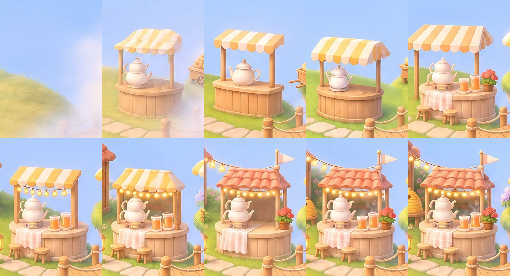
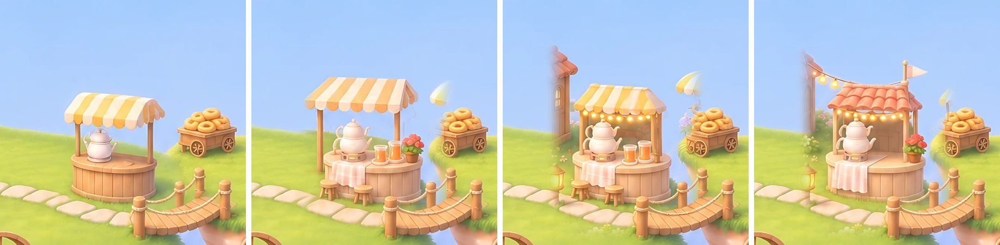
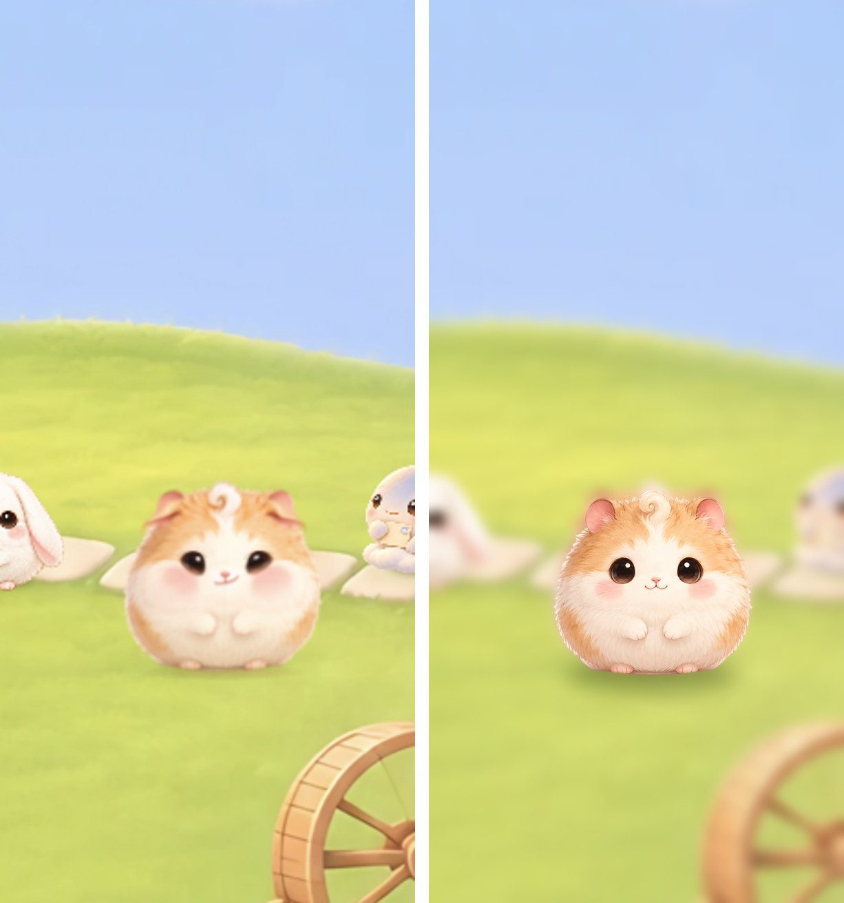

# Feel and world v1: Pofu after the first phone session

Fable pass 1 (triage and architecture), 2026-11-14. Base: `origin/main`
at 7f4e99c0, the build the founder is reinstalling. Inputs:
`docs/research/feel-motion-facts-2026-11-14.md`,
`docs/research/world-presentation-facts-2026-11-14.md` (PR #459), ten
player-path frames at 1206 x 2622 judged in 1:1 crops, the ten Home day
plates opened from the bundle, `pofu-art`'s queue, and the heat builder's
work in progress (`fix/heat-still-redraws`, uncommitted when read).

Nothing here changes the app. Every large decision below has an on-screen
proof that comes before engineering (section 3). The four images in this
document are rough mocks I made by script to test claims, not approved
references.

## 0. Three findings that change the questions

**1. The station upgrade art already exists. It is in the wrong key.**
The founder's first point was read as "plates have no station layer, so
stations cannot show a level". That is true of the code and false of the
paintings. The ten Home day plates are registered (one polygon and box
per station across all stages, `plate-home.json`), and they already hold
about five distinct paintings of the tea stall:

_Island level 1 (no stall) to 10, left to right, top row then bottom.
Bare stall; then stools, tea glasses, a cloth and flowers; then string
lights; then a tiled roof and a flag._

The picture is chosen by island level, and island level is a function of
tended days and the sum of all station levels. So about one build in four
changes the picture, and when it does the whole island changes, not the
thing the player paid for. The fix is a re-keying of art we own, not a new
art programme. A crude diff-mask composite of the later stalls into the
level 4 plate, at Home's real scale:

_Same plate, four stall looks. The light is shared because all four were
painted in place. The residue at the edges (a shop wall, an umbrella, a
lantern) is my crude mask pulling in neighbours: the work is mattes._

**2. "Near" cannot be a zoom into the plate.** With Pofu half the screen
wide the camera is at 7.4 pt per unit and the plate gives 0.28 texture
pixels per device pixel. No upscaler closes a 3.6x gap, and plates at that
size would be 16 times today's pixels across 21 states. But the founder
said what near is for: the characters are the subject. A camera that close
to a small subject has a shallow depth of field. Treated as a macro shot,
the weakness becomes the look:

_Left: today's pixels enlarged. Right: ground out of focus, Pofu's own
522 px art sharp, a contact shadow. The right frame reads as intended and
also as empty: "the details around them" need a few sharp props, which is
a small Codex pilot (section 3, proof 2)._

**3. The heat fix and the motion wish pull against each other, and the
answer is where motion runs, not how often.** Point 5 asks for a cool
phone and point 6 for more moving sky, cloud and light. If every moving
thing is a SwiftUI `Canvas` or `TimelineView` redrawn by the app, these
trade one for one: the builder's rule makes the island cooler by making it
stiller. Slow motion of a painted layer (drift, bob, glide, hop) needs no
redraw at all: it is a transform on a cached texture and the render server
can run it with no app work per frame. The power budget in section 2.4 is
built on that split.

One more finding, as the answer to "where did the motion systems go":
**the move to painted plates dropped six systems that were built for the
sprite island and are still in the code, switched off on the plate path:**
per-level station art, resident life (walks, work beats, step hops, PR
#277), critters, cloud shadows, code water (falls and fountain), and the
build moment's art swap. Nobody decided to remove them. Each `plate !=
nil` branch simply did not carry them over.

## 1. Triage of the seven points

| # | What he felt | What it really is | Kind | Cluster |
|---|---|---|---|---|
| 1a | A station's name levels up, the object does not | Station looks exist in the plates, keyed to island level (finding 1) | Decision, proof 1 | World |
| 1b | Upgrade screen, effects, sheet motion weak | The build moment has nothing to reveal, so it plays sparkles and a bloom over an unchanged picture; at 1:1 the bloom reads as fog blobs (below). The sheet's motion is the system's and stays. Fix after 1a gives it a subject | Follows 1a | World |
| 1c | Code-drawn sunflower looks bad | `Bloom` in `HomeObjectViews.swift:562`: eight capsules on a stem, beside a painting. Painted blooms exist (`garden-bloom*.png`) | Quick win | Feel |
| 2a | Near and far blend instead of one camera | The rail is one camera; the plate, backdrop and sky around it are separate views cross-faded by zoom, and the Map sky has its own camera that never zooms | Decision, proof 3 | World |
| 2b | Free zoom and pan up to the characters | No held zoom, no vertical pan, range ends at Home. And finding 2 | Decision, proof 2 | World |
| 2c | Backdrop and clouds drift across islands | Five different sky rules: static backdrop at levels 1 to 9, sky set at 10, Çağlayan's own set, Home's set re-scaled at Koke and the harbor, the Map's own pose | Same decision as 2a | World |
| 2d | Small island clouds vanish zooming out | Cut by design on the Map: the mid-cloud tile carries residue of Home's island, so it is masked below a row | Art fix inside 2a | World |
| 3 | Minigames fit but feel empty; flow needs its own assets | Flow is a wireframe (no painted piece ships). Both games have a flat gradient where the world should be, no ambient life, thin sound. Mechanics are not the complaint | Mostly known work | Minigames and UI |
| 4 | Hold a control for a bar that jumps anywhere | Half built: `PlaceControl` is a long-press menu of his islands. What is missing is the glass: no `GlassEffectContainer` or glass morphing exists anywhere | Small build, judged on device | Minigames and UI |
| 5 | Constant 120 fps, phone warms on a still painting | Sky `Canvas` and Pofu redrew forever at 30 Hz; some timelines at display rate. In hand | Quick win, in flight | Feel |
| 6 | More music, sound, motion, effects | No music ships; four proof tracks exist unused. Two cues have no call site. Ambient motion is dropped systems (above) | Decisions (music), quick wins (sound), architecture (motion) | Feel |
| 7 | How water should move; residents should hop; where systems went | Water is baked into the painting everywhere. Hops exist in `ResidentLife` and are not read on the plate | Decision, proof 4; quick win (hops) | Feel |

_`path-d04-build-burst` at 1:1. The stall is the same stall. The plate
holds up at this zoom (0.79 texture px per device px), which sets the
"sharp plate" limit used below._

**Quick wins, no decision needed** (run now, in parallel):

- **Heat** (in flight). Verdict in 2.4.
- **Sunflower:** draw the skip pots with the painted bloom. First ask the
  founder which sunflower he meant with one crop; three exist in code.
- **Hops:** on the plate path read `ResidentLife`'s hop for at most one
  resident at a time, every 6 to 14 s, seeded. Hops, not walks: a hop
  needs no new art, no walkable path and no occluder work, and it is what
  he asked for. Walk cycles stay parked.
- **Sound:** wire `pofu-hop` (to Pofu's and the residents' hops, quiet)
  and `gulp` (to collect). Both files ship and never play.
- **Çağlayan's falls:** the sky set's `fall` detail (streak tile and
  mist) already moves Home's two falls. Çağlayan's set has none. Add it as
  part of proof 4, so the founder compares it with a shader.
- **Flow board:** asset-system-v1 wave 0 (painted bed, rocks, grass, pool:
  all exist) and `batch-90-flow-stone-pilot`, already queued.

## 2. The architecture

### 2.1 Camera: three distances, one function

**Decision.** Far is the Map. Mid is one stop, the whole island fitted.
Near is not a stop: it is a free range from mid up to Pofu at half the
screen width, with held zoom and pan on both axes, bounded by the
island's box.

- Today's Island stop (0.9 widths) and Home stop (1.15 widths) are two
  stops for one distance. They merge into mid. The founder called today's
  fit the ideal; proof 2 shows him the fit once more to confirm which.
- Release inside the near range stays where the fingers left it. Release
  just above mid snaps to mid; below mid goes to the Map as today.
- A double tap on a character flies near to that character, and near
  follows it when it hops. This generalises today's resident focus.
- **Every painted layer takes its place from the one camera through a
  depth number.** A layer with depth k is scaled by `scale^k` and panned
  by `k` times the camera's pan. The island is k = 1, the sky gradient
  k = 0, clouds and far isles between. The same function draws the sky at
  the Map, in a flight, at Home, Koke and the harbor. This removes the
  Map's separate sky pose, the per-stop sky placements and the zoom
  cross-fade between two skies, which is what reads as "blending".
- The island picture still swaps resolution by scale (plate, then the
  half-size cut). That swap is invisible only if both are the same
  picture; a scout checks it (section 4.4).
- Clouds that belong to an island get a depth near 1 and stay with it at
  every distance, shrinking with it. No layer is cut by camera distance.
  The mid-cloud tile's island residue is cleaned in the file.
- One sky set per light for the Home cluster at every island level.
  Levels 1 to 9 stop using a static backdrop. Çağlayan keeps its own sky;
  the change between the two skies happens by world position during a
  flight, so it reads as travel.

**Set aside.** (a) Keep the stops and retune the fades: cheap, but two
cameras remain and the complaint returns with the next island. (b) Move
the world to a SpriteKit or Metal scene: one camera for free, but it
rewrites PofuWorld, loses live text and accessibility on the island, and
is weeks. Revisit only if the near prototype cannot hold its frame rate.

### 2.2 Layers and resolution

**Decision.** An island is six layers, back to front:

| Layer | Source | Changes with |
|---|---|---|
| Sky stack | one set per light per region | hour, weather |
| Island base | the painted plate | island level, light |
| Station looks | cut from the plates by script; painted in place by Codex where the plates lack one | that station's level, light |
| Life | character and critter sprites | time |
| Near dressing | a few sharp props around the characters, loaded only at near | camera distance |
| Effects | code | moments |

- **Station looks** are ADR-0022's hybrid (option e), which was accepted
  and never built for Home. The new fact is that most of the paintings
  exist. A station's level picks its look; the island level picks the
  ground, the decor and which stations exist.
- The open risk is direction. Compositing a richer look onto an earlier
  plate is clean (the larger object covers the smaller). A humbler look
  on a later plate leaves a hole where the richer one was painted. Proof
  1 tests both. If the hole cannot be filled by script, Codex erases the
  stations from each plate once (20 edit jobs, day and night).
- **Resolution, by camera scale:**

  | Range | pt per unit | Plate | Sharp subject |
  |---|---|---|---|
  | Far (Map) | 0.76 | half-size cut | the island |
  | Mid | 1.1 to 1.4 | 1.5 to 1.9 texture px per device px | everything |
  | Close | up to 2.7 | down to 0.75: holds (see the build frame) | everything |
  | Near | 2.7 to 7.4 | 0.75 down to 0.28: out of focus on purpose | characters and near dressing |

- The existing depth-blur shader (`pofuDepthBlur`) ramps in between 2.7
  and 7.4. Characters need about 0.9 art px per device px at near: Pofu's
  522 px art passes; the residents' sizes are a scout fact.
- The build moment keeps its timing and gains its subject: the new look
  appears through its diff mask as a ring from the station's foot, with
  `level-up`, then the residents hop. ADR-0022 specified this reveal; the
  island's own "Ada büyüdü" should use it too instead of a plain fade.

**Set aside.** (a) Larger plates or tiled plates for near: 16 times the
pixels, Codex cannot paint at that size, and an offline x2 upscale only
reaches 0.56. The x2 upscale stays as a fallback for the close range. (b)
One full plate per combination of station levels: 5^8 paintings. (c) The
sprite stations that exist (`world-<station>-<1..5>`): ADR-0022 showed a
sprite pasted on a plate reads as foreign. (d) Today's badge.

### 2.3 Motion: one technique per kind of movement

| What moves | Technique | Not this |
|---|---|---|
| Clouds, far isles, whale, sea, visitors' bob | Transform animation on a cached layer, run by the render server | A `Canvas` redrawn 15 to 30 times a second |
| Residents | Hops and squash as transforms; Pofu keeps his deform shader | Walk cycles (art missing for Simit and the goat) |
| Water in pools and streams | A masked region shader: flow distortion and glints inside the water's polygon | GIFs, video, painted frames |
| Falls | The existing `fall` tile and mist, or the region shader: proof 4 picks | Baked and still, as today |
| Lamps, windows | Flicker on the `lamps` already in the plate JSON | Display-rate glow pulse |
| Cloud shadows, sun shafts | Bring `CloudShadows` back on the plate as a drifting multiply layer | Off, as today |
| Trees, sunflowers, flags | Sway inside a per-object mask (ADR-0022); none is authored yet | Whole-layer wobble |
| Build, grow, collect, arrival | Particles and bloom at 60 Hz for a few seconds | Ambient use |

- **Why not GIFs or video for water.** 21 Home states and 12 Çağlayan
  states would each need their own loop; a loop cannot follow the hour,
  the weather or Reduce Motion; generated frames do not register at the
  pixel (the flow-tile lesson, twice); and the memory is large.
- **Where I differ from the side channel:** it suggested Codex-painted
  flow masks. A mask is data, and an image model cannot paint a vector
  field. Water is a flat, distinct colour in these plates, so the mask
  comes from the plate by script, and the direction is a polyline per
  water body in the plate JSON. There are about six water bodies in all.
- The region shaders become one pass per island reading one packed mask
  (water, sway, emissive), not one effect per object.

### 2.4 Power budget

**The heat fix.** Its approach is right: one rule every continuous
timeline must pass through, a rate per kind of motion (15, 20, 30, 60),
ambient off under Reduce Motion and Low Power, and a test that fails on a
bare `TimelineView(.animation`. Merge it. Three things to know:

1. It is a brake, not the design. The sky still redraws at 15 Hz and
   Pofu at 20 Hz for as long as Home is open. That is cooler, not cool.
2. It deletes `CADisableMinimumFrameDurationOnPhone`, so nothing can
   exceed 60 Hz. That is correct today and should come back with the
   direct tier below, with `FramePolicy` the only thing allowed to ask.
3. Nothing has been measured on a device. The ranking of causes in the
   facts file is a reading of code.

**The budget later motion work lives within**, as four tiers:

| Tier | When | Allowed | Rate |
|---|---|---|---|
| Still | Reduce Motion, Low Power, thermal state above nominal, three minutes without a touch | Nothing redraws. The island eases to rest and wakes on touch | 0 |
| Ambient | Home, an island, a minigame at rest | Transforms on cached layers anywhere. Redraw or shader work only on small regions (Pofu, water, lamps): at most 5 % of the screen's pixels in total | up to 30 |
| Moment | Build, grow, collect, arrival | Full-screen effects, for at most 5 s | 60 |
| Direct | A finger is down, or a camera spring it started is moving | Transforms only; region shaders pause | up to 120 |

**The target, relative so it survives any phone:** ten minutes on a still
Home must stay at thermal state nominal and draw no more than 15 % above
the same phone showing one photo in Photos at the same brightness;
ambient no more than 35 % above. These two numbers are my proposal and
are calibrated on the first measurement (proof 5).

On "constant 120 fps": I read it as the smoothness of his own gestures,
and I give 120 Hz only while he is touching the world. A still painting
at 120 Hz is the heat he felt. He can overrule this (section 5).

**Set aside.** A fixed cap of 30 Hz everywhere (cool, and pinch feels
worse than every system app); leaving ambient as app redraws at lower
rates (the trade in finding 3 stays).

## 3. On-screen proofs before engineering

All stills are 1206 x 2622 and all clips are that size at 30 Hz, sent to
the founder's Photos. Full screen on his iPhone 17 they are pixel-true,
so he judges on the real screen with no build. I look at each at 1:1
before he does.

| # | Proves | What is made | By | Cost | He chooses between |
|---|---|---|---|---|---|
| 1 | Station looks | Clean mattes for the tea stall and the garden, both directions, day and night; nine stills (three looks at far, mid, near) | Sonnet, script. Codex only if the downward hole fails: 2 erase jobs | 1 day, 0 to 2 jobs | A: a station shows its own level. B: as today, with a better moment |
| 2 | Near | Stills of Pofu and of Mochi at near: enlarged pixels with a cap at 2.7; macro; macro with dressing. Plus mid at 0.9 and at 1.15 widths | Sonnet, script. Codex pilot: 3 jobs of sharp props (grass tufts and daisies; pebbles; a tea glass on a stool) | 1 day, 3 jobs | The near look, how near, and which mid |
| 3 | One camera | Two 6 s clips of a pull-out from Home to the Map: today's (captured) and the depth function rendered offline from the same layers | Sonnet, script | 1 day | Whether the second reads as one camera. If not, I rework before any Swift |
| 4 | Water | Three 6 s clips of Çağlayan's pool and falls: still, `fall` tiles, region shader emulated offline | Sonnet, script | 1 day | The water he wants |
| 5 | Power | A Rehearsal power log (thermal state and battery drop per ten minutes by tier) and a switch between the `Canvas` sky and one cloud layer as a render-server transform | Opus (first of its kind) | 2 days | Nothing: he leaves the phone ten minutes in each mode; the numbers decide |
| 6 | Music | The four proof tracks (`design/sound/proof/island-*.m4a`) on his phone | Lead | 0 | Which mood, and section 5's question |
| 7 | Glass place bar | Hold the place control: a glass bar morphs out, his islands in his order | Opus, behind a flag | 1 day | Whether it feels like the Liquid Glass he likes |

Proofs 1 to 4 need no Swift and can all run at once. Total: about 7
agent-days and 3 to 5 Codex jobs.

## 4. The plan and the guide

### 4.1 Who does what

| Who | Does | Never |
|---|---|---|
| **Fable** | This pass; the look of every proof before the founder sees it; pass 2 (below); the UI pass | Scripts, builds, fact gathering |
| **Opus** | First-of-kind building: the camera depth function, near, the station-look runtime and reveal, the region-shader pass, render-server ambient, the glass bar; the `spec` that splits pass 2 into PRs | Recipes |
| **Sonnet** | Recipes: proof scripts, mattes and the cut tool, water polygons in JSON, wiring cues and hops, the flow board's painted bed | A first of its kind |
| **Haiku** | The facts in 4.4 | Opinions |
| **Codex** | Painting: near dressing, station looks the plates lack, erase edits if needed, the flow stone | Masks, data, anything that must join at the pixel |

### 4.2 Order

1. **Now, in parallel, no decision needed:** the heat PR; the quick wins
   of section 1 (Sonnet, about 2 days in all); the scouts of 4.4 (Haiku,
   half a day); proofs 1 to 4 (Sonnet, three in flight); proof 5 (Opus).
2. **Codex**, after its return queue: `batch-90-flow-stone-pilot` first
   (his point 3), then one world pilot of 3 to 5 jobs (near dressing; the
   erase edits only if proof 1 asks), then the other asset-system pilots.
3. **The founder looks** at proofs 1 to 4 and 6 in one sitting.
4. **Fable pass 2, the deep world pass,** once he has chosen. It decides
   what this pass cannot before the proofs: the layer schema in the plate
   JSON; the station-look matrix and the Codex volume manifest; the rail
   maths for mid and near and the depth of each sky layer; the reveal;
   and the PR split with the `spec` agent.
5. **Build**, three PRs in flight, world and feel side by side because
   they touch different files (`Camera/`, `Plate/` against `Sky/`,
   `Moments/`, `PofuSound`).
6. **The UI pass** runs beside all of it: `fable-2026-11-14-ui-grammar.md`
   as written, minus its glass-against-painted question (decided), plus
   points 3 and 4 (minigame HUDs, the glass bar). I do not fold it in
   here: it shares no file and no decision with the world. It must
   record one correction: asset-system-v1 says "glass is not a Pofu
   material" and asks for clay discs; the founder's decision overturns
   that.

### 4.3 Cost (estimates, to be replaced by the pass 2 spec)

| Work | Agent-days | Codex jobs |
|---|---|---|
| Quick wins and scouts | 2.5 | 0 |
| Proofs 1 to 7 | 7 | 3 to 5 |
| Camera and one sky | 5 (Opus) | 1 (clean the mid tile) |
| Station looks: cut tool, runtime, reveal | 6 (Sonnet 2, Opus 4) | 0 to 50: stations the plates lack, about 30; erase edits, about 20 |
| Near: range, pan, depth of field, dressing | 4 (Opus 3, Sonnet 1) | about 15 |
| Motion: render-server ambient, region shaders, water data, shadows | 7 (Opus 5, Sonnet 2) | 0 |
| Sound and music wiring | 2 (Sonnet) | 0 |
| **Total** | **about 33** | **about 20 to 70** |

At three in flight that is about two and a half weeks of building after
his choices. Codex at its logged pace (20 jobs a day) is one to four
days: as before, review and the last mile are the limit, not painting.
None of this except the heat fix and the quick wins belongs in Monday's
trial build.

### 4.4 Facts I did not gather (for a scout)

1. Per station, per stage, day and night: how many distinct looks the
   plates hold, and whether any station moves more than 4 px between
   stages. This sizes the Codex volume.
2. The pixel sizes of the residents' and visitors' art, for near.
3. Whether the level 1 to 9 plates are matted to alpha so they can sit
   over the level 10 sky set, and whether the half-size island cut is a
   downsample of the same plate state.
4. What the pan range gives on the plate (`plateBox` is the sprite
   island's; the facts file did not trace it).
5. What energy numbers we can get: MetricKit from TestFlight, a Mac with
   Instruments, or only the in-app log of proof 5.
6. Which sunflower the founder saw, and the exact scene where the
   backdrop drifted "across islands and scenarios" (ask him with crops).
7. How the four music proofs were made and whether `tools/sound` can
   render a full-length loop.

## 5. What only the founder can decide

1. **After proof 1:** should a station wear its own level? It means an
   island at level 8 can show a humble tea stall beside a grand garden,
   because that is what he built.
2. **After proof 2:** the near look (macro or a cap at the sharp limit),
   how near, and which fit is mid.
3. **120 Hz:** I give it only under his finger. If he wants it always, it
   costs heat, and he should say so knowing that.
4. **Music:** which of the four moods, and where music comes from: our
   own rendered tracks, a licensed library, or a commissioned composer.
   This is money and taste, and it is the one feel item with no proof I
   can make for him.
5. **Codex's order:** the flow stone and one world pilot ahead of the
   other asset-system pilots.

## Corrections for the lead

- `IslandFraming.swift:8-16` header says the Island stop is x1.5 and Pofu
  96 pt; the code is 1.0 and about 30 pt (from the facts file).
- `docs/now.md` is dated 2026-11-12 and says Codex is stopped; the queue
  resumed on 2026-11-14.
- asset-system-v1 section 1 and 2.3 ("glass is not a Pofu material", "not
  a glass circle") are overturned by the glass decision.
- ADR-0022's stage reveal (a ring through a diff mask, 2.4 s) is not what
  ships: `IslandGrowMoment` cross-fades two whole paintings in 0.8 s.
