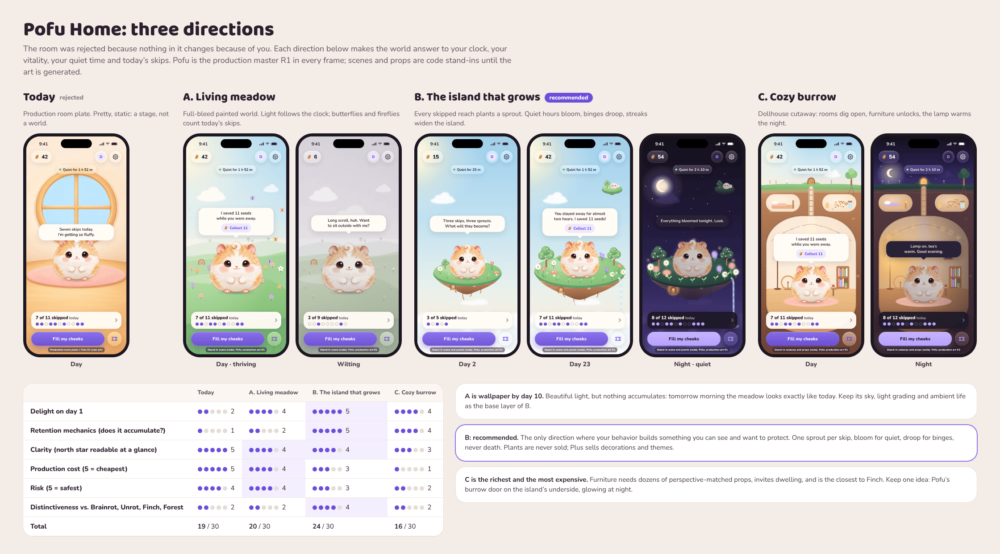

# Home Directions: Three Explorations and a Recommendation

_Status: proposal, for founder review. Last updated: 2026-11-01._
_Mockups: [`design/prototypes/home-directions/`](../../design/prototypes/home-directions/README.md).
Read with the [design language](design-language.md), the [art bible](art-bible.md)
and the [information architecture](../product/ux/information-architecture.md)._



## 1. Why the room failed

The founder rejected "Pofu's room" (a flat wall, a round window, a rug) as
boring. The wall is not the real problem. **A Home is boring when nothing in
it changes because of you.** The room could change its light with the
clock, but nothing in it reacted to today's skips, nothing accumulated over
weeks, and nothing was worth protecting. It was a stage, not a world.

So the brief for every direction below: the world must visibly answer to

| Signal | Source (`PofuCore`) | Cadence |
|---|---|---|
| Time of day | Local clock, fixed bands (design language §12) | Continuous |
| Vitality | Mood bands (thriving, content, tired, wilting) | On open, 2 s `gentle` |
| Today's skips | Attempt log: resisted vs. opened | Per Hop! outcome |
| Quiet time | `QuietTimeAccrual` (ADR-0014): seeds waiting in the cheeks | Every 30 s on Home |
| Streaks and totals | Day history | Daily |

…and at least one of them must **accumulate** into something you can see and
would not want to lose.

All three mockups share the same chrome, so they can be compared on the
world alone: the seed pill, the friend and settings buttons, the quiet-time
chip, Pofu's speech bubble (which carries **Collect** when quiet seeds are
waiting), the Today dock with the beads, and the action row ("Fill my
cheeks" plus the passes ticket). Pofu is the production master R1 in every
frame, breathing; scenes and props are code stand-ins, labeled as such.

## 2. The three directions

### A. Living meadow (full-bleed world)

| | |
|---|---|
| Screens | `a-meadow.html`: day, golden hour, night, wilting |
| Layout | Full-screen painted meadow: sky (code), far hills, a mid ridge with Pofu's burrow door, a knoll where Pofu sits, foreground grass in the corners. Chrome floats as glass in the calm sky band (top) and grass band (bottom). |
| Day → night | Sky gradient and grade follow the clock; sun upper left becomes a moon; the burrow door glows. |
| Thriving → wilting | Saturation, an overcast veil, flowers open or closed, grass posture. Never stormy. |
| Today | One butterfly per skip by day, one firefly per skip at night. |
| Quiet time | Cheek bulge on Pofu; Collect in the bubble. |
| Motion | Drifting clouds and petals, swaying grass and flowers, butterflies, twinkling stars, fireflies. |
| Monetization | Weak. Seasonal skies and outfits only; nothing to place. |
| Neighbors | Walk across the meadow for a day. |
| Production | 4 opaque plates already in the prompt library (day, sunset, night, wilting), ideally split into 3 parallax layers each (far, mid, foreground strip): 6–12 images plus 2 small particle sprites. Lowest cost. |
| Risks | **Nothing accumulates.** Tomorrow morning looks exactly like today; beautiful on day 1, wallpaper by day 10. Generic: a hamster in a meadow is what everyone draws. |

### B. The island that grows (recommended)

| | |
|---|---|
| Screens | `b-island.html`: day 2 (new island), day 23 (thriving), night after a quiet evening, after a binge |
| Layout | Pofu sits on a small floating island in a soft sky, above a sea of clouds. The island's grass top is the garden; its earthen underside shows roots, pebbles, and Pofu's little burrow door (where he sleeps). The cloud sea is the calm band the chrome floats over. |
| **Skips** | **Every skipped reach plants a sprout** at Pofu's feet, sparkling for the rest of the day. Overnight each sprout grows into a species you did not choose (daisy, tulip, lavender, mushroom, blossom tree, berry bush; rarer ones later). The beads in the Today dock and the sprouts in the world are the same number. |
| **Quiet time** | Flowers open during quiet stretches; at night, whatever bloomed during quiet hours glows softly. Seeds still wait in Pofu's cheeks for Collect. |
| **Binges** | The garden droops and closes, the sky goes overcast. **Nothing dies and nothing is removed.** One quiet hour opens it again. |
| **Streaks** | The island widens in steps (day 1 small patch → week 1 → week 3 → month 3) and milestones add landmarks: a waterfall (14 days), a pond, a lantern. |
| Day → night | Code sky and grade; moon, stars, fireflies; the burrow door glows. |
| Motion | The island bobs on a 7 s cycle (Pofu bobs with it), clouds drift, the waterfall runs, plants sway, today's sprouts twinkle, roots sway under the island. |
| Monetization (Plus) | Decorations placed on fixed slots (lantern, bench, windchime, mailbox, swing), island themes (cherry season, autumn, snow), rare seed varieties as *cosmetic species* for sprouts you already earned. **Plants are never sold and growth is never sold**: only behavior grows the island. |
| Neighbors | Neighbor characters arrive on their own islets that drift into view and dock for a day (the bunny on the day-23 screen). Later: a real friend's island visible on the horizon, only if they choose to share it (private by construction). |
| Production | About 25 assets for launch (section 5): 3 island stages, 4 plant sheets, the new-sprout sticker, a cloud set, a cloud-sea strip, a neighbor islet, a milestone-prop sheet. Every asset is an isolated object on transparency, the easiest kind of image to get consistently from GPT Image. |
| Risks | Overlaps Forest's "grow a tree per focus session" (see §3); more art than A; plants could compete with Pofu (one star per screen); a new user's island is small and sparse on day 1. Mitigations in §4. |

### C. Cozy burrow, upgraded

| | |
|---|---|
| Screens | `c-burrow.html`: day, night, wilting |
| Layout | A dollhouse cross-section of the hill: the live sky and meadow on top; a ladder shaft from the round door down to the main chamber; a bedroom nook (left) and a pantry (right); Pofu on the rug in the main chamber with a lamp, bookshelf, tea table, the idle wheel, string lights, and a framed "D" photo for the friend. |
| Day → night | Sunbeam down the shaft by day; moonbeam, lamp pool and string lights at night. |
| Thriving → wilting | Light and warmth of the room; overcast sky strip. Furniture stays. |
| Today | No natural home for skips in the picture (the weakest point). |
| Balance | The seed pile in the pantry is the balance, made visible. |
| Streaks | New chambers dug open at milestones; furniture unlocks. |
| Monetization | The strongest: Animal-Crossing-like furniture and wallpaper. |
| Neighbors | Visit and sit on a cushion. |
| Production | The most expensive: a cutaway base plate, 2–3 chamber expansions, 20+ furniture props that must all match one interior perspective and light, plus lamp-lit variants or careful grading. |
| Risks | Clutter (the bubble and chrome cover most of the chamber); decorating invites the dwelling the IA calls a failure mode; closest to Finch's decorated home and to the rejected room. |

## 3. Comparison

Scores 1–5, higher is better (for cost and risk, higher means cheaper and
safer). These are judgment calls, stated so they can be argued with.

| | Today (room) | A. Meadow | **B. Island** | C. Burrow |
|---|---|---|---|---|
| Delight on day 1 | 2 | 4 | **5** | 4 |
| Retention mechanics (does it accumulate?) | 1 | 2 | **5** | 4 |
| Clarity (north star at a glance) | 5 | 4 | 4 | 3 |
| Production cost | 5 | 4 | 3 | 1 |
| Risk | 4 | 4 | 3 | 2 |
| Distinctiveness | 2 | 2 | **4** | 2 |
| **Total / 30** | 19 | 20 | **24** | 16 |

**Distinctiveness, against the apps people will compare us with:**

- **Brainrot, Unrot:** a creature whose health mirrors screen time, on a
  mostly flat background with stats. All three directions beat them on
  world; only B gives the creature a place that is *made of* your choices.
- **Finch:** a pet bird with a decorated house, earned by self-care tasks.
  C is very close to Finch. B shares the "cozy" register but not the
  decorating-a-room loop.
- **Forest:** grows a tree per completed focus session, and kills it if you
  leave. B's honest overlap. The differences are real: B grows from *not
  doing* something (the skip in Hop!), not from a timer; nothing ever dies;
  the garden belongs to a character you care for rather than being a score;
  and growth surprises (a sprout becomes a species you did not choose). The
  island silhouette, the cloud sea, and Pofu's door under the island are
  visual signatures Forest does not have. We must still avoid Forest's
  vocabulary in copy: no "trees planted", no forest counts.

## 4. Recommendation: B, the island that grows

1. **It is the only direction where your behavior builds something you can
   see and want to protect.** Every skip is a sprout; weeks of skips are a
   garden. That is the retention loop the room never had, and it lives
   entirely outside the app: you grow the island by putting the phone down.
2. **It turns the north star into the world.** The beads in the Today dock
   and the sprouts at Pofu's feet are the same count; the abstract number
   gets a living twin without losing the honest raw count.
3. **It is kind by construction.** Binges droop the garden; they never kill
   it, and the next quiet hour revives it. That is "care over control"
   expressed in a picture, and the exact opposite of Forest's dead tree.
4. **It monetizes delight, not relief, with a hard integrity rule.** Plus
   sells decorations, island themes, and cosmetic species; growth itself is
   never for sale, so the garden stays a truthful record.
5. **It is producible.** Every asset is an isolated object on transparency
   (islands, plants, props), which GPT Image does far more consistently than
   full scenes; sky, light, night and wilting are code grades, as the design
   language already requires.

**Steal from the others.** From A: the code sky, the time-of-day grading and
the ambient life (clouds, petals, fireflies) become B's sky layer. From C:
Pofu's burrow door under the island, glowing at night, is where he sleeps at
bedtime; a later "peek inside" moment can reuse the cutaway idea without
making it Home.

**Mitigations for B's risks.**

| Risk | Mitigation |
|---|---|
| Day 1 is sparse | Onboarding plants a starter garden (one sapling, two flowers) and the first practice Hop! skip plants the first sprout on screen. The first week widens the island visibly (stage S → M at day 7). |
| Plants compete with Pofu | Plants stay below 35 % of Pofu's height except back-row trees; garden saturation is 85 % of Pofu's; only today's sprouts animate beyond a gentle sway. |
| Dwelling | No tending verbs: you cannot water, move, or harvest. Long-press on a plant shows when it was planted ("Skipped TikTok, Tuesday 23:40"), and that is all. |
| Garden overflow after months | The island widens in stages; past the largest stage, older plants merge into "mature" clusters (a meadow patch, an orchard). Tracked as an open question. |
| Forest comparison | Copy and visuals avoid tree counts and death; growth comes from skips, not timers. |

**What changes in the specs (proposals, not yet decided).** These are
expensive to reverse and should go to an ADR once the founder agrees:

1. **ADR (new), "Home is Pofu's island":** supersedes the room in
   design-language §5 and §12 and the IA's "Pofu's room" naming (IA root
   becomes "Pofu's island", TR "Pofu'nun adası"; still one root, sheets,
   no tab bar; ADR-0012 decision 1 is unchanged).
2. **Skips plant, but never earn currency:** consistent with ADR-0012
   (skips never earn seeds). Sprouts are a record, not money.
3. **`PofuCore` gains a garden ledger** (one entry per resisted attempt:
   date, species seed, growth stage), derived from the attempt log so it
   cannot drift, and the island stage derived from streak and totals.
   Keep `economy.md` in sync.
4. **Art pipeline gains a `world__` kind** (transparent, large, fit by
   width) for islands and the cloud strip; `process_assets.py` has no kind
   for big transparent world pieces today.

## 5. Art request list for B (copy-paste ready)

Run these in a new ChatGPT chat named **"Pofu · Island"**, template
**İllüstrasyon** or plain chat. Attach exactly what each prompt says.
Generate each 3–4 times and keep the single best (art bible §10). Save
winners into `design/art/inbox/` with the file name given. Pofu himself is
never in these images: the app composes R1 onto the island.

References:

- **R1**: `design/art/masters/pofu-hamster-base-v1/pofu-hamster-base.png`
  (style only).
- **P-day / P-night**: `design/reference/palette-card-world-*.png`.
- **I1**: the approved island B1, once it exists (for every later prompt).

The style block below is the art bible's style anchor v1 with the fur
sentence removed, exactly as the prompt library does for props (prompts 9
and 10); keep it verbatim.

### B1. The island, large stage (master)

- **Attach:** R1 (style only), P-day. **Ask for:** transparent PNG, 1536 × 1024.
- **Save as:** `world__island-l.png`

```text
A single small floating island for a mobile app home screen, in the same
art style as the attached character (use the character for style only: do
NOT include it or any character or animal in this image). Use only the
colors of the attached palette card.

The island, seen from the front and slightly above, so the top surface
reads as a wide soft oval:
- The top is a flat, smooth, empty lawn of short soft grass in fresh spring
  greens, with a slightly darker rounded grass lip along the front edge and
  a few short grass tufts hanging over it. The lawn is completely empty: no
  plants, no flowers, no trees, no objects (they are added separately).
- Underneath, a rounded earth body tapering to a soft blunt point, about
  two thirds as deep as the island is wide. Warm honey and caramel earth
  with gentle horizontal strata, a few small cream pebbles, and a few thin
  roots dangling from the bottom.
- On the lower left of the earth body, a tiny round wooden door with a
  small round window and a little ledge: the entrance to a hamster's home
  inside the island.
- The island fills about 90% of the image width, centered, with a generous
  transparent margin.
- Light from the upper left, a faint warm rim light on the right.

STYLE: soft painterly 2D digital illustration with the polish of a premium
storybook and a top-tier mobile app mascot. Gentle airbrushed shading, no
outlines, no hard edges. Warm diffused key light from the upper left, a
faint warm rim light along the right edge, soft ambient shadow only where
forms touch. Clean, calm, uncluttered. No text, no letters, no numbers, no
logos, no watermark, no border, no frame, no sticker outline.

AVOID: any characters or animals, plants or flowers on the lawn, water,
waterfalls, buildings other than the tiny door, a sky, clouds, a
background, a ground shadow, harsh contrast, busy texture, film grain,
vignette, text, signatures.

Output: one image, transparent background PNG, 1536 x 1024.
```

### B2–B3. The island, medium and small stages (edits of B1)

- **Attach:** the approved B1. **Ask for:** transparent PNG, 1536 × 1024.
- **Save as:** `world__island-m.png`, `world__island-s.png`

```text
Edit the attached floating island. Keep exactly the same art style, colors,
light, door, strata, pebbles and roots. Make the whole island smaller:
[B2: about 75% of the current width] [B3: about 55% of the current width],
centered on the same canvas with the same bottom-center position, the lawn
still completely empty. Same proportions of lawn to earth. No characters,
no plants, no text.

Output: one image, transparent background PNG, 1536 x 1024.
```

### B4–B6. Plant growth sheets (4 × 2)

Each sheet holds two species; each row is one species in four states,
left to right: **sprout, bud, bloom, drooping**. The app swaps states and
adds glow, sway and grading in code.

- **Attach:** R1 (style only), the approved B1 (for scale and color), P-day.
- **Ask for:** transparent PNG, 1536 × 1024. **Save as:** `sheet__plants-<pair>.png`
  (`daisy-tulip`, `lavender-mushroom`, `tree-bush`).

```text
A sprite sheet of small plants for the attached floating island, in the
same art style as the attached character (style only: no characters, no
animals). Use the colors of the attached palette card.

Layout: a grid of 4 columns and 2 rows, one plant per cell, every plant
centered in its cell and standing on the same invisible ground line at
about 85% of the cell height, identical scale across the row, clear empty
gutters between cells, nothing overlapping a cell border.
Row 1: [ROW 1 SPECIES]. Row 2: [ROW 2 SPECIES].
Columns, left to right, for each species: 1) a tiny sprout with two round
leaves; 2) a young plant with a closed bud; 3) the plant in full bloom,
plump and cheerful; 4) the same full plant gently drooping and closed, a
little paler, as if sleepy, never dead, never brown or dry.
Plants are small, round and soft, like toys in a storybook, with simple
readable shapes that work at 40 points on a phone.

STYLE: soft painterly 2D digital illustration with the polish of a premium
storybook and a top-tier mobile app mascot. Gentle airbrushed shading, no
outlines, no hard edges. Warm diffused key light from the upper left, a
faint warm rim light along the right edge, soft ambient shadow only where
forms touch. Clean, calm, uncluttered. No text, no letters, no numbers, no
logos, no watermark, no border, no frame, no sticker outline.

AVOID: pots, soil mounds, ground shadows, a floor, a background, insects,
faces on plants, sparkles, dead or dry plants, text, signatures.

Output: one image, transparent background PNG, 1536 x 1024.
```

| Sheet | Row 1 species | Row 2 species |
|---|---|---|
| B4 `sheet__plants-daisy-tulip.png` | a white daisy with a honey-yellow center | a blush-pink tulip |
| B5 `sheet__plants-lavender-mushroom.png` | a small clump of soft lilac lavender | a round peach-coral mushroom with cream spots (sprout = tiny button, bud = small closed cap, bloom = big open cap, drooping = tilted, paler) |
| B6 `sheet__plants-tree-bush.png` | a little round blossom tree with blush blossoms (sprout = seedling, bud = sapling, bloom = full round tree in blossom, drooping = blossoms closed, leaves slightly lowered) | a round berry bush with peach berries |

Slice with `process_assets.py slice` as for the other sheets.

### B7. Today's sprout (the most-seen asset)

- **Attach:** R1 (style only), the approved B4. **Ask for:** transparent PNG, 1024 × 1024.
- **Save as:** `sprite__sprout-new.png`

```text
A single tiny fresh sprout with two plump round bright-green leaves on a
short stem, the same art style as the attached sheet, centered with an 8%
margin, three-quarter view. It is the reward for a good choice, so it
should feel fresh, hopeful and very cute while staying simple: two leaves,
one stem, nothing else.

STYLE: soft painterly 2D digital illustration with the polish of a premium
storybook and a top-tier mobile app mascot. Gentle airbrushed shading, no
outlines, no hard edges. Warm diffused key light from the upper left, a
faint warm rim light along the right edge, soft ambient shadow only where
forms touch. Clean, calm, uncluttered. No text, no letters, no numbers, no
logos, no watermark, no border, no frame, no sticker outline.

AVOID: soil, a pot, a ground shadow, sparkles, a face, text.

Output: one image, transparent background PNG, 1024 x 1024.
```

### B8. Cloud set (3 × 2 sheet)

- **Attach:** R1 (style only), P-day. **Ask for:** transparent PNG, 1536 × 1024.
- **Save as:** `sheet__clouds.png`

```text
A sprite sheet of six soft fluffy clouds for a pastel sky, in the same art
style as the attached character (style only). Grid of 3 columns and 2
rows, one cloud per cell, centered, clear empty gutters. Row 1: three
small-to-medium rounded cumulus clouds of different shapes. Row 2: three
long, low, flat wisps. Creamy white with very soft lilac-blue shading
underneath, light from the upper left.

STYLE: soft painterly 2D digital illustration with the polish of a premium
storybook. Gentle airbrushed shading, no outlines, no hard edges. Clean,
calm, uncluttered. No text, no letters, no numbers, no logos, no watermark,
no border, no frame, no sticker outline.

AVOID: a sky or background, birds, sun, rain, gray storm clouds, text.

Output: one image, transparent background PNG, 1536 x 1024.
```

### B9. Cloud sea strip (tileable)

- **Attach:** the approved B8. **Ask for:** transparent PNG, 1536 × 1024.
- **Save as:** `world__cloud-sea.png`

```text
A wide band of soft, dense, fluffy clouds seen from slightly above, like a
calm sea of clouds, in the same style and colors as the attached clouds.
The band fills the bottom 45% of the image edge to edge; the top edge of
the band is a gentle row of rounded billows; the area above it is fully
transparent. The left and right edges must tile seamlessly when placed side
by side. Calm and low in detail: interface buttons will float over it.

AVOID: islands, mountains, sun, birds, sky color, text.

Output: one image, transparent background PNG, 1536 x 1024.
```

### B10. Neighbor islet

- **Attach:** the approved B3 (small island). **Ask for:** transparent PNG, 1024 × 1024.
- **Save as:** `world__islet-neighbor.png`

```text
Edit the attached floating island into a much smaller, simpler islet for a
visiting neighbor: about one third of the size, the lawn still empty, no
door, a shorter earth body with two tiny roots. Same style, colors and
light. Centered with a generous transparent margin. No characters, no
plants, no text.

Output: one image, transparent background PNG, 1024 x 1024.
```

### B11. Milestone and decoration props (3 × 2 sheet)

- **Attach:** R1 (style only), the approved B1 (scale). **Ask for:** transparent PNG, 1536 × 1024.
- **Save as:** `sheet__island-props.png`

```text
A sprite sheet of six small props for the attached floating island, in the
same art style as the attached character (style only: no characters, no
animals). Grid of 3 columns and 2 rows, one prop per cell, centered,
standing on the same invisible ground line at 85% of the cell height,
identical scale, clear empty gutters. Row 1: a tiny round pond with a lily
pad; a small mossy rock spring where a waterfall starts; a little paper
lantern on a wooden post (unlit). Row 2: a small wooden bench; a round
wooden mailbox on a post; a wooden swing hanging from a short arch.
Rounded, friendly, warm honey wood, soft pastel accents.

STYLE: soft painterly 2D digital illustration with the polish of a premium
storybook and a top-tier mobile app mascot. Gentle airbrushed shading, no
outlines, no hard edges. Warm diffused key light from the upper left, a
faint warm rim light along the right edge, soft ambient shadow only where
forms touch. Clean, calm, uncluttered. No text, no letters, no numbers, no
logos, no watermark, no border, no frame, no sticker outline.

AVOID: a ground shadow, a floor, a background, glowing lights (the app
adds glow), letters on the mailbox, text.

Output: one image, transparent background PNG, 1536 x 1024.
```

### What is deliberately not requested

- **Sky, sun, moon, stars, fireflies, glow, the waterfall stream**: code
  (gradients, particles, an animated stroke).
- **Night and wilting versions** of any asset: code grades, plus the
  drooping column of each plant sheet.
- **Pofu on the island**: R1 composed in code; sleeping at bedtime uses the
  existing "eyes closed" edit (prompt library 3a).

**Total for launch:** 3 island stages, 3 plant sheets (24 frames), 1
sprout, 1 cloud sheet, 1 cloud strip, 1 islet, 1 prop sheet: **11
generations to approve, 40+ usable frames.** Seasonal themes and more
species are later and are the Plus catalog.

## 6. UI language in this direction (proposed amendments)

The design language holds; these refine it for a full-bleed sky world.
Each is a proposal for the founder.

1. **Two-band chrome.** Over a scene, chrome lives only in the **top band**
   (seed pill, friend, settings, the quiet chip) and the **bottom band**
   (Today dock, action row). The middle belongs to the world and Pofu's
   bubble. Scenes must keep these bands calm (sky above, cloud sea below).
2. **Glass for chrome, solid for content, unchanged.** The seed pill,
   circles, quiet chip and the action row are Liquid Glass; the Today dock
   and the bubble are solid `surface.card`. In the mockups the dock at 96 %
   opacity read better than pure glass and better than an opaque card that
   cuts the world in half. Proposal: allow `surface.card` at 96 % over
   scenes, never lower.
3. **The bubble carries the one contextual action.** Collect moved from a
   floating chip into the bubble (text plus a tinted capsule button). One
   floating chip fewer, and it follows the IA: the bubble is Home's
   contextual entry point. Rule: at most one button in the bubble.
4. **A compact Today dock.** "7 of 11 skipped today" on one line, beads
   underneath, chevron to the recap: 68 pt instead of the 120 pt card,
   which gives the world back about 50 pt.
5. **Night inverts the chrome, not the world.** On night scenes the primary
   button becomes the light lilac (`violet-300` fill, `night-950` label),
   glass turns smoky, the dock turns `night-900`. Tested in the mockups:
   the violet-600 primary disappears into a plum sky; the lilac one glows.
6. **The quiet chip** is a new component: a glass capsule, 34 pt, a
   breathing green dot (the only animated chrome, at the breathing rate),
   `subheadline` semibold text ("Quiet for 1 h 52 m"). It hides when quiet
   time is not accruing.
7. **Typography unchanged.** SF Pro Rounded for everything on Home; the
   seed count and the dock use `numeral` and `headline`. Baloo 2 stays out
   of Home; Home has no title.
8. **Motion budget for Home.** At most three ambient systems at once
   (island bob, clouds, one particle kind) plus Pofu's breathing; Reduce
   Motion stops all of them except twinkle-free static light.

## 7. Self-critique and open questions

- **The stand-ins flatter B less than real art will, and A more.** Code
  plants look like clip art next to the painterly hamster; the real verdict
  needs B1, B4 and B7 generated and placed. Do that before writing the ADR.
- **Cheek bulge is too subtle.** The mask-and-scale bulge on R1 is barely
  visible at phone size; the real effect needs the shader from the
  companion motion system or the "cheeks full" face edit.
- **The bubble is large when it carries Collect** (three lines). Shorter
  copy ("I saved 11 seeds!") should be tested.
- **Garden overflow at month 6** and what "mature clusters" look like are
  unresolved.
- **Turkish and Dynamic Type** were not rendered for these mockups; the
  dock line ("11'de 7 vazgeçiş bugün") must be checked at AX sizes.
- **Species reveal timing:** overnight, or on the next app open with a
  small moment? Overnight is calmer; on-open is more delightful. Proposal:
  on next open, rationed to one reveal animation per day.
