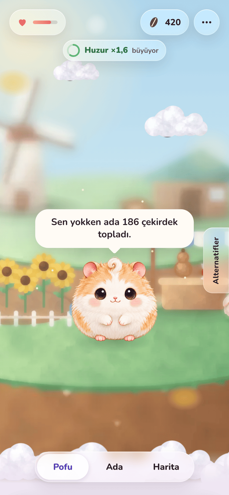
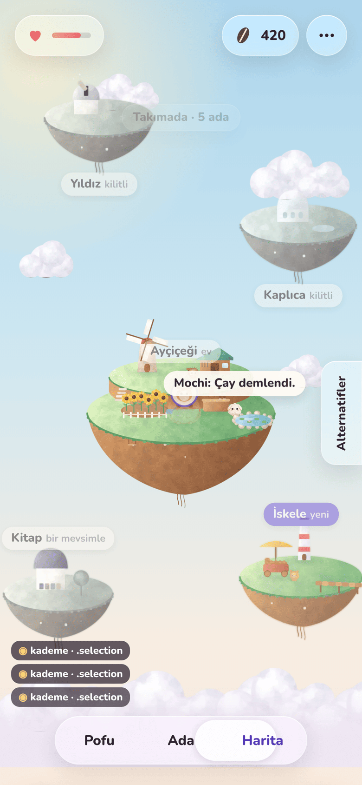
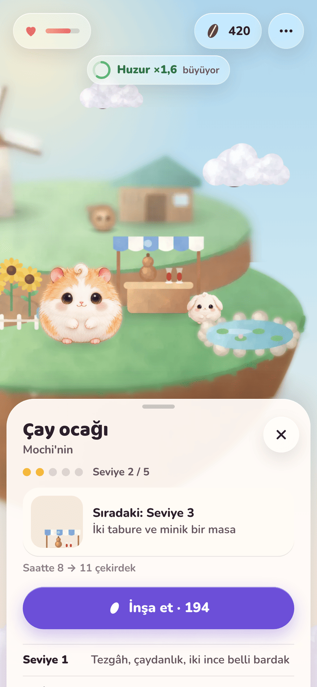
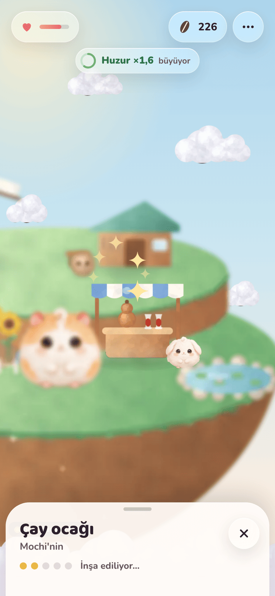

# Interaction Spec: Camera, Focus, Sheets, Reactions, Depth

_Status: proposal, for founder review. Last updated: 2026-11-01._
_Interactive prototype (touch, Turkish copy):
[`design/prototypes/interactions/`](../../design/prototypes/interactions/index.html).
Builds on [ADR-0018](../adr/0018-visual-system-v1.md) (on the open
`docs/visual-system-v1` branch), [design review 01](review-01.md), the
[design language](design-language.md) (§8 materials, §10 motion, §11 haptics),
the [companion motion system](companion-motion.md), and
[game design v2](../product/game-design.md)._

This document owns **how the world moves and feels**: the camera, focus,
sheets and menus, reactions, depth of field, feedback, and timing. _What_
lives where (the boundary between the daily app and the game) is decided
elsewhere; every rule below works whatever sits in the chrome.

| Home | Pinch, mid-gesture | Station focus | Build moment |
|---|---|---|---|
|  |  |  |  |

## 0. Decisions in one table

| Question | Recommendation | Section |
|---|---|---|
| Zoom model | **Detented camera**: pinch scrubs a rail through the three framings 1:1 and snaps on release, like a sheet snaps to its detents. Not a free camera, not tap-only. | [1](#1-zoom-and-camera) |
| Opening a station | Tap → camera focuses (0.7 s) while a sheet rises to a **42 % detent** → everything but the station and its resident goes soft. The world behind the sheet stays live: tap another station to retarget, tap anything else to close. | [2](#2-opening-a-station) |
| Menus | A rule, not a style: action lists use the system `Menu`; a glanceable readout morphs out of its glass button; anything that scrolls, takes input, or carries art is a sheet. **One sheet at a time.** | [3](#3-menus-and-sheets) |
| World behind a sheet | **Depth of field, not dimming or scaling.** Medium detent: unfocused objects soft, no dim. Large: everything deep, 14 % dim. | [3.5](#35-the-world-behind-a-sheet) |
| Reactions | The first touch gets the biggest response, repeats get smaller. No counters, combos, or random rewards. The world gets **quieter** the longer you watch. | [4](#4-reactions) |
| Blur | **Pre-blurred plate variants** from the asset pipeline (soft and deep), cross-faded by opacity. Live blur only inside native glass. About +36 % texture memory, near-zero per-frame cost. | [5](#5-blur-and-depth) |
| Haptics | Haptics confirm a recognized gesture, never a touch-down, a passive event, or a dismissal. Rationed within a poke run. | [6](#6-feedback-layers) |
| Timing | Eleven new spring tokens on top of the six in the design language; every animation retargetable; nothing blocks input for more than 150 ms. | [7](#7-timing-springs-and-interruptibility) |

**One discrepancy to resolve first.** ADR-0018 says Pofu is "about 20 % of
the screen width" at Home. Review 01's measured spec for the chosen
option B, which the founder saw and approved, says **154 pt, 38 %**
(camera scale 2.40). At 20 % (scale 1.26) Home and the Island framing are
only ×1.2 apart, so the continuous camera has almost nothing to travel
and the Home framing stops being a distinct place. This spec and the
prototype use **38 %**; the prototype's _Alternatifler → Ana ekranda Pofu
ölçeği_ toggle shows 20 % so the founder can feel the difference. See
[Proposed changes](#proposed-changes-to-existing-docs).

## 0.1 Five rules of feel

1. **Direct, then decisive.** While a finger is down it owns what it
   touches, 1:1. When it lifts, the world decides, with momentum: the
   camera and sheets land on designed positions, never in between.
2. **Everything is a spring that can be caught.** No animation queues, no
   completion handler gates input. A new target retargets from the current
   position and velocity (UIKit and SwiftUI springs already behave this
   way; our custom ones must too).
3. **The world is soft, the frame is crisp.** World motion may overshoot;
   chrome never does (design language §10). The one exception is glass
   morphing, which has a small liquid overshoot because the system's does.
4. **Rationed, never punishing.** A response gets smaller when repeated;
   it never disappears and never scolds. Anti-addiction rules A9 and A10
   apply to motion: idle life does not perform for an audience.
5. **Depth is a diorama, not a lens.** Objects sit on discrete planes
   that are sharp, soft, or deep. Blur is baked, not computed per frame.

---

## 1. Zoom and camera

### 1.1 The alternatives

| | A. Tap-only | B. Free camera | **C. Detented camera** (recommended) |
|---|---|---|---|
| Idea | Framings change only by taps and buttons (a pinch past a threshold may fire the same move as a shortcut) | Maps-style: continuous pinch 0.38×–3×, one-finger pan, momentum, bounds | One rail through Map → Island → Home. A pinch moves along it 1:1; on release, velocity projection picks a framing and a spring lands there |
| Pros | Simplest; each framing is fully designed; matches game design §3 literally ("no free camera, no panning"); shortest visits | Most freedom; feels "game-like"; scales to big worlds | The gesture everyone tries on a world works, but every resting state is a designed framing. Chrome always has its calm bands. Spatial memory from the continuous move. Teaches itself: the segmented control's indicator slides with your fingers |
| Cons | The first pinch on a painted world does nothing, which reads as dead or broken; the world feels like a picture of a world | Resting states are arbitrary: chrome overlaps art, text sits on busy areas, art is exposed past its resolution (vignettes are 1024² and show at ≤ 93 pt only by design); invites lingering (A10); every tap target needs a minimum-size rule at every zoom | Two snapping behaviors to tune (zoom, sheet); a pinch near a midpoint can land on the "wrong" framing (solved by velocity projection and a detent tick); needs one custom gesture layer |
| Build cost | Smallest | Large: bounds, momentum, minimum hit sizes, per-zoom chrome | Medium: one rail function, one release rule |
| Risk | Medium (feels inert) | High (diffuse product) | Low |

**Recommendation: C.** The camera behaves like a sheet: three detents,
direct tracking, velocity projection, rubber bands at the ends. iOS users
already know this physics from every sheet and scroll view, so it needs no
teaching, and the product keeps the "three framings of one world" promise
of ADR-0018. Game design §3's "no free camera, no panning" stays true in
spirit: the camera never rests anywhere undesigned.

### 1.2 The rail

The camera has four values: scale `s` (points per world unit), the world
point `(x, y)` it looks at, and the screen row `ay` where that point
sits. A rail parameter `z` runs 0 (Map) → 1 (Island) → 2 (Home).

| Framing | z | Scale (×W/402) | Looks at | Placed at (pt, ×H/874) | Pofu |
|---|---|---|---|---|---|
| Map | 0 | 0.46 | (0, −80) | y 430 | 30 pt vector pin |
| Island | 1 | 1.06 | (0, 40) | y 470 | 68 pt |
| Home | 2 | 2.40 | Pofu's feet (6, 20) | y 600 | 154 pt (38 %) |
| Station focus | off-rail | min(1.70, band × 0.62 / 112) | station centre (x, y − 46) | midway between the top band (safe area + 100) and the sheet's top edge, + 8 | soft |

Between framings, `ln s` is interpolated linearly in `z`, and `(x, y, ay)`
linearly with the same fraction. Interpolating log-scale is what makes a
zoom feel even: equal finger travel gives equal perceived zoom.

### 1.3 Pinch

| Parameter | Value | Why |
|---|---|---|
| Scale tracking | 1:1 with the fingers (`s = s₀ · magnification`) | Direct manipulation |
| Position tracking | On the rail, plus a **35 % pull** toward keeping the pinched point under the fingers | 0 % feels like zooming a fixed picture; 100 % lets the user drag the world off its framing. 35 % feels anchored and still lands cleanly |
| Rubber band | Past Home up to ×1.25, past Map down to ×0.8, with `f(x) = (1 − 1/(0.55·x/D + 1))·D` in log-scale | Apple's scroll-view band. Says "this is the end" without a wall |
| Release projection | `z` at `ln s + v · 0.18 s` (v in ln-units per second, clamped ±6) | A quick flick goes one framing further than the fingers did; a slow release lands where it is |
| Landing | Nearest detent to the projection; may skip a framing on a fast flick | Matches sheet physics |
| Landing spring | `cameraRelease` spring(0.55, 0.08), seeded with the release velocity along the rail | No velocity discontinuity at lift-off; a hint of settle |
| From a band | spring(0.55, 0), velocity zeroed | Never bounce back past a hard end |
| Detent tick | `.selection` when the projected landing framing changes during the pinch | The user feels where the release will go before letting go, like Apple Watch's crown detents |
| Fingers rest before lifting | Projection velocity is zero if the last move is older than 60 ms | No surprise flings |

### 1.4 Taps that move the camera

| Gesture | Where | Result |
|---|---|---|
| Single tap | Home, anywhere on the world except Pofu | **Island** (game design §3: "tap the island"). At Home the world is soft and is one target, not five; blurred stations are not individually tappable |
| Single tap | Island, on a station | Station focus (section 2) |
| Single tap | Island, on lawn or sky | Ripple and a glance from Pofu (section 4); no camera move |
| Single tap | Map, on an island | Fly to that island's Island framing (locked ones: a hop and their info) |
| Double tap | Empty world at Island or Map | One framing **in** (Map → Island → Home). At Home a double tap is just a tap (→ Island), which reads as the expected Photos-style toggle |
| Double tap | Pofu, a station, a resident | Two single taps. Objects never wait for a double tap, so a poke has no 300 ms delay |
| Two-finger tap | Anywhere on the world | One framing **out** (the Maps convention) |
| Segmented control or framing buttons | Chrome | Fly to that framing: spring(0.9, 0.1) between Home and Island, spring(1.1, 0.08) to or from the Map |

### 1.5 Panning

- **No free pan.** A one-finger drag on empty world at any framing is a
  **peek**: the camera offset follows with a rubber band (asymptote 30 pt)
  and parallax (sky ×0.3, world ×1, foreground cloud sea ×1.25), then
  springs back with `peek` spring(0.45, 0.15) on release. It says "this is
  a diorama, and it has depth" instead of ignoring the finger.
- **Map panning arrives only when needed.** When the archipelago's bounds
  exceed 1.3× the map window (not before the sixth island), the Map
  framing gains bounded pan with UIScrollView's `.normal` deceleration and
  a 60 pt rubber band. Until then it would be a gesture with no purpose.
- **No zoom momentum** beyond the release projection. A world that keeps
  sliding after you let go reads as slippery, not calm.

### 1.6 The chrome is a readout of the camera

Chrome reacts to the continuous `z`, not to the destination, so it is
right mid-gesture:

| Element | Fully visible | Fades out by |
|---|---|---|
| Segmented control's selection pill | Slides continuously with `z`; the label snaps to the projected framing | — |
| Calm chip | z ≥ 0.85 | z ≤ 0.55 |
| Island name chip | z = 1 ± 0.0 | z = 1 ± 0.33 |
| Map title and island labels | z ≤ 0.2 | z ≥ 0.45 |
| Pofu's painted body vs. the vector pin | painted at z ≥ 0.55; pin at z ≤ 0.25 | cross-fade between |
| Pofu's bubble | z > 0.8 and no sheet | — |

Chrome is never interactive while a pinch is down; its hit testing returns
as the camera lands.

### 1.7 Edge cases

| Case | Behavior |
|---|---|
| Pinch during a camera flight | The flight stops where it is; the pinch starts from there (springs are caught, not finished) |
| Tap during a camera flight | Acts on what is under the finger now; a station tap retargets the flight to its focus |
| Pinch while a station sheet is at medium | The sheet dismisses and the pinch takes the camera from the focus framing (folded into the rail by an offset that springs to zero on release) |
| Pinch starting on Pofu | Pofu's touch-down squash is released without a poke and without a haptic (section 4.2) |
| Pinch during the build moment | Allowed. The model is already committed; the celebration keeps playing in the world |
| Pinch during Pofu's animation | Allowed; Pofu's motion is local and keeps playing |
| Cloud pass (new island) | The only time camera gestures are not accepted (≤ 2.3 s). Any tap skips to the end. At most once a day |
| App backgrounded mid-flight | On return, the camera is at its target (no replay) |
| Rotation | Portrait only |
| VoiceOver | `accessibilityZoomAction` steps one framing in or out; framings are also buttons |

### 1.8 Reduce Motion

- **Direct manipulation still tracks the fingers.** A user-driven 1:1
  pinch is not vestibular-triggering; Apple's own apps keep it.
- Automatic travel (taps, buttons, the release landing beyond 0.2 s)
  becomes a **200 ms cross-fade** between framings. The release landing
  from a pinch uses a 200 ms critically damped spring, no overshoot.
- Peek, parallax, and the cloud pass are off (the island simply appears
  on the map with a fade).

### 1.9 SwiftUI notes

- **Model-driven camera.** Keep `Camera { scale, center, anchorY, offset }`
  in a `@Observable` model, advanced by our own spring
  (`CompanionSpring` in `PofuCompanion` already integrates
  `spring(duration:bounce:)` with momentum). Gesture velocity hands off
  exactly; SwiftUI's `Animation` APIs take an initial velocity only as a
  normalized scalar (`.interpolatingSpring(duration:bounce:initialVelocity:)`),
  which is awkward for four coupled values.
- Render with **one** transform on the world container
  (`.scaleEffect(s, anchor: .topLeading).offset(t)` or a custom
  `GeometryEffect` returning one `ProjectionTransform`), driven from a
  `TimelineView(.animation(paused: !camera.isMoving))`. Never animate
  plates individually.
- `MagnifyGesture` gives `magnification`, `startLocation`, and `velocity`
  (iOS 17+). Combine it with a `DragGesture` via `.simultaneously(with:)`
  for the midpoint and the peek. Two-finger tap needs a UIKit recognizer:
  `UITapGestureRecognizer` with `numberOfTouchesRequired = 2` wrapped in
  `UIGestureRecognizerRepresentable` (iOS 18+).
- Double tap lives only on the background layer:
  `.onTapGesture(count: 2)` composed `.exclusively(before:)` a single
  `SpatialTapGesture` there. Pofu, residents, and stations sit above with
  their own `.onTapGesture`, which wins and fires immediately.
- Detent tick: `.sensoryFeedback(.selection, trigger: projectedFraming)`.
- Reduce Motion: `@Environment(\.accessibilityReduceMotion)`; cross-fade
  by switching the framing with `.transition(.opacity)` on a snapshot
  layer, or animate opacity of a framing-keyed `id`.
- VoiceOver: `.accessibilityZoomAction { action in camera.step(action.direction) }`.

---

## 2. Opening a station

### 2.1 The alternatives

| | **A. Focus + sheet** (recommended) | B. Zoom into a station page | C. In-world card |
|---|---|---|---|
| Idea | The camera moves to the station; a sheet with detents rises; the station stays visible and sharp above it | `matchedTransitionSource` + `.navigationTransition(.zoom)` from the station into a full-screen page | A small card pops up next to the station, inside the world |
| Pros | The station you are improving stays in view, so the build happens _in_ the world; one sheet pattern for everything; native Liquid Glass sheet | Most dramatic; a lot of room | Most "game"; no sheet at all |
| Cons | Needs depth of field to keep the station the one star | The world disappears exactly when you change it; the build moment has to happen on a separate page | Breaks at large Dynamic Type and with long Turkish strings; covers neighbors; custom accessibility |
| Verdict | **Yes** | For a future full-screen "island book" perhaps | No |

### 2.2 The sequence

| t (ms) | What happens | Spring or duration | Haptic |
|---|---|---|---|
| 0 (touch-down) | Station scales to 0.965 around its footprint | `press` spring(0.16, 0) | — |
| tap recognized (≤ 300 ms, ≤ 9 pt movement) | Station squishes back to 1 | `squish` spring(0.28, 0.45) | `.selection` |
| +0 | Camera flies to the station's focus framing | `focus` spring(0.7, 0.12) | — |
| +0 | Sheet rises to the medium detent (42 % of the height) | system sheet; custom `sheet` spring(0.42, 0) in the prototype | — |
| +0 → +350 | Depth of field: station and its resident stay sharp; everything else goes **soft** | `dof` spring(0.35, 0) on the blur level | — |
| +0 → +200 | Bottom chrome fades out under the sheet; the island name chip hides | opacity tied to sheet position | — |

From **Home**, a station is not directly tappable (section 1.4); the user
goes to the Island first. From the **Island**, the move is one continuous
camera flight. Pofu stays sharp when his own garden is focused.

### 2.3 The station sheet

- **Detents:** `compact` 132 pt (used only during the build moment),
  `medium` 42 % of the height, `large`. Swipe up for the level history;
  swipe down to dismiss.
- **The world behind a medium sheet is live**
  (`presentationBackgroundInteraction(.enabled(upThrough: medium))`):
  - tap **another station**: the camera retargets to it (spring 0.7, 0.12)
    and the sheet's content cross-fades (out 110 ms, in 120 ms), without
    dismissing. This is the fastest way to tour stations, and it keeps
    the stack at one sheet;
  - tap **anything else**: the sheet dismisses. The tap is consumed (it
    does not also poke Pofu).
- **Content order:** name (Baloo 2, 24 pt) and resident; five level dots
  with "Seviye n / 5"; the next level as a card (painted thumbnail at
  64 pt, its one-line description); the rate change; one primary button
  "İnşa et · cost" with the seed glyph. When unaffordable, the button is
  disabled and reads "n çekirdek daha". No shake, no warning sound.

### 2.4 The build moment

The model commits on the tap (seeds spent, level up); everything after is
presentation that can be interrupted.

| t (ms) | Event | Motion | Haptic |
|---|---|---|---|
| 0 | Tap "İnşa et" | Button squish 0.97; sheet goes to **compact** (it gets out of the way instead of disappearing, so the user stays in context) | — |
| 0 | Camera pushes in slightly and re-centres for the compact sheet | spring(0.6, 0.1), scale 1.95 | — |
| 300 | Anticipation | station squashes to 1.06 × 0.88 over 120 ms, ease-in | — |
| 420 | **Swap** hidden at the deepest point: 120 ms cross-fade to the new level's art; six dust puffs | `pop` spring(0.55, 0.5) back to 1 | `.impact(weight: .medium)` |
| 450 | Sparkles: 7, staggered 30 ms, 0.8 s | ease-out | — |
| 600 | Level tag "Seviye 3!" pops above the station, lives 2.6 s | `pop` | — |
| 720 | Pofu hops (12 units) with the excited face 1.1 s | companion physics | — |
| 840 | The resident hops | `hop` | — |
| 1,020 | Settle | — | `.success` |
| 1,750 | Sheet returns to **medium** with the next level | sheet spring | — |

Level 5 uses the design language's three-transient celebration haptic
instead of `.success`. Celebrations never stack: a second build during the
first replaces the tag text and adds no second burst.

### 2.5 Closing

Swipe down, tap the world, or the close button (SF Symbol `xmark` in a
44 pt glass circle). The camera returns to **where the user came from**
(the framing, or in a free model the exact camera) with
`refocus` spring(0.6, 0.1); depth of field clears with `dof`. No haptic.

### 2.6 Interruption rules for stations

| During | Input | Result |
|---|---|---|
| Camera flight to a station | Tap a different station | Retarget camera and sheet content |
| Camera flight to a station | Swipe the sheet down | Dismiss; camera retargets home |
| Build moment | Tap the world or swipe down | Sheet closes; the celebration finishes in the world |
| Build moment | Tap "İnşa et" again | Not possible: the sheet is compact and shows "İnşa ediliyor…" (the one input that is refused, and it says so) |
| Build moment | Pinch | Allowed (section 1.7) |
| Sheet dragging | Release | Projection 0.2 s; nearest detent; dismiss below half the medium detent or faster than 1,100 pt/s downward |

### 2.7 Hit areas

Hit testing runs in world coordinates against simple shapes (the SwiftUI
equivalent is `contentShape`), never against image alpha.

| Target | Shape (world units) | Minimum on screen | Priority |
|---|---|---|---|
| Pofu | 60 × 62 box around the body, feet at the bottom | 44 pt (padded) | 3 |
| Resident | 26 × 26 box at the feet | 44 pt (padded) | 2 |
| Station | 92 × 94 box over the footprint (x ± 46, y − 84 to + 10) | 64 pt at the Island framing (it is 95 pt there) | 1 |
| Home's soft world | ellipse 190 × 150 | — | 0 |
| Island on the map | ellipse ≥ 105 × 90 | 88 pt | 1 |

Overlaps resolve by priority, then by the nearest footprint centre. The
prototype's "Dokunma alanları" toggle draws them.

### 2.8 SwiftUI notes

- `.sheet(item: $focusedStation)` with
  `.presentationDetents([.height(132), .fraction(0.42), .large], selection: $detent)`,
  `.presentationBackgroundInteraction(.enabled(upThrough: .fraction(0.42)))`,
  `.presentationContentInteraction(.resizes)`. iOS 26 renders partial
  detents as inset Liquid Glass and `.large` edge to edge.
- Changing `focusedStation` while presented swaps content in place; wrap
  the content in `.id(station)` with `.transition(.opacity)`.
- Build: `KeyframeAnimator(initialValue: Squash(), trigger: buildCount)`
  with `scaleX`, `scaleY` tracks (`CubicKeyframe` for the anticipation,
  `SpringKeyframe(…, spring: .init(duration: 0.55, bounce: 0.5))` for the
  pop). The art swap is an `Image` keyed by level with
  `.transition(.opacity)` inside `withAnimation(.linear(duration: 0.12))`
  at the keyframe's deepest point.
- Haptics: `.sensoryFeedback(.selection, trigger: focusedStation)`,
  `.sensoryFeedback(.impact(weight: .medium), trigger: swapCount)`,
  `.sensoryFeedback(.success, trigger: buildSettled)`.
- Press state on a world object: a `DragGesture(minimumDistance: 0)` in
  `.simultaneousGesture` sets `pressed`; the tap is `.onTapGesture`.

---

## 3. Menus and sheets

### 3.1 The alternatives

| | A. System `Menu` everywhere | B. Glass morph panels everywhere | C. Sheets everywhere |
|---|---|---|---|
| Pros | Native, accessible, already morphs from its button in iOS 26 | Most "Liquid Glass"; the button becomes the panel | One pattern; scrolls; any content |
| Cons | Text rows only, no readouts, no art | Custom; text on glass needs care; no scroll | Heavy for a two-line readout; covers the world |

**Recommendation: a rule, not one style.**

| Content | Surface | Example |
|---|---|---|
| A list of actions (≤ 6), no art | System `Menu` | "⋯" → sounds, personality, settings |
| A glanceable readout (≤ 4 lines, no scroll, no input) | **Glass morph panel** from its button | The seed pill → today's seeds, calm; the wellbeing pill → mood |
| Anything that scrolls, takes input, or carries art | **Sheet** with detents, zooming out of its button where it has one | Station, island, Today, friends, settings |

### 3.2 The glass morph

- The button's glass **is** the panel: at t = 0 the panel's clip equals
  the button's shape exactly, then grows to the panel (260 pt wide,
  anchored to the button's trailing edge, under it). The button itself
  hides while the panel is open.
- Open: spring(0.38, 0.18), a small liquid overshoot. Content fades in
  160 ms after a 90 ms delay, rising 4 pt. Close: content out 70 ms, then
  spring(0.30, 0) back into the button.
- **Text on glass uses the thick variant** (≥ 0.95 opacity of the panel
  colour): clear glass behind paragraphs is illegible over painted art
  (the prototype's first version proved it). Design language §8's "glass
  carrying text paragraphs is forbidden" holds; a readout of two short
  lines on thick glass is the limit.
- A tap outside closes it and is consumed. Haptic: `.selection` on open
  only.

### 3.3 One sheet at a time

| Open | Then the user opens | Result |
|---|---|---|
| Station sheet | Another station (tap behind) | Content swaps in place |
| Station sheet | A chrome button | Not reachable: the bottom chrome is under the sheet and the top chrome yields to a large sheet. At medium, a top button closes the sheet, then opens its own surface |
| Morph panel | Anything | The panel closes first (the tap that closes it does nothing else) |
| Any sheet | A pinch on the world | The sheet dismisses; the pinch proceeds |
| A sheet | A second sheet from inside it | Never. Push inside the sheet (`NavigationStack`) instead |

### 3.4 Detents and swipe dismissal

System sheets already implement this; the numbers are for custom sheets
and for tuning expectations. Velocity projection 0.2 s; nearest of the
allowed detents; dismiss when projected below half the medium detent or
above 1,100 pt/s downward; rubber band above `large` with a 40 pt
asymptote; tapping the grabber toggles medium ↔ large.

### 3.5 The world behind a sheet

| | **Depth of field** (recommended) | Dim | Scale back |
|---|---|---|---|
| What | Focused object sharp, the rest soft; deeper at large | World darkens 22 % (36 % at large) | World scales to 94 % with rounded corners (iOS 13 cards) |
| Pros | Keeps the thing you are editing true and bright; says "this one" without words | Cheapest; familiar | Strong sense of a layer |
| Cons | Needs the blur variants (section 5) | Darkens the station you are about to improve; muddy over painted art | Shrinks the very thing you are editing; fights glass sheets, which are designed to float over a live world |

Numbers: at **medium**, unfocused objects at blur level 1 (soft), no dim;
at **large**, everything goes to level 2 (deep) and dims 14 %, both
interpolated by the sheet's position between the detents. For sheets
without a focus object (seeds, Today), everything is soft at medium.

### 3.6 SwiftUI notes

- Morph panels: put the button and the panel in one
  `GlassEffectContainer`; give both the same `glassEffectID(_:in:)` with a
  shared `@Namespace`; show one or the other with
  `withAnimation(.spring(duration: 0.38, bounce: 0.18))` and
  `.glassEffectTransition(.matchedGeometry)`. Use `.glassEffect(.regular)`
  on the panel; thick content background is a solid `surface.card` layer
  inside it at 95 %+ opacity, not a second glass.
- Sheets from buttons: `.matchedTransitionSource(id:in:)` on the button,
  `.navigationTransition(.zoom(sourceID:in:))` on the sheet's root view.
- Action lists: `Menu { … } label: { Image(systemName: "ellipsis") }` with
  `.buttonStyle(.glass)`.
- Chrome under a sheet: tie bottom-bar opacity to the sheet's height with
  `.onGeometryChange(for: CGFloat.self)` inside the sheet; iOS 26 also
  hides a bottom toolbar behind a sheet automatically.

---

## 4. Reactions

### 4.1 Rationing rules

| Rule | Number |
|---|---|
| A **run** is a series of touches on one thing less than 2.5 s apart | 2.5 s |
| The response rises for 3 touches, stays playful for 3 more, then calms | 1–3, 4–6, 7+ |
| Pofu's lines: at most one per run, each line at most once per visit | 1 |
| Resident lines: once per visit per resident, then they only hop | 1 |
| Haptic intensity in a run | 0.5 for touches 1–4, 0.3 for 5–8, none after 8 |
| Idle beats while the user only watches | 3 (at 20, 45, 80 s), then breathing and blinks only |
| No numbers, counters, combos, streaks, or random rewards for touching anything | — |

The inverse of a slot machine: the reward for repeating is _less_, and
the world gets quieter the longer you stare at it (A9, A10).

### 4.2 Poking Pofu

| Phase | Motion | Face | Haptic |
|---|---|---|---|
| Touch-down | Squash 1.05 × 0.91 around the feet, `press` spring(0.16, 0) | — | **none** (it may still become a pinch, a pet, or a pan) |
| Tap recognized | Rebound with `squish` spring(0.28, 0.45) | — | `.impact(flexibility: .soft, intensity: 0.5)` |
| Poke 1 | — | happy, 520 ms | |
| Poke 2 | Hop 8 units | happy, 650 ms | |
| Poke 3 | Hop 5 | proud, 800 ms; line once per visit: "Dıt. Orası benim burnum." | |
| Pokes 4–6 | Ticklish wiggle: shear impulse ±70 °/s, spring(0.3, 0.55) | happy | intensity 0.3 from poke 5 |
| Poke 7+ | Squash amplitude 45 % | smug half-lid, 1 s ("okay, okay") | none after 8 |

Pofu never waits for a double tap. A long press becomes petting (4.3).

### 4.3 Petting

**Alternatives:** (A) long press, then stroke (recommended): unambiguous,
coexists with the peek pan; (B) a drag across him without a long press:
conflicts with the peek and with scrolling sheets; (C) two-finger stroke:
undiscoverable.

| Phase | Trigger | Motion | Face | Haptic |
|---|---|---|---|---|
| Melt | Press held 350 ms, ≤ 9 pt movement | Squash to 1.04 × 0.93 over `melt` spring(0.6, 0) | happy closed eyes, held | Core Haptics "melt": continuous, intensity 0.5 → 0, sharpness 0.2, 0.6 s |
| Lean | Finger moves | Shear toward the finger, ±5°, feet planted, `lean` spring(0.25, 0) | | — |
| Stroke | Direction reversal after ≥ 22 pt of travel | Two fur wisps drift up from the finger, 700 ms | | `.impact(flexibility: .soft, intensity: 0.25)`, at most every 250 ms |
| Doze | 8 strokes | Breathing slows to 6 s | eyes closed, held | — |
| Release | Lift | Sigh: back to 1 with `sigh` spring(0.9, 0.1) | happy 1.2 s (or keeps dozing) | — |
| Wake | Next poke on him | Small hop (4) | normal | the poke's |

### 4.4 Residents, stations, lawn

| Touch | Response | Haptic |
|---|---|---|
| Resident (Island framing or focus) | Hop 7 units (`hop`); first time per visit a chip line, 2.2 s: "Mochi: Çay demlendi." · "Fındık: Tık tık. Bir şey tamir ediyorum." | soft impact 0.4 |
| Station touch-down | Press 0.965 | — |
| Station tap | Opens it (section 2) | `.selection` |
| Locked slot (dotted plot, blank sign) | The sign hops; a sheet with the opening condition | `.selection` |
| Island on the map, locked | Hop 5; its sheet with arrival progress | `.selection` |
| Lawn (Island framing) | A ring ripples out from the touch (0.3 → 1.3, 520 ms) with three leaf flecks; Pofu glances toward it | none (empty space is not a control) |
| Sky | Pofu glances; nothing else | none |
| Glance | Shear 3.2° toward the touch, `glance` spring(0.5, 0.2); back after 1.1 s with spring(0.7, 0.15); at most every 1.2 s | — |

### 4.5 Idle life

| Behavior | Rule |
|---|---|
| Breathing | Continuous (companion motion: 3.2–6.0 s by mood) |
| Blink | Every 3–6 s at random, 150 ms, only when no other face is showing |
| Idle beat 1 (20 s without input) | Yawn: stretch 1.06 × 0.97 for 0.5 s, eyes closed 1.1 s, settle with spring(0.9, 0.1) |
| Idle beat 2 (45 s) | A resident fidgets (Mochi hops in place) |
| Idle beat 3 (80 s) | A second yawn |
| After that | Only breathing and blinks until the next touch |
| Looking at the touch | The glance above; while petting, the lean replaces it |

### 4.6 Reacting to the user's real behavior on return

At most **one** arrival reaction per app open, chosen by priority, played
**250 ms after the first frame** (so Pofu is seen before he reacts), never
when the user returns within 60 s (continuity, not a performance), and
never with a haptic (it is passive).

| Priority | Condition since the last visit | Reaction (game design §12 lines) |
|---|---|---|
| 1 | Back after 3+ days | **Missed you:** bounce, happy face, open mouth. "Geldin! Komşular her şeyi idare etti." |
| 2 | A guarded session over 60 min | **Worried:** six small shear trembles (±40 °/s, 90 ms apart), worried face 2.6 s. "Bu uzun sürdü. İyi misin? Ben biraz sallantıdayım." |
| 3 | A skip (resisted reach) | **Proud:** hop 14, proud face 1.8 s. "Vazgeçtin! Başardık. Yani, çoğunu sen." |
| 4 | First open after a calm night | **Morning stretch:** stretch 1.07 then settle (0.9, 0.12), happy face. "Günaydın. Ada bütün gece huzurluydu." (new line, to be written natively in Turkish) |
| 5 | Fourth open within an hour (A9) | **Bored:** half-lid, looks away. "Burada yeni bir şey yok, söz. Biz bakmasak da ada gayet iyi." |
| — | Otherwise | A glance toward the user and a blink. No line |

The arrival reaction competes with the "while you were away" bubble: the
reaction plays first, the bubble follows it after 1.2 s.

### 4.7 SwiftUI notes

- Pofu's touch handling: `DragGesture(minimumDistance: 0)` in
  `.simultaneousGesture` for the press, `.onTapGesture` for the poke, and
  `LongPressGesture(minimumDuration: 0.35).sequenced(before: DragGesture(minimumDistance: 0))`
  for melt and strokes. Feed events into `CompanionMotion` (squish,
  impulse, lean target); the face kit swaps inside the squash (design
  language §10, principle 3).
- `.sensoryFeedback(.impact(flexibility: .soft, intensity: pokeIntensity), trigger: pokeCount)`;
  Core Haptics (`CHHapticEngine`, one continuous event with an intensity
  parameter curve) for the melt.
- Idle beats: a `Task` with `try await Task.sleep(for:)` restarted by
  every input; the poke ladder is plain state, not a `PhaseAnimator`
  (phases cannot be retargeted mid-way).
- Return reactions: decide in `PofuCore` from the event log
  (`ReturnReaction.choose(since:)`), play in the view on
  `.onAppear` / `scenePhase == .active` with a 250 ms delay.

---

## 5. Blur and depth

### 5.1 The depth model

Every world object (an island plate, a station vignette, a resident,
Pofu) has a **blur level** `b` from 0 to 2: 0 sharp, 1 soft, 2 deep.
Blur is in **world units**, so it scales with the camera like a real
lens's circle of confusion: soft σ = 1.4 units, deep σ = 4.0 units.

| Framing or state | Pofu | Focused station + resident | Other stations, residents, home island | Other islands |
|---|---|---|---|---|
| Home | 0 | — | 1 (3.3 pt) | hidden |
| Island | 0 | — | 0 | 1, 35 % opacity |
| Map | pin | — | 0 | 0 |
| Station focus, medium sheet | 1 (0 for the garden) | 0 | 1 (2.3 pt) | 1 |
| Large sheet | 2 | 2 | 2 | 2 |

Between Home and Island the home world's level follows the camera:
`b = clamp((z − 1.3) / 0.5)`, so the focus pull happens during the move
and is complete by 60 % of it (as review 01 specified). Level changes not
tied to the camera ease with `dof` spring(0.35, 0).

Home's soft blur is 3.3 pt here against review 01's 2.4 pt. 2.4 pt read
as "slightly out of focus" rather than "behind Pofu" in the prototype; σ
is one pipeline constant, so the final value is decided on the iPhone.

### 5.2 Three ways to render it

| | (a) Live `.blur(radius:)` | **(b) Pre-blurred variants** (recommended) | (c) Metal `layerEffect` |
|---|---|---|---|
| How | SwiftUI blurs each layer offscreen every frame (`visualEffect { $0.blur(…) }` is the same thing, geometry-aware) | The asset pipeline bakes a soft and a deep copy of every world image; the app cross-fades opacity | A `[[stitchable]]` shader samples a disc of taps per pixel; could do true tilt-shift by depth |
| Per-frame GPU (estimate, A18-class, 3×) | 1–3 ms per full-screen layer during moves; 4–8 ms for the island, five stations, residents. The 120 Hz budget is 8.3 ms | During a 0.35 s transition: one extra alpha-blended draw per object, ~0.2–0.5 ms; **at rest: zero** (fully transparent layers are removed) | 13-tap disc on a 3.2 Mpx layer: ~1–2 ms per layer, **always** (it runs every frame, even at rest) |
| Memory | An offscreen texture per blurred layer (~13 MB for a full-screen RGBA layer at 3×) | Soft stored at ½ resolution (¼ pixels), deep at ⅓ (⅑): **+36 % texture memory** per asset; in the prototype, +0.28 MB of WebP on 0.6 MB | An offscreen pass per layer, like (a) |
| Look | Exact, any radius | Two fixed levels; a brief soft double image mid-transition (hidden by motion); blur scales with zoom (physically right) | Best (variable blur) |
| Risk | Frame drops exactly during the moments that must feel best; thermal cost on long visits | Pipeline step (automatic, already written) | Metal toolchain in SwiftPM (companion motion §2b); per-frame cost |

**Recommendation: (b).** Depth of field becomes a cross-fade, which is
the cheapest thing a GPU can do, and it costs nothing when nothing moves.
Live blur stays where the system does it best: inside Liquid Glass. The
prototype's _Alternatifler → Alan derinliği → Canlı filtre_ switches to
(a) for a side-by-side on the iPhone (turn on the FPS counter).

Estimates are from typical Gaussian costs and fill rates, not measured;
I6 in the iteration plan must measure them with Instruments.

### 5.3 The pipeline step

`design/prototypes/interactions/tools/preblur.py` is the reference:

- blur in **premultiplied** colour (no dark fringes on transparent edges);
- pad by 3σ on every side (blur bleeds outside the alpha) and record the
  padding in a manifest, so the app grows the variant's frame by the
  same fraction;
- downscale soft ×½ and deep ×⅓ (a blurred image has no detail to lose);
- naming: `<asset>.b1.webp`, `<asset>.b2.webp` in the prototype;
  in the app, `<asset>__soft` and `<asset>__deep` image sets.

### 5.4 SwiftUI notes

```swift
struct DepthImage: View, Animatable {
    let name: String
    var level: Double            // 0 sharp … 2 deep
    var animatableData: Double { get { level } set { level = newValue } }
    var body: some View {
        let w = DepthWeights(level)  // sharp, soft, deep opacities
        ZStack {
            if w.deep > 0 { Image(name + "__deep").resizable().padding(-pad.deep).opacity(w.deep) }
            if w.soft > 0 { Image(name + "__soft").resizable().padding(-pad.soft).opacity(w.soft) }
            if w.sharp > 0 { Image(name).resizable().opacity(w.sharp) }
        }
    }
}
```

The `if` removes invisible layers from the render tree, which is what
makes the rest state free. Do not wrap the world in `.drawingGroup()`
(it flattens into one offscreen Metal pass every frame).

### 5.5 Under sheets and glass

Sheets and glass controls blur what is behind them natively; never add
`.blur` to the world for a sheet. The world's depth of field (5.1) is what
makes a medium sheet read as "about this station".

---

## 6. Feedback layers

### 6.1 Haptics map

Principle: **a haptic confirms a recognized gesture or a committed
result.** Never on touch-down, never for passive events (return
reactions, idle, calm changes), never on dismissal, never in a loop.

| Interaction | Feedback | API | When | Rationing |
|---|---|---|---|---|
| Poke Pofu | soft impact 0.5 → 0.3 | `sensoryFeedback(.impact(flexibility: .soft, intensity:))` | tap recognized | 0.3 from the 5th in a run, none after the 8th |
| Pet: melt | continuous, 0.5 → 0, 0.6 s | Core Haptics | long press recognized | once per press |
| Pet: stroke | soft impact 0.25 | `sensoryFeedback` | each stroke | ≤ 1 per 250 ms |
| Resident tap | soft impact 0.4 | `sensoryFeedback` | tap | — |
| Station or island tap | `.selection` | `sensoryFeedback` | tap | — |
| Framing button | `.selection` | `sensoryFeedback` | tap | — |
| Pinch detent crossing | `.selection` | `sensoryFeedback(trigger: projectedFraming)` | projected framing changes | — |
| Camera landing | none | | | navigation is silent |
| Build: art swap | medium impact | `.impact(weight: .medium)` | deepest point of the squash | — |
| Build: settle | `.success` (level 5: the celebration pattern) | `sensoryFeedback` / Core Haptics | 600 ms after the swap | one per build |
| Morph panel open | `.selection` | | open only | — |
| Sheet detent change, dismiss | system | | | — |
| Not enough seeds | none (the button is disabled and says why) | | | design language's `.warning` applies to the gate, not to building |
| New island lands (cloud pass) | `.success` | | the island settles | once a day |
| Return reactions, idle, blinks | none | | | — |

### 6.2 Sound palette (optional, off when the Sounds toggle is off)

Plush foley in D major pentatonic (design language §11),
`AVAudioSession.Category.ambient`, peaks around −18 dBFS, one sound per
interaction at most.

| Interaction | Sound | Length |
|---|---|---|
| Poke | Felt "pff", 4 random takes, pitch −2 semitones after the 5th in a run | 120 ms |
| Stroke | A soft brush on felt | 150 ms |
| Melt / doze | A tiny contented hum / one slow breath | 300 / 600 ms |
| Lawn tap | A grass rustle at −30 dBFS | 200 ms |
| Resident | One two-note motif per resident (Mochi: a tea glass clink) | ≤ 300 ms |
| Station tap | Soft wooden "tok" | 80 ms |
| Build swap / settle | Wooden "tok" + three rising kalimba notes | 120 / 600 ms |
| Camera, sheets, menus | **Silence.** Navigation never makes a sound | — |
| Cloud pass | A wind swell under the clouds | 1.3 s |
| Return reactions | None (Pofu's face carries it) | — |

### 6.3 Copy tone for reactions

- Lines are **short** (one line, ≤ 45 characters ideal, two lines max),
  written natively in Turkish first (game design §12 guardrail 6).
- **Tease the app, never the person.** No guilt, no "you left me".
- Physical comedy over words: most reactions have no line at all; a line
  is the reward for the third poke, the first resident tap, or a real
  behavior change.
- Residents speak through a **chip** with their name ("Mochi: …"), never
  a second speech bubble (one star per screen).
- No exclamation inflation: at most one "!" per screen ("Seviye 3!" is
  the one on a build).

---

## 7. Timing, springs, and interruptibility

### 7.1 Spring tokens

The six existing tokens stay (`snappy` 0.25/0, `squish` 0.28/0.45,
`settle` 0.5/0.2, `gentle` 0.9/0.1, `hop` 0.42/0.35, `pop` 0.55/0.5).
New tokens, all `spring(duration:bounce:)`:

| Token | Spring | Use |
|---|---|---|
| `press` | 0.16, 0 | Touch-down on any world object |
| `camera` | 0.90, 0.10 (= `gentle`) | Home ↔ Island flights |
| `cameraFar` | 1.10, 0.08 | Flights to or from the Map |
| `cameraRelease` | 0.55, 0.08, seeded with gesture velocity | Landing after a pinch |
| `focus` | 0.70, 0.12 | Camera to a station |
| `refocus` | 0.60, 0.10 | Back from a station; compact ↔ medium during a build |
| `peek` | 0.45, 0.15 | Peek drag springing back |
| `dof` | 0.35, 0 | Blur level changes |
| `morphOpen` / `morphClose` | 0.38, 0.18 / 0.30, 0 | Glass panels |
| `melt` / `lean` / `sigh` | 0.60, 0 / 0.25, 0 / 0.90, 0.10 | Petting |
| `glance` | 0.50, 0.20 (return 0.70, 0.15) | Pofu looks at a touch |

### 7.2 Gesture and timing constants

| Constant | Value |
|---|---|
| Tap: max movement / max duration | 9 pt / 350 ms (after that it is a long press) |
| Long press (melt) | 350 ms |
| Double tap: interval / distance | 300 ms / 40 pt |
| Two-finger tap | < 260 ms, < 8 % magnification |
| Zoom projection / sheet projection | 0.18 s / 0.20 s |
| Rest-before-lift (no fling) | 60 ms |
| Sheet fling dismiss | 1,100 pt/s |
| Rubber bands | camera ×1.25 in, ×0.8 out; peek 30 pt; sheet 40 pt; map pan 60 pt |
| Poke run window | 2.5 s |
| Stroke threshold / haptic cooldown / doze | 22 pt / 250 ms / 8 strokes |
| Glance cooldown / hold | 1.2 s / 1.1 s |
| Face cross-fade | 90 ms (120 ms for art swaps) |
| Bubble / resident chip / level tag | 3.2 s / 2.2 s / 2.6 s |
| Idle beats | 20, 45, 80 s, then none |
| Return reaction delay / suppression | 250 ms after first frame / back within 60 s |
| Content cross-fade in a sheet | out 110 ms, in 120 ms |

### 7.3 Interruptibility rules

1. **Every animation is a spring on model state** and can be retargeted
   from its current value and velocity. Completion handlers never gate
   input.
2. **Nothing blocks input for more than 150 ms.** The only refused input
   is a control whose action is already in flight (Build while building),
   and it shows that state. The prototype's check asserts no main-thread
   task over 150 ms.
3. **Fingers catch moving things.** Touching a flying camera or a moving
   sheet stops it under the finger (like `UIScrollView`), and the gesture
   continues from there.
4. **A tap outside a transient surface dismisses it and is consumed**,
   except a station behind a medium sheet, which retargets.
5. **Model first, animation second.** Seeds and levels commit on the tap;
   if the app dies mid-celebration, the state is right.
6. **Celebrations do not stack.** A second one during the first merges.
7. **A pinch outranks everything in the world**: it cancels a press, a
   pet, or a pending poke, and dismisses a medium sheet.
8. **Reduce Motion replaces travel, not touch.** Direct manipulation
   still tracks the finger.
9. **Background mid-motion → land on return**, never replay.
10. **Rationed is not ignored.** A diminished response still responds.

---

## 8. Performance budget

| Item | Budget |
|---|---|
| Frame time during gestures and camera moves | 8.3 ms (120 Hz on iPhone 17); hitch ratio < 5 ms/s in Instruments |
| World GPU time per frame | ≤ 4 ms in motion; near zero at rest |
| Offscreen passes on the world | None (glass is the system's) |
| Visible world images | ≤ 24 at any time (each object shows 1 image at rest, 2 during a focus pull) |
| World texture memory | ≤ 150 MB per island at 3× including blur variants |
| Particles (sparkles, puffs, wisps, leaves) | ≤ 24 alive |
| Idle frame loop | `TimelineView` paused when nothing moves; companion breathing at ≤ 60 fps; ambient at 30 fps; everything paused when a large sheet covers the world or the app is inactive |
| Hit testing | World-space shapes, O(objects), ≤ 20 shapes |
| Input-to-photon for a poke | Touch-down squash visible in the next frame |

The prototype follows the same rules in the browser: only transform and
opacity animate per frame (the morph's clip-path on one small element is
the one exception), blur is baked, and its single
`requestAnimationFrame` loop stops when the world is at rest (asserted
by the check).

## 9. Accessibility

- **VoiceOver:** the world is a container; Pofu is one element with
  actions "Dürt" (poke) and "Okşa" (pet); each station in view is a
  button ("Çay ocağı, seviye 2 / 5, sıradaki 194 çekirdek"); islands on
  the map are buttons. `accessibilityZoomAction` steps framings.
- **Switch Control and Voice Control:** every camera move has a button
  (the framing control); no gesture-only function.
- **Reduce Motion:** section 1.8; poke and pet keep the face change and
  the haptic, drop squash, hops, wisps, and particles.
- **Reduce Transparency:** glass falls back to `surface.raised`; depth of
  field stays (it is not transparency).
- **Dynamic Type:** sheets and morph panels grow; a morph panel whose
  content outgrows four lines at the user's size becomes a sheet.

## 10. The prototype

[`design/prototypes/interactions/index.html`](../../design/prototypes/interactions/index.html):
plain HTML, CSS, and JS; no network; Turkish on screen. Open it on the
iPhone in Safari (or serve the folder). The **Alternatifler** tab on the
right edge compares the open choices: zoom model A / B / C, blur method
(pre-blurred / live filter / none), the world behind a sheet (depth /
dim / scale), menu style (morph / sheet), Home scale (38 % / 20 %),
Reduce Motion, hit areas, the haptic HUD, an FPS counter, return
reactions, and the cloud pass.

Try: pinch (and flick) between the framings; double tap empty lawn;
two-finger tap; poke Pofu repeatedly; press and hold him, then stroke;
tap Mochi and Fındık; tap a station, drag the sheet, tap another station
behind it; build the çay ocağı and the garden; open the seed pill.

**Verification:** `node tools/check.js --shots` (Playwright, Chromium,
390 × 844, `hasTouch`, `isMobile`, real multi-touch through the DevTools
protocol) runs 61 checks: layout, 44 pt targets, which element receives
each tap, pinch snapping and rubber band, double and two-finger taps,
tap-during-flight retargeting, focus and depth levels, detents, the
build, retargeting behind the sheet, the morph, all three zoom models,
Reduce Motion, the cloud pass, no long task over 150 ms, no errors, the
frame loop stopping at rest, dark mode, desktop (trackpad zoom), and the
sandboxed iframe. `python3 -I tools/preblur.py` rebuilds the blur
variants.

**What the prototype cannot tell us:** real frame pacing on an iPhone,
Liquid Glass refraction, haptics (the HUD only names them; Safari has no
vibration API), and whether σ 1.4 reads as depth at arm's length.

## 11. Self-critique

- **The camera rail is untested on a real thumb.** The 35 % focal pull,
  the 0.18 s projection, and the ×1.25 band are educated guesses; the
  pinch-to-snap model can feel "sticky" if the projection is too short.
  They are constants; tune them on the device first.
- **Detents for a camera are a bet.** Players of free-camera games may
  expect to linger mid-zoom. I chose legibility and short visits over
  freedom on purpose; B is one toggle away if the founder disagrees.
- **Home's tap-to-island removes the shortcut to a station from Home.**
  It is two taps instead of one. I accepted it because huge, blurred hit
  areas swallowed every lawn tap in the first version.
- **Blur numbers are estimates.** The cost table is reasoned, not
  measured. The recommendation is robust (baked is cheaper than live in
  every scenario), the absolute numbers are not.
- **The double image mid focus pull** is visible if you scrub slowly in
  the prototype. On device it lasts 0.35 s under motion; if it shows,
  add a third, intermediate variant (σ 0.7) for +6 % memory.
- **The poke ladder is designed, not tested with people.** "Smug after
  seven pokes" might read as dismissive; the gentle-personality setting
  should map it to "sleepy" instead.
- **Stand-in art.** The world is review 01's gouache stand-ins; real
  plates with more texture will change how much blur reads as depth.

---

## Proposed changes to existing docs

Not edited in this change; listed for the lead to apply or reject.

1. **ADR-0018, Decision 1** (proportion): "At Home, Pofu is about 20 % of
   the screen width" contradicts review 01's measured B spec (154 pt,
   38 %, camera scale 2.40) that the founder approved. Change to "about
   38 % (154 pt on a 402 pt screen)", or record a new decision if 20 % was
   intended; at 20 % Home and Island are only ×1.2 apart.
2. **Game design §3 "Home ↔ island ↔ archipelago":** replace "no free
   camera, no panning" with "no free camera: a pinch moves along the
   three framings and always lands on one; a drag only peeks (rubber
   band); the map pans only once the archipelago outgrows the screen".
   Add "at Home, a tap anywhere on the island goes to the Island framing;
   stations open from the Island framing".
3. **Design language §10 Motion, Tokens:** add the eleven tokens of
   [7.1](#71-spring-tokens) and the constants of
   [7.2](#72-gesture-and-timing-constants); add the interruptibility rules
   of [7.3](#73-interruptibility-rules) as principle 6.
4. **Design language §10 Reduce Motion:** add "direct manipulation (pinch,
   drag) still tracks the finger; only automatic travel becomes a
   cross-fade".
5. **Design language §11 Haptics map:** "Tap Pofu" fires on the recognized
   tap, not on touch-down, at 0.5 → 0.3 → none within a run; add rows for
   pet strokes, station and island taps, the pinch detent tick, the build
   swap (medium impact), and "no haptic for passive events, dismissals,
   or camera landings". Clarify that "not enough energy → `.warning`"
   applies to the gate, not to building.
6. **Design language §8 Materials:** add "text inside a glass panel sits
   on the thick variant (≥ 95 % opaque content background)"; add "bottom
   chrome fades under a sheet; top chrome yields to a large sheet".
7. **Review 01 §3 timing, Station level-up:** "Sheet down `snappy`"
   becomes "sheet to a 132 pt compact detent"; the Home depth of field of
   2.4 pt becomes "soft level, σ 1.4 world units (3.3 pt at Home), to be
   tuned on device".
8. **Companion motion §3 / `CompanionMotion`:** add the touch-down press
   squash (1.05 × 0.91), the petting lean (shear ±5° toward the finger),
   the doze after eight strokes, the poke ladder, and the glance; these
   are new events for the existing springs.
9. **Art bible / prompt library / `tools/art`:** every world asset gets
   `__soft` and `__deep` variants generated by the pipeline (no prompts),
   premultiplied blur, 3σ padding with a manifest, ½ and ⅓ resolution;
   the asset budget gains about 36 % texture memory and about 45 % disk
   for world art.
10. **Information architecture, presentation table:** add the station
    sheet (detents 132 pt / 42 % / large, background interaction up to
    42 %, retarget by tapping another station) and the menu rule of
    [3.1](#31-the-alternatives).
11. **Iteration plan:** I6 adds "Instruments: hitch ratio < 5 ms/s during
    camera moves with the blur variants"; I7 names this spec as the
    timing reference.
