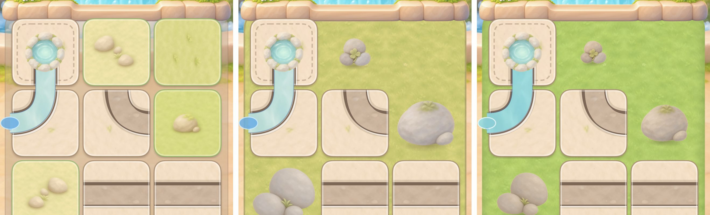
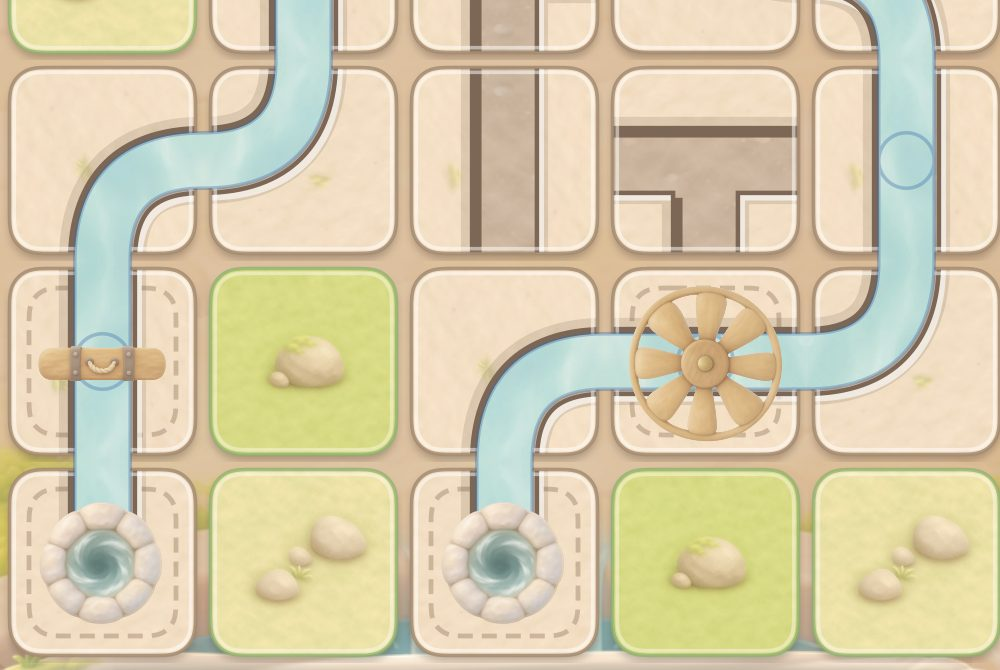

# Minigame overhaul v1: the stream game and the garden game

**Status:** Fable's review and first pass, 2026-11-16 (founder-input 38,
task 2). The code half is in the same PR as this note. Rules of the two
games do not change: [flow-game.md](flow-game.md) and
[minigames.md](../product/minigames.md) stay canonical for them.

Everything below was judged on real in-app frames at 1206 x 2622 in 1:1
crops (`path-game-flow-*`, `path-game-garden-midround`, `2x-garden-*` on
`screenshots/main`), against batch 127's painted targets (flow t2, garden
t2).

## 1. What is wrong today, in order of what the player sees

| # | Where | At 1:1 | Cause |
|---|---|---|---|
| 1 | Both | The board is paler than the scene it sits in. The stream in the stones is a milk blue beside a turquoise pool; the lawn is olive beside spring grass | The board art was painted in the milky envelope, the backdrops in the vivid one. Nothing in code brings them together |
| 2 | Stream | A ring is drawn in the water at the centre of every straight, split, gate and wheel (figure 2) | The code stroked the outline of each arm of the channel, round ends included |
| 3 | Stream | Method A: grass, rock and stone are the same raised square, so nothing says which cells can be turned | Every cell is a keycap |
| 4 | Stream | Method B: the rocks are cold grey, and the largest is bigger than a stone; the lawn has a drawn brown outline | Cut-outs drawn at 88 percent of a cell; a code stroke |
| 5 | Both | The HUD is a third material: cream plates with a stitched line, SF Symbols, a code-drawn seed, a rule line with no surface that never leaves | UI grammar G3, not yet built |
| 6 | Garden | Cells are 41 pt (under the 44 pt touch target) with a 24 pt empty margin; the tray is a 190 pt slab holding plots 60 to 100 pt tall | Layout constants |
| 7 | Stream | The waterfall, the lip's notch and the spring do not line up: the water has no visible way from the fall to the board, and the mouths end in a drain, not in the pool | The lip is one picture with its notch in the middle; the spring sits in any column |

## 2. The stream board's ground: B

_Figure 1. Stage 1 at 1:1. Left: A (keycaps). Middle: B as it was.
Right: B after this pass._

**Pick: B, one lawn, with the stones as the only raised things.** The
reason is not taste. In a turn-the-stones game the one thing the eye must
find is which cells answer a tap. In A all twelve cells are raised
squares; in B the five stones stand on the ground and the ground is
ground. B also removes nine seams per board and lets a rock be a rock
instead of a picture of a rock on a tile.

**The blend (A's grass squares laid over B's lawn) was tried and
dropped.** Composed from the two real frames, green squares on a green
lawn lose their edge and the board turns to mud: it keeps A's confusion
and adds B's layer. Layering itself causes no problem; what it needs is
in the list below, and all of it is now in code:

- the lawn is graded to the backdrop's grass (a multiply, the file is
  untouched) and loses its drawn outline for a soft shaded edge;
- the cut-out rocks are warmed into the stone's family and capped at 72
  percent of a cell, each on a contact shade;
- the turnable stones keep their keycap and its shadow, which is what
  lifts them off the lawn.

A stays one line away (`POFU_FLOW_GROUND=keycaps`) for comparison frames.

## 3. What this pass changes

**Stream.** B is the default. The stream and the dribble's puddle are the
painted water, graded to the pool's turquoise. The rings in the water are
gone. The rule line sits on a glass tag and leaves at the first turn.

_Figure 2. Stage 4 solved, before this pass: the rings at the gate and on
the right-hand straight, and the stream's colour against the pool's._

**Garden.** Cells are 44 pt (side margin 24 to 14 pt), so the bed is 7
percent larger and each cell is a full touch target. The tray stops at
164 pt. The rule line leaves at the first plot.

**Both HUDs** use the design system's chrome instead of their own paper:
`PofuIconButton` (glass circle; the painted close icon), glass tags for
the plates, the painted seed and drop, the honey verb for "Done". With
Reduce Transparency the same calls fall back to the crafted faces. No new
component was needed; `PofuHUD` in the grammar's G3 can be this.

## 4. What code cannot fix: art for Codex

The lead queues them. Rows 1 to 5 are written out as one ready manifest,
[batch-flow-kit-v2.yaml](assets/minigames-overhaul-v1/batch-flow-kit-v2.yaml)
(it needs only its batch number and the after-#501 frame as a reference).
All are painted in the vivid envelope of the backdrops (the pool and the
fall are the colour reference), top-left key light.

1. **Lip kit** (replaces `flow-board-lip`): a tileable run of lip stones
   one cell wide, a notch piece one cell wide with water spilling through
   it, a left and a right end. The code then sets the notch over the
   spring's column, so the fall visibly feeds the board (row 7 above).
2. **Mouth spout**: one cell-wide piece where a channel leaves the
   board's lower edge and pours into the pool, dry and wet. Replaces the
   drain ring for mouths in the last row.
3. **Lawn v2** in spring green with a soft tufted edge as a 9-slice
   (batch 132's stone edge then frames it, or is dropped if the tufted
   edge reads better: decide on the frame).
4. **Rocks v2**: four warm cut-outs at one scale, each with its own
   painted contact shade, none wider than 70 percent of a cell.
5. **Stream water v2**: a seamless strip in the pool's turquoise with
   soft streaks along the flow and a lighter bank edge, so the code's
   grade is no longer needed.
6. **Garden tray v2**: a shallow seed tray about 150 pt tall at 370 pt
   wide with three faint hollows where the plots sit.
7. **Round card**: the garden's end cards are code-drawn stitched paper;
   the grammar keeps them painted (they hang in the world). One painted
   paper card as a 9-slice.

## 5. Not done, and why

- **Water that moves.** A slow drift on the wet channel would do more
  for the stream game than any still picture, but the scene rests at 0 Hz
  for the battery (the founder reported heat). It needs a device test,
  not a guess: a builder task after this merges, capped at 30 Hz and a
  few seconds after each pour.
- **Placed tiles in the garden** are pastel on dark soil. The target
  keeps them so and the founder called the game lovely; left alone.
- **Rules, boards, rewards.** Sound as designed. Stage 1's first board
  takes two taps; that is right for a first board.
