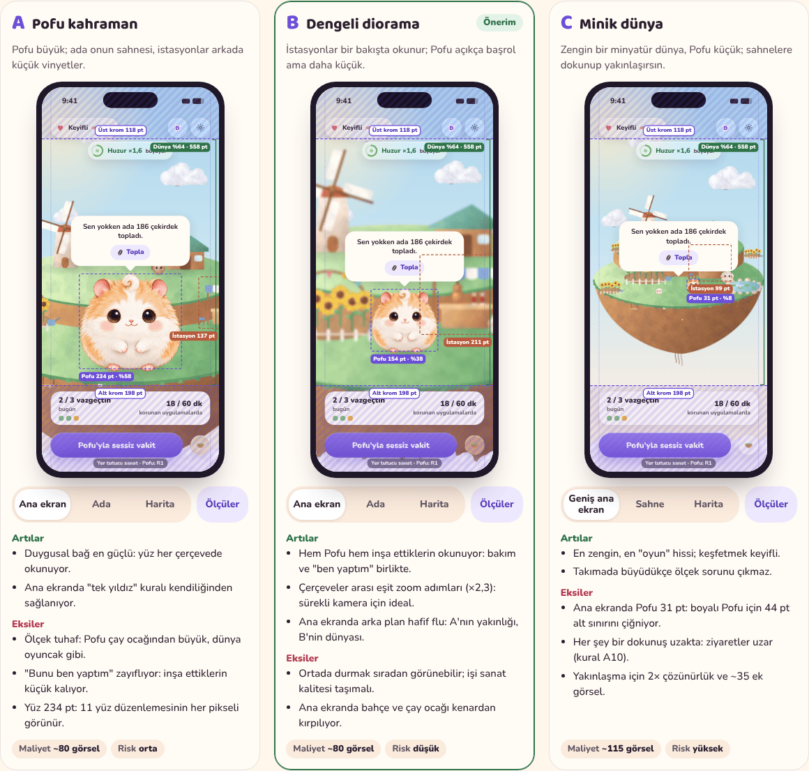

# Design Review 01: Proportion, UI Language, and Choreography

> **Superseded in part (2026-11-02)** by UI critique 01 (PR #63) and UI system v2 (PR #70) once merged, for the UI language and Home. Proportion and choreography conclusions are carried by [ADR-0018](../adr/0018-visual-system-v1.md) and the [interaction spec](interaction-spec.md).

_Status: proposal, for founder review. Last updated: 2026-11-01._
_Review page (animated, mobile-first, Turkish captions):
[`design/prototypes/review-01/`](../../design/prototypes/review-01/index.html).
Read with the [design language](design-language.md), the [art bible](art-bible.md),
[Home directions](../archive/home-directions.md), [game design v2](../product/game-design.md),
and ADR-0015 to ADR-0017._

## 0. Why these three, and why now

The archipelago (ADR-0016) is decided, the island prototype proves the
loop, and the founder is about to commission the first batch of GPT Image
art. Three decisions now shape every image that gets made and every view
that gets built, and they are expensive to reverse once art exists:

1. **Proportion and framing:** how big Pofu, stations, island, sky, and
   chrome are relative to each other on each of the three framings (Home,
   Island, Archipelago map) at iPhone 17 size (402 × 874 pt). This fixes the
   canvas sizes, the level of detail, and the resolution of every vignette.
2. **The UI language over the world:** whether the frame stays native
   (the design language's rule), becomes craft, or moves into the world.
3. **Choreography:** how the world moves and how the three framings
   connect, plus the micro-moments the loop depends on.

For each, three radically different alternatives were built as animated
phone mocks on one page. Pofu is the production master (R1, plus the
prototype's code face overlays standing in for the face-edit kit); Mochi is
the concept art; everything else is a **labeled stand-in**: the island
prototype's own Canvas drawings, re-rendered at high resolution and given a
gouache pass (`tools/render-standins.js`, `tools/painterly.py`) so they sit
next to painted fur without pretending to be final art.

## 1. Proportion and framing system

### The alternatives

| | A. Pofu-hero | **B. Balanced diorama** (recommended) | C. Tiny world |
|---|---|---|---|
| Idea | Pofu large; the island is his stage, stations are background vignettes on the rim | Stations readable at a glance; Pofu clearly the lead but smaller | A rich miniature world with Pofu small; tap to zoom into scenes |
| Pofu width, Home / Island / Map | 234 pt (58 %) / 120 pt (30 %) / 53 pt painted | 154 pt (38 %) / 68 pt (17 %) / 30 pt vector pin | 31 pt (8 %) / 101 pt in a zoomed scene / 13 pt → pin |
| Camera scale, Home / Island / Map | 1.95 / 1.00 / 0.44 | 2.40 / 1.06 / 0.46 | 1.12 / 3.60 (scene) / 0.46 |
| Pros | Strongest emotional bond; the face reads in every framing; "one star per screen" for free | Care and "I built this" read together; even zoom steps (×2.3, ×2.3) suit a continuous camera; closest to the working prototype | Richest, most game-like; exploration is a pleasure; scales well as islands accumulate |
| Cons | Scale is absurd (Pofu bigger than the tea stall), so the world reads as a toy; builds stay small, weakening "I built this"; at 234 pt every pixel of the 11 face edits shows | Middle ground can look generic; the art has to carry it; Home crops the garden and the çay ocağı at the edges | Pofu at 31 pt breaks the design language's 44 pt floor for painted Pofu; everything is a tap further away, lengthening visits (rule A10); zooming needs 2× art and new scene art |
| Production (AI images) | ≈ 80 (home island v1 set + 1 near-lawn plate) | ≈ 80 (the v1 set in game-design §15) | ≈ 115 (+5 scene backdrops, +20 decor props, vignettes at 2048 px, +10 resident poses) |
| Risk | Medium | **Low** | High |

### Recommendation: B, with one idea from A and one from C

B is the only option that carries both promises of the product at once:
care for Pofu and the visible proof of time away. From **A** it takes the
closeness: Home frames Pofu at 38 % of the width and softens the world
behind him with a **depth-of-field blur** (2.4 pt). That blur also hides
the real constraint of a continuous camera: at Home's 2.4× zoom on a 3×
display the island plate would need about 2,600 px of width, and GPT
Image tops out at 1,536. From **C** it takes one rule: on the map Pofu is
not painted (30 pt would be mush) but a **vector Pofu pin** drawn from
`pofu.glyph`, exactly as design language §2 already requires below 44 pt.

### Measured spec (B, iPhone 17, 402 × 874 pt)

| Measure | Home | Island | Map |
|---|---|---|---|
| Camera scale (world unit → pt) | 2.40 | 1.06 | 0.46 |
| Camera anchor (world point → screen) | Pofu's feet → (201, 600) | (0, 40) → (201, 470) | (0, −80) → (201, 430) |
| Top chrome band | 0–118 pt (62 status + 44 pt glass row at y 70 + 12) | 0–158 pt (+ island name chip at y 124) | 0–158 pt |
| Bottom chrome band | 676–874 pt (Today card 76 + 12 + button 56 + 34 safe area + 20) | 676–874 pt (next-build card + primary) | 724–874 pt |
| World window | 558 pt · 64 % | 518 pt · 59 % | 566 pt · 65 % |
| Pofu | 154 pt wide (38 %), feet at 600 pt (69 % height) | 68 pt (17 %) | 30 pt vector pin |
| A station (çay ocağı L3, 88 × 76 world units) | 211 pt, cropped at the edge, blurred | 93 × 74 pt (≈ 1.4 Pofu widths) | 40 pt, not tappable |
| Island lawn (344 world units) | 170 % of the width, front lip at 686 pt | 365 pt (91 %) | 158 pt |
| Tap targets | Pofu ≥ 154 pt | each station's footprint ellipse ≥ 64 × 64 pt | each island ≥ 88 pt |
| Depth of field | island and stations 2.4 pt blur, Pofu sharp | none | none |
| Other islands | hidden | 35 % opacity | 100 % (locked: grayscale 85 %, 55 % opacity) |

Rules that come with it:

- **Grid:** 20 pt margins, 4 pt base grid, 8 pt rhythm (design language §5).
- **Scale ratios to hold in the art:** Pofu : station : island lawn ≈
  1 : 1.4 : 5.4 in width at the Island framing. Station vignettes keep the
  existing guide (720 × 216 px footprint ellipse on 1024²), placed at
  130 world units, so nothing in the slot layout changes.
- **Text against art:** no text directly on painted art. Speech bubble 17 pt
  (`body`) on `surface.card`; world tags and map labels at least 13 pt
  (`footnote`) on a solid chip; Baloo 2 only on Hop! and celebration lines.
  Every chrome element sits inside the bands above, which is why the art
  bible's calm top and bottom zones matter.
- **Resolution budget:** vignettes are generated at 1024² and shown at most
  93 pt (≈ 280 px at 3×), so they have 3.6× headroom at the Island framing.
  At Home they are blurred, so the 2.4× zoom never exposes upscaling.

## 2. The UI language over the world

The same three screens (Home, a station sheet, Hop!) in each language.

| | **A. Native glass** (recommended, with two objects from C) | B. Storybook craft | C. Diegetic UI |
|---|---|---|---|
| Idea | iOS 26 Liquid Glass chrome; minimal; the world glows through | Paper-cut ribbons, stitched cards, felt buttons, a torn-paper sheet (Cats & Soup, Animal Crossing) | UI lives in the world: a seed jar, a calm lantern, a Today signpost, a mailbox for friends, a notice board for builds, a gate for Hop! |
| Pros | Exactly the design language ("illustration is the world; native is the frame"); Dynamic Type, VoiceOver, dark mode, and Reduce Transparency for free; reads as trustworthy in an app that asks for Screen Time access | The warmest, most tactile, most recognizable in screenshots | The most magical: the world shows its own state; almost no "app" on screen |
| Cons | On its own it can feel like a utility app; glass needs calm art behind it | Breaks design language principle 2; decorated frames break at large Dynamic Type sizes and with long Turkish words; every control is custom forever | A lantern's brightness does not say "×1.6", so information stops being glanceable; each object needs its own VoiceOver and Dynamic Type solution; objects compete with Pofu (one star per screen) |
| Production | 0 images (3 hand-drawn custom SF Symbols already planned) | ≈ 20 images (paper textures, 9-slice frames, ribbons, stitched buttons, tape) plus custom controls | ≈ 10 images (jar, lantern, signpost, mailbox, board, gate, plank 9-slice, paper note) |
| Accessibility | Meets the design language's rules as written | Needs an amendment and per-control work; contrast holds (dark ink on paper) | Needs an amendment; targets ≥ 44 pt and live text on solid planks are possible, glanceability is not |
| Risk | Low | Medium to high | High |

### Recommendation: A, plus two diegetic indicators

Keep the native glass frame. Add exactly two world objects from C, as
**indicators, never controls**:

- **The seed jar** by Pofu's door: it fills as seeds are collected, so the
  "I did something" moment lands in the world (seeds fly into it).
- **The calm lantern** on a post at the edge of the lawn: its glow tracks
  the calm multiplier (15 % → 100 % as calm goes ×1.0 → ×2.0).

The seed pill and the calm chip stay; the objects repeat their information
in the world. Proposed amendment to design language §2 (to be recorded if
accepted): _"A world object may display state that also has a native
readout. It is never the only path to that information and never a
control. At most two per scene."_ The image-dump test gains a sixth
question: "If it shows state, where is its native twin?"

## 3. Choreography

| | **A. Continuous camera** (recommended) | B. Pop-up book | C. Cloud pass |
|---|---|---|---|
| Idea | One world; a spring dolly and zoom between Home → Island → Map | Layers fold down front to back with paper physics; the next scene pops up back to front | Clouds sweep in and cover the move; islands drift |
| Pros | Spatial memory (you always know where you are); pure code, one `scaleEffect` + `offset` in SwiftUI; fastest | The most memorable, most "Pofu" moment; every screen becomes a page | The calmest and most magical; speaks the world's own language |
| Cons | The 2.4× zoom magnifies art (solved by B's depth of field); large zooms can trouble vestibular-sensitive users (Reduce Motion cross-fade) | Tiring by day 30 (each move ≈ 0.9 s); every plate split into 3 depth layers; a paper metaphor clashes with Liquid Glass | Hides spatial continuity ("where am I?"); adds ≈ 1.1 s to every move, noticeable at three visits a day |
| Production | 0 images | ≈ 15 (depth-layer splits, fold edges) | ≈ 6 cloud sprites (shared with the sky) |
| Risk | Low | Medium | Medium |

### Recommendation: A for navigation, C for one rare moment

Navigation is always the continuous camera. The cloud pass is kept for the
**new-island arrival** only: on the first open after an island drifts
close, clouds part and the island floats in. It is rare, so it stays
special. The pop-up book is beautiful and wrong for daily navigation; it
could open onboarding once.

### Timing spec (recommended set)

Springs are SwiftUI `spring(duration:bounce:)`, named by the design
language's tokens (`snappy` 0.25/0, `squish` 0.28/0.45, `settle` 0.5/0.2,
`gentle` 0.9/0.1, `hop` 0.42/0.35, `pop` 0.55/0.5). The review page renders
them faithfully as CSS `linear()` easings sampled from the same spring.

| Moment | Duration and spring | Sequence and stagger | Haptics |
|---|---|---|---|
| Home → Island | 0.90 s, `gentle` | Chrome out `snappy` 0.25 s, 40 ms stagger; new chrome in at 55 % of the camera; depth of field clears by 60 % | None (the tap already gave `.selection`) |
| Island → Map | 1.10 s, spring(1.1, 0.08) | Other islands 35 % → 100 % over 0.6 s; labels fade in 0.3 s after the camera settles; Pofu cross-fades to the pin | None |
| Collect seeds | Each seed 0.62 s on an arc (`hop`), at most 24 seeds | 35 ms launch stagger; counter at most 1.0 s with monospaced digits; jar fill `settle`; pill and jar `pop` at the end | Tap: soft impact 0.5; at most 10 `.selection` ticks on landings; `.success` at the end |
| Station level-up | Camera 0.6 s `gentle`; squash 0.12 s (1.06 × 0.88); `pop` | Sheet down `snappy` → camera to the station → squash → dust puff and the sprite swap hidden in a 120 ms cross-fade at the squash's deepest point → `pop` → sparkles 0.8 s → tag 2.6 s → Pofu "excited" hop at +0.3 s, the resident hops 120 ms later | Medium impact at the swap; `.success` on settle (the three-transient "celebration" only for level 5) |
| Calm +0.1 | Ring 0.6 s `settle`; numeral 0.25 s `snappy` | A passive update, seen on the next visit | None (passive) |
| Calm reaches ×2.0 | Glow breathes on a 3.2 s cycle | Pofu "smug" once | None |
| Quick check (halving) | Ring drains to half over 0.8 s `gentle` | "halved" for 2 s | None |
| Full open (reset) | Ring empties in 0.45 s plus one `squish` wobble | Pofu pouts for 5 s | None: no punishment sound or haptic |
| Pofu's emotions | Face swaps inside a 90 ms squash or a blink, 120 ms cross-fade | Proud hop; pout squash (1.04 × 0.95) plus puffs; jealous lean −4°; worried tremble; unwell flattens to 0.9 over 2 s `gentle` with the ash grade; excited double bounce | Tap on Pofu: soft impact 0.5 |
| Breathing break (v2) | Screen in 0.6 s; inhale 2 s, exhale 3 s (10 s break: 4 / 6) | "Nicely done." 0.4 s; choices slide in `snappy` 0.5 s after 0.3 s | Soft impact 0.4 on the tap; soft 0.3 at the turn to exhale; none at the end |
| New island (cloud pass) | Cover 0.5 s ease-in, hold 0.15 s, part 0.7 s ease-out; the island drifts in 1.6 s `gentle` | At most once a day | `.success` when the island settles |
| Reduce Motion | Camera, folds, flights, and hops become 200 ms cross-fades; the breathing orb holds still while the words and the color change | | |

## 4. The combined recommendation

The choices interact. Three internally coherent packages:

| Package | Proportion | UI language | Choreography | Images | Risk | Character |
|---|---|---|---|---|---|---|
| **Recommended: living diorama, native frame** | B | A + jar and lantern | A + cloud pass for arrivals | ≈ 88 | Low | Calm, legible, Apple-native, fastest to build |
| Storybook | A | B | B | ≈ 115 | Medium–high | The warmest and most "game"; the design language must be rewritten |
| Miniature world | C | C | C | ≈ 130 | High | The most magical world; the weakest accessibility and the longest visits |

Avoid mixing across packages where the metaphors fight: pop-up book
transitions with a glass frame, or a diegetic UI with a Pofu-hero framing
(the objects have nowhere to stand).

## 5. Questions for the founder (one line each)

1. **Proportion:** B (balanced diorama), yes? _(A / B / C)_
2. **UI language:** native glass plus the seed jar and the calm lantern as
   indicators, yes? _(yes / A only / B / C)_
3. **Motion:** always the continuous camera, the cloud pass only when a new
   island arrives, yes? _(yes / clouds more often / pop-up book)_
4. **Pofu on the map:** a 30 pt vector Pofu pin instead of a tiny painted
   Pofu? _(yes / no)_
5. **Next art batch:** start the first 8 images of game-design §15 (island
   plate, çay ocağı L1–L2, garden, simit cart, Mochi) for the chosen
   package? _(yes / change this first: …)_

## 6. Self-critique

- **The stand-ins flatter nothing, and that cuts both ways.** The gouache
  pass makes the Canvas drawings sit next to Pofu, but they are still
  simple shapes. The proportion decision is sound on stand-ins (sizes,
  bands, ratios are real); the UI-language decision is less so, because
  glass looks best over rich art and storybook craft looks best next to
  equally crafted art. B and C are slightly under-sold by the stand-ins.
- **I am recommending the option closest to what exists.** That is a bias
  to name. The case for B is the two-promise argument and the resolution
  budget, not inertia; A would be the right call if the product leaned
  harder on the companion and less on building.
- **The diegetic mocks are the weakest craft on the page.** The SVG jar,
  lantern, signpost, and mailbox are quick stand-ins; a real diegetic
  direction would be far more charming. The verdict against C is about
  glanceability and accessibility, which better art would not fix.
- **Depth of field is carrying a lot.** It hides upscaling and creates the
  one-star focus at Home. If the blurred world reads as "out of focus"
  rather than "behind Pofu" on the founder's phone, the fallback is a
  dedicated Home near-lawn plate (one extra image) at 2× resolution.
- **The motion mocks are browser approximations.** The springs are the
  real SwiftUI curves, but frame pacing, Liquid Glass refraction, and
  haptics can only be judged on device; the timing table is a starting
  point for the first SwiftUI build, not a final answer.
- **Haptics are designed on paper only.** The page marks the beats on a
  timeline; none of them has been felt.

## 7. The review page

- **Publishable files** (relative to `design/prototypes/review-01/`):
  `index.html`; `fonts/baloo-2-latin-wght-normal.woff2`,
  `fonts/nunito-latin-wght-normal.woff2`,
  `fonts/nunito-latin-ext-wght-normal.woff2`; and every file in `assets/`
  (`pofu.webp`, `pofu-hero.webp`, `neighbor-bunny.webp`, the nine
  `pofu-*.webp` face stand-ins, `isle-*.webp`, `st-*.webp`, `res-hog.webp`,
  `cloud-a.webp`, `cloud-b.webp`). About 0.95 MB in all. `screenshots/`,
  `tools/`, and `fonts/OFL-*.txt` are not needed at runtime.
- **Sandbox-safe:** no dialogs, no query strings, relative paths only,
  fonts as relative files, `<meta charset="utf-8">`, `viewport-fit=cover`
  with safe-area padding, light and dark themes, Reduce Motion respected.
- **Verified** with `node tools/check-review.js --shots` (Playwright,
  Chromium): iPhone 15 emulation with touch and a 375 px phone (no
  horizontal page scroll in any section, every interactive element at
  least 44 × 44 pt, carousels swipe by touch and by tab, framing buttons
  and the measurement overlay work, no errors or dialogs); desktop at
  1280 px (three phones side by side); the page inside
  `<iframe sandbox="allow-scripts">` over HTTP (scripts run, fonts and
  every image load, no failed requests).
- **Rebuilding the stand-ins:** `node tools/render-standins.js <dir>` then
  `python3 -I tools/painterly.py <dir> assets`.
