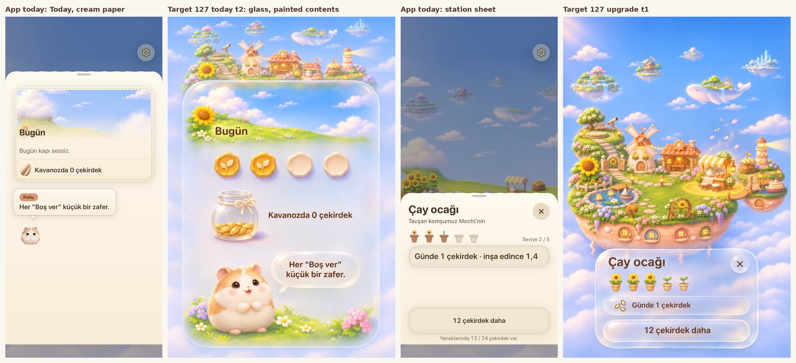
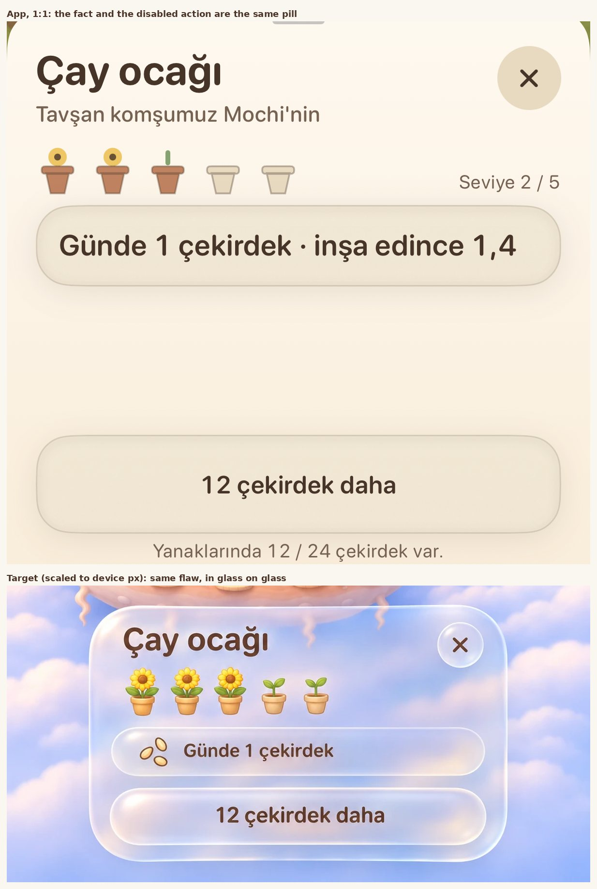
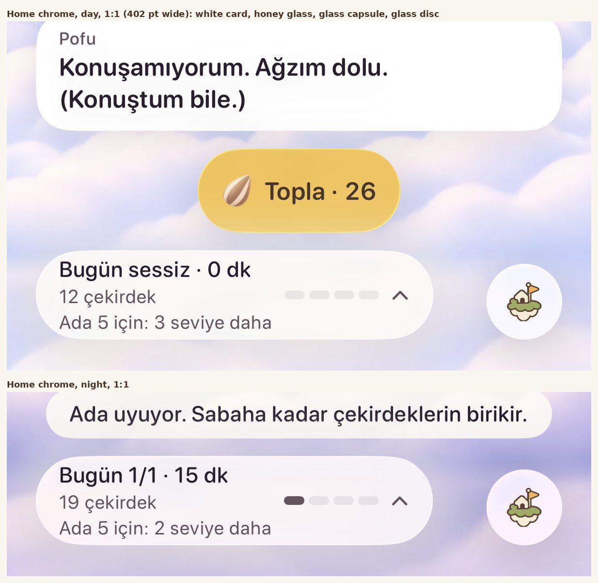
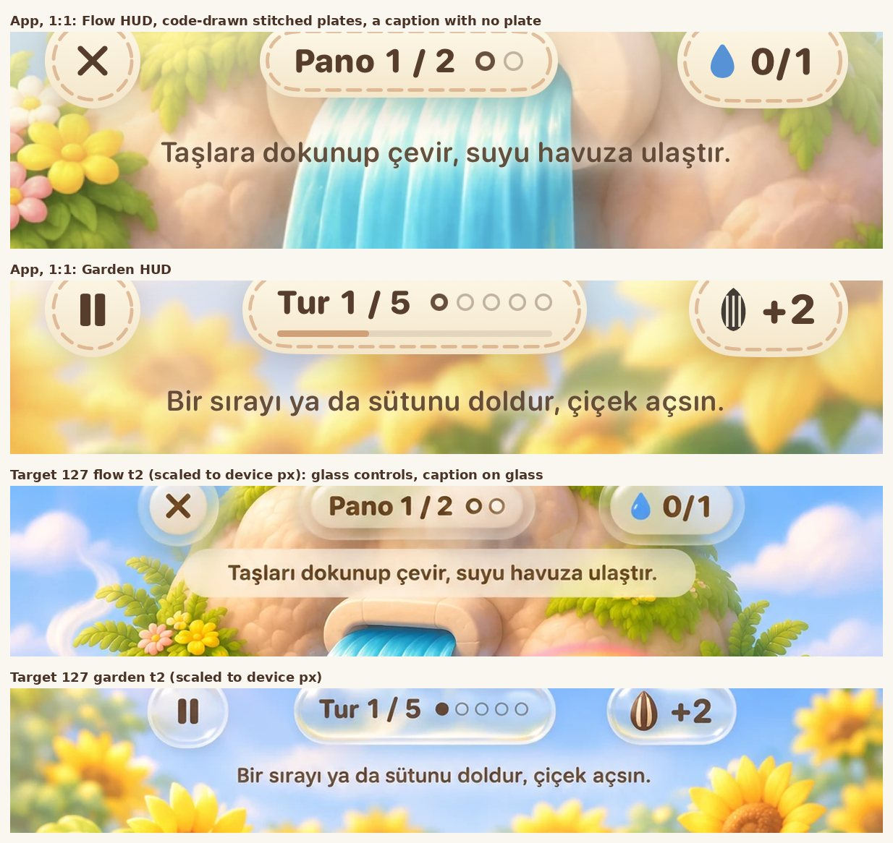
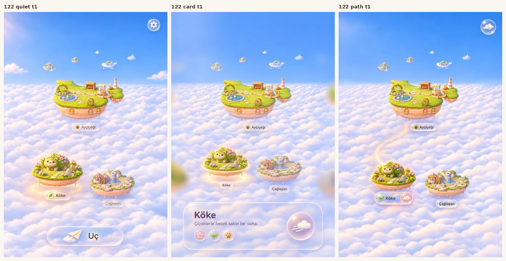

# UI grammar v1: two planes

**Status:** proposal for the founder (2026-11-16). Author: Fable, on the
brief `docs/studio/briefs/fable-2026-11-14-ui-grammar.md` (night plan step
N10). Nothing changes in the app until he has seen this.

**The answer in one paragraph.** Pofu has two planes. The **world plane**
is the painting and every thing that lives in it: the island, Pofu, his
speech, the Door's plaques, a game's stones, pots, seals, the jar. It is
painted, always. The **screen plane** is everything that floats on the
phone's glass in front of the world: buttons, sheets, tags, the game HUD,
toasts. It is native Liquid Glass, always. Words and numbers are live
text on either plane. The split is by plane, not by screen, so every
screen speaks the same language. This is the hybrid the founder liked,
made strict, and it is also what Apple's own rule for Liquid Glass says
(controls float above content; content is never glass). The rest of this
document is the sizes, the limits and the list of screens that break it.

**What I looked at.** Code at `origin/main` 236019c1: `PofuDesignSystem`
(tokens, skins, kit, sheet), and the layout of Home, the sheets, the
Door, onboarding and both games. Fourteen player-path frames of
`screenshots/main` (6963041) at 1206 x 2622, as two contact sheets and as
1:1 crops of the Home chrome (day and night), the station sheet, the
Today sheet, the Door, the Map tag and both game HUDs. From pofu-art
`origin/main`: the five picked screen targets of batch 127 with the
lead's reviews, all six takes of batch 122, and the 18 picked duo icons
of batch 128 rendered at 26 pt and 34 pt on paper, sky and night. Apple's
Human Interface Guidelines pages Materials, Color, Buttons, Layout,
Sheets and Typography, fetched 2026-11-16. UI v3, ADR-0020,
asset-system v1 sections 1-2, founder-input 24 to 26 and 35, and the
scout's `docs/research/night-2026-11-15-app-state.md`.

**Not seen, and two premises of the brief that do not hold.**

- The brief says the player-path frames exist in both skins. They exist
  in the glass skin only. The crafted skin has two frames at 460 px
  (`sprite-09-home-crafted-*`), too small to judge. Everything here about
  crafted comes from its code.
- The brief says a side-by-side of the two states was being prepared. I
  found none in either repository. The batch 127 targets are the better
  evidence anyway, and I used those.
- No device-size frame exists for Settings, the resident card, the
  breath room, the celebration card, any accessibility text size, or any
  glass surface on a real phone. Section 7 names these for a scout.

## 1. The rule

| Plane | What is on it | Made of | Why |
|---|---|---|---|
| **World** | The island, sky, residents, Pofu. Things you can point at: pots, seals, the jar, a seed, stickers, duo icons. Pofu's speech bubble. Controls that are objects standing in a scene: the Door's plaques on their rope, a game's stones and tray, a station you tap. Reward cards that hang in the world | Painted art. Never drawn by code | It is the game. The founder's rule: no code-drawn pictures |
| **Screen** | Verbs, quiet buttons, round controls, tags, sheets, the game HUD, toasts, menus | Native iOS 26 Liquid Glass, regular variant | It is the app. The founder's decision: glass is the default, native glass for controls |
| **Words** | Every letter and number | Live text, cocoa ink | Two native languages, Dynamic Type, VoiceOver |

**The test a builder applies to any new element:**

1. Is it a thing that exists on the island or in the scene? Paint it.
2. Otherwise, does it float in front of the world? Glass.
3. Is it a word or a number? Live text, on whichever of the two it sits.

There is no third material. Cream paper pages, stitched code-drawn
plates, white cards, linen stat cards inside sheets and clay discs are
all a third material, and each is on today's screens.

Three consequences that are easy to miss:

- **Glass never holds glass, and never holds paper.** A sheet's contents
  sit directly on the sheet: a picture, a row of painted objects, text,
  one verb. No cards inside a glass sheet, no pill around a fact.
- **Colour on glass means one thing.** Honey glass is the one verb of the
  screen. All other glass is untinted. (Apple: tint the background of the
  primary action, and do not tint several controls.)
- **Regular glass, not clear.** The painted targets show very clear
  glass. Apple reserves clear glass for media and asks for a dim behind
  it; regular glass is the one made for text. The real regular glass in
  today's frames is milky and legible on the day sky and on the night
  cloud sea (figure 3).

## 2. The grammar

Canvas: iPhone 17, 402 x 874 pt (1206 x 2622 px at 3x).

### 2.1 Zones

Every screen with the world behind it has three bands.

| Band | Where | Holds | Limit |
|---|---|---|---|
| **Top** | from the safe area down 60 pt | rare actions and status: close, pause, settings, HUD progress, a toast | one item per corner plus one centred |
| **Stage** | the middle | the world and its subject. The subject (Pofu, the island, the board) sits centred between 35 % and 50 % of the height | no screen-plane element except a tag attached to a thing, and Pofu's bubble |
| **Bottom** | the lowest 30 % | the verb and the standing controls, where the thumb is | three items |

### 2.2 Spacing

A 4-pt grid with seven steps, already in `PofuSpacing`: 4, 8, 12, 16,
20, 24, 32.

| Step | Use |
|---|---|
| 20 | screen margin, both sides, every screen |
| 8 | between parts of one group (icon and label, title and subtitle) |
| 16 | between groups, and padding inside a surface |
| 24 | between sections; sheet top to title |
| 12 | the smallest gap between two glass shapes, so they never fuse |
| 4 | fine adjustment inside a control only |
| 32 | above the verb on a full page |

No raw number in a `padding`. Today the code has 24 distinct raw values
from 2 to 150 beside the tokens.

### 2.3 Type

Six roles, all SF Pro Rounded on Dynamic Type text styles. Today there
are 11 named styles, 9 in real use, and 20 more distinct raw sizes from
7.5 to 64.

| Role | Size at default | Weight | Use | Limit |
|---|---|---|---|---|
| Display | 56 | heavy | the Door's "Hop!", a celebration | one word or two, one per screen |
| Page title | 28 | bold | full pages: first screens, a round's end | two lines |
| Title | 22 | bold | a sheet's or card's name | one line |
| Label | 17 | semibold | every button, Pofu's speech, a fact, HUD numbers (monospaced digits) | one line on a control, two in a bubble |
| Body | 17 | regular | sentences | three lines on a world screen |
| Note | 13 | regular | a hint, a caption, a secondary line | two lines; nothing smaller, anywhere |

- The 15 and 16 pt styles (`subheadline`, `callout`), `title3` and the
  12 pt `caption` go: a step of one or two points is noise, not
  hierarchy. Settings keeps the system list's own styles.
- Two inks: cocoa, and cocoa at 60 % for Note. No grey, no violet.
- Everything scales with Dynamic Type. Sheets and pages scale fully and
  scroll. The HUD, tags and the bottom band scale up to the first
  accessibility size and stop, so they never cover the stage. Both game
  HUDs use fixed sizes today and do not scale at all.

### 2.4 Density: the most one screen shows

**Order, always: picture, title, fact, verb, note.** Show, then say.

| Screen kind | The most it shows |
|---|---|
| World screen (Home, the Map, an island) | five screen-plane elements in all; three in the bottom band; one honey verb; one line from Pofu at a time |
| Sheet | one title, one picture or one row of objects, three facts, one verb, one note. All of it visible at the detent it opens at, without scrolling. A sheet answers one question |
| Game | top: one round control, one progress capsule, one score capsule. Bottom: two round controls. One caption, which leaves after the first move |
| Page (first screens, a round's end) | one picture, one title, two lines of body, one verb and at most one second choice |
| The Door | the app tag, one word, one line, Pofu, two choices, one note. It is at this limit today and is right |

Rows of objects (pots, seals, pips) hold five at most; a sixth becomes
"+N". A row of chips holds four.

### 2.5 Stack or side by side

- **Buttons with words stack, full width, same size.** The honey verb is
  the lowest; a second choice sits above it. Style tells them apart, not
  size (Apple's rule too). Two worded buttons never share a row: Turkish
  labels are long, and large text breaks the row. Today the Door has the
  verb lowest and the notifications page has it on top; the Door is
  right.
- **Side by side is for peers of one kind:** objects in a row, chips, an
  icon with its label, a label with its value, and the bottom band's
  pair (the status capsule and the place control).
- **Centre** a surface whose subject is centred and whose text is two
  lines or fewer (the Door, a page, a celebration, a caption, a toast).
  **Lead** everything inside sheets, rows and bubbles. One surface never
  mixes the two.
- At accessibility sizes a side-by-side row becomes a stack
  (`ViewThatFits`), never a clipped row.

### 2.6 How each kind is presented

| Kind | Plane | Presented as | Size | Limit |
|---|---|---|---|---|
| **Verb** | screen | honey-tinted prominent glass, cocoa Label; may carry one painted object (the seed in "Topla") | 52 high; full width on sheets and pages, hugging its label on a world screen | one per screen |
| **Second choice** | screen | untinted glass, same shape and size as the verb | 52 high | one |
| **Blocked verb** | screen | untinted glass whose label is the reason ("12 çekirdek daha") with the seed object; tapping it explains | 52 high | never a faded honey pill |
| **Text button** | screen | cocoa Label, no surface | 44 hit area | "not now" and the like |
| **Round control** | screen | glass circle, one duo icon | 52 with a 34 pt icon in the bottom band; 44 with a 26 pt icon in the top band | one per corner |
| **Sheet** | screen | the system sheet with its own glass, over the world dimmed 12 %. Contents directly on it, no cards. Opens at the height its content needs; goes to large (where the system turns it opaque) only for a list | system radius and grabber | section 2.4 |
| **Fact** | on a sheet | plain text: a 28 pt painted object, then a Label. Never inside a pill | one line | three per sheet |
| **Card** | world | a painted paper tag that hangs in the world, for a reward (the celebration card). Not used inside glass sheets | hugging | one at a time |
| **Bubble** | world | painted paper with a tail that points at the speaker, beside the speaker in the stage | at most 70 % of the width, two lines of Label | one at a time |
| **List row** | opaque page only | native row: 26 pt duo icon, Body label, value trailing in Note ink, system chevron | 52 high at least | Settings and long lists; never more than three rows on a glass sheet |
| **Tag / badge** | screen | glass capsule attached to a thing in the world; optional 20 pt icon; a count goes inside it | 32 high, Note in semibold | one line, one per thing |
| **Toast** | screen | glass capsule in the top band, one Label, optional painted object | 44 high | one at a time, 2.5 s |
| **HUD** | screen | glass capsules in the top band; the caption is a glass capsule too | 44 high | section 2.4 |
| **Progress** | world or text | five or fewer steps: painted objects (pots, seals). More: a number | 28 to 34 pt objects | |

Corners: a control with one row of content is a capsule. Anything else
uses 24, or 16 when it sits inside a 24. The system decides a sheet's
corners.

### 2.7 Icons

The three tiers of asset-system v1 section 2.2 stand, with sizes: painted
objects 28 pt and up, never as a button's glyph; duo icons 26 pt in rows
and the top band, 34 pt on the bottom band's round control; SF Symbols
only for the system's own marks (chevron, checkmark) and developer
screens. The batch 128 picks hold at 26 pt on paper, sky and night
without a plate under them: their cocoa line carries its own contrast.

### 2.8 Night and accessibility

Glass adapts by itself; painted things follow the world's night as they
do today. Reduce Transparency: the system makes glass opaque, and the
painted crafted faces remain as that fallback only, no longer as a skin
to choose. Increase Contrast, VoiceOver, 44 pt targets and Reduce Motion
are unchanged from ADR-0020.

## 3. Glass and painted

### 3.1 Which of the two states

The founder was to compare the hybrid after ADR-0020 (painted UI with
native glass in some menus) against asset-system v1 ("glass is not a Pofu
material"). **Neither as it stood; the hybrid, with the line moved.**

- Asset-system v1 painted everything, controls included. He has since
  decided against it, and I agree: it makes the phone feel like a
  console and gives up the native feel of a control under the thumb.
  Its decision 10 and its "one round button is clay" are reversed.
- The ADR-0020 hybrid drew its line between screens: paper sheets here,
  glass chrome there, stitched plates in the games. So one tap moves the
  player between three dialects. Figure 1 shows it: glass chrome on Home,
  then a cream paper sheet rising over it.
- Two planes draws the line between layers, and it is the same line on
  every screen. It keeps what he liked in each: the world and its objects
  stay fully painted (more of the painting is visible than today, because
  paper pages go), and every control is the native glass he loves.

_Figure 1. Today's Today and station sheets (cream paper) beside the
picked targets (glass over the island, painted objects as the content)._

### 3.2 Where each belongs

| Thing | Today | In this grammar |
|---|---|---|
| Home: "Topla" | honey glass with the painted seed | stays; it is the model verb |
| Home: status capsule, settings, place control | glass | stay; the status capsule drops to two lines |
| Home: Pofu's line | an opaque white card across the bottom band, no tail | painted paper bubble with a tail, beside Pofu |
| Today, station, visitor sheets | cream paper; a linen card around a fact | system glass; contents directly on it |
| Game HUD | code-drawn stitched cream plates; a caption with no surface | glass capsules; duo icons; the painted seed |
| First screens | four cream pages | Pofu on the home lawn; one honey verb |
| The Door | painted postcard, painted plaques | stays painted: the plaques are objects in the scene |
| Game boards, tray, stones | painted | stay painted |
| Celebration card | painted paper tag | stays painted: it hangs in the world |
| Settings | native list | stays native; duo icons at 26 pt |
| Map tags | glass capsules | stay |

_Figure 2. At 1:1 the daily-yield fact and the blocked action are the
same pill, so a fact reads as a button. The target repeats it in glass
on glass. In the grammar the fact is plain text and only the verb has a
surface._

_Figure 3. Home's bottom band at 1:1. The glass reads on both skies. The
white card is the one element that is neither glass nor paint._

_Figure 4. The stitched plates are drawn by code, which the founder has
ruled out; the caption floats on the painting with nothing behind it._

### 3.3 Where I do not follow the targets

The batch 127 pictures are the direction, not the specification:

- The welcome's button is clear glass. It is the screen's verb, so it is
  honey, like "Topla" and "Boş ver".
- The upgrade's fact is a second pill inside the sheet (the lead's review
  says the same). It is plain text.
- The glass in all five is clearer than regular glass. The app uses
  regular glass; expect it milkier than the pictures.
- The Today jar is a third full beside "0 çekirdek". The jar's fill
  follows the number.

### 3.4 The far camera (batch 122)

_Figure 5. One take of each variant._

**Quiet.** The world carries the selection (a warm ring under the island,
its tag lit) and the bottom band has one verb, "Uç". That is this grammar
exactly: a thing is marked in the world, the act is on glass under the
thumb. The verb becomes honey. Card puts a panel of words about an island
the player is already looking at into the bottom band, the largest
element on the screen for the least news. Path makes the verb a disc of
about 28 pt beside the tag, below the 44 pt target and in a different
place for each island.

## 4. Tooling

**What I looked at.**

- Apple's HIG (the six pages above) and the iOS 26 SwiftUI glass API the
  code already uses (`glassEffect`, `.glass`, `.glassProminent`) or does
  not yet (`GlassEffectContainer`, `glassEffectID`, which the place
  control's "hold for a bar" wish needs). This is the authority for the
  screen plane; the grammar cites it rather than restating it.
- The design skills installed in this environment (`design-system`,
  `design-critique`, `accessibility-review`, `design-handoff`) and
  `artifact-design`. They are generic audit and hand-off templates
  shaped for web and Figma work. They know nothing of SwiftUI, Liquid
  Glass or Pofu's tokens, and a builder who loaded one would get a
  checklist of general advice. The accessibility checklist is sound and
  is folded into ours.
- Libraries, judged from knowledge and not re-read today: UIKit layout
  DSLs (SnapKit, PinLayout, FlexLayout) solve a problem SwiftUI does not
  have. Token pipelines (Style Dictionary) pay off across platforms; we
  have one. SwiftLint custom rules would enforce the grammar but add a
  toolchain to do what forty lines of Python in `tools/` do on Linux.
  Snapshot libraries duplicate the frame harness CI already runs.

**Verdict: none fits. Our own, in four small parts.**

1. **A skill, `.claude/skills/pofu-ui/SKILL.md`,** one page that every
   builder touching a screen loads. Outline: the three-question test;
   the zone, spacing and type tables; the density limits; the kinds
   table with the one kit call for each; "before you push" (run the
   checker, fetch your frames, crop the bottom band and the top band at
   1:1, count the screen-plane elements); a link here for the reasons.
2. **A narrower kit.** One entry per kind, so the grammar is the easy
   path: `PofuVerb`, `PofuSecondChoice`, `PofuRound`, `PofuTag`,
   `PofuFact`, `PofuToast`, `PofuHUD`, and a `PofuSheet` scaffold with
   named slots (picture, title, objects, facts, verb, note) that cannot
   hold a card. Six type roles replace eleven styles; four button styles
   replace thirteen.
3. **A checker, `tools/design/check_grammar.py`,** in CI on Linux. It
   fails on: `.system(size:` outside the kit; a raw number in `padding`;
   `Image(systemName:` outside an allow list; `glassEffect`,
   `presentationBackground` or a `ButtonStyle` declared outside the kit.
   Developer and Rehearsal screens are exempt.
4. **A kit frame on the player path** (`path-kit-day`, `-night`,
   `-ax`): every kind on one screen at device size, so a change to the
   kit is seen before it is merged.

## 5. What changes

Ranked by what the player sees most. Each is one builder PR. G0 is first
because the others use it.

| # | Item | Breaks the grammar how | The work |
|---|---|---|---|
| G0 | Kit, checker, skill | 13 button styles, 20 raw type sizes, two skins | Section 4, parts 1 to 4. The crafted skin becomes the Reduce Transparency fallback, not a choice |
| G1 | Home chrome (every open) | Pofu's line is a white card in the bottom band; the status capsule has three lines; four items in a band of three | The line becomes the paper bubble beside Pofu. Status capsule to two lines. Bottom band: the verb, then the capsule and the place control |
| G2 | Sheets: station and upgrade, Today, visitor, passes (several times a day) | cream paper; a fact in a pill identical to the button; about a quarter of the station sheet empty; two sheet backgrounds in use | `PofuSheet` scaffold on system glass; facts as text; fitted height. The upgrade plays with the camera at the home plate's framing (target review). Replaces #453 |
| G3 | Game HUD: Flow first, then Garden (each play) | code-drawn plates; caption with no surface; fixed type; a code-drawn seed; SF Symbols for pause, undo, hint | `PofuHUD`; duo icons; the painted seed; caption leaves after the first move. Flow is night-plan item A5 |
| G4 | The Door (the product's moment) | closest to right. The app chip is an opaque white pill; the subtitle is near-black beside a cocoa title | chip to a glass tag; one ink. Plaques stay painted |
| G5 | First screens (once, but first) | four cream pages; SF Symbols in the app rows; verb above the second choice on one page | the world behind every page; honey verb lowest; duo icons in the rows. Night-plan item A8 |
| G6 | The Map | no selected state, no verb | batch 122 quiet: ring, lit tag, one honey "Uç" |
| G7 | Settings and the resident card | not judged: no device-size frame | a scout adds the frames first (section 7), then one PR |

## 6. Decisions

### Made here

| # | Decision | Set aside |
|---|---|---|
| 1 | Two planes: world painted, screen glass, words live | A split by screen (ADR-0020 as built): three dialects in one session. Paint everywhere (asset-system v1): overruled, and rightly |
| 2 | No skin choice. Crafted faces serve Reduce Transparency only | Keeping the A/B switch: every screen would be built and reviewed twice |
| 3 | Regular glass everywhere, never clear | Clear glass as in the targets: Apple restricts it to media with a dim, and text on it fails over a bright sky |
| 4 | Honey glass is the verb, one per screen; all other glass untinted | Clear verb (welcome target); tinting several controls |
| 5 | A fact is text, never a pill | The linen stat card: it is the button's twin (figure 2) |
| 6 | Six type roles, nothing under 13 pt | Keeping 11 styles: the 15, 16 and 17 pt steps do not read as levels |
| 7 | The verb is the lowest button; worded buttons stack | Primary on top (the iOS onboarding habit): the Door, seen most, already has it lowest, where the thumb is |
| 8 | Two round sizes: 52 in the bottom band, 44 in the top | One size: the place control is the main way around and earns the larger target |
| 9 | Sheets open at fitted height on system glass; large and opaque only for lists | Our own glass-then-paper surface (`PofuSheetSurface`): it re-implements what the system sheet now does |
| 10 | Our own skill, kit entries and checker | Adopting a general design skill or a lint toolchain (section 4) |
| 11 | Far camera: quiet | Card, path (section 3.4) |

Once the founder agrees, the lead records decision 1 as an ADR that
amends ADR-0020, and marks asset-system v1 decision 10 and section 2.3
superseded. Some painted kit masters (sheet paper, linen card, clay
disc) will then ship only in the fallback. That is a cost already paid,
and not a reason to keep them on screen.

### Only the founder can decide

Asked in Turkish with the figures, not from this table. My pick first.

1. **Sheets:** glass over the dimmed island; or cream paper as today.
2. **First screens:** inside the painted world; or the cream pages.
3. **Far camera:** quiet; or card; or path.
4. **Pofu's speech:** a painted paper bubble beside him; or a glass
   capsule in the bottom band like the other chrome.
5. **The Door's two choices:** painted plaques in the scene, as today;
   or honey and plain glass like every other screen.

## 7. Facts I did not gather (for a scout)

1. Glass on the founder's iPhone 17: a sheet and the HUD over the night
   island and over the brightest noon sky. Every glass frame I saw is a
   simulator render.
2. Cost of glass over a moving scene. Sheets freeze the world for this
   reason (`PofuWorldFreeze`); a game HUD cannot. Measure frame time and
   heat with three glass capsules over the Flow and Garden scenes before
   G3 merges. The founder has already reported heat.
3. Device-size player-path frames for Settings, the resident card, the
   breath room and the celebration card, and one Home frame at the
   largest accessibility text size.
4. Whether the system sheet keeps its glass at a custom fitted height
   and with `presentationBackground` removed, on iOS 26.
5. Contrast of cocoa Label and Note text on regular glass over the five
   skies, measured from frames.
6. Whether Baloo 2 is still wanted. It is not bundled; this grammar does
   not need it.
