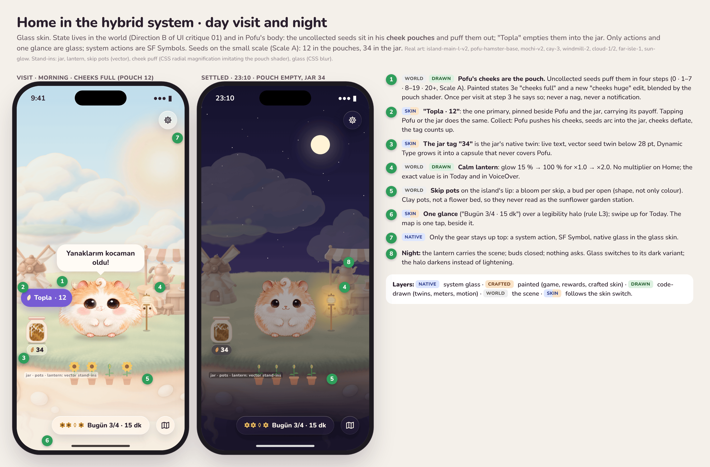
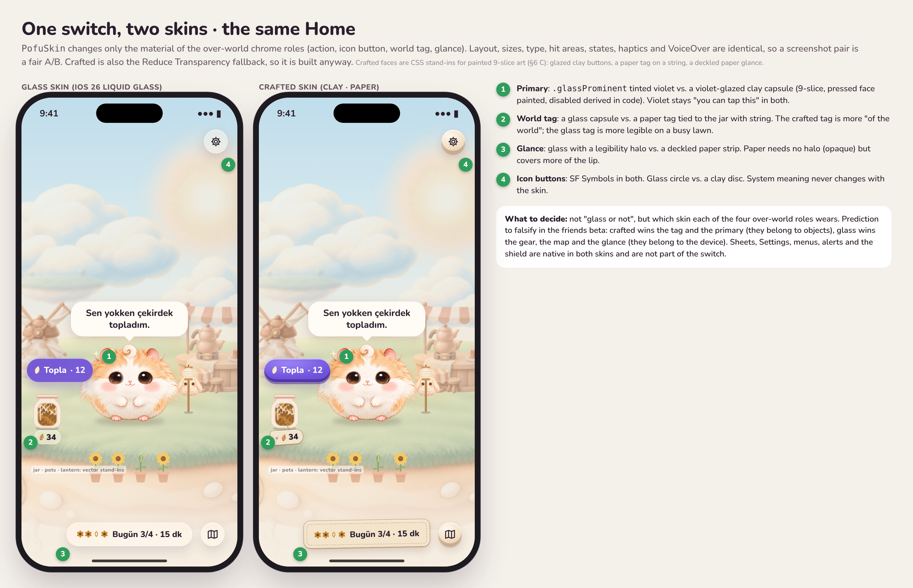
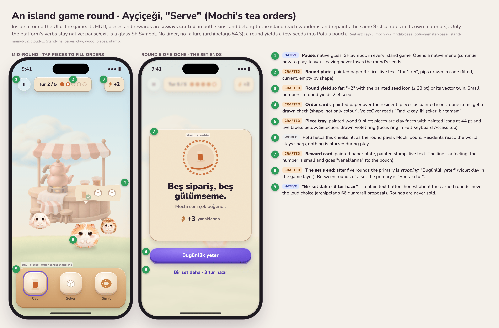
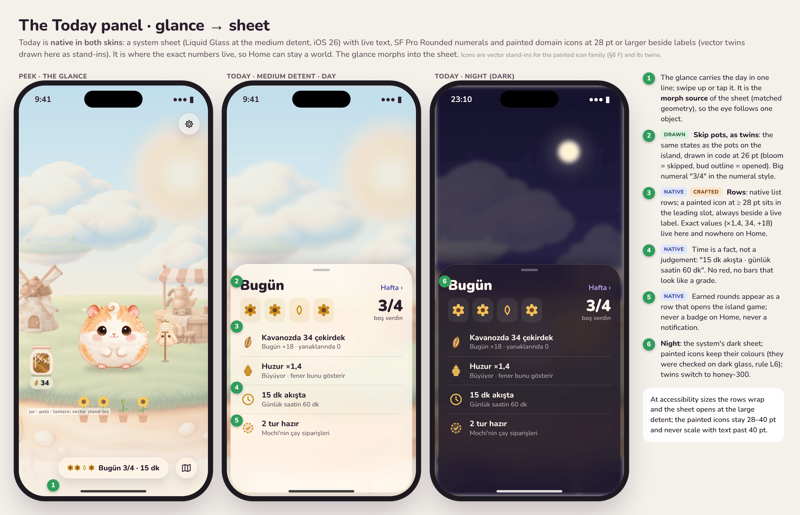

# UI System v2: Glass Where It Is the Device, Craft Where It Is the World

_Status: proposal for the founder. Last updated: 2026-11-02._
_Builds on [ADR-0018](../adr/0018-visual-system-v1.md) (Glass++), the
[design language](design-language.md), the [interaction spec](interaction-spec.md),
[UI critique 01](ui-critique-01.md) (PR #63, Direction B "Living Diorama")
and the archipelago system (PR #64, not merged yet) (PR #64:
island games, rounds, decor spots, rumours). Mockups:
[`ui-system-v2/`](ui-system-v2/), source in
[`ui-system-v2/mockup-src/`](ui-system-v2/mockup-src/) (render with
`NODE_PATH=$(npm root -g) node render.js <outdir>`). No Swift changes in
this document._



## 0. The answer in one paragraph

Pofu's interface is built from **three layers**, decided per component,
not per screen: **Native** (system Liquid Glass, SF Symbols, sheets,
lists, menus, alerts: everything that is the *device* talking),
**Crafted** (painted art with live text on top: the island game's HUD and
pieces, rewards and celebrations, world objects that carry state, and
painted domain icons: everything that is the *world* talking), and
**Drawn** (code: vector twins, meters, rings, glows, the cheek pouch
shader, motion). Between them sits **one design-system switch,
`PofuSkin` (`glass` / `crafted`)**, that changes only the material of the
four chrome roles that float over the world on Home, the island and the
map (the action button, round icon buttons, world tags, the glance). The
switch exists because the founder's doubt is right and cannot be settled
without a phone: glass over a pale pastel painting is the hardest case
Liquid Glass has. We write legibility rules for it (§3), build the
crafted skin anyway (it is also the Reduce Transparency fallback, so the
A/B costs little), and decide role by role on his iPhone and in the
friends beta. The founder's cheek idea becomes the game's most legible
readout: **uncollected seeds live in Pofu's cheek pouches and puff them
out** ("Yanaklarım kocaman oldu!"); "Topla" empties them into the jar. My
prediction, to be falsified: crafted wins the tag and the primary (they
belong to objects), glass wins the gear, the map and the glance (they
belong to the device), and the rest of the app is native in both.

## 1. The founder's doubt, taken seriously

> "I love Liquid Glass, but glass only reads as glass with a good
> background, crisp icons and supporting elements. Other users may find
> it too glassy and want it more game-like. I can't judge without a real
> device."

All three claims are correct, and the third decides the method.

1. **Glass needs a background with contrast to bend.** Liquid Glass is a
   lens: it shows its edge by refracting and by its specular rim. Over a
   high-key pastel (our sky at 80–92 % luminance, our lawn in sage and
   cream) there is little to bend and the rim is white on near-white, so
   a glass capsule reads as "a slightly blurry patch". Apple's own answer
   is in the HIG: the `clear` variant needs a dimming layer over bright
   content, and `regular` adapts its tint to the backdrop. Our world is
   exactly the case that needs those answers spelled out (§3).
2. **Glass needs crisp content.** Painted icons are soft by nature. Inside
   glass they must carry a dark value core or they dissolve (ADR-0018's
   legibility check; `icon-style-v1` already demands it). SF Symbols and
   live text are crisp; that is why system verbs stay SF Symbols.
3. **"Too glassy" is a real risk for a game.** Glass is the platform's
   voice. Used for game objects (a jar's label, a collect button pinned to
   the jar, a round counter) it says "settings" where the player should
   feel "toy". The UI critique already found the inverse failure: glass
   used decoratively and solid cards used where Apple uses material.
4. **It cannot be judged on a Mac or in a PNG.** Liquid Glass's look is
   motion-dependent (specular highlights follow the device tilt and the
   content scrolling under it). CSS blur in our mockups is clearer and
   flatter than the real thing. So the deliverable is not a verdict; it
   is a **switch** the founder flips in the Rehearsal build on his iPhone
   (§4), plus the rules that make both sides of the switch good enough to
   compare fairly.

## 2. The principle: three layers and a switch

### 2.1 The layers

| Layer | What it is | Made with | Owns | Never |
|---|---|---|---|---|
| **Native** (N) | The device talking: navigation, system actions, sheets, lists, settings, menus, alerts, pickers, purchases, text-heavy and accessibility-critical controls | SwiftUI controls, Liquid Glass (`.glass`, `.glassProminent`, `glassEffect`), SF Symbols, system sheets | Behaviour, states, haptics, Dynamic Type, VoiceOver, focus for every control in the app (including crafted-skinned ones) | Painted glass; painted text; custom versions of system pickers, alerts, menus |
| **Crafted** (C) | The world talking: game HUD and pieces, rewards, celebrations, world objects that carry state, painted domain icons, and the crafted skin's faces | Painted art (image generation under the art bible), sliced or layered, with **live text and drawn marks on top** | The look of the surface: material, light, edge | Text, numbers or letters in the art; being the only path to information; being a control without a native `Button` underneath |
| **Drawn** (D) | Code: vector twins, meters and pips, rings, glows, masks, the cheek pouch shader, particles, springs | SwiftUI shapes, custom SF Symbols, Metal shaders | Every state change that is continuous or numeric (fill levels, glow, puff), and every mark below 28 pt | Imitating paint (no fake fur or fake paper in vectors) |

The **World** (W) is not UI: plates, stations, residents, Pofu. It is
listed in the tables where a world object carries state.

**The rule that keeps the layers honest:** _behaviour is always native,
material may be crafted, numbers are always live._ A crafted button is a
SwiftUI `Button` with a `ButtonStyle` that draws a painted face; it keeps
the system's hit testing, haptics, focus, accessibility traits, Dynamic
Type and pressed state. Nothing painted ever contains a word or a digit.

### 2.2 How to decide a component's layer

Ask in order; the first yes decides.

1. Is it a **system verb** (close, back, settings, share, more, add,
   pause, done) or a **system surface** (sheet, list, menu, alert,
   picker, keyboard, purchase sheet, the Screen Time shield)? → **Native**,
   in both skins.
2. Does it **report a problem**, ask for a **permission**, or carry
   **paragraphs**? → **Native** (boundary doc §11: errors are never
   painted).
3. Is it **inside an island game round**, a **reward**, or a
   **celebration**? → **Crafted** (the game layer), in both skins.
4. Is it a **world object that shows state** (jar, lantern, pots, Pofu's
   cheeks)? → **World + Drawn** (painted object, drawn state), with a
   native twin.
5. Is it **continuous, numeric, or smaller than 28 pt**? → **Drawn**.
6. Is it one of the **four over-world chrome roles** (primary action over
   the world, round icon button over the world, world tag, glance)? →
   **follows the skin switch** (glass or crafted).
7. Otherwise → **Native**.

### 2.3 Decision table

| Component | Layer | Glass skin | Crafted skin | Twin / note |
|---|---|---|---|---|
| Settings, guarded apps, setup guide, repair, history, friends, privacy | N | List, canvas tint | same | One painted header at most |
| System sheets (Today, station, island, decor, Plus) | N | Native sheet, glass at partial detents | same | Painted content inside (icons, previews) |
| Menus, alerts, confirmation dialogs | N | System | same | — |
| Shield (Screen Time) | N (Apple's template) | Apple-rendered | same | Our icon is a painted Pofu mood (180 px) |
| Close, back, done, share, settings, map | N verb | SF Symbol in glass circle | SF Symbol on clay disc **over Home, Island and Map only** | Never a painted symbol; pause in an island game stays glass in both skins |
| Primary action over the world ("Topla · 12") | Skin | `.glassProminent`, violet | Violet-glazed clay capsule (9-slice) | Payoff number is live text |
| Secondary action over the world | Skin | `.glass` | Cream-glazed clay capsule | — |
| World tag (jar count, island name at Island framing) | Skin | Glass capsule, thick | Paper tag on a drawn string | Is itself the native twin of the object |
| Glance (Home's peeking line) | Skin | Glass capsule over a legibility halo | Paper strip (stitched edge) | Morph source of Today |
| Primary/secondary inside sheets and lists | N | System button styles | same | — |
| Seed jar | W + D | — | — | Fill = code mask over two paintings; twin: tag, Today, VoiceOver |
| Calm lantern | W + D | — | — | Glow = code; twin: Today, VoiceOver |
| Skip pots | W (+ D state) | — | — | One pot per reach; twin: glance, Today pots row |
| Pofu's cheeks (the pouch) | W + D | — | — | Shader + two painted edits; twin: "Topla · N", VoiceOver value |
| Seed piles under stations | W + D | — | — | Glint = code |
| Pofu's speech bubble | D | Drawn bubble, `surface.card` | same | Live text, ≤ 2 lines |
| Island game HUD (round plate, yield, tray, pieces, order cards) | C | Crafted | Crafted | Each island reskins the same roles |
| Reward card, round stamp, set stamp, level-up | C | Crafted | Crafted | Live text over painted plate |
| Domain icons ≥ 28 pt (seed, calm, island, station, round, rumour…) | C | Inside glass or rows | Inside clay or rows | Vector twin < 28 pt |
| Meters, pips, rings, progress | D | — | — | Shape plus number, never colour only |
| Map pin for Pofu | D | Vector Pofu pin, 30 pt | same | ADR-0018 §4 |
| Build and decor spot markers | W | Painted stake-and-string footprint | same | Replaces the dashed ellipse (critique H9) |
| Widgets, Lock Screen | C plate + N text | — | — | ADR-0018 widget rules |
| App icon | C layers | Icon Composer | — | — |
| Paywall purchase controls | N | StoreKit views | same | Painted header plate above |
| Onboarding permission steps | N | Native | same | World steps (welcome, try it) use the scene |

**Seven rows are native in both skins, five follow the switch (and only
over the world), the game layer and rewards are crafted in both, and the
world's state is World + Drawn with a native twin.** That is the hybrid:
not a compromise between two looks, but a division of labour.

## 3. Glass legibility rules for a pastel world

These rules apply to every glass element that floats over the painted
world (Home, Island, Map, Hop!'s backdrop). Sheets and lists are the
system's job and are exempt except for L9.

| # | Rule | Number |
|---|---|---|
| **L1** | **Calm zones only.** Glass sits in the top band (0–118 pt), the bottom band (the last 190 pt), or over open sky. Never over Pofu's bounding box plus 12 pt, never over a station's art, never over a lantern-lit area at night (a bright spot under dark glass reads as a stain). | Plates keep these zones low-detail (art bible) |
| **L2** | **Measure the backdrop.** For each glass rect, sample the world as rendered under it, blurred at 20 pt: **luminance standard deviation ≤ 0.08** and **mean luminance 0.55–0.92 by day, 0.04–0.28 by night**. Outside those bounds a legibility plate (L3) is required. | `tools/design/glass_probe.py` (proposed) on CI screenshots |
| **L3** | **Legibility plate ("halo").** A soft radial plate behind the glass cluster, extending 16–24 pt past it, that pushes the backdrop **away from the label's luminance**: by day `cream-50` at 40–55 % (dark labels need a lighter, calmer backdrop), by night `night-950` at 45–55 %. It is a gradient with no edge, so it reads as atmosphere, not a box. | `PofuLegibilityPlate`, tokens `skin.glass.plate.*` |
| **L4** | **`regular`, never `clear`, over the world.** `clear` glass over a bright painting needs a dimming layer and still loses its edge. Day tint: `regular.tint(cream-50 @ 0.30)`; night: `regular` untinted. Tint for meaning only on the one primary (`glassProminent`, violet). | — |
| **L5** | **Text contrast on the composite.** Live text on glass meets **4.5:1** against the composite (glass over the measured backdrop), numerals and labels ≥ 17 pt semibold may use **3:1** (WCAG large text). SF Symbols and drawn marks **3:1** (WCAG 1.4.11). | Probe computes it from the screenshot |
| **L6** | **Painted icons inside glass** are ≥ 28 pt and pass **3:1** for their dark value core against light glass (`#EEE7E0` composite) and their light side against dark glass (`#2E2638`). The contact sheet test at 24, 30 and 60 pt (ADR-0018) runs on both glass tones. | `icon-style-v1`, QA |
| **L7** | **Sizes.** Glass controls ≥ 44 × 44 pt. Text on glass ≥ 15 pt (subheadline) and ≥ semibold. No caption or footnote text on glass over the world. Numerals on glass use the numeral style (SF Pro Rounded Heavy, monospaced digits) at ≥ 17 pt. | — |
| **L8** | **Amount.** Over the world, glass carries a label or a readout of at most **2 lines, 32 characters each**. More is a sheet. Readout panels (the morph panel) use the thick variant (interaction spec §3.2). | — |
| **L9** | **One material per layer.** No glass on glass, no glass on a crafted face or panel, no crafted face inside a glass control. A sheet is one layer; its rows are not glass. | — |
| **L10** | **At rest, not in motion.** Legibility is checked at rest. While the camera moves, over-world chrome fades (interaction spec §1.6) and returns as the camera lands. | — |
| **L11** | **Accessibility overrides.** *Reduce Transparency*: the four over-world roles switch to the **crafted skin** (opaque, already designed), not to a grey slab; system surfaces follow iOS. *Increase Contrast*: plate opacity × 1.5, a 1 pt `ink-900` @ 20 % rim on glass, `text.secondary` → `ink-700`. *Bold Text*: SF honours it. | `PofuSkinPolicy` (§4) |
| **L12** | **Dark mode is night, not a theme.** The world's night grade and the system's dark appearance follow the same clock rule as the design language §12; glass uses its dark variant, the halo darkens, painted icons keep their colours. | — |

**What the rules buy:** in the mockups the glance and the jar tag sit on
a cream halo over a sage-and-peach lip, so their labels measure well over
4.5:1 even where the painting is busiest. Without the halo, the same
capsule over the pots and pebbles is the "too glassy" case the founder
fears.

### 3.1 The crafted skin

The fallback must be good in its own right, or the A/B is rigged.

| Role | Crafted face | Material logic |
|---|---|---|
| Primary action | Violet-glazed clay capsule, glossy top light, darker lip at the bottom; label white | Violet stays the action colour (design language principle 1), so the A/B tests material, not hue |
| Secondary action | Cream-glazed clay capsule; label `ink-900` | Same glaze as the seed jar (batch 02's "milky glaze"), so controls look made in the same kiln as the world |
| Icon button | Round cream clay disc, 44 pt, SF Symbol in `ink-900` | The symbol stays vector; only the disc is painted |
| World tag | Cream paper tag with a punched hole, tied to its object by a drawn string | The tag belongs to the object; the string makes the binding visible |
| Glance | Cream paper strip with a stitched inset edge | Paper is opaque: no halo needed, but it covers more of the island's lip |

Night: the primary face and the paper have painted night versions
(indigo-dyed paper, a violet glaze lit warm from the lantern side); code
grading alone muddies them (the critique's H12 lesson: a pale night
primary reads as disabled).

**Why clay and paper, not wood:** wood is dark and busy at 44 pt, darkens
further at night, and reads "tavern"; clay matches the jar, the pots and
the çay ocağı's ceramics, and paper matches the existing
`CelebrationCard`. Wood is kept for the game layer's trays, where
"workbench" is the right feeling.



## 4. The switch in `PofuDesignSystem` (spec, no Swift yet)

### 4.1 Names

| Name | Kind | What it is |
|---|---|---|
| `PofuSkin` | enum | `.glass`, `.crafted`. The only switch. |
| `PofuSkinPolicy` | type | Resolves the effective skin from, in priority order: **accessibility** (Reduce Transparency → `.crafted`), **developer override** (Settings › Geliştirici, the Rehearsal panel, launch argument `-PofuSkin crafted`), **beta assignment** (deterministic from the install ID, see §4.4), **default** (`.glass` until decided). Exposes `skin(for role:)`, so a mixed result (crafted tag, glass gear) is one configuration, not a fork. |
| `\.pofuSkin` | environment value | Set once at the root from the policy. Views never read the policy directly. |
| `PofuChromeRole` | enum | `.action(.primary)`, `.action(.secondary)`, `.iconButton`, `.worldTag`, `.glance` (with its morph readout). The closed list of what the switch may touch: four roles, the action role in two weights. |
| `PofuChromeStyle` | protocol | One requirement per role: given the role, the label and the state, produce the surface. Conformances `GlassChromeStyle` and `CraftedChromeStyle`. |
| `PofuActionButtonStyle(role:)` | `ButtonStyle` | Reads `\.pofuSkin` and delegates to the matching `PofuChromeStyle`. Keeps `configuration.isPressed`, the system's hit testing and haptics. |
| `.pofuChrome(_ role:)` | view modifier | For non-button surfaces (tag, glance, readout). |
| `.pofuLegibilityPlate(_:)` | view modifier | L3's halo; a no-op under `.crafted` (opaque). |
| `PofuGameSkin` | protocol | **Not** part of the switch. The island game layer's roles (`plate`, `tray`, `pieceFace`, `orderCard`, `stamp`, `accent`), one conformance per island (`AycicegiGameSkin`, later `CaglayanGameSkin`…), always crafted. |
| `PofuCraftedAsset` | enum | Typed names for the sliced faces in the asset catalog (§4.3), so a missing slice is a compile error, not a blank button. |

### 4.2 Tokens (`design/tokens/pofu-tokens.json`, new `skins` group)

| Token | Glass | Crafted |
|---|---|---|
| `skin.surface.primaryAction` | `glassProminent` + `accent` | asset `craftedFacePrimary` / `…Night` |
| `skin.surface.secondaryAction` | `glass` regular | asset `craftedFaceSecondary` |
| `skin.surface.iconButton` | `glass` regular, circle | asset `craftedDisc` |
| `skin.surface.worldTag` | `glass` regular, thick | asset `craftedTagPaper` + `skin.string.color` |
| `skin.surface.glance` | `glass` regular | asset `craftedPanelPaper` / `…Night` |
| `skin.glass.tint.day` / `.night` | `cream-50` @ 0.30 / none | — |
| `skin.glass.plate.day` / `.night` | `cream-50` @ 0.48, radius +20 pt / `night-950` @ 0.50 | — |
| `skin.label.onPrimary` | `text.onAccent` | white (day and night) |
| `skin.label.onFace` | `text.primary` | `ink-900` day, `cream-100` night |
| `skin.pressed.scale` | 0.97 (`squish`) | 0.97, plus the pressed face |
| `skin.pressed.face` | system | asset `…Pressed` (primary only); others darken 8 % in code |
| `skin.disabled` | system | saturation 0.4, label opacity 0.55 |
| `skin.focus.ring` | system | 3 pt `accent`, 3 pt offset, drawn |
| `skin.sampledFace.*` | — | mean colour sampled from each face master by the pipeline, so `contrast_report.py` checks crafted labels too |

### 4.3 Assets

Crafted faces live in `PofuDesignSystem`'s asset catalog
(`Crafted.xcassets/<name>.imageset`) with **slicing set in the catalog**
(`Contents.json` `resizing` with cap insets, `center` mode `stretch`), so
SwiftUI's `Image(...).resizable(capInsets:)` and UIKit both get correct
9-slices at every scale. The cap insets are tokens too
(`skin.slice.<asset>`), and the art pipeline writes them (§6).

### 4.4 A/B plan

| Stage | How | What we learn |
|---|---|---|
| **Screenshots** (now) | The CI screenshot test renders each Home, Island and Map state in both skins, day and night, at Large and AX3 (the matrix doubles; the macOS job only runs when Swift changes) | Composition and legibility at rest; the probe (L2, L5) runs on both |
| **Founder's iPhone** (Rehearsal, before membership day 1) | A "Kaplama: Cam / El işi" segmented control in the Prova panel, plus per-role overrides | Real Liquid Glass in his hand: tilt, motion, his wallpaper and brightness |
| **Friends beta** | Half the testers start on each skin (install ID parity), may switch after 7 days; the switch is visible in Settings › Görünüm during the beta only | Preference; a **5-second glance test** ("how many seeds in the jar, how many skips today?") in each skin; "feels like a game" 1–5; misses on the primary |
| **Decision** | Per role. Ship the winner as default; keep the other only as the Reduce Transparency fallback. A public user-facing toggle only if the beta splits close to even (it doubles QA forever) | — |

## 5. Component inventory

States and behaviour come from the role a component plays; the role
definitions below are written once, and the screen tables list each
component's layer, role, size and what differs.

### 5.1 Roles (states, sizes, accessibility)

| Role | Default | Pressed | Disabled | Focus (keyboard, Switch Control) | Size | Dynamic Type | VoiceOver |
|---|---|---|---|---|---|---|---|
| **Primary action (over world)** | Glass: `glassProminent` violet, white label. Crafted: violet clay face | Scale 0.97 + `.soft` haptic; crafted swaps to the pressed face | Never shown disabled over the world: hidden instead | System ring / drawn 3 pt violet ring | 44 pt tall (52 pt in sheets), min width 120 pt | Label `headline`, grows to AX3, then wraps to 2 lines; the face's vertical caps grow with it | Button, label includes the payoff: "Topla, 12 çekirdek" |
| **Secondary action** | Glass regular / cream clay | Same | Label at 55 %, no fill change | Same | 44 pt | Same | Button |
| **Icon button** | SF Symbol 22 pt in a 44 pt circle, glass / clay disc | 0.94 + `.selection` haptic | Hidden | Same | 44 × 44 | Symbol scales with `.body` up to 28 pt; the circle grows to 52 | Button with a verb label ("Ayarlar", "Harita") |
| **World tag** | Glass thick capsule / paper tag on a string | Not a control | — | — | 26 pt tall, numeral 15 pt heavy | Grows to `.accessibility1`; beyond, the tag hides and the glance shows the number | Not separate: it is the object's `accessibilityValue` |
| **Glance** | Glass capsule over a halo / paper strip | Tap opens Today (morph); `.selection` | — | Focusable | 44 pt, 234 pt wide | Wraps to 2 lines, then becomes the small sheet detent | Button: "Bugün: 4 uzanışın 3'ünde boş verdin, 15 dakika akışta. Bugün'ü aç" |
| **Readout panel** (morph) | Thick glass from its button | — | — | — | ≤ 260 pt wide | Wraps; past 4 lines becomes a sheet | Static text, focus moves into it on open |
| **Row with painted icon** | Native row; icon 28–34 pt leading | System | System | System | 44 pt min | Text wraps; icon never grows past 40 pt | Icon is decorative, the label speaks |
| **Game piece** (game layer) | Clay square face, painted piece icon, live label below | 0.94, face darkens 8 %, `.rigid` haptic | 45 % with a drawn lock-free "not now" shape (never colour only) | Drawn 3 pt violet ring | 76 pt, icon 44 pt | Label wraps under; the tray scrolls horizontally at AX sizes | Button: "Çay" + hint "Siparişe ekle" |
| **Game plate** (HUD) | Painted paper 9-slice, live text, drawn pips | — | — | — | 48 pt tall | Grows; pips stay drawn | "Tur 2 / 5" as a header |
| **Reward card** | Painted paper plate, painted stamp, live text | — | — | — | Width 346 pt | Text wraps, stamp shrinks to 96 pt | Announced on appear: line, then the yield |
| **Speech bubble** | Drawn `surface.card`, tail to Pofu | — | — | — | ≤ 230 pt wide, ≤ 2 lines | Grows; at AX sizes moves above the scene as a banner | Announcement, also Pofu's `accessibilityHint` |

### 5.2 Home (visit and settled)


| Component | Layer | Role | Size and place | Night | Notes |
|---|---|---|---|---|---|
| Scene (island, stations, residents, sky) | W | — | Full bleed; Pofu 154 pt, feet at 69 % | Grade; real night versions for emissive layers (founder input) | Decorative to VoiceOver except Pofu and the indicators |
| Pofu | W + D | — | 154 pt body | Sleeping face 3a at night | One element: "Pofu, keyfi yerinde, yanaklarında 12 çekirdek". Double tap = collect when the pouch has seeds, else poke |
| **Cheek pouch** | W + D | — | Steps 0 · 1–7 · 8–19 · 20+ seeds (Scale A) | Unchanged; he sleeps with full cheeks | §5.2.1 |
| Speech bubble | D | Bubble | Above Pofu | Night bubble colours | One line per visit beat; no numbers except a payoff |
| Seed jar | W + D | — | ≈ 56 × 72 pt, left of Pofu | Code grade | Fill is a code mask over `ui-jar-empty` / `ui-jar-full` (§6) |
| Jar tag "34" | Skin | World tag | Under the jar | Dark glass / night paper | The jar's native twin |
| "Topla · 12" | Skin | Primary | Pinned between jar and Pofu, 44 pt | Night: no collect beat (A21) unless opened | Only in the visit state; tapping Pofu or the jar does the same |
| Calm lantern | W + D | — | ≈ 30 × 96 pt, right of Pofu | The night hero: full glow at calm ×2.0 | VoiceOver: "Huzur feneri, ×1,4, büyüyor" |
| Skip pots | W | — | 36 × 56 pt each, on the lip, one per reach (max 8 visible; 9+ cluster: two blooms per pot, drawn count badge) | Heads fold (`ui-pot-sleep`) | One element: "Bugün 4 uzanış, 3'ünde boş verdin" |
| Seed piles | W + D | — | Under producing stations | Glint off at night | Part of the station's element |
| Glance | Skin | Glance | Bottom band, 234 pt | Dark | Morph source of Today |
| Map button | N verb | Icon button (skin over world) | Bottom-right, 44 pt | Dark | Critique N6: a visible way out |
| Gear | N verb | Icon button | Top-right, 44 pt | Dark | — |
| Rumour beat | D + W | — | A one-time bubble and a fog shimmer | — | At most one per visit (archipelago §9.3) |

#### 5.2.1 The cheek pouch (the founder's "yanaklarım kocaman oldu")

The economy already models a pouch: seeds are "a pouch by source,
collected into a jar" (economy, `StationLedger`). The companion motion
system already has a pouch shader ("cheek pouches, the energy mechanic",
companion motion §4) and the prompt library already has the reference
edit (3e, cheeks full). The founder's idea connects them: **the pouch is
the uncollected balance, and you can see it on Pofu's face.**

| Step | Uncollected seeds (Scale A) | Look | Made by |
|---|---|---|---|
| 0 | 0 | Base face | R1 |
| 1 | 1–7 | Slightly rounder at cheek height | Pouch shader at 35 % toward 3e |
| 2 | 8–19 | Full cheeks | 3e "cheeks full" (painted), shader for the in-between |
| 3 | 20+ | "Kocaman": cheeks bulge past the head's outline | New edit 3h "cheeks huge" (painted) |

- **Why painted edits at the top:** a radial magnification shader cannot
  invent the new silhouette of a hamster with overstuffed pouches (fur
  direction, the blush stretching). The shader carries the in-betweens
  and the motion; 3e and 3h anchor the two ends, composited by region
  like every face-kit edit, so cheeks combine with any mood.
- **The collect beat:** Pofu turns to the jar, presses his paws to his
  cheeks (the real hamster gesture of emptying pouches; pose edit
  `pofu-collect-push`), the seeds arc into the jar in three puffs, the
  cheeks step down 3 → 0, the tag counts up, `.success` haptic.
  VoiceOver announces "12 çekirdek toplandı. Kavanozda 46."
- **Line rule:** at step 3, once per visit, Pofu may say "Yanaklarım
  kocaman oldu!" (or a sibling line). Never on the shield, never in a
  notification, never on a widget line, never twice a day. Full cheeks
  are cute, not a chore: the seeds keep accruing whether or not he is
  emptied (no cap, no loss: game design A2), so there is nothing to
  hurry.
- **Guardrail check (A18, "no counter that begs checking"):** the cheeks
  replace a counter rather than add one. They never animate to attract
  attention while the app is closed, and widgets show Pofu's mood face,
  not his cheek step, at small sizes (below 44 pt the vector glyph has no
  cheeks at all). If the dogfood shows opens "to empty the cheeks", the
  first fix is to cap the visible step at 2 outside visits.
- **Rounds pay into the pouch:** an island game round's seeds go to the
  cheeks ("+3 yanaklarına"), so play and the world share one gesture.

### 5.3 Island view (the island framing)

| Component | Layer | Role | Size | Night | Notes |
|---|---|---|---|---|---|
| Island name tag | Skin | World tag | 26 pt, over the sky | Dark | Fades with `z` (interaction spec §1.6) |
| Station (tap target) | W | — | Art bounds + 12 pt, ≥ 44 pt | Grade | Opens the station sheet; depth of field behind |
| Build spot | W | — | Painted stake-and-string footprint | Grade | "Burada ne olacak?" opens the build sheet |
| Decor spot (empty) | W | — | Painted marker per family (ground, hanging, water, sky, wall, seat) | Grade | Visible only at the Island framing |
| "Oyna" door (wonder islands) | Skin | Primary | 44 pt, pinned at the island's toy or game station | Hidden at night | Play is entered on purpose (A23) |
| Back to Home | N verb | Icon button | 44 pt | — | Or pinch |
| Seed pill (Island and Map only) | N + C icon | Readout | Glass capsule with a painted seed ≥ 28 pt | Dark | Game design §5: never on Home (the jar is) |
| Material counter (wonder islands) | N + C icon | Readout | Same capsule, the island's material icon | Dark | Shown only on its island (archipelago §4.4) |

### 5.4 Map

| Component | Layer | Role | Size | Notes |
|---|---|---|---|---|
| Islands, fog rings, the vapur | W | — | — | Locked islands are silhouettes in fog, not padlocks (critique I5) |
| Pofu pin | D | — | 30 pt vector Pofu | ADR-0018 §4 |
| Island label | N | — | `subheadline` on a glass tag, only at `z ≤ 0.2` | Fades with the camera |
| Rumour light at the edge | W + D | — | Drawn glow on the outer ring | Never dated (archipelago §9.3) |
| "Söylentiler" | N | Icon button → sheet | 44 pt | Heard rumours, a native list with painted icons |
| Island sheet | N | Sheet | Medium detent | Painted island preview at the top, native rows |

### 5.5 An island game round



| Component | Layer | Role | Size | Notes |
|---|---|---|---|---|
| Pause | N verb | Icon button (glass in both skins) | 44 pt, top-left | Native menu: continue, how to play, leave. Leaving keeps the round's yield |
| Round plate "Tur 2 / 5" | C + D | Game plate | 48 pt | Pips drawn: filled, current (ring), empty (outline) |
| Yield "+2" | C + D | Game plate | 48 pt | Painted seed (or the island's material) ≥ 28 pt, live numeral |
| Order cards | C + D | Game plate (`orderCard`) | Hug content, tail to the resident | Painted pieces, drawn checks; VoiceOver per card |
| Residents, station | W | — | — | React to each served item; nothing blurs during play |
| Piece tray | C | `tray` (wood) | 138 pt tall | Scrolls horizontally at AX sizes |
| Pieces | C + N behaviour | Game piece | 76 pt | Selection ring drawn; no timing-critical input (archipelago §4.3 rule 5) |
| Round end card | C | Reward card | 346 pt wide | A feeling line, a small yield "+3 yanaklarına", a painted stamp |
| "Sonraki tur" (inside a set) | C | Game primary (violet clay) | 52 pt | No countdown, no auto-start (A23) |
| "Bugünlük yeter" (set end) | C | Game primary | 52 pt | After five rounds stopping is the primary; "Bir set daha · 3 tur hazır" is a plain text button |
| Daily cap reached | C + W | Reward card | — | "Çaylar bitti" and the toy still answers (A24) |

Each wonder island reskins the same `PofuGameSkin` roles in its own
materials (Çağlayan: wet slate and leaf; Revontuli: birch and frost),
so 50 islands do not mean 50 UI systems: 6 sliced faces per island.

### 5.6 The shield (Screen Time)

Apple renders it from `ShieldConfiguration`: icon, title, subtitle, two
buttons. We control colour, copy and the icon only (gate v2 §5).

| Component | Layer | Notes |
|---|---|---|
| Background, title, subtitle, buttons | N (Apple) | Opaque, fixed palette per state (gate v2 §5.2). Not part of the skin switch |
| Icon | C | Painted Pofu mood at 180 px from the face kit; the "hop at the door" pose (critique SH2); **never cheeks puffed** on the shield (the pouch is not a reason to resist or to open) |

### 5.7 Hop!

| Component | Layer | Role | Notes |
|---|---|---|---|
| Backdrop | W | — | The world, blurred and dimmed 30 % (critique HP1), not a flat wash |
| App chip "Instagram · bu saat 2. kez" | N | Glass tag | Over the dimmed world: L2 passes by construction |
| Pofu | W | — | 154 pt, mood from the gate |
| Care rows (open choices) | N | Native quiet buttons on one thick glass group | Text-heavy and accessibility-critical: native in both skins |
| "Boş ver" | N | Primary (`glassProminent`) | Native in both skins: the gate's most important control never changes material for a test |
| Skipped state | W + D | — | Pofu proud, a pot blooms on the lip (the skip pots get the bloom live), a seed hops into the pouch |
| "Pofu'yla bir dakika" / one round (A25) | N | Secondary | At most once; never at night |

### 5.8 Today



| Component | Layer | Notes |
|---|---|---|
| Sheet | N | Medium and large detents; morphs from the glance |
| Skip pots row | D | Drawn twins of the pots (bloom, bud), 26 pt, plus the "3/4" numeral |
| Rows: jar, calm, time, rounds | N + C icon | Painted icon ≥ 28 pt in the leading slot; exact values live here (×1,4, 34, +18), nowhere on Home |
| "Hafta ›" | N | Pushes the week inside the sheet |
| Night | N | System dark sheet; icons keep their colours; twins switch to `honey-300` |

### 5.9 Build and decor sheets

| Component | Layer | Notes |
|---|---|---|
| Sheet | N | Medium detent, the world behind with depth of field |
| **Next-level preview** | W (the next level's painted vignette) | Top of the sheet, 180 pt tall, on a painted paper plate (crafted) — critique S1: see what you build |
| Price | N + C icon | "15" with a painted seed; shows the jar delta ("Kavanoz 34 → 19") |
| "İnşa et · 15" | N | Primary inside the sheet (system style) |
| Decor families | N | A native grid; each item a painted thumbnail ≥ 64 pt with a live name; the selected item gets a checkmark (never colour only) |
| Swap in place | W | The item appears on its spot live behind the sheet as you choose (Tiny Glade's lesson: no confirm screen) |

### 5.10 Paywall (Plus)

| Component | Layer | Notes |
|---|---|---|
| Header | C | A painted plate (`plate-paywall`): the archipelago at golden hour with a calm zone for the title |
| Title and benefits | N | Live text, native list with painted icons ≥ 28 pt |
| Purchase controls | N | StoreKit views (`SubscriptionStoreView` styles), 349,99 TL a year, 999,99 TL lifetime, restore, terms: never painted, never skinned |

### 5.11 Settings

All native in both skins (critique ST1: "Settings is right"). Painted
domain icons appear only beside labels in rows that are about the world
(islands, friends, Plus); rows that configure the gate or report errors
use SF Symbols only. The skin control lives under Görünüm during the
beta, and under Geliştirici in Rehearsal.

### 5.12 Onboarding

| Step (gate v2 §3) | Layer | Notes |
|---|---|---|
| O1 Welcome | W + N | Opens on the island at the Home framing, Pofu waking (critique O1); one native primary |
| O2, O4, O6 primers | N | Native text, one painted illustration at most |
| O3, O5 Apple's alert and picker | N (Apple) | Untouched |
| O7 Try it, O8 "Yakaladım!" | W + C | The world; the celebration on the painted card |

## 6. Art list (feeds the Codex production queue)

Written so each row becomes a manifest job in `tools/imagegen/manifest/`
(`id`, `kind`, `name`, `edit_of`, `canvas`, attachments and blocks). The
existing `batch-02-ui` jobs keep their ids; this list revises some and
adds the rest. **Pilot** items let us build the Home A/B and the cheek
idea in W4; everything else follows ADR-0018's timing unless the
amendments in §7 say otherwise.

Conventions: masters at the pipeline's canvas (1024² for `icon` and
`ui`), transparent, no text. "Ship" is the largest on-screen size; the
export is @3x of it. Slices are in points at @1x (the pipeline converts).
"D/N": day only (night by `WorldGrade`), or a painted night version.

### A. World indicators (kind `ui`)

| # | id | Object | Ship | Slicing / layers | D/N | Pilot | Source |
|---|---|---|---|---|---|---|---|
| 1 | `ui-jar-empty` | Seed jar, milky glaze, window panel empty | 56 × 72 pt | One layer | D | **yes** | = `batch-02-ui:jar-0` |
| 2 | `ui-jar-full` | Edit: window full of seeds | same | Revealed bottom-up by a drawn wavy mask over #1 (continuous fill, replaces jar fill states 1–4) | D | **yes** | replaces `jar-1` |
| 3 | `ui-lantern-off` | Paper lantern **on a short honey-wood post** | 30 × 96 pt | One layer; glow is code | D | **yes** | revises `lantern-off` (adds the post) |
| 4 | `ui-lantern-on` | Edit: lit from inside, no halo | same | Cross-faded with #3 by calm | D (is the night hero) | **yes** | = `lantern-on` |
| 5 | `ui-pot-empty` | Small terracotta pot with soil | 36 × 56 pt | Socket; one per reach | D | **yes** | new |
| 6 | `ui-pot-bloom` | Edit: one sunflower bloom (skipped) | same | — | D | **yes** | new |
| 7 | `ui-pot-bud` | Edit: one closed green bud (opened) | same | — | D | **yes** | new |
| 8 | `ui-pot-sleep` | Edit: bloom head folded down for the night | same | — | **N** | no | new |
| 9 | `ui-seed-pile` | Small pile of seeds on grass | 40 pt | Glint drawn | D | no | new |
| 10 | `ui-spot-stake` | Build/decor ground spot: stake, string, chalk footprint | 90 × 50 pt | — | D | no | new (critique H9) |
| 11 | `ui-spot-hook` | Hanging decor spot: a brass hook on a branch | 28 pt | — | D | no | new |

### B. Pofu's body states (kind `char`, edits of R1, face-kit registration)

| # | id | Change | Ship | Layers | Pilot | Source |
|---|---|---|---|---|---|---|
| 12 | `pofu-cheeks-full` | Prompt 3e: pouches stuffed | 154–300 pt | Cheek region composited by mask | **yes** | prompt library 3e (never generated) |
| 13 | `pofu-cheeks-huge` | New 3h: pouches bulge past the outline, eyes squint happily, still cute, no food visible | same | Larger mask region | **yes** | new |
| 14 | `pofu-collect-push` | Pose edit: both paws pressed to the cheeks, eyes happy | same | Whole-figure edit | no | new |
| 15 | `sheet-pofu-cheeks` | Prompt 11, 3 × 3 sheet, only if the shader falls short | 60–154 pt | Sliced by `process_assets.py` | no | prompt library 11 |

### C. Crafted skin faces (kind `ui`, 9-slice; new block `crafted-face-v1`)

| # | id | Face | Ship | Slice (T, L, B, R in pt) | D/N | Pilot |
|---|---|---|---|---|---|---|
| 16 | `ui-face-primary` | Violet-glazed clay capsule, top light, darker lip | 52 pt tall, 120–360 wide | 16, 26, 16, 26; centre flat (stretch) | D | **yes** |
| 17 | `ui-face-primary-pressed` | Edit: pressed in, top shadow | same | same | D | no |
| 18 | `ui-face-primary-night` | Edit: lit warm from the lantern side | same | same | **N** | no |
| 19 | `ui-face-secondary` | Cream-glazed clay capsule | same | same | D | no |
| 20 | `ui-face-disc` | Round cream clay disc | 44–52 pt | None (scaled) | D | **yes** |
| 21 | `ui-tag-paper` | Paper tag with a punched hole | 26 pt tall | 8, 14, 8, 10 (hole in the left cap) | D | **yes** |
| 22 | `ui-panel-paper` | Cream paper panel, stitched inset edge | any | 20, 20, 20, 20; centre is a 64 pt tile | D | **yes** |
| 23 | `ui-panel-paper-night` | Edit: indigo-dyed paper | any | same | **N** | no |

### D. Game layer, Ayçiçeği "Serve" (the template for every island)

| # | id | Kind | Object | Ship | Slice / layers | Pilot |
|---|---|---|---|---|---|---|
| 24 | `ui-game-tray` | `ui` | Wooden serving tray | 138 pt tall | 24, 32, 24, 32 | no |
| 25 | `ui-game-piece-face` | `ui` | Clay square tile for a piece | 76 pt | None | no |
| 26 | `icon-piece-tea` | `icon` | Tulip tea glass on a saucer | 44 pt | — | no |
| 27 | `icon-piece-sugar` | `icon` | Two sugar cubes | 44 pt | — | no |
| 28 | `icon-piece-simit` | `icon` | A simit | 44 pt | — | no |
| 29 | `ui-stamp-round` | `ui` | Ink stamp, round, a tea glass motif, no text | 132 pt | — | no |
| 30 | `ui-stamp-set` | `ui` | Larger stamp, the island's sunflower emblem | 160 pt | — | no |
| 31 | `ui-card-celebration` | `ui` | Paper card with a torn edge (replaces the drawn `CelebrationCard` background) | any | 28, 28, 28, 28 | no |

Every later wonder island needs #24, #25, #29, its pieces (2–4) and,
optionally, its own panel: about 6–8 images, inside the archipelago's
12–16 image budget.

### E. Domain icons (kind `icon`, each with a hand-traced vector twin)

| # | id | Concept | Pilot | Source |
|---|---|---|---|---|
| 32 | `icon-seed` | Seed | **yes** | `batch-02-ui` |
| 33 | `icon-calm` | Calm: **the lit lantern**, so the icon and the world indicator agree | no | revises `batch-02-ui:icon-calm` (was a cloud on a moon) |
| 34 | `icon-island` | Island | no | `batch-02-ui` |
| 35 | `icon-cay` | Çay ocağı | no | `batch-02-ui` |
| 36 | `icon-friend` | Friend | no | `batch-02-ui` |
| 37 | `icon-mood-content` | Pofu's face | no | `batch-02-ui` |
| 38 | `icon-skip` | A bloom in a pot | no | new |
| 39 | `icon-round` | An earned round: a wooden token with a burnt sunflower | no | new |
| 40 | `icon-breath` | The breathing break: a soft dandelion clock | no | new |
| 41 | `icon-rumour` | A corked bottle with a rolled note (no letters) | no | new |
| 42 | `icon-decor` | A small wind chime | no | new |
| 43 | `icon-plus` | Plus: a sun-gold sunflower head | no | new |

### F. Surfaces

| # | id | Kind | Object | Pilot | Source |
|---|---|---|---|---|---|
| 44 | `widget-medium` | `widget` | Medium widget plate | no | `batch-02-ui` |
| 45 | `appicon-draft` | `appicon` | App icon (later split into background, island, Pofu layers) | no | `batch-02-ui` |
| 46 | `plate-paywall` | `world` | The archipelago at golden hour, calm zone top-left for the title | no | new |

**Count: 46 items** (12 already in `batch-02-ui`, 3 of them revised; 34
new). **Pilot: 14** — `icon-seed`, `ui-jar-empty`, `ui-jar-full`,
`ui-lantern-off`, `ui-lantern-on`, `ui-pot-empty`, `ui-pot-bloom`,
`ui-pot-bud`, `pofu-cheeks-full`, `pofu-cheeks-huge`, `ui-face-primary`,
`ui-face-disc`, `ui-tag-paper`, `ui-panel-paper`. That is exactly what
Home's A/B and the cheek idea need, and nothing else. Painted night
versions: 3 (`ui-pot-sleep`, `ui-face-primary-night`,
`ui-panel-paper-night`); everything else is graded.

### 6.1 What the pipeline needs for this list

- A new block **`crafted-face-v1`**: "a painted surface for a control the
  app slices and stretches: lit from straight above so the centre is flat
  left to right, no text, no symbols, no glass, a clean silhouette on a
  transparent background, edges inside the cap insets". It is used only
  by section C and only after the ADR amendment (§7): `ui-object-v1`'s
  "never paint buttons" stays true for every other job.
- A manifest field **`slice: {caps: [t, l, b, r], ship_height: pt}`** that
  `run.py promote` writes into the asset catalog's `Contents.json`, and a
  QA check that the centre tile is flat (column variance under a
  threshold) and that the caps contain the whole rounded edge.
- **`edit_of` chains** for #2, #4, #6–8, #12–14, #17–18, #23 so each stays
  pixel-registered with its base (the face-kit rule).
- The legibility contact sheet (ADR-0018) for section E on **both glass
  tones and on the crafted clay**.
- Asset nodes in `content/assets/` via `sync_assets.py` once the jobs are
  in a manifest.

Example job, ready to paste into a manifest once the amendment lands:

```yaml
  - id: pofu-cheeks-huge
    kind: char
    name: pofu-hamster-cheeks-huge
    edit_of: pofu-cheeks-full
    chat: "Pofu · Character"
    prompt:
      - text: |
          Change: puff the cheek pouches out much further, as if stuffed
          with far too many sunflower seeds: the cheeks bulge clearly past
          the outline of the head on both sides and slightly down, the
          face becomes wider than the body at cheek height, the blush
          stretches with them, and the eyes squint a little in proud
          delight. No visible food. Nothing else changes.
      - block: edit-keep-v1

  - id: ui-face-primary
    kind: ui
    name: face-primary
    canvas: 1024x1024
    slice: {caps: [16, 26, 16, 26], ship_height: 52}
    chat: "Pofu · UI objects"
    attach:
      - ref: approved:ui-jar-empty
        role: "The glaze: paint the capsule in this same matte-to-soft-gloss ceramic glaze."
      - ref: palette:world-props
        role: "The palette card for props."
    prompt:
      - text: |
          A wide, chunky capsule of glazed clay in soft violet (#6C4FD8 at
          its mid-tone), lit from straight above: a soft cream highlight
          along the top edge, a slightly darker rounded lip along the
          bottom edge, perfectly even from left to right. Nothing on it.
      - block: crafted-face-v1
      - block: prop-style-v2
```

## 7. Proposed ADR-0018 amendments (not edited here)

1. **Three layers replace "world, brand surfaces, chrome".** Native,
   Crafted and Drawn (§2.1), with the rule "behaviour is always native,
   material may be crafted, numbers are always live". Supersedes design
   language §2's three-layer table.
2. **Painted control faces are allowed in two places only:** the island
   game layer (`PofuGameSkin`) and the crafted skin of the four
   over-world roles (`PofuSkin`). Each face is a 9-slice behind a native
   `Button`, with live text, drawn focus and an Increase Contrast check.
   "No painted glass" stays absolute; "no painted button frames, bars or
   sheets" stays true everywhere else (sheets, lists, menus, the shield,
   Hop!'s care rows, purchases).
3. **The skin switch is a design-system feature, not a theme.** One
   `PofuSkin` value, a closed list of roles, the crafted skin doubling as
   the Reduce Transparency fallback; the choice of default is made per
   role from the A/B in §4.4.
4. **World indicators: three objects plus Pofu's body.** The jar, the
   lantern and the skip pots, plus Pofu's cheek pouch as a body state;
   each with a native twin (tag, glance, Today, VoiceOver value) and none
   the only path to its information. "At most two per scene" becomes "at
   most three objects per scene, plus Pofu".
5. **Pull the pilot forward to W4.** The 14 pilot items (§6) and the jar,
   lantern, pots and cheek pouch in code move from "after the friends
   beta" to W4, with vector stand-ins until the art lands (UI critique 01
   amendment 2, extended). The rest of Glass++ production keeps its
   friends-beta timing.
6. **Glass legibility rules L1–L12 become approval criteria** for any
   glass over the world, checked by a probe on CI screenshots.
7. **Readouts over the world may be glass** (Apple Weather's pattern;
   UI critique 01 amendment 3), limited by L8: two lines of 32
   characters, thick variant for panels.
8. **The calm icon becomes the lantern** so the icon family and the world
   indicator agree (batch 02's cloud-and-moon is retired).
9. **The gate's own controls never change material in a test.** "Boş
   ver", the care rows and the shield are native in both skins.

The CLAUDE.md "Current state" line on Glass++ timing changes with
amendment 5 when the founder approves.

## 8. Mockups

| File | What it shows |
|---|---|
| [`01-home-day-night.png`](ui-system-v2/01-home-day-night.png) | Home in the glass skin: the morning visit with full cheeks and "Topla · 12", and the settled night with the lantern carrying the scene |
| [`02-home-glass-vs-crafted.png`](ui-system-v2/02-home-glass-vs-crafted.png) | The same Home in both skins, side by side |
| [`03-island-game-round.png`](ui-system-v2/03-island-game-round.png) | Ayçiçeği's "Serve" game mid-round and at the set's end |
| [`04-today-panel.png`](ui-system-v2/04-today-panel.png) | The glance, then Today at the medium detent by day and at night |

Real art: `island-main-l-v2`, `pofu-hamster-base`, `mochi-v2`,
`findik-base`, `cay-3`, `windmill-2`, `cloud-1`, `cloud-2`,
`far-isle-1`, `sun-glow`. **Stand-ins** (marked on the boards): the jar,
lantern and pots (vector), the cheek puff (a CSS radial magnification
that imitates the pouch shader; the real step 3 is a painted edit), the
crafted clay, paper and wood (CSS), the game pieces and the stamp, and
glass itself (CSS blur, clearer and flatter than Liquid Glass). Numbers
are on Scale A: 12 seeds in the pouch, 34 in the jar, +18 today, a round
yields 2–4. Nunito stands in for SF Pro Rounded.

## 9. Order of work

| # | Step | Check |
|---|---|---|
| 1 | Founder reads this and the boards; approves or redirects the layer split and the switch | — |
| 2 | ADR-0018 amendment (§7) and design language §2, §8, §14 edits | Founder approval |
| 3 | `PofuDesignSystem`: `PofuSkin`, roles, both styles with **vector stand-in faces**; Home on the roles; the cheek pouch shader driven by the pouch balance | CI green; screenshots in both skins |
| 4 | Pilot batch (14 images) through Codex; slices in the catalog | QA, harmony, contact sheet on both glass tones |
| 5 | Rehearsal: the skin control in the Prova panel; founder flips it on his iPhone | Founder picks per role, or asks for the beta to decide |
| 6 | The glass probe on CI screenshots | Every over-world glass element passes L2 and L5 |
| 7 | Game layer for Ayçiçeği's "Serve" with `PofuGameSkin` | A round is playable with VoiceOver alone |

## 10. Self-critique

- **The switch could become a crutch.** Two skins invite "let users
  choose" and doubled QA forever. Mitigation: a closed list of four
  roles, the crafted skin justified independently as the Reduce
  Transparency fallback, and a decision rule per role.
- **The mockups flatter both skins.** CSS glass is clearer than Liquid
  Glass; CSS clay is cleaner than painted clay will be. Neither board is
  evidence; the iPhone is.
- **Crafted faces are the riskiest art we have planned.** Generated UI
  looks cheapest exactly here (design language §2). The `crafted-face-v1`
  block, the flat-centre QA and painting only 6 faces (not dozens) are
  the mitigation; if the pilot faces look like a mobile ad, the crafted
  skin falls back to drawn clay (code gradients) and the painted budget
  goes to the game layer.
- **The cheeks could become a nag.** A visibly stuffed Pofu is an
  invitation to open the app. §5.2.1's limits (no shield, no
  notification, no small widget, once a day) are guesses until the
  dogfood week measures opens without a reach.
- **Three indicators plus cheeks is a lot of state in one scene.** If
  the 1-second glance test fails, the pots move into Today only and the
  lip stays clean.
- **I did not specify iPad, landscape or the Watch.** Home is portrait
  iPhone first; the roles carry over, the composition does not.
