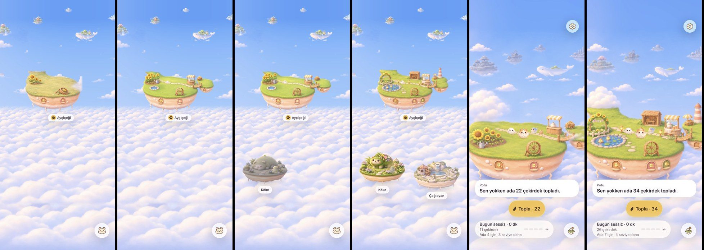
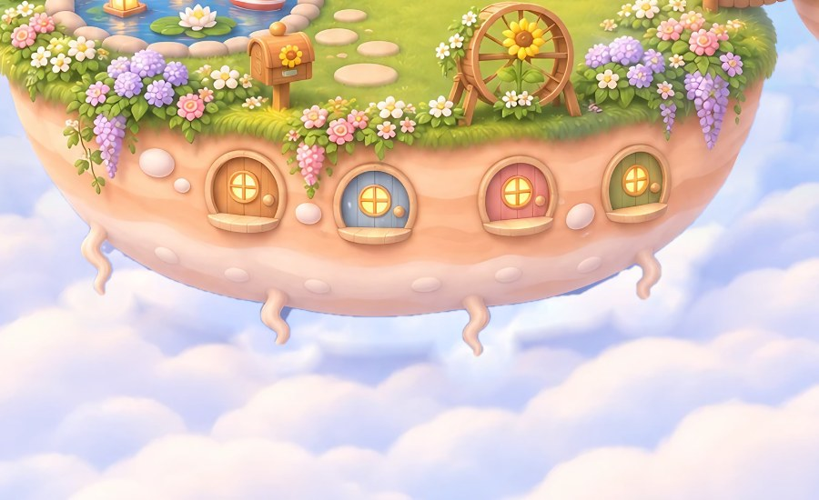
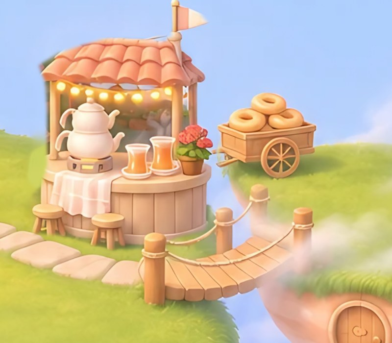
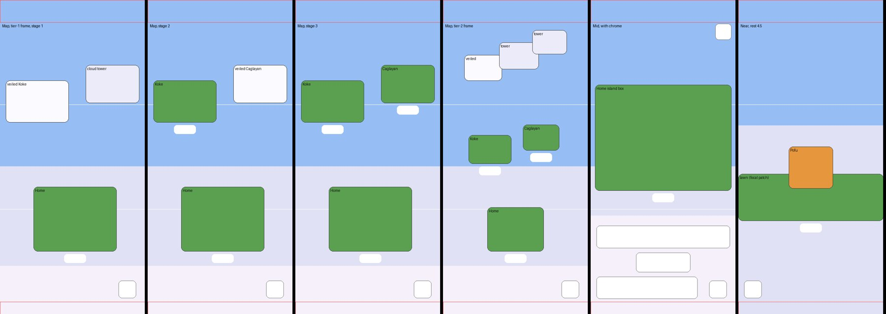

# World presentation v2: composition, life, edges, depth

Fable pass 2, 2026-11-15. Follows `feel-and-world-v1.md` (v1) and
`feel-and-world-proofs-look.md`. Base: `origin/main` at 5196def1. Taken as
decided (founder-input 28 and 32): stations wear their own level, near is
the macro look, water is the region shader, one camera is the depth
function, 120 Hz only under the finger, music later.

Checked for this pass: six shipped frames from `screenshots/main` (four
Maps, two Homes), the v2 proof stills in 1:1 crops, `plate-home.json`,
`IslandFraming`, `HomePlate.mapStop`, `WorldHome`'s chrome,
`IslandScene.swift:848, 946`. Every number marked *(start)* is a starting
value that proof round 3 (section 10) confirms or moves; every number
marked *(scout)* rests on a fact I did not gather (section 11).

## 0. What the four notes really are

**1. "Everything sits too high" is in the shipped app, not only in the
proofs, and it has three causes in code.**

_Shipped frames. Day 1: one island at 28 to 43 % of the height, and 57 %
of the screen below it is cloud floor with one button. Day 13: Home at 26
to 45 %, two small islands at 62 to 78 %, the bottom 22 % empty. Home
(right two) is balanced, because the chrome carries the lower third._

- `HomePlate.mapStop` fits the union of Home, Koke and Çağlayan on every
  day, including the days when the player owns one island.
- The Map and the Island stop fit into the band between the Home chrome
  (118 pt on top, 198 pt below), and neither shows that chrome. The lower
  23 % is reserved for nothing.
- The neighbours are placed below Home and are smaller. So the heaviest
  shape is on top and the light ones under it, which is top-heavy, and it
  also fights perspective: lower on a ground plane means nearer, and
  nearer should be larger.

And one cause in the art: the cloud floor is one texture with the same
puff size from the horizon to the bottom edge. A cloud sea seen from
above has small puffs at the horizon and large ones near the viewer. A
floor without that gradient reads as wallpaper, which is the backdrop
"losing its weight".

The v2 proofs repeated all of this and added one more: they drew mid
without the chrome that carries its lower third. A layout proof without
the chrome is not a layout proof.

**2. Life** is a budget question with a free answer: v1's render-server
transforms cost no app frames, so the sky can carry far more motion than
it does. Section 3 spends it.

**3. Edges.** Two crops, both mine to have caught harder in round 2:

_Top: a blue-grey band hangs under the earth body at the lower right: the
plate's own sky and baked contact haze, kept by the matte. Bottom: a pale
patch of other grass left of the stall, a dark smear at the roof's upper
left, the old stall's ghost inside the new one, a mist blob on the bridge
post, a fuzzy lawn rim in front of the cart._

**4. Depth of field.** He is right that "Pofu sharp, the rest blurred" is
cheap, and proof 2's macro was exactly that: one blur radius for the
whole ground. A lens has a focal plane. Section 5 gives the world one.

**5. A gap the lead reported, confirmed in code.** On every painted Home
plate the world-prop layer is skipped (`if let props, plate == nil`,
`IslandScene.swift:848, 946`). The skip pots, the calm lantern and the
seed jar have not been on the player's island since the plates shipped.
The pots are the only place a resisted reach becomes something he can
see. This is a hole in the core loop, and section 6.3 closes it.

## 1. Composition

### 1.1 The screen

All numbers in points on the 402 x 874 reference (iPhone 17); other
phones scale by width and keep the bands' pt heights. One Swift type,
`ScreenBands`, owns these; nothing else hard-codes a band.

| Band | y | Holds |
|---|---|---|
| Top safe | 0 to 59 (the scene's default top inset; scout fact 1) | Sky only. No tappable pixel, no label |
| Top row | 59 to 118 | The gear at mid (right 56 pt). Sky, far isles, whale |
| Stage | 118 to the bottom chrome | The subject |
| Bottom chrome, mid | 628 to 840 | Line card, the one action, the glance (measured on the frames; the code constant says 676) |
| Bottom chrome, Map and near | corner only: x 314 to 386, y 766 to 840 | The place control (Map), the back control (near, mirrored left) |
| Bottom safe | 840 to 874 | Nothing tappable |

### 1.2 Five rules, each a number a script can check

On any settled frame, from the projected boxes (island box plus its name
chip; characters at near) and the layer list:

| # | Rule | Map | Mid | Near |
|---|---|---|---|---|
| C1 | Hero placement as a share of the height. Map: Home's foot (island box, no chip); if he picks Home on top, Home's box centre at 0.30 to 0.36 instead. Mid: the island's box centre. Near: the focused character's feet | foot at 0.79 to 0.81 | 0.42 to 0.46 with chrome | feet at 0.58 to 0.62 |
| C2 | Tallest full-width run with no subject and no chrome, as a share of the height | at most 0.18; 0.21 for the one run that holds the horizon | at most 0.15 | at most 0.30 (sky) |
| C3 | Each third of the screen holds a subject, chrome or a named backdrop feature (far isle, whale, cloud tower, lip) | all three | all three | top third may be sky |
| C4 | No island box is cut by a screen edge; nothing tappable inside the safe bands or the corner keep-out | yes | yes | characters whole or fully out |
| C5 | Smallest tappable island | at least 88 pt wide | n/a | n/a |
| C6 | At rest, no backdrop feature's box (far isle, whale, puff over 40 pt) comes within 24 pt of a subject, a slot or a chrome box | yes | yes | n/a |

_Round 3 corrected C1 and C2 and added C6: `world-presentation-round3-look.md`._

Plus one rule for time: **the frame may change only when a tier is
announced** (1.3). An unlock changes what a slot holds, never where
anything sits.

### 1.3 The Map: home in front, the journey rising

**Decision.** Home is the foreground and sits low. The other islands are
placed above it in tiers, further out and higher, the way distance looks
across a cloud sea. The horizon runs between Home and the first tier.

- **World positions** (units, origin = Home's box centre, +y down; Home's
  box taken as 330 x 257 *(scout)*). The tier pitch is 470: the smallest
  pitch at which no neighbour's box or chip enters the mid frame (1.4).

  | Island | Tier | Centre | Box |
  |---|---|---|---|
  | Home | 0 | (0, 0) | 330 x 257 |
  | Koke | 1 | (-150, -470) | 250 x 166 |
  | Çağlayan | 1 | (150, -540) | 212 x 150 |
  | Tier 2 (three places) | 2 | y -950 to -1100, x -190, 20, 200 | as painted |

  Within a tier the slots are staggered by 60 to 80 units so that two
  islands never form a level pair. Later tiers follow the story map's
  order; a tier holds two or three places.
- **A slot is never empty.** Each slot in the frame holds, in order of
  the player's progress: a plain cloud tower (not yet announced), a
  veiled tower with the island's silhouette inside (next to open), the
  island. The unlock is the veil thinning in place (section 9).
- **The frame is fixed per tier.** The tier-1 frame serves from day 1
  until Çağlayan blooms: Home, Koke's slot and Çağlayan's slot are in it
  on day 1. Fit: Home's foot at 0.80 of the height, the constellation
  between x 16 and 386 and below y 84; scale = the smaller of the two
  fits, clamped to at least 0.45 pt per unit.

  | Frame | Scale | Home | First tier | Second tier |
  |---|---|---|---|---|
  | Tier 1 (days 1 to Çağlayan's bloom) | 0.70 | 230 pt wide, y 520 to 699 | Koke 174 pt, y 224 to 340; Çağlayan 148 pt, y 181 to 286 | none |
  | Tier 2 | 0.47 | 156 pt, y 577 to 699 | y 347 to 455 | y 84 to 224 |
  | Tier 3 and later | 0.45 | the Map pans vertically, one finger, snapping to tier frames; it rests on the tier of the island he came from and the two below | | |

- **Backdrop at the Map:** horizon at 0.53 of the height (it falls in
  the gap between the first tier's chips and Home's top); far isles and
  the whale in the widest sky band that no slot owns (tier 1, journey
  order: y 350 to 450, in front of the horizon; C6), never y 62 to 200,
  where they sat on the slots in round 3; the foreground cloud lip from y 740 down,
  under the place control. Bottom run without a subject: 16 %.

_Green: tappable islands with their chips. White: veiled slot. Grey:
cloud tower. Red: safe bands. White lines: thirds. Rightmost: orange is
the character, green the lawn in focus._

**Set aside, and shown beside it in round 3 so he chooses on the
screen:** today's order (Home on top), re-fitted per tier with the same
rules. It fixes the empty bottom and keeps the top-heavy shape. A scout
confirms no story text needs the neighbours below Home (section 11).

### 1.4 Mid

- **Fit to the island's box**, not to a constant: the level 10 box (with
  the harbor islet) is 378 pt wide (0.94 of the width), scale 1.145, box
  centre at y 383, so the island spans y 236 to 530. Sky with the whale
  above (118 pt; its rest pose left of x 290, clear of the gear), the cloud lip from y 600 as the bed the chrome sits on.
- **The frame does not chase growth.** Every island level uses the level
  10 box, so the island visibly grows into its frame. Exception: if a
  young island would be under 0.72 of the width, fit to that *(scout:
  box width per level)*.
- No neighbour is visible at mid (the pitch guarantees it). Mid has no
  pan; the 30 pt peek stays.
- The chrome fades out between 1.05 and 1.25 times the mid scale. As it
  fades, the camera's anchor eases from y 383 to y 437 (the middle), so
  the picture re-centres when the chrome that balanced it leaves.

### 1.5 Near

- A free range, 1.25 times mid up to 7.4 pt per unit. Rest (double tap on
  a character): 4.5, where Pofu is 122 pt wide. Limit: Pofu at 201 pt.
- The focused character's feet at 0.60 of the height; horizontally at
  0.50, moved up to 0.12 of the width away from the side he faces.
- Pan is free on both axes while the screen's centre stays inside the
  island's box grown by 10 %; past it, a 30 pt rubber band.
- Only the back control shows (bottom left). Collect at near is a tap on
  the jar (6.3).

## 2. The backdrop as layers of one camera

Each layer has a depth exponent k. With the mid camera as reference
(scale s0, look L0, anchor A), a camera at scale s and look L draws a
layer at

    scale_k = s0 * (s / s0)^k
    look_k  = L0 + k * (L - L0)
    screen(p) = A + scale_k * (p - look_k)

k = 1 is the island; k = 0 never moves. This one function replaces
`PaintedSky.mapPose`, the per-stop sky placements and the z cross-fades.

| Layer | k | Art | Note |
|---|---|---|---|
| Sky gradient, sun, stars | 0 | per light, per region | |
| Horizon band (the sea's far edge) | 0.05 | tile, puffs about 12 pt | A horizon does not move when a camera moves in; it stays at 0.53 |
| Far isles | 0.25 | cut-outs | Not tiles: they belong to a region and change by world position in a flight |
| Whale | 0.35 | cut-out | |
| Cloud puffs | 0.6 | 5 to 7 single cut-outs, not one tile | |
| Floor, middle | 0.45 | tile, puffs about 40 pt | |
| Floor, near | 0.85 | tile, puffs about 90 pt | Carries each island's soft shadow |
| Cloud towers and veils | 1 | cut-outs at Map slots | |
| Islands | 1 | sections 4 and 6 | |
| Wisps | 1.1 | 2 thin cut-outs | Cross an island's foot |
| Lip | 1.25 | tile, puffs 160 pt and larger, soft | The bottom edge's weight; the chrome's bed |

The four floor layers are the ground plane: puff size and k both rise
toward the viewer, and that gradient is the weight the floor lacks today.
Each floor layer has a soft top edge, so no seam needs to join at the
pixel. Çağlayan's region keeps its own sky, far isles and floor tint; the
blend between regions is by the camera's world position.

## 3. Life

All of it is transforms on cached layers, run by the render server: no
app frame. The region shaders keep v1's limit (5 % of the pixels, 30 Hz).

| Layer | Motion *(start)* | Tier |
|---|---|---|
| Horizon band | drift 0.5 pt/s | Ambient |
| Floor middle, near, lip | drift 1.5, 3, 5 pt/s; swell up and down 3, 5, 8 pt over 11, 17, 23 s | Ambient |
| Cloud puffs | each its own drift, 2 to 5 pt/s; breathe 1.5 % over 14 to 20 s | Ambient |
| Far isles | bob 2 pt over 9 to 13 s, phases apart | Ambient |
| Whale | glide 5 pt/s, bob 4 pt, roll 1.5 degrees | Ambient |
| Birds | 3 to 5 marks cross every 45 to 120 s | Ambient |
| Towers and veils | billow 2 % over 20 s | Ambient |
| Islands at the Map | bob 2 pt over 6 to 9 s, phases apart. None at mid or near: targets stay still | Ambient |
| Wisps | one crosses an island's foot every 20 to 40 s | Ambient |
| Cloud shadows on the lawn | a multiply layer drifting 8 pt/s inside the island's matte | Ambient |
| Sun shafts | opacity 0.25 to 0.45 over 12 s | Ambient |
| Water, lamps, sway | region shaders, as v1 | Ambient, paused in Direct |
| Hour change | cross-fade over 20 s | Ambient |

**Limits.** At most 24 moving layers at the Map, 18 at mid, 10 at near.
Nothing ambient but the birds faster than 8 pt/s, no full-width layer
faster than 5, and no period under 5 s: Pofu is a
calm place. Periods are chosen not to share a multiple, so the picture
never visibly loops. In the Still tier every layer eases to its rest
phase in 2 s.

**Check (`tools/proof/life_meter.py`, on a 12 s clip at 30 Hz).** Round 3
showed that the share of changed pixels measures how much textured area
moves, not how fast: a floor sliding at 16 pt/s and one at 3 score the
same. So: (1) speeds are checked on the layer list against the limits
above, not on pixels; (2) each third of the screen changes by at least
4 % of its pixels (more than 4/255, one second apart) and a Still clip by
0; (3) the meter prints the mean absolute change between adjacent frames,
which gates nothing until the founder has judged the round-3 clips and
his verdict gives it a range. In the app, the Rehearsal
log counts app-rendered frames per 10 s at ambient: only the region
shaders' ticks may appear.

## 4. Edges and mattes

### 4.1 The standard

- **Everything over the sky is a matte at texture resolution.** The 20
  Home plates get full-size mattes made from the plate with the shipped
  quarter-size cut as the trimap. `feather: 48` in `plate-home.json`
  goes to 0.
- **What an island's matte holds:** earth, lawn, overhanging plants, root
  tendrils, everything standing on it. **What it never holds:** the
  plate's sky, cloud, mist, or the haze under the body. The island's
  shadow is drawn by code on the near floor layer; falls and mist are
  effects.
- **Edge colour is the object's.** Edge pixels are decontaminated: the
  colour of a half-transparent pixel is taken from the object inside it.
- **Station looks sit on an erased base.** Each plate gets a base with
  every station painted out (section 7). A look is the object plus a
  separate shadow matte, always composited object-over-ground, so the
  downward hole of proof 1 cannot occur.
- **Soft edges are declared.** A region that is meant to be soft (steam,
  a fall's foot) is a polygon in `softEdges`; the checks skip it and I
  look at it.

### 4.2 The acceptance check: `tools/art/matte_check.py`

Run on every matte and every look, in CI for shipped art. Lengths are
texture pixels.

| # | Test | Pass |
|---|---|---|
| M1 | Border: alpha along the image's four borders | 0 everywhere (no rectangle), unless `fullBleed` |
| M2 | Width of the 0.05 to 0.95 alpha band along the edge normal | 95th percentile at most 3 (islands), 2 (looks, props); 5th percentile at least 0.7, so a stepped one-bit edge fails |
| M3 | Contamination: for edge pixels, how far the recovered colour is pulled from the nearest opaque colour toward the source's sky at that row (0 to 1) | 95th percentile at most 0.15 |
| M4 | Specks and holes: alpha above 0.02 outside the main shape, or below 0.99 enclosed in it, in patches under 64 px | none |
| M5 | Halo in use: composited over the day, golden and night destinations at device scale; a 6 px ring outside the shape, starting one device px out (the first holds the edge's own anti-aliasing; M2 and M3 guard it), against the destination alone | mean difference at most 2/255 |
| M6 | Rim: a 4 px ring inside the shape against the next 8 px inward, in luminance | within 8 % |
| M7 | Look locality: base plus look, outside the look's matte grown by 2 | equal to the base, at most 1/255 |
| M8 | Look wholeness: inside the matte shrunk by 2, against the painting it was cut from | at most 2/255 |
| M9 | Ghost: correlation of the erased base's fine detail with each look's fine detail, inside that look's matte | at most 0.25 |
| M10 | Registration: named anchor points across stages and lights | within 1 px |
| M11 | Haze: opaque pixels near the outside that are the source's own sky colour, in a connected patch of 16 px or more | none |

The script writes a JSON report and one sheet of the eight worst edge
spans at 4x. Numbers gate; the sheet is what I and then the founder look
at, at 1:1 over all three lights.

## 5. Depth: one lens for the world

### 5.1 The model

The camera is a lens focused on a plane. Blur depends on how far a thing
is from that plane, and on the shot.

- **Subject distance** follows the framing: `D = 1375 / s` units
  *(start)*: 1200 at mid, 306 at rest, 186 at the limit.
- **Depth of a point** is its distance behind (+) or in front (-) of the
  focal plane. On the island: `delta = (rowFocus - row) * unitsPerPixel *
  cos(e) / sin(e)`, where `row` is the plate row of the point's foot and
  `e` the painting's camera elevation (10.5 degrees for Home, from the
  lawn ellipse, scout fact 5; the code comment's 17 does not fit the
  ellipse; the depth per row is twice what 20 gave, so R4 retunes the
  aperture). Ground
  pixels use their own row. A standing thing (station, character, prop)
  uses its `footY` for all its pixels, so it is sharp or soft as one
  object. The earth face uses the lip's row.
- **Blur radius, in points:**

      r = N * s * |delta| / (D + delta)     capped at 14

  `N` is the shot's aperture. This is the thin-lens circle of confusion
  with its constants folded into `N` and 1375.
- **What it gives without any special case:** the nearer the camera, the
  thinner the sharp zone (macro behaves like macro); at mid the whole
  island is inside it (a landscape is sharp front to back); two things
  on the same row are sharp together whatever they are.
- **Sharp means r at most 0.5 pt.** Below 0.35 pt a layer skips the blur.

| Layer | delta |
|---|---|
| Sky, horizon band | infinite: r = N * s |
| Far isles, whale | 8000, 5000 |
| Cloud puffs, floor middle | 2500, 1500 |
| Floor near, towers | 400 |
| Island, looks, props, characters, dressing | from the row, as above |
| Wisps, lip | in front; out of frame at near |

### 5.2 Shots

| Shot | s | Focal plane | N | Result |
|---|---|---|---|---|
| Map, flights | up to 0.9 | n/a | 0 | No blur |
| Mid | 1.145 | island centre | 0.25 | Everything sharp; sky r 0.3 |
| Station focus, the build moment | up to 2.6 | the station's foot | 0.8 | Station and its row sharp; far lawn r 0.3; sky r 2 |
| Near, rest | 4.5 | the character's foot | 1.6 | Sharp zone about 20 units each way; a stall 60 units behind r 1.2 (legible); sky r 7 |
| Near, limit | 7.4 | the character's foot | 1.3 | Sharp zone about 10 units; village r 2.3; sky r 9.6 |
| Two in frame | any | midway between the two foot rows | lowered until both have r at most 0.6 | Both sharp; the background gives up blur to pay for it |
| Rack | any | moves between two planes in 0.6 s | holds | Used by the reveal and by a tap on another character |
| Night | any | as the shot | times 1.25 | Lamps bloom into soft discs |

`N` between shots follows the scale: 0.25 up to 1.6 pt per unit, rising
smoothly to 1.6 at 4 and easing to 1.3 at the limit. Every row above is a
value in `plate-*.json` (`near.shots`), tuned on stills, not in code.

### 5.3 What is sharp on the focal plane

A focal plane is only convincing if the plane itself has detail. At near
the plate has 0.28 to 0.46 texture pixels per device pixel, so:

- **Characters:** their own art (Pofu 522 px; the residents *(scout)*).
- **Station looks ship at twice the plate's resolution** (cut-outs only,
  from the x2 upscaler in `docs/research/plate-upscale.md`): 0.92 at
  rest. A stall on Pofu's row is sharp beside him, which is the
  founder's point exactly.
- **A focal ground patch:** one painted patch of lawn (grass blades,
  clover, soil flecks; soft alpha edge) laid under the focused character
  at near, tinted by the plate's colour beneath it and clipped to the
  lawn. It makes the ground sharp where the lens says it is sharp.
- **Near dressing:** small props on or behind the focal row. None in
  front of the sharp zone (proof 2: large blurred foreground shapes fail).

### 5.4 How it runs

The picture is still while the camera rests, so the blur is not a
per-frame kernel. The island composite is kept at four blur levels
(radius 0, 2, 6, 14 pt at the current framing) and blended by soft masks
cut from the depth channel of the packed mask (section 6.1). Sky layers
and characters take a plain layer blur of their own radius. During a
pinch (Direct tier) the levels' radii follow the scale on the render
server; the masks are static. Whether this is a layer stack or one
shader reading an atlas is the Opus prototype's call; it passes when no
band edge is visible at 1:1 and the Direct tier stays at 120 Hz.

## 6. The layer schema

### 6.1 `plate-<island>.json`, version 2

Added to today's keys (which stay):

    "camera":   { "elevationDeg": 10.5, "midBox": [x0, y0, x1, y1], "minWidthShare": 0.72 }
    "base":     "world-home-base-<light>-<stage>"          // stations erased
    "matte":    "world-home-matte-<stage>"                 // full size, one per stage
    "mask":     "world-home-mask-<stage>"                  // R water, G sway, B emissive, A depth row
    "softEdges":[ { "id": "...", "polygon": [...] } ]
    "stations": [ { "id": "teaStall", "footY": 852, "slot": [...polygon...],
                    "looks": [ { "level": 1, "art": "world-home-look-teaStall-1-<light>",
                                 "shadow": "...-shadow", "box": [...], "from": "plate:8" | "codex" } ] } ]
    "props":    [ { "id": "jar" | "pots" | "lantern", "footY": ..., "tap": [...polygon, at least 44 pt at mid...],
                    "slots": { "<stage>": [x, y] }, "states": [...], "occludedBy": ["wheel"] } ]
    "water":    [ { "id": "pond", "flow": [[x, y], ...], "speed": 6 } ]
    "near":     { "patch": "world-home-near-patch", "dressing": [ { "art": "...", "at": [x, y], "footY": ..., "stages": [...] } ],
                  "shots": { "rest": { "s": 4.5, "N": 1.6 }, ... } }

`skyset-<region>.json` gains `k`, `delta` and `motion` per layer
(sections 2, 3, 5), and `mapSlots` for towers and veils.

### 6.2 Draw order on an island

1. Base plate through its matte, at the blur levels.
2. Station looks, back to front by `footY`, each with its shadow.
3. Props, characters, near dressing and the ground patch, sorted with the
   looks by `footY`; today's occluders still cut what stands behind them.
4. Cloud shadows (multiply), region shaders (water, sway, emissive).
5. Effects.

**The far picture is a snapshot of this composite**, rendered once at
half size whenever the state changes and cached by a state hash. The
shipped `mapisle` cuts retire: they could never show the player's own
station looks, and a snapshot is by construction the same picture as
mid, which settles v1's swap question.

### 6.3 The props come back, painted, over the plate

- **Over the plate, not into it.** The pots change with every reach, the
  lantern with calm, the jar with every collect. Nothing that changes
  within a day can live in a painting chosen by island level.
- **Painted, not the sprite art.** ADR-0022 found a sprite on a plate
  reads as foreign, and proof 2's dressing frames showed it again. Codex
  paints them in the plate's clay style (section 8). Glow and count tags
  stay code.
- **Where, in the composition.** All three stand on the front lip, the
  row of the things that matter, and they are spread so each third of
  the island's width has one:
  - **Jar:** front centre, just right of Pofu's stand. It is the most
    tapped thing on the island, so it gets the centre of the thumb's
    reach.
  - **Pots:** a row on the left lip toward the garden, where planted
    things belong. One tap target for the row (it opens Today).
  - **Lantern:** on a short post at the right lip, by the tea corner and
    the bridge. Calm and evening belong with tea.
- **Per stage.** A slot per island level in `props[].slots`, because
  decor moves in as the island grows (the west bush and the mailbox
  arrive on the left lip at levels 7 to 10). A script proposes each slot
  as the free lip span nearest the default; I look at the ten.
- **Size and distance.** At mid the jar is about 22 pt tall with a 44 pt
  target; the chrome keeps Collect, so nothing depends on a small tap. At
  near the props are subjects: the jar collects on a tap, and a pot
  blooming after a resisted reach is a moment worth the camera (the rest
  shot, focal plane on the pot row). At the Map they are in the snapshot.
- **Depth:** by `footY`, like everything else. They take contact shadows
  from code and are cut by occluders.

## 7. The station-look matrix

- **Looks: 8 stations x 5 levels x 2 lights = 80 cut-outs**, golden
  graded from day by the harmony grade (checked on one look before the
  batch). A station at level 0 shows its plot from the base.
- **Presence = built.** Today a station appears only at the island
  levels whose plate paints it (the windmill only at levels 8 to 10). On
  the base it appears when the player builds it, at any island level.
- **Sources.** First by script from the plates, wherever a station has a
  distinct painting (the tea stall has about five). The rest by Codex,
  painted in place on a crop of the base and cut by difference against
  that base. The scout's table (section 11, fact 3) turns this into exact
  counts; my estimate is 30 to 40 Codex looks.
- **Level to look.** Where the plates hold fewer than five looks for a
  station, levels share a look only until Codex fills the gap; no badge.
- **Bases: 20 erase jobs** (10 levels, day and night), all stations in
  one edit per plate, after the 2-job pilot passes M7 to M9.

## 8. What Codex paints, and the manifests

Slugs for the manifest writer; batch numbers are theirs. Common brief for
all: the Home day plate's soft clay style and its key light, reference
crops at 1:1 from the level 10 plates, transparent background unless
stated, no outline, no baked cast shadow.

| Manifest | Jobs | Content | Accept |
|---|---|---|---|
| `world-base-erase-pilot` | 2 | Tea stall and garden painted out of the level 10 day plate | M7 to M9; recomposite at near |
| `world-base-erase` | 18 to 20 | All stations out of each plate, day and night | M7 to M9, M10 |
| `world-station-looks-<station>` | 30 to 40 in all | Missing looks, painted in place on a base crop, day and night | M2 to M9 at twice plate size |
| `world-near-dressing-pilot` | 3 | As in the proofs-look doc | Reads as plate beside Pofu at 1:1 |
| `world-near-patch` | 1 day, 1 night | The focal ground patch, 1024 x 512, soft edge | Sharp under Pofu at rest and limit; no visible border |
| `world-home-props` | 4 | Jar (empty, third, two thirds, full); pot (empty, sprout, bloom, asleep); lantern (unlit, lit; glow in code); night set only if the grade fails | M2 to M6; reads as plate at mid and near |
| `world-cloud-kit-pilot` | 2 | One lip tile and one cloud tower, day | Weight and softness at the Map and under the chrome |
| `world-cloud-kit` | about 10 | Three floor tiles by puff size, lip, 3 towers, 6 puffs, 2 wisps; night by grade | M1 to M4; a 12 s clip passes the life check |

Not Codex: mattes, masks, depth, flow lines, slots, the veil's silhouette
(a blurred, tinted copy of the island's own matte).

## 9. The rail and the reveal

### 9.1 Rail

- One parameter z. `ln s` is linear in z: z = 0 the current tier frame,
  z = 1 mid, z = 2 the near limit (7.4). Rest is z = 1.73.
- Release: below 0.5 to the Map; 0.5 to 1.12 to mid; above 1.12 it stays
  where the fingers left it. Rubber band to 0.85 times the Map scale and
  1.12 times the limit.
- A pinch zooms about the fingers' midpoint: the world point under it
  stays under it. Today's zoom about the anchor is why near would feel
  like a slider and not a camera.
- Anchor and chrome as in 1.4. Pan as in 1.3 and 1.5.
- A flight is the same rail: out to the scale that fits both islands'
  boxes (not a fixed z), across, in. The sky follows by k and needs no
  rule of its own.
- Springs and the 120 Hz Direct tier are unchanged.

### 9.2 Reveals

| Moment | Sequence | Length |
|---|---|---|
| Station level-up | Sheet drops; camera to the station focus shot, focal plane racks to the station (0.5 s). The old look dips 4 % at its foot with a dust puff (0.25 s). The new look opens through a ring growing from the foot (0.7 s, soft 10 pt edge with a honey rim), `level-up` at the ring's start; the look settles from 1.06 to 1 (0.35 s); shadows cross-fade; seeds and the level tag; one or two residents hop at 0.9 s; camera and focus return | at most 3.2 s, Moment tier |
| Island grows | The same ring from the island's centre through the two bases' difference, at mid (2.4 s, ADR-0022); up to three new pieces of decor settle back to front | 3 s |
| Island unlocks | At the Map: the veil's three cloud layers drift apart and thin (2 s), the island's bob starts, its chip fades in. Nothing else moves | 2.4 s |
| A tier is announced | On the first Map visit after: the camera eases to the new tier frame (1.2 s), then the new towers rise from the horizon band | 2 s |
| A pot blooms | Rest shot on the pot row; the bloom opens; `pofu-hop` from Pofu | 2 s |

Reduce Motion: each becomes a 0.4 s cross-fade with no camera move.

## 10. Proof round 3

Before any Swift. Sonnet scripts under `tools/proof/`, three in flight;
I look at every output at 1:1 before the founder does. Stills are 1206 x
2622, clips that size at 30 Hz, to his Photos. **Every still carries the
real chrome for its distance**, cut from shipped frames.

| # | Proves | Made | Needs | He looks at |
|---|---|---|---|---|
| R1 | Note 1 | `composition.py`: the Map at stages 1, 2, 3 and the tier-2 frame, in both orders (journey rising; Home on top) = 8 stills; mid with chrome at island levels 1, 4, 10 = 3; near at rest and limit = 2. `composition_check.py` prints C1 to C5 per still | Cloud floor in four puff sizes, made by scaling the existing tiles; the pilot lip and tower if they have arrived | The two orders side by side at stages 1 and 3; then mid; one choice: which order |
| R2 | Note 2 | `life.py`: two 12 s clips, the Map at stage 3 and mid, with section 3's motion; `life_meter.py` | R1's layers | Both clips, beside today's Map. Is it alive, is it still calm |
| R3 | Note 3 | `island_matte.py` v2 on the level 4 and 10 plates, day and night; `matte_check.py`; an edge tour: four stills at 2.7 along the rim over day, golden and night skies; the tea stall and the garden on the erased base, both directions, at near | The 2 pilot erase jobs | The edge tour and two station stills. Any edge he can find is a fail |
| R4 | Note 4 | `dof.py`: per-pixel blur from the model, and the same frames through the four-level blend, to show the app's version and not only the ideal. Six stills: mid; station focus; Pofu at rest with Mochi (two in frame); Pofu at the limit; the tea stall on his row sharp beside him; proof 2's one-radius macro as the control. One 4 s rack from Pofu to the stall | The patch job and the dressing pilot; the upscaled stall | The control beside the two-in-frame still; the rack clip |
| R5 | The props | Jar, pots and lantern at their slots at levels 2, 6 and 10, mid and near | `world-home-props`, or the sprite art marked as placeholder for position only | Whether he can find his pots at mid without being told |

Pass for the round: C1 to C6 and M1 to M11 green, the life check in
range, and no still I would not show. Cost: about 5 agent-days of Sonnet
and 9 Codex jobs (2 erase, 3 dressing, 1 patch, 2 cloud, 1 props sheet).

## 11. Facts for a scout

1. The safe-area insets the app reads on iPhone 17, and the chrome's real
   boxes at Home (line card, action, glance, gear, place control).
2. The island's box per island level, in units; the free spans of the
   front lip per level (for the prop slots).
3. Per station, per level plate, day and night: how many distinct
   paintings exist and which levels they map to (v1's fact 1).
4. `plate-home.json`: the pier is present at stages 0, 1, 2 and 5, the
   garden at every stage but 7. Intended or errors?
5. The camera elevation of the Home, Koke and Çağlayan paintings (from
   the lawn's ellipse).
6. Whether any story, lore or art text places Koke or Çağlayan below
   Home (the undersides doc, the falls), and the story map's island
   order, to assign tiers.
7. What `pofuDepthBlur` does today; whether a SwiftUI shader can read
   more than one image; whether a blur on a still layer is cached.
8. Proof 5's result: do repeating SwiftUI transforms cost app frames?
9. The most pots a day can show; the lantern's and the jar's states.
10. Where the blue band under the island comes from: the plate, the
    backdrop, the feather or the matte.
11. The state of the Codex pilots (2 erase, 3 dressing).
12. The residents' art sizes (v1's fact 2), for near.

## 12. The PR split

| PR | Who | Does | After |
|---|---|---|---|
| W1 mattes | Sonnet | `matte_check.py`, full-size mattes for 20 plates, `feather` 0, the island shadow as data | R3 |
| W2 one camera | Opus | The layer function of section 2, `k` in the sky sets, removal of `mapPose` and the z fades; the rail of 9.1 with pinch about the fingers | R1, W1 |
| W3 composition | Opus | `ScreenBands`, world positions, tier frames, slots with towers and veils, fit-to-box mid, anchor easing; C1 to C5 as unit tests on projected boxes (pure maths, runs on Linux) | W2 |
| W4 cloud kit and life | Sonnet | The floor layers, puffs, wisps, lip, cloud shadows as render-server transforms; `life_meter.py` in the screenshot job | W2, cloud kit |
| W5 looks data | Sonnet | The cut tool, bases, look cut-outs at twice size, the matrix in JSON, `matte_check` in CI | Erase batch, fact 3 |
| W6 looks runtime | Opus | The compositor, the far snapshot, presence = built, the level-up and grow reveals | W1, W5 |
| W7 props | Sonnet | Slots, painted props over the plate, tap targets, occluders, the jar's collect at near | W6's compositor, props batch |
| W8 near | Opus | The free range and pan, the depth channel, the four-level blur, shots, the patch and dressing | W2, W6, R4 |
| W9 region shaders | Opus | Water, sway and emissive from the packed mask (v1) | W8's mask |
| W10 unlock and tier reveals | Sonnet | 9.2's Map moments | W3, W4 |

World and feel still touch different files. At three in flight: W1, then
W2, then W3, W4 and W5 together, then W6, W7 and W8, then W9 and W10.
Estimate: 34 agent-days (Opus 19, Sonnet 15) and 70 to 85 Codex jobs,
replacing v1's world rows.

## 13. For the founder

Only one thing here is his and not the screen's: **the order of the
Map.** Home in front with the journey rising behind it moves Koke and
Çağlayan from below Home to above it. R1 shows him both.

## Corrections for the lead

- v1 4.4 fact 3 and the proofs-look doc treated the rectangle as the
  matte problem. The matte is also wrong where it exists: it keeps the
  plate's haze under the body (section 0, note 3).
- `IslandFraming.bottomBand` is 198 pt; the Home chrome with a line card
  starts at 628, 246 pt from the bottom.
- The v2 proofs' "one tall seamless cloud floor" (my request in round 2)
  is withdrawn: one texture cannot carry a ground plane. Section 2
  replaces it.
- v1 kept the shipped `mapisle` cut for the far picture. With station
  looks it would show an island the player did not build; 6.2 replaces
  it with a snapshot.
