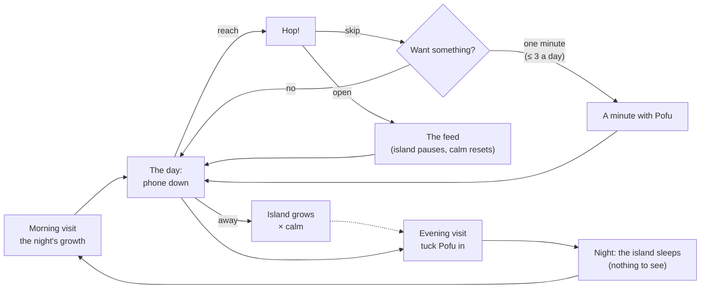
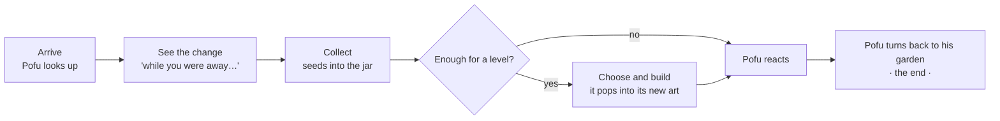
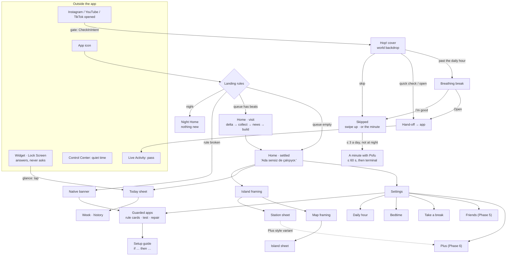

# The App and the Game: Where the Line Is

_Status: **accepted as the direction** (lead, 2026-11-01). No ADR-0019 for
now: the rules are tunable, so they live here and in the game design. §13's
edits land with the IA and user-flow rewrite after the founder's gate week
([iteration plan](../archive/iteration-plan.md), stage G). Last updated:
2026-11-01._
_Builds on the [vision](vision.md), [game design v2](game-design.md),
ADR-0012 to ADR-0017, ADR-0018 and the iteration plan (open branch
`docs/visual-system-v1`), [design review 01](../archive/review-01.md), the
local reports in [`docs/archive/local-reports/`](../archive/local-reports/), and the
founder's input of 2026-11-01 (opening intents, habit substitution, the
diagnosed setup failure). Storyboard (Turkish copy, phone-first):
[`design/prototypes/app-game-boundary/`](../../design/prototypes/app-game-boundary/index.html).
Motion and micro-interactions are out of scope; this document fixes
structure and boundaries only._

## 0. The answer in one paragraph

Pofu is **a guard that keeps a garden**. The product is the half second at
the door of Instagram, YouTube and TikTok (Hop!); the archipelago is the
visible proof of the time you did not spend there, and, after a resisted
reach, a **healthier place for the urge to go**: one finite minute with
Pofu instead of the feed. Every open of Pofu has an intent (the gate, a
glance, a visit, a minute, setup or repair), and each intent has its own
landing, length and exit. Most glances never need the app. A visit or a
minute plays at most three beats and then **Pofu turns back to his
garden**: the world stays open, but nothing in it asks for you again until
you have been away, and staying longer yields nothing because seeds grow
only while you are away. Everything you configure is a plain native list,
written as a rule you would say out loud ("if Instagram opens, Pofu
comes"); everything you feel is the world; anything broken is native,
first, and one tap away.

## 1. What is wrong with the current plan

The direction (an idle archipelago behind a soft gate) is right; the
founder confirmed the game identity. The boundary between the two is not
yet designed, and several existing decisions pull the wrong way:

| # | Current decision or artifact | Why it is wrong | Fix |
|---|---|---|---|
| 1 | **Every open lands on the same Home** (IA, prototype) | A glance, a visit and a repair are different jobs with different lengths. One landing makes each of them worse and makes every open a game visit. | Opening intents (§2) |
| 2 | Home's primary button is **"Quiet time with Pofu"** (prototype, review 01) | It puts a timer session, inside the app, in the hero slot. Quiet time accrues by itself since ADR-0014. The hero slot of an anti-scroll app should never invite staying. | A contextual primary that disappears (§3, §6.3) |
| 3 | The skip celebration offers **"Breathe for a minute · Start a focus"** chips (user flows §2) | The instinct is right (give the urge somewhere to go) but the routines are open-ended app features with no end and no reward. | One finite ritual, "A minute with Pofu" (§3.3) |
| 4 | **A 21:30 push**, "Pofu's day is ready" (user flows §5, onboarding copy "once in the evening") | It pulls people into the phone at the riskiest hour, for a summary a widget can show. | Off by default; when on, the notification *is* the summary (§7.3) |
| 5 | **Streaks** in the vision (principle 3, "Together: share streaks"), the roadmap (Phases 1, 4, 5) and the IA's Free table | They contradict game-design A4 and A8. A streak is a daily open obligation by another name. | Cumulative counts only (§7.6) |
| 6 | **A friends avatar on Home's top bar** (prototype) | Friends are Phase 5: a dead button until then, a social pull on the root after. | Settings; Home shows a pending request only (§8) |
| 7 | **Home carries eight things** (wellbeing, friends, gear, calm, bubble, Today card, primary, island button) | A dashboard pasted over a game; each item is a reason to look. | At most five chrome items (§6.3) |
| 8 | **The setup guide speaks Shortcuts' language** (user flows §1 step 7, `SetupGuideView`) | The founder thought "if Instagram opens, then do X" (exactly what an automation is), searched "Insta" and "Pofu" in Shortcuts, found only actions, and never reached the App trigger in the Automation tab. His mental model was right; the guide never met it. | Setup as a rule in his words (§10) |
| 9 | **Setup is an onboarding step and a Settings row** | Without a working gate there is no product and, by ADR-0014's observation window, no growing island either. Setup health is the most important utility, and it is buried. | Broken setup overrides the world natively; the island wakes with the first real Hop! (§9.3, §10) |
| 10 | **The IA and user flows are room-era** (passes store, "Fill my cheeks", 1 seed = 1 minute, skips never earn) | Superseded by ADR-0015 and ADR-0016, yet still what an engineer would build from. | Rewrite list (§13) |
| 11 | **Looking at Pofu counts as "away"** (A9 says opening Pofu earns nothing, but a long stay still grows calm) | If thirty minutes staring at the island grows calm like thirty minutes with the phone down, Pofu is a safe place to scroll. | Past two minutes in the foreground, Pofu is not "away" (§7.7) |

## 2. Opening intents

Pofu cannot read a mind, but it knows how it was opened. Each way in maps
to one intent, and each intent gets its own landing, length and exit.

| Intent | The user's question | How Pofu knows | Landing | Length | Exit |
|---|---|---|---|---|---|
| **Gate** | "I'm opening Instagram" (often not even a question) | `CheckInIntent` (later the shield's "Talk to Pofu") | Hop! cover over the world backdrop | ≤ 3 s on the skip path | Skipped (terminal), the minute, or the hand-off |
| **The minute** (substitute) | "I still want *something*" | Chosen in Hop!'s skipped state | The world, framed as one minute | ≤ 60 s, visibly | Pofu ends it: "Bu kadar." Terminal. |
| **Glance** | "How am I doing? How is Pofu?" | **Ideally no open at all**: widget, Lock Screen. In the app: a widget tap (`pofu://today`) | Outside: the widget answers. Inside: the Today sheet over the settled world | 0 s outside; 2–5 s inside | Swipe up. Nothing to continue. |
| **Visit / play** | "Let's see the island" | App icon, or a bubble action, with a non-empty visit queue | Home in the **visit** state | 30–60 s, p90 ≤ 150 s | Pofu turns back to his garden: the **settled** state |
| **Settled reopen** | (the reflex) | App icon with an empty queue | Home in the **settled** state, Today card readable at once | 2–5 s | Nothing to do; swipe up |
| **Setup / repair** | "Make Pofu work" | Onboarding, the Home banner, Settings, the one reminder after a skipped setup | A native setup or repair flow, the rule card first | As long as it takes; target ≤ 90 s per app on iOS 26, ≤ 20 s with the iOS 27 import | "Yakaladım!" on verification, back to Home |

### Should a glance need the app?

No. A glance is the most frequent non-gate reason to open Pofu, and every
answered glance outside the app is one fewer reason to build an
app-opening habit. So:

- **Home Screen widget** (small and medium): Pofu's mood, the calm, skips
  today ("8 / 11"), guarded minutes ("38 / 60 dk"), the island as it is.
- **Lock Screen widgets**: a calm ring with "×1,6", and "8 vazgeçiş".
- **Live Activity** only while a pass or quiet time runs.
- **They answer and never ask** (A18): no "seeds waiting", no "ready to
  build", no "new island". A widget tap opens the Today sheet (a glance),
  not a visit.
- **Before the paid membership:** widgets read shared state through an App
  Group. Whether the free Personal Team build may use an App Group is
  **unverified** (a task for the local agent); if it may not, the in-app
  glance (Today card readable at 0 taps on any landing) is the stopgap.

## 3. The core game loop

The founder's brief: the game is a healthy alternative to the Reels
reflex, and the loop must be right. Habit research describes a habit as
cue → routine → reward. Pofu keeps the **cue** (the reach, the boredom,
the half-second urge), keeps a **reward** that is real (something
changed, a small choice, a warm reaction, a clean ending), and changes the
**routine** from an endless feed to a finite moment that ends on its own.
The economy does the rest: seeds grow only while you are away, so staying
longer in Pofu yields nothing.

### 3.1 The day loop



### 3.2 The visit loop (the same shape for a visit and for the minute)



| Beat | What makes it satisfying | Why it does not loop |
|---|---|---|
| **See the change** | Novelty that you caused: the island is bigger *because* the phone was down | The change is computed from time away; reopening sooner shows nothing new |
| **Collect** | A tactile, deterministic little payout (seeds arc into the jar) | No cap, no expiry, no "full": there is never a reason to collect *now* (A2) |
| **Choose and build** | Agency and visible craft: you picked the çay ocağı's awning | Seeds bound it: 0–3 builds a visit, usually 0–1 |
| **Pofu reacts** | Warmth, a face, a line written for this moment | One reaction per beat, rationed lines (game design §12) |
| **The end** | Closure: something finished, which a feed never gives you | The settled state has nothing that calls for attention |

### 3.3 "A minute with Pofu" (*Pofu'yla bir dakika*): the substitute

After a skip in Hop!, the skipped state offers one secondary action:
**"Bunun yerine: Pofu'yla bir dakika"** (*Instead: a minute with Pofu*).
"Swipe up" stays the primary: putting the phone down is still the best
outcome.

| Rule | Default |
|---|---|
| Offered | After a skip (including "I'm good, skip it" after a breath), outside bedtime, **at most 3 times a day**. The 4th skip of the day shows the plain skipped state. |
| Content | The visit queue (§6.2): the away delta and collect, one piece of news, one affordable build. If the queue is empty, one **care moment** instead: brush Pofu's fur (he puffs up, purely cosmetic) and one line. At most one care-only minute a day. |
| Length | **≤ 60 s**, shown by a soft ring that fills (the end is visible from the start; this is a session length, not a game timer). The minute ends earlier when its beats are done. |
| Ending | Pofu says it, every time: "Bu kadar. Telefonu bırakalım mı?" ("That's it. Phone down?"). The minute closes into the settled world with no primary action. Terminal. |
| Economy | The minute **earns nothing**: no seeds, no calm, no wellbeing beyond the skip's own capped gift. It shows what time away already earned. |
| Never | Offered at night (the substitute at night is sleep), offered in a notification, chained ("one more minute"), or longer than 60 s. |

Why this satisfies the urge without becoming the new feed:

1. **Same cue, shorter routine.** The reach still goes somewhere, but the
   somewhere ends in under a minute, on its own.
2. **A real reward.** Something changed, you touched it, Pofu was glad.
   Not a lecture and not a wall.
3. **Nothing to farm.** Seeds come only from time away. A fourth minute,
   or a longer stay, shows the same island.
4. **It fades by design.** With a cap of three and a queue that empties,
   the minute is training wheels: on a good day the queue is spent by the
   morning visit and the offer is just Pofu being nice. The metric of
   success is that the minute is followed by the phone going down, not by
   the feed (§7.8).

## 4. Three models

### Model A: "The world is the app" (TR: *Dünya uygulamanın kendisi*)

**Pitch.** There is only the world. Every open lands on Pofu up close on
his island; Island and Map are two more camera framings, and every
utility function is a glass sheet over the world (Today, Settings, setup,
limits). No screen ever looks like a utility. This is the current
trajectory of ADR-0016 and review 01.

**Screen map.** Home (world) ↔ Island ↔ Map. Sheets: Today, Station,
Island, Settings (guarded apps, limits, bedtime), Plus. Covers: Hop!,
onboarding.

**Daily loop.** Reach → Hop! many times. Two to four visits: collect,
build, browse the map, maybe the Today sheet. Evening Today sheet.

| Pros | Cons | Risks |
|---|---|---|
| One product, one voice; the strongest differentiator | Every trip, even "change my bedtime", passes through the game | Pofu becomes the new reach: the world is always on screen and always slightly interesting |
| Fewest screens; matches ADR-0012 decision 1 and ADR-0016 | Utility looks secondary, which hurts trust when the gate breaks | Setup and repair get ignored behind a pretty sheet |
| Already prototyped | Home's chrome carries both jobs and fills up | Glance, visit and repair look the same in the data |

### Model B: "Two rooms" (TR: *İki oda*)

**Pitch.** The root is **Today** (*Bugün*): a calm native screen like
Apple's Health summary, with Pofu as a medium portrait, beads, guarded
minutes, each app's guard status, and one large card, "Go to the island".
The world is a room behind that door, a full-screen cover with a close
button. Utility first; the game is opt-in.

**Screen map.** Today (native root) → Island cover (Home framing, Island,
Map) → Station and Island sheets. Today → Settings, History, Guarded apps.

**Daily loop.** Reach → Hop!. Open → Today → optionally the door → collect,
build, close the door.

| Pros | Cons | Risks |
|---|---|---|
| Utility fast and trustworthy; broken setup impossible to miss | Two products; Pofu in two places | The island becomes a forgotten feature and "I built this" never lands |
| The door is a clean metric | The emotional core is one tap away; the root looks like Brainrot's dashboard | Or the door becomes the fun place and Today is skipped |
| Easy to grow (history, friends) | Breaks the continuous world of ADR-0016 and ADR-0018 | Pushes toward tabs, then five tabs |

### Model C: "The game that ends itself" (TR: *Kendini bitiren oyun*)

**Pitch.** Opening Pofu does not land on a place; it plays a **visit**: a
short queue computed on open (what happened while you were away, collect,
at most one decision), and then Pofu turns back to his garden. When the
queue is empty, the world **settles**: still open, still tappable, but
nothing calls for attention. Reopen in ten minutes and you get the settled
world and nothing new. Pofu sends you away by having nothing to show, not
by locking anything.

**Screen map.** Root: the world at the Home framing, in the visit or the
settled state. Island and Map framings. Sheets: Today, Station, Island,
Settings. Covers: Hop!, onboarding.

**Daily loop.** Reach → Hop!. Morning visit ≈ 40 s. Maybe an evening
visit. Nothing else is needed or asked for.

| Pros | Cons | Risks |
|---|---|---|
| Anti-compulsion by construction | Can feel paternalistic if "nothing new" is said too often | Thin quiet days make thin visits |
| Every visit ends finished | Idle browsing is allowed but unrewarded | A visit queue is more product logic than a static Home |
| Measurable: start, settle, end | | |

### Also considered: "The invisible app" (TR: *Görünmeyen uygulama*)

The world lives only in Hop!, widgets and the Lock Screen; the app is
setup and settings. Rejected: spending seeds by hand on a level you chose
is the "I built this" moment, and it needs a place. Kept: **glance
surfaces carry the world** (§2).

## 5. Recommendation: C, the finished visit, in A's single world, with B's native utility

**Model C is the spine**, because it is the only model where "don't become
a new thing to scroll" is a property of the structure rather than a hope.
It keeps A's one continuous world (ADR-0016, ADR-0018; no tab bar) and
takes B's rule for utility: what you configure is a native list, and what
is broken is shown natively and first. It adds the founder's two
requirements: **opening intents** (§2), so a glance or a repair is never
forced through a visit, and **the minute** (§3.3), so the game is a
bounded substitute for the reflex, reachable from Hop! three times a day.

Why not A: right look, wrong behavior. Everything in A survives except
the assumption that the world is a place you hang out in.

Why not B: it protects utility by demoting the soul of the product. Pofu
works because you care about him and see your time away become something;
a door you must choose to open weakens both every day, and it gives the
substitute nowhere natural to live.

| Pros | Cons | Risks and mitigations |
|---|---|---|
| A visit is shorter than one Reel by design (≈ 40 s of content) | More product logic: intents, a queue, a settled state, the minute's cap | **Thin quiet days.** A quiet day has no news beat, and that is fine. Measure how often the first open of the day finds an empty queue (target ≤ 10 %). |
| The reflex gets a finite, rewarding routine instead of a wall | Some players want to linger; we let them, but do not reward it | **The minute becomes the new reach.** Cap of 3, ≤ 60 s, earns nothing; the metrics of §7.8 decide. |
| Utility is never hidden behind fun when it matters | | **Feels preachy.** Pofu never says "go away"; he gets on with his day. |
| Most glances never open the app | | **Setup still fails.** §10 meets the user's mental model; the iOS 27 import is the real fix. |

## 6. The visit, in structure

### 6.1 Landing rules

- **Gate** opens Hop!, never Home.
- **Widget tap** opens the Today sheet over the settled world.
- **App icon** builds the visit queue: non-empty → visit state; empty →
  settled state. Either way the Today card is readable on the first frame,
  so a glance from the icon costs 2 s.
- **Repair banner, setup reminder, `pofu://setup/{app}`** open the native
  repair flow for that app.
- **Night** (bedtime to 06:00) opens night Home (§9.5), whatever the way in.
- If the app comes forward more than 30 s after a Hop! session ended, it
  resets to the icon rules above.

### 6.2 The visit queue

On a visit landing (or the start of a minute), Pofu builds a queue of at
most **three beats**, in this priority:

| Priority | Beat | Example (TR) | Max |
|---|---|---|---|
| 1 | **Guard broken** (any app Not set up or Silent) | Native banner: "YouTube kuralı salıdan beri çalışmadı · Onar" | While true; never a push; never inside the minute |
| 2 | **Pofu needs care** (wellbeing < 25) | "Pek iyi değilim. Telefonu biraz bırakalım mı?" | 1 a day |
| 3 | **The away delta + Collect** | "Sen yokken huzur ×1,6'ya çıktı, komşular 186 çekirdek topladı." · Topla | Whenever seeds are waiting |
| 4 | **One piece of news** (a stage grew, an island drifted close, the ferry's postcard, a wish) | "Bak hele: gece yeni bir ada yanaştı!" | 1 a visit |
| 5 | **One build**, only if affordable | "Çay ocağı → 3. seviye · Hazır" | 1 a visit |
| 6 | **Weekly recap**, first visit after Sunday 18:00 | "Haftamız hazır." | 1 a week |

Then the world **settles**:

- Pofu turns back to what he was doing (watering, sweeping, napping); eye
  contact ends. This is the "done" signal everywhere: the end of a visit,
  of a minute, and of the skipped state.
- The primary button disappears. In its place, one quiet line: **"Ada
  sensiz de çalışıyor."** No "come back at", no countdown (A2), no close
  button (iOS has none).
- The world stays tappable: stations open their sheets, the map opens.
  Nothing pulses or is badged; the island's next-build card reads "Hepsi
  tamam" until seeds cover a level.
- The queue stays empty until something real changes, and changes come
  only from time away (§7.7).

### 6.3 Home in the visit and settled states

| Band | Visit state | Settled state |
|---|---|---|
| Top (0–118 pt) | Wellbeing pill · gear. A broken guard replaces the pill row with a native banner. A pending friend request (Phase 5) shows as a chip. | Same |
| World | Pofu facing you, the bubble with one action, the calm lantern and the seed jar (ADR-0018 world indicators) | Pofu at work, no bubble (one line on tap), lantern and jar |
| Calm chip | Shown (it is the stake) | Shown |
| Bottom (676–874 pt) | Today card (beads, n / 60 dk) · the beat's primary (Topla, Adaya bak, İnşa et) | Today card · "Ada sensiz de çalışıyor." · island button (secondary, for accessibility) |

At most five chrome items: wellbeing, gear, calm, Today, one action. The
seed pill stays off Home (game design §5); the friends button leaves.

## 7. Anti-compulsion guardrails

These extend game design §4 (A1–A14). New rules are A15 onward.

### 7.1 Session budget

| Measure | Design length | Target (median user, from week 2) | Fail line |
|---|---|---|---|
| A visit | ≈ 40 s (greet 3, delta and collect 8, news 5–15, build 10–20) | Median **≤ 60 s** | > 120 s |
| p90 visit (builds plus the map) | — | **≤ 150 s** | > 5 min |
| The minute | ≤ 60 s, hard | 100 % ≤ 60 s | Any over |
| Hop!, skip path | ≤ 3 s | ≤ 3 s | > 5 s |
| Glance in the app | 2–5 s | — | — |

**A15. Visits and minutes end.** Every visit plays at most three beats and
settles; every minute ends by 60 s. Check: UI tests that a reopen within 15
minutes lands settled with no primary action, and that a minute closes at
60 s.

### 7.2 What "done for now" feels like

Pofu turns back to his garden; the primary action is gone; one line says
the island works without you (after a minute: "Bu kadar. Telefonu
bırakalım mı?"). Nothing is taken away and nothing is locked. Copy never
says "come back later", "see you at…", or "you've been here a while"; the
only time-in-app line is the yawn of §7.7, at most once a day.

### 7.3 Notification policy

| Pofu **may** push | Condition | Cap |
|---|---|---|
| Pass ended ("Süre doldu.") | Only when the Live Activity is off or unsupported | One per pass |
| A friend answered or is asking (Phase 5) | A real person | Per request |
| Setup was skipped in onboarding | Once, the next evening, then never | 1 ever |
| Evening summary | **Off by default**, opt-in. When on, the notification carries the whole summary and is complete without opening the app. | 1 a day |

Pofu **never** pushes: seeds waiting, a build, a stage or an island, a
ritual or a wish, Pofu's mood, "I miss you" or any re-engagement, the
minute, streaks, a disconnected app (that reads as surveillance), Plus,
seasonal events. **No app icon badge, ever.** Pushes the user did not
directly cause: **≤ 1 a day**.

**A16. Notifications serve the user's own action or a real person.**

### 7.4 No infinite content, no variable-ratio rewards

- Per visit: one delta, builds bounded by seeds, one news beat. Per day:
  three minutes, one ritual per island, one wish, one story page (A1).
- **A17. Every reward is deterministic.** Kind and amount are known before
  it arrives. **Postcards arrive in a fixed, published order** (no random
  draw, no duplicates, no rarities); wishes rotate in a fixed order.
  Randomness only in ambient animation. Surprise is allowed in noticing
  (the island grew overnight), never in amount.

### 7.5 Glance surfaces answer, they never ask

**A18.** Widgets, the Lock Screen and Live Activities show state and the
island as it is; never uncollected seeds, "ready to build", "new island",
or a call to action. The jar on a widget shows **collected** seeds only.

### 7.6 Streak ethics

**A19. No consecutive-day counts anywhere**: not in the game, Today,
friends, or copy (neither "streak" nor *seri*). Counts are cumulative
(tended days, calm nights, skips this week) and only go up. A missed day
is invisible, not a loss.

### 7.7 Growth while away, not while staring

- Production, calm and gathering happen while you are away; opening Pofu
  does nothing for production (A9).
- **A20. Pofu is not "away".** The first **2 minutes** of a Pofu
  foreground session count as away, so visits and minutes cost nothing.
  Past 2 minutes, Pofu's foreground time counts as **paused**: calm stops
  growing and stations pause, as during a pass, but calm does not reset
  and wellbeing does not drain. Pofu yawns once ("Biz bakarken ada
  beklemede. Telefonu bırakınca devam eder."), at most once a day. This is
  what makes "staying longer yields nothing" literally true. Pofu's own
  foreground time is measured exactly (scene phase), even before the
  membership. `CalmAccrual` and `StationLedger` take Pofu foreground
  intervals as input.
- **A21. Nights are a dead end.** From bedtime to 06:00, opening Pofu shows
  the sleeping island and nothing new: no delta, collect, builds or minute
  (extends A5). The night's growth is revealed after 06:00. Today and
  Settings stay reachable: utility is never locked.

### 7.8 Measuring that the game is not a new compulsion

All metrics are computed on device from the event log (`PofuPersistence`),
never uploaded (vision principle 4). New events: `appForeground(intent:
gate | minute | glance | visit | settled | repair, source)`, `visitStart`,
`visitSettle`, `minuteStart`, `minuteEnd`, `utilityTask(kind)`. A
developer readout in Settings shows them for the founder's dogfood
(iteration plan I11), and the Today sheet shows the user one honest row:
**"Pofu'da bugün: 3 dk"** next to the guarded minutes. The app reports its
own screen time.

Targets per user, median day, from week 2:

| Metric | Definition | Target | Fail line | If it fails |
|---|---|---|---|---|
| **Time in Pofu** | Foreground minutes, Hop! excluded | **≤ 5 min/day** | > 10 | Drop the news beat on days with a build; lower the minute's cap |
| **Visits** | Visit and settled landings from the icon | **1–3/day** | ≥ 6 | Make collect automatic (no button) |
| **Median visit** | `visitStart` → background | **≤ 60 s** | > 120 s | Cut what the p50 visit spends time on |
| **Check-back rate** | Icon opens < 15 min after the previous visit ended | **≤ 10 %** | > 25 % | Settled state shows Pofu asleep close-up, not the island |
| **Minutes taken** | Of offers | 20–60 % | < 5 % (useless) or 3 a day every day (a new habit) | Reword it, or lower the cap |
| **The minute holds** | Minutes **not** followed by a guarded app within 10 min | **≥ 80 %** | < 60 % | It is not satisfying the urge; redesign its content |
| **Glances outside** | Widget views per in-app glance (needs WidgetKit timeline reloads as a proxy) | Rising | — | — |
| **Night opens** | Opens 23:00–06:00 | ≤ 1/week | ≥ 3/week | Night Home becomes a plain sleeping card |
| **Displacement** | Pofu minutes gained ÷ guarded minutes saved, against week 1 | **≤ 10 %** | > 20 % | Revisit A20 and the cap |
| **Trend** | Pofu minutes per day, week 2 → 6 | Flat or falling | Rising while skips fall | A compulsion signal: stop shipping world content until fixed |

Two fail lines in the founder's 7-day dogfood (I11) block the next world
feature until fixed. These sit next to the north star (impulses resisted),
never in its place.

## 8. Where every utility function lives

Depth is taps from the settled Home. Frame (§11): **World**, **Glass** (a
native sheet over the world, painted art only as content), or **Native**
(a system list off the world).

| Function | Lives in | Entry points | Depth | Frame |
|---|---|---|---|---|
| **Hop!** (pause, intent, care, friend) | Full-screen cover | `CheckInIntent`; later the shield | 0 (system) | World backdrop, navigation only into the minute |
| **The minute** | The world, framed | Hop!'s skipped state | 0 (from Hop!) | World |
| **Breathing break** | State of Hop! | Past the daily hour, inside Hop! only | 0 | Own lavender room; the island is not shown |
| **Emergency pass** | State of Hop! | Friend rung | 0 | Glass |
| **Gate setup, first time** (Shortcuts rule now; Screen Time permission and picker after the membership; the iOS 27 import) | Onboarding cover, then **Guarded apps** | Onboarding; "Add an app" | 0 in onboarding; 2 later | Native; the rule card (§10); real Shortcuts screenshots |
| **Repair** (an app Not set up or Silent) | **Guarded apps → the app's rule** | **Native banner on Home's top band** while broken; Settings | **1** (banner) | Native. Never world-framed. In the world, Pofu sits at his door looking out: an indicator, never the path. |
| **App selection** | Guarded apps | Gear; onboarding | 2 | Native (later `FamilyActivityPicker`) |
| **The daily hour** (15–180 min) | Settings → Daily hour | Gear; the Today sheet's "n / 60 dk" row | 2 | Native |
| **Bedtime window** | Settings → Bedtime | Gear; the bubble on the first evening | 2 (1 from the bubble) | Native |
| **Schedules** (Screen Time, after the membership) | Guarded apps → Schedules | Gear | 3 | Native |
| **Take a break** | Settings → Take a break | Gear; long-press the gear | 2 (1) | Native |
| **Glance** (mood, calm, skips, minutes) | Widgets, Lock Screen; Home's Today card | Outside the app; any landing | **0** | Painted widget plates (ADR-0018); glass card |
| **Today in detail** (by hour, reasons, hardest hour, Pofu's own minutes) | Today sheet | Today card; widget tap | 1 | Glass sheet, native content |
| **History** (7 days free; Plus: all) | Today sheet → Week | | 2 | Native (Swift Charts) |
| **Weekly recap** | Sheet | Visit queue beat after Sunday 18:00 | 1 | Glass; one painted header |
| **Quiet time timer** (optional; verified focus later) | Control Center, widget, Today sheet row | Mostly outside the app | 0 outside; 2 inside | Live Activity |
| **Collect, build, islands, map** | The world | Visit queue; tapping the world | 0–3 | World |
| **Pofu: name, personality** | Settings → Pofu | Gear | 2 | Native |
| **Notifications** (evening summary opt-in) | Settings → Notifications | Gear | 2 | Native |
| **Privacy, Pofu's own numbers** | Settings → Privacy | Gear | 2 | Native |
| **Settings** | Large sheet, navigation stack | Gear | 1 | Native |
| **Friends (Phase 5)** | Settings → Friends; approval sheet from a universal link | Gear; Messages | 2; 0 | Native, small Pofu |
| **Paywall (Phase 6)** | Plus sheet | A Plus style variant in a station sheet (3); Settings → Plus (2); one quiet row at the end of the first weekly recap | 2–3 | Native, one painted header |

Never on Home: the seed count, the paywall, friends (except a pending
request), settings rows, history. Never in Hop! or the minute: Settings,
the paywall, the map.

## 9. Moments across the boundary

### 9.1 Hop!, while the user is in another app

1. The thumb opens Instagram; the automation runs `CheckInIntent`; Pofu
   comes forward (`.foreground(.dynamic)`).
2. **What they see:** the Hop! cover. The backdrop **is** the world at the
   Home framing, blurred and dimmed, stations working: the stake, shown
   and not explained. In front: Pofu's reaction, the calm chip ("Huzur
   ×1,6 · büyüyor"), "18 / 60 dk", and the rung's choices, "Vazgeç"
   primary (ADR-0012 decision 4).
3. **What they cannot do:** navigate the world. No island button, seed
   pill or Today card. **A22. Hop! shows the world and opens it only
   through the minute.**
4. **Skip:** Pofu's proud beat, the bead drops, a seed hops into the jar
   while the skip gift lasts (+3, at most 5 a day, shown in the world and
   not as a number). Then:
   - primary hint: "Hazır olunca yukarı kaydır." (swipe up);
   - secondary, while the day's cap lasts and outside bedtime: **"Bunun
     yerine: Pofu'yla bir dakika"**.
   If neither is chosen, Pofu turns back to his garden after a few
   seconds: terminal. iOS gives apps no way to go to the Home Screen, so
   the screen simply has nowhere else to go.
5. **The minute:** the cover becomes the world, the ring starts, the queue
   plays, Pofu ends it (§3.3).
6. **Open (quick check or full):** the hand-off line, the backdrop's
   stations pause (the consequence, shown), the target app opens, the Live
   Activity counts down with the vector Pofu.
7. **Past the daily hour:** the breathing break replaces the backdrop with
   its own room.

### 9.2 Coming back to the app after resisting

The next icon open is a visit if the queue has something, settled if not.
The delta leads with the result of the time away, not a score: "Sen
yokken huzur ×1,6'ya çıktı, komşular 186 çekirdek topladı." Pofu is proud
on a good day, tired on a bad one, glad either way (ADR-0017). If a minute
already played the delta, the icon open is settled, and that is correct.
After a binge the visit says less and Pofu is softer; nothing is lost.

### 9.3 First run: the island wakes with the first Hop!

1. Welcome → the promise → pick apps (Instagram, YouTube, TikTok) →
   practice Hop! (a fake Instagram icon) → name.
2. **Set up one app** with the rule card (§10), fully, with verification.
   The island is visible behind the setup intro, asleep in morning mist.
3. **Verify:** "Instagram'ı bir kere aç." The first real Hop! fires.
4. **"Yakaladım!"** On return the island wakes: the mist lifts, the first
   sunflower opens, Pofu starts gathering. The first seed is planted by the
   first working gate. This is honest: ADR-0014's observation window means
   nothing accrues before the first check-in anyway.
5. Notifications, asked narrowly (pass ended, a friend).
6. Home: stage 1, garden level 1, calm ×1.0 "büyüyor".

**If setup fails or is postponed:** Home shows the island asleep in mist,
Pofu at his door, and a native banner, "Instagram kuralı henüz yok · Kur
(1 dk)". One line says why: "Kapıda durabildiğim an ada uyanır." One
reminder the next evening, then never.

### 9.4 The first seven days

Utility arrives one piece a day, in context, from Pofu's bubble; the world
arrives on the existing schedule (game design §5, simulation medians).

| Day | Utility (one bubble action) | World | The minute | We never |
|---|---|---|---|---|
| 0 | One rule (Instagram), verified; the daily hour on at 60 silently | The island wakes; garden L1 | Offered from the first skip | Paywall, streaks, a second rule in onboarding |
| 0, evening | **Bedtime**: "Genelde kaçta yatarsın?" | First calm night counts | — | Evening push |
| 1 | **Second rule**: "YouTube açılınca da geleyim mi? 1 dk" | First morning delta; build garden L2 (30); stage 2 shows Mochi's plot | Its first care-only minute is likely (the morning visit spent the queue) | Morning push |
| 2 | **Third rule**: TikTok | Build the çay ocağı (40); Mochi arrives | | |
| 2–3 | **Widget**: "Beni ana ekrana koy, açmadan bakarsın." (one sheet with the system's add-widget steps) | | | |
| 3 | The breathing break, explained the first time it happens, inside Hop! | | | Explain it in advance |
| 3–4 | Today gains "En zor saat" (needs 3 days of data) | | | |
| 5 | | Stage 3: the lily pond | | Announce it by push |
| 6 | Nothing. A quiet day is part of the design. | | | Invent news |
| 7 | **Weekly recap**: skips against the goal of half, guarded minutes, Pofu's own minutes, minutes taken; a quiet Plus row at the end (ADR-0012) | | | A modal paywall |
| 8–9 | | İskele drifts close (the cloud pass, ADR-0018) | | A countdown to it |

With the paid membership, day 0 becomes the Screen Time permission and
picker (ADR-0013) and Live Pofu is offered on day 3; the world schedule is
the same.

### 9.5 Bedtime and morning

- **Evening:** the last visit can carry "Pofu'yu yatır" (tuck in) as its
  news beat. No push.
- **Bedtime (default 23:00–06:00):** Hop! uses its night variant over the
  night island, and the skipped state offers no minute: the substitute at
  night is sleep ("İyi geceler, Pofu" is the primary). Opening Pofu shows
  the sleeping island and Pofu asleep, one line ("Şşş. Ada uyuyor. Sabah
  görüşürüz."), nothing new (A21). Once Yıldız arrives, its 20-second
  stargazing ritual is the one exception, and it only ever ends in "İyi
  geceler".
- **Morning (after 06:00):** the first visit is the day's main game
  moment: the night's growth, the calm night bonus, the ferry's postcard
  once İskele is here, a stage that grew. No push announces it; the widget
  shows the island as it is, never "seeds waiting" (A18).

## 10. Setup and repair: a rule in the user's words

### 10.1 What happened

The founder's mental model was **"if Instagram opens, then do X"**. That
is exactly what a personal automation is. He searched "Insta" and "Pofu"
in Shortcuts; search shows **actions** (the "then" half), never the **App
trigger** (the "if" half), which lives in the Automation tab. The in-app
guide did not send him there. He was one tab away from success, in a
model that was already correct.

### 10.2 The fix: teach the rule, then the taps

Every setup and repair surface shows the same **rule card**, in his
words, before any Shortcuts vocabulary:

```
┌───────────────────────────────────────────────┐
│ EĞER   Instagram açılırsa                     │  ← "if": the Automation tab
│ O ZAMAN Pofu gelsin (Hop in)                  │  ← "then": the Pofu action
└───────────────────────────────────────────────┘
```

| Rule | Detail |
|---|---|
| Name the two halves | "Kural iki parça: **eğer** ve **o zaman**." Every guide step is tagged with the half it builds, and the card ticks each half off. |
| Say where the "if" lives, first | Step 0, before Shortcuts opens: "**Arama yapma.** Kuralın 'eğer' kısmı Kestirmeler'in alttaki **Otomasyon** sekmesinde." With a real screenshot of the tab bar, the tab circled. |
| Say why search fails | "Arama sadece 'o zaman' kısmını bulur. Pofu'yu orada görürsen doğru yoldasın, ama kural Otomasyon'da başlar." |
| iOS 26 steps | Automation tab → + → **App** → Choose: Instagram → Is Opened → **Run Immediately**, Notify off → Next (the "if" is done) → New Blank Automation → search **"Pofu"** → **Hop in** → App: Instagram → Done (the "then" is done). Labels verified on device in both languages (T3). |
| iOS 27 | The import link is the primary path (about 3 taps per app; local report T5). Triggers are actions at the top of a shortcut there, so the manual fallback has its own wording; the rule card is identical. |
| Verify, always | "Test et: Instagram'ı aç." A Hop! means the rule works; Pofu says "Yakaladım!". |
| The likely failure first | Returning without a check-in opens troubleshooting with this card first: "Pofu'yu aramada bulup çalıştırdıysan: o, kuralın sadece 'o zaman' kısmı. 'Eğer' kısmını Otomasyon'da kuralım." Then "Ask Before Running", then "the automation is off". |
| A hook on his exact path | If Hop in is run by hand from the Shortcuts library or editor (no automation behind it, to be verified as detectable), Pofu says "Bu kuralın 'o zaman' kısmı. Şimdi 'eğer' kısmını kuralım mı?" and opens the guide at step 0. The path that failed becomes an entrance. |

The guide is a native screen with real screenshots and the rule card
pinned at the top (and, when built, the picture-in-picture guide of user
flows §1 shows the same card). It is never painted.

### 10.3 Where setup and repair live

- **Onboarding:** one rule, verified.
- **Guarded apps** (*Korunan uygulamalar*), Settings → 1 tap: one row per
  app, each written as its rule with a plain status: "Instagram açılınca →
  Pofu · Çalışıyor", "YouTube açılınca → Pofu · Salıdan beri sessiz",
  "TikTok · Kural yok". Row actions: **Test et**, **Onar** (the guide for
  that app), **Bilerek kapattım**.
- **Home banner** while any rule is broken (repair at 1 tap); the same
  item is the visit queue's first beat, but never interrupts Hop! or a
  minute.
- **Silent detection** stays as in user flows §7 (relative to the user's
  own baseline before the membership; certain with DeviceActivity after).
- **After the membership** the row gains the shield's status (Screen
  Time), and the rule becomes the optional "Live Pofu" layer (ADR-0013).

## 11. Visual language at the boundary

Glass++ (ADR-0018) decides how chrome and painted art combine; this
section decides which screens are which.

**The rule:** *What you feel is the world. What you configure is a list,
written as a rule. What is broken is native, first.*

| Frame | Screens | Painted art allowed |
|---|---|---|
| **World** (painted scene, glass chrome in the bands) | Home (visit, settled), Island, Map, the minute, Hop!'s backdrop and skipped state, night Home, onboarding welcome, practice Hop!, "Yakaladım!" | Everything the art bible allows |
| **Glass over the world** (native sheet at medium detent) | Today, station, island, weekly recap | Painted content only: a vignette, Pofu's mood icon ≥ 28 pt, a recap header |
| **Own scene** | Breathing break | Pofu and the orb only |
| **Painted plate, native text** | Widgets, Lock Screen (vector Pofu below 44 pt) | ADR-0018's widget rules |
| **Native** (grouped lists, canvas-tinted backgrounds, SF Symbols, painted domain icons ≥ 28 pt next to a label) | Settings and everything under it, Guarded apps and the rule card, the setup guide, repair, daily hour, bedtime, schedules, take a break, history, friends, approval, Plus, privacy | One painted header at most (Plus, empty states); never in rows that report errors |

- **Errors and repair are never painted.** Charm on an error screen reads
  as hiding the problem.
- **Real UI is shown as real UI.** The setup guide uses real screenshots of
  Shortcuts; the user has to recognize the tab they are about to tap.

## 12. Screen map



## 13. Proposed changes to existing docs

The lead integrates these; this PR does not edit them.

### New ADR

- **ADR-0019 (proposed): "The finished visit: opening intents and the
  app–game boundary"** (numbered after ADR-0018 on
  `docs/visual-system-v1`). Decision: Model C in one continuous world;
  opening intents and their landing rules (§2, §6.1); the visit queue and
  the settled state (§6.2); "A minute with Pofu" as the bounded substitute
  after a skip (§3.3); broken rules override the world natively; the
  island wakes with the first verified Hop!; rules A15–A22; the metrics
  and fail lines of §7.8. **Amends** ADR-0012 (decision 1: the root is the
  world in visit or settled state, still no tab bar; decision 4: the
  skipped state gains one secondary action), ADR-0016 (Home anatomy),
  ADR-0014 (Pofu foreground time past 2 minutes is not quiet time),
  ADR-0018 (the frame table of §11), ADR-0013 (setup is taught as a rule;
  the iOS 27 import becomes the primary path once T5 part 2 confirms Run
  Immediately survives).

### `docs/product/ux/information-architecture.md`

- Status: superseded by this document for navigation, Home and entry
  points.
- §1: replace the usage table with the opening intents of §2; the three
  conclusions gain a fourth: "A visit ends."
- §2: keep option C (single home, no tab bar); the root is the world at
  the Home framing in the visit or settled state; replace the Home
  anatomy with §6.3; delete "One primary action: Fill my cheeks" and
  "the seed balance lives in Pofu's cheeks"; remove the friends button.
- §2 presentation rules: add "Glass sheet over the world: Today, station,
  island, weekly recap", "The minute: the world framed, from Hop!", and
  "Native banner: a broken rule".
- §3 inventory: delete Earn picker (6), Cheeks-fill moment (8), Passes (9);
  turn Focus session (7) into the quiet time timer (Control Center,
  widget, Today row); Today / evening recap (10) becomes the Today sheet
  plus the weekly recap; add the minute, Island and Map framings, Station
  and Island sheets, Night Home, Guarded apps (renaming "Protected apps
  and setup health") with rule cards, Daily hour, widgets; replace
  "Later: Pofu's neighbors" (21) with a pointer to game design §8.
- §4 naming: drop "1 seed buys 1 minute"; retire "Fill my cheeks"; add
  calm (*huzur*), wellbeing (*keyif*), guarded apps (*korunan
  uygulamalar*), rule (*kural*), visit (*ziyaret*), a minute with Pofu
  (*Pofu'yla bir dakika*), the daily hour (*günlük saat*).
- §5 Free and Plus: replace the economy and room rows with game design
  §10; no streaks.
- §6 deep links: remove `pofu://passes` and `pofu://earn`; keep
  `pofu://today` (widget glances) and `pofu://setup/{app}`; add
  `pofu://quiet`.

### `docs/product/ux/user-flows.md`

- §1 onboarding: rewrite step 6 and the guided setup (step 7) around the
  rule card and "don't search, open the Automation tab" (§10.2); the first
  troubleshooting card is the search confusion; step 11 becomes "the
  island wakes" (no 15 starting seeds); add the asleep-island Home for a
  postponed setup; step 10's copy drops "once in the evening" (EN "Only
  when a pass ends or a friend answers. Never to pull you back in." TR
  "Sadece iznin bittiğinde ya da bir arkadaşın cevap verdiğinde. Seni geri
  çekmek için asla.").
- §2 Hop!: the pay rung becomes the care rung (ADR-0015); add the world
  backdrop and A22; the skip celebration replaces its two chips with the
  minute offer (§3.3), and "Resisting does not earn seeds" becomes the
  capped +3 shown as a seed into the jar; the "no seeds and no friend"
  edge case goes.
- New flow: **A minute with Pofu** (offer, content, ring, ending, cap,
  night rule).
- §3 Earning and §4 Spending: delete; keep the optional quiet time timer
  outside the app.
- §5: the recap becomes the Today sheet plus the weekly recap; the 21:30
  notification becomes an opt-in, self-contained summary; the seeds row
  leaves; the night Hop! loses its night price and its minute; add night
  Home (A21) and the morning visit.
- §7: Settings groups become Pofu · Guarded apps · Daily hour · Bedtime ·
  Notifications · Friends · Take a break · Plus · Privacy and data (with
  Pofu's own numbers); setup health rows are written as rules (§10.3).
- §8: close questions 1–6 with pointers to ADR-0012, ADR-0015 and this
  document.

### `docs/product/game-design.md`

- New section (before §3): **the core game loop** of §3 here, with both
  diagrams and the satisfaction table, and "A minute with Pofu".
- §2 pillar 6: "Home stays calm, and every visit ends."
- §3 visit table: replace with the visit queue (§6.2) and the settled
  state; step 6's copy becomes "Ada sensiz de çalışıyor."; drop "Quiet time
  with Pofu" as Home's action.
- §4: add A15–A22; tighten A10 to median ≤ 60 s, p90 ≤ 150 s.
- §7 İskele: "a postcard from somewhere far away" becomes "the next
  postcard in the set's published order" (A17).
- §13: `CalmAccrual` and `StationLedger` take Pofu foreground intervals
  (A20); new `VisitQueue` (a pure function of state and the last visit)
  and `MinuteRules` (cap 3, 60 s, one care-only a day, never at night).
- §14: a sensitivity note for A20 (nil for visits under 2 minutes).
- §16: add the open questions of §14 below.

### `docs/product/vision.md`

- Core loop: replace "Earn / Spend energy for unlock windows" with Protect
  (Hop!, the breath) → Away (calm, seeds) → Visit or a minute (build, then
  leave) → Care (Pofu's wellbeing); "Together" loses "share streaks,
  compete weekly".
- Principle 3: "streaks" → "the archipelago"; ladder rung 3 "Pay" → "Care".
- Add to "The moment we design for": the reach can be resisted *or
  redirected*, and the redirect always ends.
- Success table: Pofu's own time per day (≤ 5 min) next to the north star.

### `docs/roadmap.md`

- Phase 1: "Streaks and first milestones" → "Cumulative milestones";
  "Daily recap and bedtime mode" → "Today sheet, weekly recap, bedtime and
  night Home"; add "Opening intents, the visit queue and the settled
  state", "A minute with Pofu", "Pofu's own time in the event log", "Setup
  guide v2: the rule card". Move a basic widget from Phase 4 into Phase 1
  if the Personal Team allows an App Group (glances belong outside).
- Phase 2: delete "Spend flow: unlock windows bought with energy".
- Phase 4: "Themes and world variants unlocked by streaks" → "by tended
  days".
- Phase 5: "Shared streaks and weekly leagues" → reconsider against A8 and
  A19.

### Iteration plan (`docs/archive/iteration-plan.md`, open branch)

- I6: build Home's visit and settled states and the landing rules, not a
  static Home.
- I8: include the minute and the rule-card guide; the T3 device check
  covers the guide's labels in Turkish.
- I11: log the §7.8 metrics with resisted reaches; two fail lines block
  I10 and later world work.
- Year one, "friends visiting each other's islands": flag against A8; if
  kept, a once-a-week snapshot, never a browsable island.

### `docs/design/design-language.md`

- §2: add the rule of §11 and its frame table.
- §8: name the Today, station, island and recap sheets as the glass sheets
  over the world.

### Local agent brief (`docs/archive/local-agent.md`)

- Add two checks: whether the Personal Team build may use an App Group
  (widgets before the membership), and whether running Hop in by hand from
  Shortcuts is distinguishable from an automation run (the §10.2 hook).

## 14. Open questions for the founder

1. **The minute's cap.** Three a day, ≤ 60 s, one care-only. Enough to
   catch the urge on a hard afternoon, few enough not to become the new
   Reels? (The biggest one: it decides how much of the reflex Pofu
   absorbs versus extinguishes.)
2. **A20, the 2-minute rule.** Is "the island waits while we look at it"
   fair, or does it feel like a punishment for enjoying the island?
3. **The evening summary.** Off by default?
4. **A sleeping island until the first rule works.** The right push to
   finish setup, or too discouraging when it fails?

## 15. Self-critique

- **Substitution is a bet with a known failure mode.** A substitute that
  satisfies too well becomes a habit of its own; one that satisfies too
  little is ignored. The cap, the 60 s, and "earns nothing" bound the first
  risk; "the minute holds" (≥ 80 % not followed by a feed within 10
  minutes) is the only real evidence, and it comes from the founder's
  week.
- **The recommendation is strict about attention.** A cozy game that is
  strict can read as cold. The settled state lives or dies on Pofu's "back
  to work" pose being charming; if it reads as rejection on the phone, the
  fallback is Pofu staying turned to you, asleep.
- **The targets are informed guesses.** Finch and idle games count
  multi-visit days as success; we target the opposite with no data of our
  own. The fail lines are written so that a bad week changes the design,
  not the targets.
- **A20 adds a rule players must learn.** If the dogfood shows visits and
  minutes always under 2 minutes, it never fires and could be cut.
- **The setup fix is copy and structure, not a guarantee.** The rule card
  meets the founder's mental model; whether the Automation tab's real
  labels match the guide in Turkish is a device check (T3), and the iOS 27
  import remains the real fix.
- **Pre-membership, guarded minutes are estimated** (granted pass
  minutes), so displacement is approximate until DeviceActivity. Pofu's
  own time is exact.
