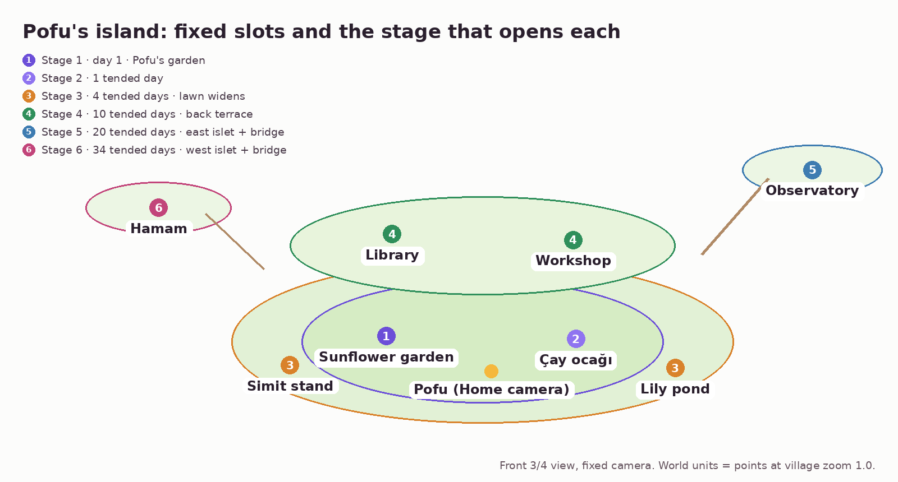

# Pofu's Island: Game Design (v1)

_Status: proposal for founder review. Last updated: 2026-11-01._
_Builds on [Home direction B](../design/home-directions.md) (the island
that grows), the founder's direction of 2026-11-01 (pre-planned growth,
idle stations, a calm multiplier, care over currency, a richer Pofu), the
[vision](vision.md), and ADR-0004, ADR-0010 to ADR-0014. Where this
document diverges from [economy.md](economy.md) or an ADR, it says so in
section 13 and proposes the ADR change. Simulation:
[`tools/sim/island_economy.py`](../../tools/sim/island_economy.py).
Prototype: [`design/prototypes/island-game/`](../../design/prototypes/island-game/README.md)._


## 0. The game in one paragraph

Pofu lives on a small floating island with a few neighbors who run cozy
stations: his sunflower garden, Mochi's **çay ocağı**, Simit's simit
stand, a lily pond, a library, a workshop, an observatory, a hamam. They
work while you are away. The longer you stay away from your guarded apps,
the calmer the island gets: a **calm multiplier** climbs from ×1.0 to ×2.0
and everyone works faster. Open Instagram and the calm resets to ×1.0, and
Pofu feels it: his **wellbeing** drops, he pouts, and on a bad day he curls
up, unwell (never gone). Come back after a quiet afternoon and the pantry
is full of goodies the residents made; spend them on the next designed
level of a station, watch the çay ocağı get its striped awning, and close
the app. Nothing is left unfinished. A month in, you look at the island
and think: *I quit doomscrolling and built this.*

## 1. Why this shape

- **Pre-planned, not free building.** A fixed set of stations on fixed
  slots, each with five designed levels. The player chooses the order (and
  a style at some levels), never the placement. This keeps the island
  beautiful at every stage (a designer composed every frame), makes art
  consistency tractable (each station is one vignette and four edits of
  it), and removes the decorating loop that invites dwelling.
- **Idle, because the game is played while you are away.** Idle games
  (Cats & Soup is the closest reference: animal residents at cooking
  stations, offline production, station upgrades, cozy hand-drawn
  vignettes; Legend of Mushroom shows the genre's AFK-reward loop) are the
  one genre whose core verb is *not playing*. We take their structure and
  reject their monetization and retention tricks (section 4).
- **Care over currency.** Seeds-for-screen-time made every reach a price
  check. The founder's point: a currency turns everything into math and
  breaks the intimacy. Opening an app now costs **Pofu's wellbeing** and
  **your built-up calm**, two things you feel rather than count. The only
  number left is the pantry of goodies, an in-world material the residents
  make, spent only on the island.
- **Loss aversion as the nudge.** "I have ×1.6 built up; I'm not throwing
  it away for Reels." Resisting never resets the calm; only opening does.

## 2. Pillars

1. **Played while you are away.** Production, growth, and surprises happen
   in real time with the phone down. A visit is short and ends finished.
2. **Care over currency.** Opening a guarded app costs wellbeing and calm,
   never coins. Goodies are a game material, never a wallet for screen time.
3. **Pre-planned growth.** Fixed slots, designed levels, island stages
   revealed by tended days. Seeds of progress cannot be bought.
4. **Pofu never dies.** Lead decision, section 9.
5. **Home stays calm.** Pofu up close is Home; the diorama is one tap away.
6. **Plus sells variety, never progress.** Style variants, extra residents,
   seasonal skins. Never goodies, calm, wellbeing, speed, or time.

## 3. Core loop and session design

### The loop

```
 away (most of the day)                            visit (1–2 min, max ~5)
 ─────────────────────                             ───────────────────────
 calm stretch ──► calm ×1.0 → ×2.0 (+0.1 / 20 min)  ┐
 residents work ─► goodies × calm, into the pantry  ├─► collect · see Pofu ·
 skip a reach ──► calm keeps growing, Pofu proud    │   upgrade 0–3 stations ·
 open an app ───► calm resets, Pofu's wellbeing ↓   │   optional quiet minute ·
 calm night ────► wellbeing +10, calm +0.2          ┘   a neighbor's wish · done
 tended days ───► the island grows: new slots
```

### A visit (target 1–2 minutes, hard ceiling about 5)

| Step | What happens | Time |
|---|---|---|
| 1. Home | Pofu's bubble: "While you were away, the residents made 186 goodies (calm ×1.6)." **Collect**. Wellbeing and calm are glanceable at the top. | 10 s |
| 2. Island (optional) | Tap the island: the camera pulls back to the diorama. Stations show their output popping gently. | 10 s |
| 3. Upgrade (optional) | Tap a station: the next designed level, its cost, sometimes a style choice. Upgrade; the vignette pops into its new art. | 10–30 s each |
| 4. Care (optional) | "Quiet time with Pofu": a one-minute breathing moment with him, once a day (+5 wellbeing, no goodies, so it cannot be farmed). | 60 s |
| 5. Neighbor (sometimes) | One small wish a day at most ("Could the island stay quiet this afternoon? I'd love a nap.") | 10 s |
| 6. Close | "All caught up. Nothing is waiting; the island keeps going without you." | — |

**Natural caps:** goodies limit how much you can upgrade; there is one
quiet moment and at most one wish a day; nothing ripens on a timer; and
production needs no tending, so there is never a reason to stay.

**Positioning:** "The two-minute island." A healthier thing to open than
Reels, and one that tells you to leave.

### Home ↔ diorama

- **Home** is direction B: Pofu close up on the island, wellbeing pill top
  left, calm chip under it, the bubble with one action, the Today dock with
  beads, "Quiet time with Pofu", and an island button.
- **Tap the island** (or the island button): the same scene's camera pulls
  back over 0.9 s to the fixed diorama. One scene, two framings; no
  separate screen, no free camera, no panning.
- **Tap a station** to open its sheet; the house button returns to Pofu.

## 4. Anti-addiction rules (acceptance criteria)

| # | Rule | Check |
|---|---|---|
| A1 | **Finite visits.** Each visit has a bounded set of things: collect, the upgrades the pantry allows, one quiet moment a day, at most one wish. Then "All caught up". | No feature generates unbounded per-visit content. |
| A2 | **No storage cap, no timers.** Production never stops because the pantry is full, nothing ripens on a clock, nothing expires. (Idle games cap offline earnings to force check-ins; we reject that outright.) | No "full" state; no countdown UI. |
| A3 | **No game notifications.** The island never sends a push. | Notification audit lists zero world triggers. |
| A4 | **No streak loss.** Island stages count tended days cumulatively. Calm resets on an open, by design; nothing else is ever taken away. Upgrades are permanent. | Unit tests: stage and levels are monotonic. |
| A5 | **The island sleeps.** 23:00–06:00: you can look, not upgrade. Calm holds (neither grows nor resets) unless an app opens. | UI test at 23:00 and 05:59. |
| A6 | **No paid acceleration.** No buying goodies, calm, wellbeing, production boosts, skips of waiting, ads for boosts, gacha, or loot boxes. | Store review checklist. |
| A7 | **No FOMO.** Seasonal sets return every year. | Copy review: no countdowns. |
| A8 | **No comparison.** No leaderboards or "your friend's island is bigger". | Design review. |
| A9 | **Opening Pofu does nothing for production.** Calm grows whether or not you look. Looking at the island earns nothing, so checking it is not rewarded. On the fourth Pofu open in an hour, Pofu is **bored**: "Nothing new here, I promise." | Rules test; emotion trigger. |
| A10 | **Session budget.** Median visit ≤ 90 s, p90 ≤ 3 min, ceiling ~5 min. Two weeks over p90: remove content until it is not. | On-device aggregated analytics. |
| A11 | **Skips are not farmable.** A skip gives +1 wellbeing, at most 6 a day, and never goodies (ADR-0012). | `CareLedger` tests. |
| A12 | **Kind emotions.** Pofu teases the app, never the user (section 10's guardrails). | Copy review in EN and TR. |

## 5. Mechanics and numbers

All numbers are defaults (proposed `CareRules`, `CalmRules`,
`StationCatalog`), tuned by the simulation in section 12.

### Pofu's wellbeing (TR: *Pofu'nun keyfi*)

| Rule | Default |
|---|---|
| Range | 0–100, **floor 5** (never zero, never dead) |
| Start | 70 |
| Drain while a guarded app is open | 0.35 per minute; ×2 inside bedtime; ×1.25 per earlier open in the last 3 h (the old price escalation, now in care) |
| Drain per open | 1.5 (the reach itself) |
| Heal while calm (waking) | 5 per hour |
| Calm night (no opens 23:00–06:00) | +10 |
| Skip | +1, at most 6 a day |
| Sleeps it off | each night, wellbeing below 60 moves 30 % of the way back to 60 |
| Bands | Cozy ≥ 75 · Content ≥ 50 · Tired ≥ 25 · Unwell ≥ 12 · Curled up < 12 |
| Effect on the island | below 25 the residents stop to look after Pofu: production × 0.6 |

The meter shows a soft bar and a mood word, never a number. "Sleeps it
off" exists because the first simulation left heavy scrollers' Pofu
unwell for a whole first week; a bad day must not stack into a bad week.

### The calm multiplier (TR: *huzur*)

| Rule | Default |
|---|---|
| Range | ×1.0 → ×2.0 |
| Growth | +0.1 per 20 continuous calm waking minutes (×2.0 after 3 h 20 min) |
| Verified focus session | calm grows 1.5× faster during it (ADR-0004's verified bonus, re-homed) |
| Reset | to ×1.0 when a guarded app **opens** (any pass: free rung, care step, friend, emergency) |
| Not a reset | a resisted reach; opening Pofu; bedtime |
| Bedtime | holds; a calm night adds +0.2 |
| Observation | grows only while observed (ADR-0014's 72-hour window); blind time neither grows nor resets it |

The chip shows a ring filling toward the next +0.1 and the word
"growing"; at ×2.0 it glows and says "full". The reset is a small,
visible wobble back to ×1.0 ("starts again now"), never a shatter.

### Idle production

- Each built station makes **goodies** (TR: *erzak*) every minute at its
  level's rate, times calm, times the unwell factor. Production runs
  24 h, no cap, no collection deadline.
- Goodies go to the **pantry** (in the world: a basket by Pofu's door;
  in the chrome: a basket pill in the diorama view only, never on Home).
- Goodies buy only upgrades. They never buy screen time, calm,
  wellbeing, or anything in the soft gate.

### Stations (v1): the level ladders

Costs and rates are the simulation's tuned numbers (cost to reach each
level; goodies an hour at each level, before calm). Level costs grow
×2.3, rates +55 % of base per level.

| # | Station (TR) | Resident | Opens | Level costs 1→5 | Rate L1→L5 / h | Function beyond goodies |
|---|---|---|---|---|---|---|
| 1 | Sunflower garden (*Ayçiçeği bahçesi*) | Pofu | Stage 1 (built) | — · 30 · 69 · 159 · 365 | 6 → 19 | The first upgrade, on day 1 |
| 2 | **Çay ocağı** | Mochi, bunny | Stage 2 | 40 · 92 · 212 · 487 · 1,119 | 5 → 16 | Level 3+ unlocks the daily "quiet minute with Pofu" over tea |
| 3 | Simit stand (*Simitçi*) | Simit, kitten | Stage 3 | 250 · 575 · 1,322 · 3,042 · 6,996 | 8 → 26 | — |
| 4 | Lily pond (*Nilüferli gölet*) | the frogs | Stage 3 | 200 · 460 · 1,058 · 2,433 · 5,597 | 4 → 13 | A lily pad per calm night (record) |
| 5 | Library (*Kütüphane*) | Bulut, chinchilla | Stage 4 | 700 · 1,610 · 3,703 · 8,517 · 19,589 | 10 → 32 | Pofu's journal: your skips and quiet days as pages |
| 6 | Workshop (*Atölye*) | Fındık, hedgehog | Stage 4 | 800 · 1,840 · 4,232 · 9,734 · 22,387 | 10 → 32 | Unlocks the style variants of other stations |
| 7 | Observatory (*Gözlemevi*) | Pofu, at night | Stage 5 | 1,800 · 4,140 · 9,522 · 21,901 · 50,371 | 14 → 45 | Your week as a sky: a star for each calm night |
| 8 | Hamam | everyone | Stage 6 | 2,400 · 5,520 · 12,696 · 29,201 · 67,162 | 16 → 51 | Wellbeing heals 25 % faster while calm |

Total for the whole v1 world: **302,331 goodies**.

What each level looks like (the art list; every level is an edit of the
level before):

| Station | L1 | L2 | L3 | L4 | L5 |
|---|---|---|---|---|---|
| Sunflower garden | Three sunflowers in a bed | Picket fence, two more | Watering can, seedlings | Sunflower arch with bunting | One giant sunflower that follows the sun |
| Çay ocağı | Counter, çaydanlık, two tulip glasses | Striped awning | Two stools, a tiny table (**style: rose stripes or İznik blue**) | String lights | Tiled roof, geranium, a flag |
| Simit stand | Cart with a pile of simit | Sun umbrella | A simit pole stacked high | A bench for regulars | A little kiosk with a flag |
| Lily pond | Small pond, pebbles | Lily pads | Reeds and a blossom | Wooden dock | Floating lanterns |
| Library | Round book hut | Lit window, book stack | Second floor | Reading bench and lamp | Tower with a flag (**style: lilac or teal dome**) |
| Workshop | Shed and workbench | Wall of tools | Spinning wind vane | Chimney | Big gear sign |
| Observatory | Small dome | Brass telescope | Star-map wall | Second dome | Beacon |
| Hamam | One dome, one basin | Steam and towels | Two small domes | Lanterns | Garden courtyard (**style: marble or tile**) |

### Island expansion (pre-planned)

Stages grow with **tended days** (observed days with at least one skip or
one calm hour), counted cumulatively.

| Stage | Tended days | What appears | New slots |
|---|---|---|---|
| 1 | 0 | A small island: Pofu, his garden, his door | Garden (built) |
| 2 | 1 | Mochi's islet docks; the çay ocağı plot gets a sign | Çay ocağı |
| 3 | 4 | The island widens on both sides | Simit stand, lily pond |
| 4 | 10 | A raised back terrace with steps | Library, workshop |
| 5 | 20 | An islet to the east, joined by a rope bridge | Observatory |
| 6 | 34 | An islet to the west, joined by a rope bridge | Hamam |

Locked slots one stage ahead are visible as dotted plots with a blank
sign, so the next morning's surprise is anticipated but not counted down.



### Unlock order and session pacing (heavy scroller, one simulated run)

Day 1: garden L2. Day 2: çay ocağı L1, garden L3, çay ocağı L2. Day 3:
garden L4, çay ocağı L3. After the first week, roughly one upgrade every
day or two, with a bigger "new slot" morning at each stage.

## 6. Residents (neighbors)

| Resident | Species | Station | Arrives | Personality |
|---|---|---|---|---|
| **Mochi** | Lop bunny, cream | Çay ocağı | Stage 2 (concept art exists) | The host. Remembers how you take your tea. |
| **Simit** | Kitten, honey tabby | Simit stand | Stage 3 | Loud, cheerful, sells out by noon. |
| **Bulut** | Chinchilla, cloud cream | Library | Stage 4 | Quiet, reads to Pofu. |
| **Fındık** | Hedgehog | Workshop | Stage 4 | Tinkers; makes the style variants. |

Wishes: at most one a day, from one resident, always measured by
behavior Pofu already sees (a quiet afternoon hour, no opens 21:00–23:00,
3,000 steps, one more skip than yesterday). "Not today" is always
offered and costs nothing; a fulfilled wish brings a free cosmetic (a
tea set, a wind chime, a carrot patch), never goodies.

## 7. Seasons and events

Free for everyone: snow on the island in winter, blossoms in spring,
fireflies on calm summer nights, lanterns on calm autumn evenings,
Hıdırellez's wish-ribbon tree on 5–6 May. Plus: seasonal skins of
stations (a winter çay ocağı with a salep pot), returning every year
(A7).

## 8. Free vs Plus

| Free forever | Plus |
|---|---|
| Blocking, the friction ladder, the care step | — |
| All 8 stations, all 5 levels, all stages, all landmarks | **Extra style variants** for every station level |
| Mochi, Simit, Bulut, Fındık and their wishes | **Extra residents** (fox kit, duckling, otter) with cosmetic stalls that **produce nothing** |
| Free seasonal touches | **Seasonal station skins**, returning every year |
| — | **Island themes** (cherry, autumn, snow-globe, seaside) |

**Plus buys variety, not progress.** A Plus member and a free member who
behave the same have the same calm, the same production, and the same
levels; the Plus island just looks different.

## 9. Lead decision: Pofu never dies

Pofu can be tired, unwell, curled up in deep sleep, ash-tinted and
matted; he cannot die, run away, or be taken away. Reasons:

1. **Death is an uninstall.** The users who most need Pofu are the ones
   who relapse. A dead pet after a bad weekend is a reason to delete the
   app and the automation with it, which ends the intervention entirely
   (and ADR-0013's whole setup effort).
2. **Shame does not change habits; it hides them.** The relapse is when
   Pofu must be most welcoming ("You're back!"), not a grave.
3. **Recovery is the story.** Every bad day is followed by a visible
   comeback (sleeps it off, a quiet hour perks him up). That arc teaches
   that one evening is not a failure.
4. **Precedent.** Forest's dead tree is its most criticized mechanic;
   Finch never lets the bird come to harm. Our art bible already forbids
   sick, crying, or bandaged Pofu.

Floor: wellbeing 5, "curled up": eyes closed, flattened, matted,
desaturated, a slow breath, residents gathered around him. One quiet
hour visibly lifts him a band.

## 10. Pofu's emotional range

Pofu gets a Duolingo-owl-level personality, aimed at the reach, not at
the person. Each emotion has a trigger in the loop, one line in English
and one written natively in Turkish (not translated), a face recipe, and
a body motion. The prototype shows **jealous, pout, smug, excited,
unwell, sleepy, proud** with code stand-in faces.

### Catalog

| Emotion | Trigger | EN | TR | Face (edits) | Body |
|---|---|---|---|---|---|
| **Jealous** | Hop! care step, a reach for a guarded app | "Instagram again? What does it have that I don't?" | "Yine mi Instagram? Onda olup bende olmayan ne?" | side-eye + flat mouth | leans away, a little cross-vein |
| **Jealous (TikTok)** | same, TikTok | "Oh. TikTok. I see how it is." | "Hı. TikTok. Anladım ben seni." | side-eye | turns a quarter away |
| **Pout** | opened anyway: calm resets | "Hmph. Calm's back to ×1.0. Fine. It'll grow again." | "Hıh. Huzur yine ×1.0. Peki. Yine büyür." | pout mouth + cheeks full + half-lid | squash, a puff of air |
| **Smug** | calm reaches ×2.0 | "Calm ×2.0. Maxed out. I'm basically a zen master now." | "Huzur ×2.0. Tavan yaptı. Resmen zen ustasıyım." | half-lid + smirk | chin up, sparkles |
| **Proud** | a skip | "Skipped! We did that. Mostly you." | "Vazgeçtin! Başardık. Yani, çoğunu sen." | eyes happy | a hop |
| **Relieved** | a skip on the third reach in an hour; coming back after a lapse | "Phew. You came back to me." | "Oh be. Bana döndün." | eyes happy | soft exhale (squash out) |
| **Excited** | an upgrade, a new slot | "Level 3! Look at the little stools!" | "Üçüncü seviye! Şu minik taburelere bak!" | eyes happy + mouth open | bounce |
| **Surprised** | the island grew overnight | "Wait. Was that there yesterday?" | "Dur bir dakika. Bu dün burada var mıydı?" | mouth "o" | small jump |
| **Worried** | first open after a session over 60 min | "That was a long one. You okay? I'm a bit wobbly." | "Bu uzun sürdü. İyi misin? Ben biraz sallantıdayım." | worried mouth | tremble, a sweat drop |
| **Unwell** | wellbeing < 25 | "Not feeling great. Sit with me for a quiet hour?" | "Pek iyi değilim. Benimle biraz sessizce oturur musun?" | eyes closed + worried mouth + matted | flattened, slow breath, ash grade |
| **Tired** | wellbeing 25–50 | "Bit of a sleepy day. Let's take it easy." | "Biraz uykulu bir gün. Yavaştan alalım." | half-lid | slow blink |
| **Sleepy** | bedtime | "Sleep well. The residents are closing up too." | "İyi uykular. Komşular da dükkânı kapatıyor." | eyes closed | z's, slow breath |
| **Cheeky** | a reach after 23:00 | "It's past eleven. Instagram is asleep too. (It isn't. But it should be.)" | "Saat on biri geçti. Instagram da uyuyor. (Uyumuyor. Ama uyumalı.)" | side-eye + half-lid | a yawn |
| **Bored** | fourth Pofu open within an hour (A9) | "Nothing new here, I promise. The island's fine without us watching." | "Burada yeni bir şey yok, söz. Biz bakmasak da ada gayet iyi." | half-lid + flat mouth | looks away, slow blink |
| **Grateful** | a resident's wish fulfilled | "Mochi napped all afternoon. She says thank you!" | "Mochi bütün öğleden sonra uyudu. Sana teşekkür ediyor!" | eyes happy | a little wave of the paws |
| **Missed you** | back after 3+ days | "You're back! The residents kept everything going." | "Geldin! Komşular her şeyi idare etti." | eyes happy + mouth open | bounce |
| **Playful** | tapping Pofu | "Boop. That's my nose." | "Dıt. Orası benim burnum." | eyes happy | squish |

### The face kit (11 edits of R1)

Existing in the prompt library: **eyes closed** (3a), **eyes happy**,
**mouth open**, **mouth "o"**, **cheeks full**, **matted**. New:
**half-lid**, **side-eye**, **pout mouth**, **worried mouth**, **smirk**.
That is 11 pixel-aligned edits. The app composites them by region (eyes
from one edit, mouth from another, cheeks from a third) with soft masks,
exactly as the prototype does in code, so 11 images cover all 17
emotions above. Body motion (lean, squash, bounce, tremble, chin up) is
code (ADR-0011).

### Guardrails

1. **Tease the app, never the person.** Instagram is the rival; you are
   never the villain. No "you hurt me", "you broke my heart", "where were
   you", "I'm sad because of you".
2. **No tears, no sickness props.** Art bible §9 holds: no crying, no
   bandages, no thermometer. Unwell is sleepy and ash-tinted.
3. **Rationed so it stays funny.** At most one sassy line per Hop!; the
   same line never twice in 7 days; at most 3 jealous or pouting moments a
   day, then Pofu goes plainly kind ("It's okay. Calm grows back."). After
   two pouts in a row, the next reaction is always kind.
4. **Respect a stated reason.** If the intent rung says "reply" or "look
   something up", no jealousy: that is a legitimate use.
5. **A gentle mode.** Settings → Pofu's personality: *Playful* (default)
   or *Gentle* (no sass, same warmth).
6. **Turkish first, not translated.** Lines are written in Turkish by a
   native speaker and tested with native speakers; humor that does not
   land in both languages is cut.

## 11. Mapping to PofuCore (proposed)

| Concept | Today in PofuCore | Proposed |
|---|---|---|
| Opening cost | `Wallet`, prices, escalation, night ×2, refunds | `CareLedger`: drain per minute and per open, with the escalation and night multipliers re-homed; no prices. |
| Calm | `QuietTimeAccrual` (quiet blocks, sleep bonus, 72 h observation) | `CalmAccrual`: the same stretch logic, now producing a multiplier step every 20 min instead of a seed every 10 min. Prefix-consistent like today. |
| Wellbeing | `VitalityLedger` (daily EMA, bands, blind days freeze) | `Wellbeing`: a continuous meter fed by the same events; blind time freezes it; bands renamed. |
| Production | — | `StationLedger`: levels, pantry, production as a pure function of (levels, calm history, wellbeing history). Deterministic and testable like the economy. |
| Stages | — | `IslandStage` from tended days; monotonic. |
| The ladder | pause → intent → pay → askFriend | pause → intent → **care** (shows the loss, open allowed) → askFriend on the fourth rapid reach; emergency pass unchanged. |
| Skips | never earn | still never earn goodies; +1 wellbeing, capped. |

Invariants to test: wellbeing in 5…100; calm in 1.0…2.0; calm never
resets without an open; levels and stage never decrease; production is
the same computed in many small steps or one (prefix consistency).

## 12. Economy simulation

`python3 -I tools/sim/island_economy.py` runs five archetypes for 60
days, minute by minute: reaches as a Poisson process, binge continuation
after each pass, night sessions, the ladder (free pause and intent
passes, the care step, a friend or the emergency pass on the fourth rapid
reach), wellbeing, calm, production, and upgrades bought at three daily
visits (cheapest next level first, at most two per visit).

| Archetype | First upgrade (day) | World done (day) | World at day 30 | World at day 60 | Calm avg wk 1 → wk 9 | Resets/day | Wellbeing wk 1 → wk 9 (lowest) | Unwell days | Feed min/day wk 1 → wk 9 |
|---|---|---|---|---|---|---|---|---|---|
| Heavy scroller, improving | 1 | not by 60 | 20 % | 78 % | 1.14× → 1.49× | 8.0 | 29 → 97 (5) | 8 | 230 → 45 |
| Moderate | 1 | 60 (12/40 runs) | 30 % | 78 % | 1.31× → 1.39× | 7.4 | 76 → 91 (6) | 0 | 94 → 69 |
| Already disciplined | 1 | 49 | 45 % | 100 % | 1.79× → 1.78× | 2.0 | 100 → 100 (70) | 0 | 6 → 7 |
| Relapse and recover | 1 | 60 (5/40 runs) | 24 % | 78 % | 1.35× → 1.55× | 6.8 | 89 → 98 (5) | 6 | 81 → 34 |
| Never opens (upper bound) | 1 | 45 | 45 % | 100 % | 1.99× → 2.00× | 0.0 | 100 → 100 (70) | 0 | 0 → 0 |

_Medians of 40 runs; world = all stations at level 5 (302,331 goodies).
"World" is the share of all upgrade costs paid._


**Targets, checked:**

- **Everyone upgrades on day 1.** The garden's level 2 costs 30; the
  first morning's production covers it for every archetype.
- **Nobody finishes before day 45.** The upper bound (never opens) ends
  on day 45, held by the stage-6 gate; the disciplined user on day 49.
- **Scrolling visibly slows the island and visibly hurts Pofu.** Calm
  averages ×1.14 for a heavy scroller in week 1 against ×1.79 for a
  disciplined user. For the moderate player, 20 points more resisting
  raises average calm from ×1.35 to ×1.49 and goodies in month 1 by 16 %.
  Wellbeing is the louder signal: the heavy scroller's Pofu starts the
  game tired and recovers to cozy as their feed time falls from 230 to 45
  minutes a day.

**Findings that changed the design:**

1. **Wellbeing needed "sleeps it off".** Without it, the heavy scroller's
   Pofu was unwell for 20 of 60 days, nearly all of week 1; with it, 8.
2. **The multiplier is a mid-game lever, not an end-game one.** All
   non-disciplined archetypes reach 78 % by day 60, because the last
   levels of the hamam and observatory are cost-bound for everyone. Calm
   decides *how fast you get there*, not *whether*. That is kind, and it
   means the emotional channel (wellbeing, Pofu's faces) has to carry most
   of the motivation.
3. **Removing the price removes a hard limit.** Under economy v0, an
   empty wallet forced the friend rung; now an open is always one tap
   past the care step. The simulation assumes behavior unchanged, so feed
   minutes match the old runs. Whether loss aversion replaces the price is
   the central unknown: with a modest response (+0.25 resist probability
   per ×1.0 of calm at stake), the heavy scroller's week-9 feed time falls
   from 45 to 24 minutes and the moderate player's from 69 to 52.

## 13. Divergences from the current specs and proposed ADRs

| Current spec | What changes | Proposed ADR |
|---|---|---|
| economy.md: seeds (`Energy`) buy unlock windows; allowance; prices with escalation and night ×2; refunds; hoarding question | **Retired for the gate.** Opens cost wellbeing and calm, not seeds. Escalation and night multipliers move into wellbeing drain. Allowance, prices, and refunds go away; the hoarding question disappears. | **ADR-0015, Care over currency** (supersedes the spending half of economy v0; amends ADR-0004 and ADR-0012 decision 3) |
| ADR-0008 / economy.md ladder: pause → intent → pay → askFriend | The **pay** rung becomes the **care** rung (the loss is shown; open allowed). askFriend on the fourth rapid reach (`highestAttemptRung = askFriend`, already supported). Emergency pass unchanged. | ADR-0015 |
| ADR-0014 quiet time earns seeds (1 per 10 min, cap 48, +10 per night) | The same stretch logic feeds **calm** (+0.1 per 20 min to ×2.0, +0.2 per calm night) and **wellbeing**; observation window unchanged. | ADR-0015 (amends ADR-0014) |
| economy.md vitality: daily EMA of usage, resistance, activity | Becomes **wellbeing**, a continuous meter with "sleeps it off"; blind time still freezes it. | ADR-0015 |
| ADR-0004: verified activity earns 1.5× | Verified focus makes calm grow 1.5× faster. Honor timers stay for people who like them but no longer earn currency. | ADR-0015 |
| ADR-0012 decision 1: Home is Pofu's room | Home is Pofu's island (direction B); the diorama is a second framing. | **ADR-0016, Pofu's island: a pre-planned idle diorama** |
| ADR-0012 decision 5: first neighbor at 100 skips | Residents arrive with stages (Mochi at stage 2). | ADR-0016 |
| Art bible §9 (no sick or crying Pofu) | Unchanged and relied on: unwell is sleepy and ash-tinted. | **ADR-0017, Pofu never dies** (records section 9) |
| Monetization research | Plus sells variety; production, calm, and goodies are never sold. | ADR-0016 |

Domain note: `Energy` can be renamed or kept as the internal type for
goodies; the user never sees "seeds" as money any more. The sunflower
garden still makes *çekirdek* as one of the goodies, which keeps the
brand's sunflower-seed charm without the wallet.

## 14. Art and tech plan

### Rendering: pure SwiftUI (recommendation changed by the new direction)

The isometric free-building direction needed SpriteKit (z-sorting
hundreds of sprites, hit-testing a grid, a free camera). A fixed-camera
diorama with eight slots does not.

| | Pure SwiftUI (layered `Image`s, `TimelineView`, `Canvas` particles) | SpriteKit via `SpriteView` | RealityKit |
|---|---|---|---|
| Scene size | ~1 plate stack + 8 vignettes + 5 characters + particles: trivial | Overkill | Overkill |
| Zoom Home ↔ diorama | `scaleEffect` + `offset` on one container, a spring (ADR-0011 tokens) | `SKCameraNode` | Camera |
| Tap a station | `.onTapGesture` on each vignette, accessibility labels for free | Manual hit-testing, manual accessibility | Ray casts |
| Pofu | The same SwiftUI companion view as everywhere (ADR-0011), with the face kit compositing | Re-implement the companion | Re-implement |
| Accessibility, Dynamic Type, VoiceOver | Native | Weak | Weak |
| Risk | Particle counts must stay modest (they will) | Second renderer to maintain | Wrong medium for painterly 2D |

**Recommendation:** a `PofuWorld` SwiftUI module: an `IslandScene` view
that stacks the stage plates, places vignette images at fixed slot
anchors, overlays residents and Pofu, and runs ambient motion through
`TimelineView` (paused off-screen, 30 fps idle). The model
(`CareLedger`, `CalmAccrual`, `StationLedger`) lives in `PofuCore`.

### Asset spec (fixed diorama)

| Topic | Spec |
|---|---|
| View | One fixed front three-quarter view, camera about 25° above the horizon; ground ellipses have a 0.3 height-to-width ratio. Light from the upper left (art bible §4). |
| Island plates | Composited parts on transparency: main island small (stage 1–2) and large (3+), back terrace (4+), east and west islets (5, 6), rope bridges. Lawns empty. |
| Station vignettes | 1024 × 1024 transparent. Footprint ellipse 720 × 216 px centered at (512, 800) = the **anchor**; maximum height to y = 150. Guide: [`design/art/templates/station-guide.png`](../../design/art/templates/station-guide.png). Placed at 130 × 130 pt at diorama zoom 1. |
| Levels | 5 per station, each an **edit** of the previous level ("add a striped awning; change nothing else"). Style variants are edits of the level they belong to. |
| Residents | 1024 × 1536 like R1, front view; 2 poses each (working, idle) as edits. |
| Night, wellbeing, seasons | Code grades (night multiply, ash desaturation for unwell); no night or sick versions generated. Seasonal skins are edits. |
| Slot layout | [`assets/island-layout.png`](assets/island-layout.png); world units are points at diorama zoom 1. |
| Counts for v1 | 6 plate parts + 40 level vignettes + ~10 variants + 4 residents × 3 + 11 face edits ≈ 80 images, most of them edits. |

### Consistency strategy

1. **The guide is the camera.** Attach `station-guide.png` to every
   vignette prompt: the ellipse fixes the view angle and footprint, the bar
   fixes the height. The prompt removes the guide.
2. **Level chains are edits.** L2 is an edit of L1, L3 of L2: the same
   station can never drift between levels, which is the hardest problem in
   AI art and the main reason for pre-planned growth.
3. **A reference sheet** (**P-station**) after the first approved vignette
   (the çay ocağı L1), attached to every new station's L1 prompt.
4. **One chat per station** ("Pofu · Çay ocağı"), restarted on drift.
5. **Optional Blender blockouts** for buildings that drift in angle: a
   gray box rendered with the same camera (`bpy` from PyPI) as "paint over
   this shape".
6. **Pipeline checks:** a `station__` kind in `process_assets.py` verifies
   canvas size, that the lowest opaque row sits within ±12 px of y = 800,
   and that no magenta guide pixels survive.

### The first 8 prompts (vertical slice: stages 1–3, the çay ocağı)

The **prop style block** (art bible style anchor v1 without the fur
sentence, verbatim as in direction B's prompts) and the **view block**
are pasted verbatim.

View block:

```text
VIEW: a fixed front three-quarter view, the camera about 25 degrees above
the horizon, exactly like the attached guide: the object stands on the
magenta ground ellipse, centered on the magenta cross, no taller than the
magenta height bar. Then remove the guide completely: no ellipse, no
cross, no bar, no magenta, no grid may remain in the output.
```

Prop style block:

```text
STYLE: soft painterly 2D digital illustration with the polish of a premium
storybook and a top-tier mobile app mascot. Gentle airbrushed shading, no
outlines, no hard edges. Warm diffused key light from the upper left, a
faint warm rim light along the right edge, soft ambient shadow only where
forms touch. Clean, calm, uncluttered. No text, no letters, no numbers, no
logos, no watermark, no border, no frame, no sticker outline.
```

**D1. Main island, small (stages 1–2).** Attach R1 (style only), P-day.
Transparent PNG 1536 × 1024. Save as `world__island-main-s.png`.

```text
A small floating island for a cozy mobile game diorama, in the same art
style as the attached character (style only: no characters or animals).
Use only the colors of the attached palette card. Seen from the front and
a little above, so the top is a wide soft oval lawn of short spring grass,
completely empty (stations are added separately), with a darker rounded
grass lip along the front edge. Underneath, a rounded earth body tapering
to a soft blunt point, about as deep as two thirds of the island's width:
warm honey and caramel earth with gentle strata, a few cream pebbles, a few
thin dangling roots. On the lower left of the earth body, a tiny round
wooden door with a round window and a little ledge: a hamster's home. The
island fills about 80% of the width, centered.
[paste the prop style block]
AVOID: characters, plants or objects on the lawn, water, sky, clouds,
background, ground shadow, text.
Output: one image, transparent background PNG, 1536 x 1024.
```

**D2. Main island, large (stage 3+).** Attach the approved D1. Same size.
Save as `world__island-main-l.png`.

```text
Edit the attached floating island. Keep exactly the same style, colors,
light, door, strata, pebbles and roots. Make the island about 40% wider
and a little deeper, so the lawn becomes a longer oval, keeping the same
bottom-center position and the lawn still completely empty. No
characters, no objects, no text.
Output: one image, transparent background PNG, 1536 x 1024.
```

**D3. Back terrace (stage 4).** Attach the approved D2. Save as
`world__terrace.png`.

```text
For the attached island, draw only a raised grassy terrace that will sit
on the back half of its lawn: a soft oval lawn about 75% of the island's
width, lifted on a low earthen step with the same strata and colors, and a
short flight of four cream stone steps on its front left. The terrace lawn
is empty. Same style and light as the attached island. Nothing else: not
the island itself, no characters, no objects.
Output: one image, transparent background PNG, 1536 x 1024.
```

**D4. Çay ocağı, level 1 (becomes P-station).** Attach
`station-guide.png`, R1 (style only), P-day. 1024 × 1024 transparent.
Save as `station__cay-1.png`.

```text
A tiny Turkish tea stall (çay ocağı) for a cozy island diorama, in the
same art style as the attached character (style only: no characters, no
animals). A small rounded wooden counter in warm honey wood; on it a
copper Turkish double teapot (çaydanlık, a small pot stacked on a larger
one) on a little burner, and two tulip-shaped tea glasses of amber tea on
tiny saucers. Friendly, rounded, toy-like proportions; no awning, no roof
yet (later levels add them).
[paste the view block]
[paste the prop style block]
AVOID: characters, signs or letters, a floor, grass, a background, text.
Output: one image, transparent background PNG, 1024 x 1024.
```

**D5. Çay ocağı, level 2 (an edit).** Attach the approved D4. Save as
`station__cay-2.png`.

```text
Edit the attached tea stall. Add two thin wooden poles at the back corners
and a scalloped striped awning between them, soft rose-pink and cream
stripes. Keep everything else exactly the same: the counter, the
çaydanlık, the glasses, the position, the size, the light. No text.
Output: one image, transparent background PNG, 1024 x 1024.
```

**D6. Sunflower garden, level 1.** Attach `station-guide.png`, P-station.
Save as `station__garden-1.png`.

```text
A small oval garden bed of soft brown soil with three plump, cheerful
sunflowers of slightly different heights, for the same island diorama,
same style and light as the attached tea stall. Big round honey-yellow
petals around warm brown centers, two soft leaves on each stem. Room on
the bed for more flowers later.
[paste the view block]
[paste the prop style block]
AVOID: characters, insects, fences, tools, a background, text.
Output: one image, transparent background PNG, 1024 x 1024.
```

**D7. Simit stand, level 1.** Attach `station-guide.png`, P-station.
Save as `station__simit-1.png`.

```text
A tiny street-food cart for simit (round Turkish sesame bread rings), for
the same island diorama, same style and light as the attached tea stall.
A rounded coral-red cart on two wooden wheels with a glass-free open tray
on top holding a neat pile of golden-brown simit rings with tiny sesame
dots. Friendly, toy-like proportions. No umbrella yet.
[paste the view block]
[paste the prop style block]
AVOID: characters, letters or price signs, a floor, a background, text.
Output: one image, transparent background PNG, 1024 x 1024.
```

**D8. Mochi, the bunny (resident).** Attach R1 (style and scale), the
concept `design/prototypes/home-directions/assets/neighbor-bunny.webp`,
P-char. Transparent PNG 1024 × 1536. Save as `char__mochi-base.png`.

```text
Draw Mochi, a neighbor of the attached hamster character, in exactly the
same art style, lighting and level of fluff as the hamster, using the
attached bunny concept for her design. Same canvas rules as the hamster:
full body, sitting upright, front view, centered, feet on an invisible
line at 88% of the height, about 62% of the canvas width.
CHARACTER: Mochi, a baby lop-eared bunny whose body is a soft round ball,
creamy white with very faint warm-blush shading, two long floppy ears
hanging beside the face with blush-pink insides, a single soft cream curl
of fur on top of the head, big round glossy dark espresso eyes with one
large round catchlight and one tiny sparkle each, soft blush ovals on the
cheeks, a tiny pink nose, a small smiling "w" mouth, two tiny front paws
together at the chest, two small feet peeking out; three small toe
creases on each paw and foot. No clothes, no accessories.
[paste the art bible's style anchor v1, with the fur sentence]
[paste the art bible's negative list]
Output: one image, transparent background PNG, 1024 x 1536.
```

The 5 new face edits (half-lid, side-eye, pout mouth, worried mouth,
smirk) follow the prompt library's 3a–3f pattern ("Edit the attached
image. Change only…"); they belong in the prompt library once approved.

## 15. Open questions for the founder

1. **Is the care step enough without a price?** Removing seeds-for-
   screen-time removes the only hard limit besides the friend rung. Keep
   it purely emotional (your direction), or keep a small hard backstop:
   after 60 minutes of opens in a day, the care step adds a 10-second
   breath with Pofu before "Open"? (Recommended: the backstop.)
2. **Should a short, necessary open reset calm fully?** "Reply" or
   "look something up" on the intent rung could halve the bonus instead of
   resetting it. Full reset is simpler and stronger; partial is fairer.
   (Recommended: full reset, but no jealousy for stated reasons.)
3. **Names.** Goodies / *erzak*, calm / *huzur*, wellbeing / *keyif*,
   and the residents Mochi, Simit, Bulut, Fındık. Keep them?
4. **"Sleeps it off".** Pofu recovering partly every night is kind but
   softens the consequence of a binge. Keep it (recommended), or make
   recovery come only from quiet time?
5. **Pace.** Heavy and moderate players reach 78 % of the world by day
   60, the disciplined finish on day 49. Is a two-month world right, or do
   you want a longer horizon (more stages) before seasons take over?

## 16. Self-critique

- **Fun:** the strongest moments are the morning collect with a number
  that is visibly bigger because you stayed calm, the station popping
  into its next level, and Pofu's faces. Jealous and pout are genuinely
  funny in the prototype; smug at ×2.0 is a small reward worth chasing.
  The weak part is depth: eight stations and forty levels are a two-month
  game. That is a feature for an anti-doomscroll app and a risk for
  retention after month two; seasons have to carry it.
- **Addictive?** Idle games are retention machines, and we borrowed their
  skeleton. What keeps this honest is what we removed: storage caps,
  timers, ads, boosts, push, gacha, and any reward for opening the app.
  The real risk is a new reflex: checking the calm number. Rule A9 (no
  reward for looking, "bored" Pofu) is the mitigation, and the metric to
  watch is Pofu opens per day versus impulses resisted.
- **Loss aversion can turn into anxiety.** A visible multiplier that
  resets is exactly the kind of number people obsess over. The reset is
  designed to be small and kind (a wobble, "starts again now") and the
  multiplier only changes production speed, never takes anything built.
  It still needs testing with the founder's own Instagram, YouTube and
  TikTok habit.
- **Wellbeing guilt.** "Pofu is suffering, let me not open Instagram" is
  the founder's goal and also the line to shame. The guardrails (tease the
  app, never the person; ration; gentle mode) are necessary, not
  sufficient: this needs user testing in Turkish.
- **The simulation is honest about the economy and silent about
  motivation.** It proves pacing and recovery; it cannot prove that calm
  and wellbeing change behavior as much as a price did.
- **The prototype art is code.** It proves layout, scale, the camera, the
  loop, and the emotional beats. It does not prove that GPT Image can hold
  one diorama angle across forty level edits; prompts D4 and D5 are the
  real test and should run first.
