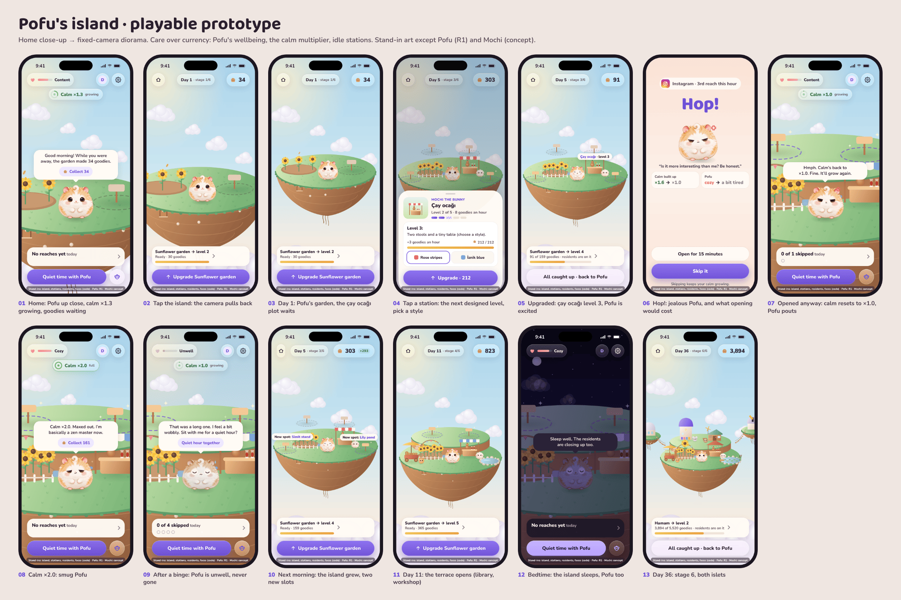
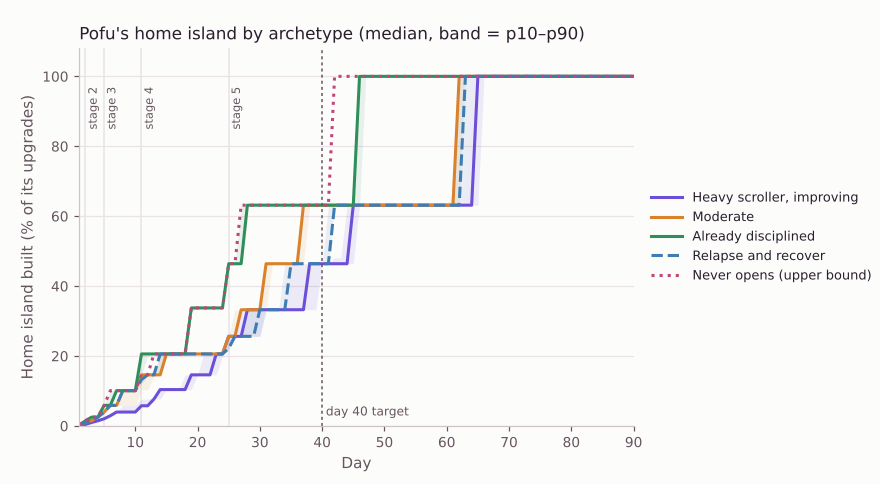
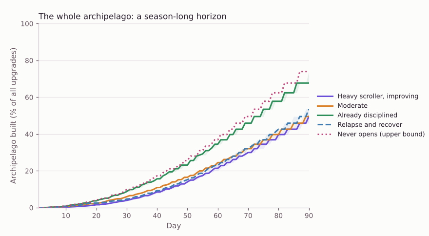
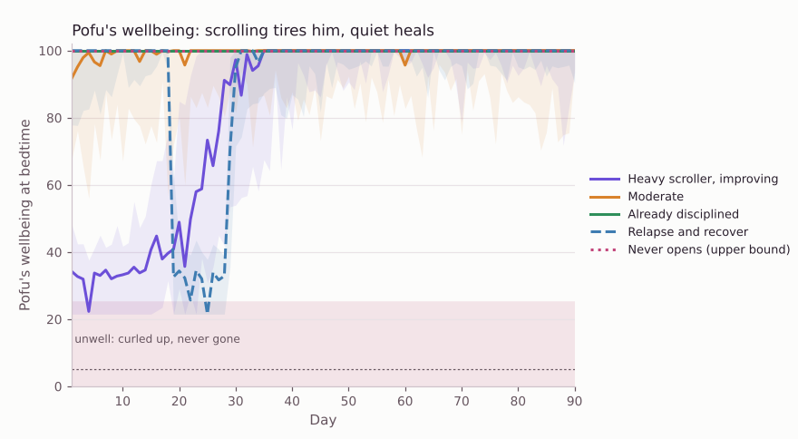
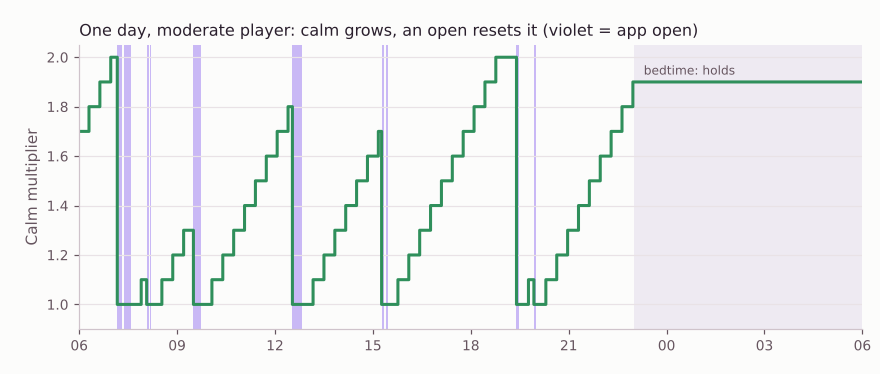
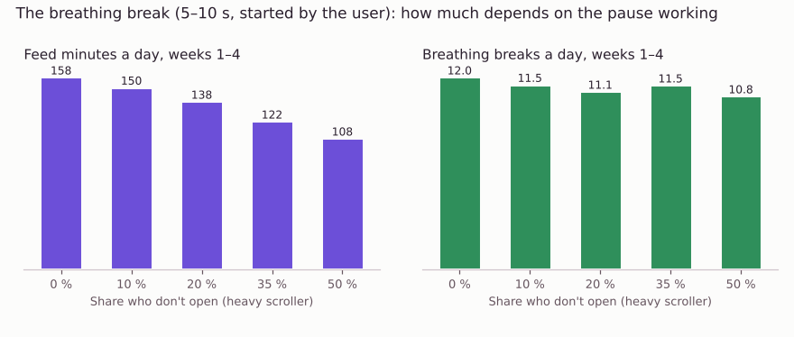

# Pofu's Archipelago: Game Design (v2)

_Status: v2, the founder's decisions of 2026-11-01 applied. Last updated:
2026-11-01. Decisions: [ADR-0015](../adr/0015-care-over-currency.md) (seeds
as world material, the breathing break), [ADR-0016](../adr/0016-pre-planned-idle-archipelago.md)
(the pre-planned idle archipelago), [ADR-0017](../adr/0017-pofu-never-dies.md)
(Pofu never dies). Builds on [Home direction B](../design/home-directions.md),
the [vision](vision.md), ADR-0004, ADR-0008, and ADR-0010 to ADR-0014.
Simulation: [`tools/sim/island_economy.py`](../../tools/sim/island_economy.py).
Prototype: [`design/prototypes/island-game/`](../../design/prototypes/island-game/README.md)._



## 0. The game in one paragraph

Pofu lives on a small floating island, Ayçiçeği, with neighbors who run
cozy stations: his sunflower garden, Mochi's **çay ocağı**, a lily pond,
Fındık's workshop, a windmill. While your phone is down they work, and
the island gathers **seeds** (*çekirdek*). The longer you stay away from
your guarded apps, the calmer the island gets: a **calm multiplier**
(*huzur*) climbs from ×1.0 to ×2.0 and everyone works faster. Open
Instagram for a quick check and the calm halves; open it properly and it
resets, and Pofu feels it: his **wellbeing** (*keyif*) drops, he pouts,
and on a bad day he curls up, unwell (never gone). Past your daily hour,
every open first waits for a **breathing break** with Pofu: one breath,
then two, never more than three. Come back after a quiet afternoon, spend
your seeds on the next designed level of a station, and close the app.
Over the weeks, new islands drift close, each with its own small ritual:
a harbor whose morning ferry brings postcards, a night island where calm
nights become stars, a hot spring, a library. Seeds never buy screen
time. A month in, you look at the archipelago and think: *I quit
doomscrolling and built this.*

## 1. What changed in v2, and why

| Founder decision (2026-11-01) | What it means in the game |
|---|---|
| **Seeds stay, but only as world material.** The user must feel "I did something." | Seeds come from time away (Pofu's own gathering, plus the stations working while no guarded app is open) and a little from each resisted reach. You spend them by hand on pre-planned levels. Seeds **never** buy screen time ([ADR-0015](../adr/0015-care-over-currency.md)). v1's "goodies / erzak" are renamed seeds / çekirdek. |
| **The breathing break is the hard limit.** | After the daily threshold (default 60 guarded minutes), every open waits for 10 s of breathing with Pofu, growing to 20 s and 30 s with repeated opens, never more. It replaces both the price and v1's open question about a "backstop". |
| **Measure usage honestly.** | Short opens (a pass of 3 minutes or less) are **quick checks**: they halve the calm bonus instead of resetting it, and Pofu is not jealous. What we can and cannot see is written down per phase (section 6). |
| **An archipelago, not one island.** | Five islands, each with its own small loop and resident, arriving with time and progress (and, later, with seasons). |
| **"Sleeps it off" stays.** | Unchanged from v1 (section 5). |

Kept from v1: pre-planned stations with five designed levels, idle
production, the calm multiplier, Pofu's wellbeing and emotions, finite
visits, no game notifications, Plus sells variety and never progress.

## 2. Pillars

1. **Played while you are away.** Seeds, calm, and growth happen in real
   time with the phone down. A visit is short and ends finished.
2. **Care over currency.** Opening a guarded app costs calm and Pofu's
   wellbeing, and past the daily hour a breath. It never costs seeds, and
   seeds never buy an open.
3. **I built this.** Seeds are earned by staying away and spent by hand on
   designed levels; every build is a visible change on the island.
4. **Pre-planned growth.** Fixed slots, designed levels, islands arriving
   on a designed schedule. Progress cannot be bought.
5. **Pofu never dies** ([ADR-0017](../adr/0017-pofu-never-dies.md)).
6. **Home stays calm.** Pofu up close is Home; the island and the
   archipelago map are one tap each.
7. **Plus sells variety, never progress.** Never seeds, calm, wellbeing,
   speed, time, or islands.

## 3. Core loop and session design

### The loop

```
 away (most of the day)                              visit (1–2 min, max ~5)
 ─────────────────────                               ───────────────────────
 phone down ────► Pofu gathers seeds (1 / 10 min)     ┐
 residents work ─► seeds × calm, only while no        │  collect seeds · see Pofu ·
                   guarded app is open                ├─ build 0–3 levels · maybe
 calm stretch ──► calm ×1.0 → ×2.0 (+0.1 / 20 min)    │  visit another island ·
 skip a reach ──► +3 seeds (5 a day), calm grows,     │  an island's ritual · done
                   Pofu proud                         │
 quick check ───► calm bonus halves, no jealousy      │
 open an app ───► calm resets, wellbeing ↓            │
 past 60 min ───► every open waits for a breath       │
 calm night ────► wellbeing +10, calm +0.2, +10 seeds ┘
 tended days ───► the home island grows; new islands drift close
```

### A visit (target 1–2 minutes, hard ceiling about 5)

| Step | What happens | Time |
|---|---|---|
| 1. Home | Pofu's bubble: "While you were away, the island gathered 186 seeds (calm ×1.6)." **Collect**. Wellbeing, calm and today's guarded minutes (n / 60) are glanceable. | 10 s |
| 2. Island (optional) | Tap the island: the camera pulls back to it. Stations show seeds popping gently. | 10 s |
| 3. Build (optional) | Tap a station: the next designed level, its seed cost, sometimes a style choice. Build; the vignette pops into its new art. | 10–30 s each |
| 4. Archipelago (sometimes) | The map button pulls back to every island. A new one drifted close? Visit it. | 10–20 s |
| 5. Ritual (sometimes) | One island ritual at most a day: a postcard from the ferry, tonight's star, a page of Bulut's story. | 10–30 s |
| 6. Close | "All caught up. Nothing is waiting; the island keeps going without you." | — |

**Natural caps:** seeds limit how much you can build; each island ritual
happens at most once a day and only when earned by calm; nothing ripens
on a timer; production needs no tending.

### Home ↔ island ↔ archipelago

- **Home** is Pofu up close on his island: the wellbeing pill, the calm
  chip, the bubble with one action, the Today card (beads and guarded
  minutes against the daily hour), "Quiet time with Pofu", and an island
  button.
- **Tap the island** (or the island button): the camera pulls back over
  0.9 s to the island in view. **The map button** pulls further back to the
  archipelago. One continuous world, three framings; no free camera, no
  panning. While one island is in view, the others recede (35 % opacity)
  so the archipelago is felt but never clutters.
- **Tap a station** to build; **tap an island** on the map to read about
  it and visit.

## 4. Anti-addiction rules (acceptance criteria)

| # | Rule | Check |
|---|---|---|
| A1 | **Finite visits.** Collect, the builds the seeds allow, at most one island ritual a day, at most one wish. Then "All caught up". | No feature generates unbounded per-visit content. |
| A2 | **No storage cap, no timers.** Production never stops because a jar is full, nothing ripens on a clock, nothing expires. | No "full" state; no countdown UI. |
| A3 | **No game notifications.** The islands never send a push. | Notification audit lists zero world triggers. |
| A4 | **No streak loss.** Stages and island arrivals count tended days and calm nights cumulatively, never in a row. Calm resets on an open, by design; nothing else is ever taken away. | Unit tests: stages, levels and arrivals are monotonic. |
| A5 | **The islands sleep.** 23:00–06:00: you can look, not build. Calm holds unless an app opens. | UI test at 23:00 and 05:59. |
| A6 | **No paid acceleration.** No buying seeds, calm, wellbeing, production, islands, skips of waiting, ads for boosts, gacha, or loot boxes. | Store review checklist. |
| A7 | **No FOMO.** Seasonal islands and sets arrive for everyone and stay; seasonal touches return every year. No countdowns. | Copy review. |
| A8 | **No comparison.** No leaderboards, no "your friend's archipelago is bigger". | Design review. |
| A9 | **Opening Pofu does nothing for production.** Looking earns nothing. On the fourth Pofu open in an hour he is **bored**. | Rules test; emotion trigger. |
| A10 | **Session budget.** Median visit ≤ 90 s, p90 ≤ 3 min, ceiling ~5 min. | On-device aggregated analytics. |
| A11 | **Skips are barely farmable.** A skip gives +1 wellbeing (6 a day) and +3 seeds (5 a day, 15 seeds). In week 1 that is 1–2 % of a player's seeds: a thank-you, never a reason to trigger the gate. | `CareLedger` tests; simulation share. |
| A12 | **Kind emotions.** Pofu teases the app, never the user (section 12). | Copy review in EN and TR. |
| A13 | **Seeds never touch the gate.** No rung, pass, breath, or emergency path reads or writes seeds. | `SeedsNeverBuyTimeTests` on every rung. |
| A14 | **The breathing break is bounded.** 10 s, 20 s, at most 30 s; always skippable into "not now" (which is a skip), never a dead end; the emergency pass is unchanged. | UI test; ladder tests. |

## 5. Mechanics and numbers

All numbers are defaults (proposed `SeedRules`, `CareRules`, `CalmRules`,
`BreathRules`, `StationCatalog`, `IslandCatalog`), tuned by the
simulation in section 14.

### Seeds (TR: *çekirdek*)

Seeds are **world material**: in the world, sunflower seeds in Pofu's
cheeks and a seed jar by his door; in the chrome, a seed pill on the
island and map views only, never on Home. They are spent by hand on the
next designed level of a station. They never buy screen time, calm,
wellbeing, a breath skip, or anything in the soft gate (A13).

| Source | Rule | Share of seeds, week 1 (sim) |
|---|---|---|
| **Pofu's quiet gathering** | ADR-0014's accrual, unchanged: 1 seed per 10 continuous quiet waking minutes, at most 48 a day, +10 for a calm night, 72-hour observation window, held (not lost) when unobserved. | 3–9 % |
| **The stations** | Each built station makes seeds every minute **while no guarded app is open** (nights included), at its level's rate, × calm, × 0.6 while Pofu is unwell. No cap, no deadline. | ~90 % |
| **A resisted reach** | +3 seeds, for at most 5 skips a day. | 1–2 % |

Why the stations pause during a pass: "the residents work while you are
away" becomes literally true. Scrolling never takes seeds away, but the
island visibly stops while you scroll, and the calm multiplier makes
every quiet minute after it worth more. This is the strongest "I did
something" signal: the morning number is bigger *because* the phone was
down.

### Pofu's wellbeing (TR: *Pofu'nun keyfi*)

| Rule | Default |
|---|---|
| Range | 0–100, **floor 5** (never zero, never dead) |
| Start | 70 |
| Drain while a guarded app is open | 0.35 per minute; ×2 inside bedtime; ×1.25 per earlier open in the last 3 h |
| Drain per open | 1.5 (the reach itself) |
| Heal while calm (waking) | 5 per hour |
| Calm night (no opens 23:00–06:00) | +10 |
| Skip | +1, at most 6 a day |
| **Sleeps it off** | each night, wellbeing below 60 moves 30 % of the way back to 60 |
| Bands | Cozy ≥ 75 · Content ≥ 50 · Tired ≥ 25 · Unwell ≥ 12 · Curled up < 12 |
| Effect on the islands | below 25 the residents stop to look after Pofu: production × 0.6 |

The meter shows a soft bar and a mood word, never a number. "Sleeps it
off" stays (founder, 2026-11-01): a bad day must not stack into a bad
week. Without it the heavy scroller's Pofu was unwell for 20 of 60 days;
with it, 6 of 90.

### The calm multiplier (TR: *huzur*)

| Rule | Default |
|---|---|
| Range | ×1.0 → ×2.0 |
| Growth | +0.1 per 20 continuous calm waking minutes (×2.0 after 3 h 20 min) |
| Verified focus session | calm grows 1.5× faster (ADR-0004's verified bonus, re-homed) |
| **Quick check** (a pass of ≤ 3 min) | the bonus **halves**, rounded down to 0.1: ×1.6 → ×1.3, ×2.0 → ×1.5. Pofu is not jealous. |
| Quick check chained | a quick check that starts within 20 min of the previous one's end counts as a full open |
| Reset | to ×1.0 on any other open (free rung, care rung, friend, emergency) |
| Not a reset | a resisted reach; a breathing break that ends in "not now"; opening Pofu; bedtime |
| Bedtime | holds; a calm night adds +0.2 |
| Observation | grows only while observed (ADR-0014's 72-hour window) |

The chip shows a ring filling toward the next +0.1 and the word
"growing"; at ×2.0 it glows and says "full". A reset is a small wobble
back to ×1.0 ("starts again now"); a halving says "halved".

Why halving and not "no effect": a quick check is still a reach, and we
cannot verify its intent (section 6). Halving makes it cost something
visible but proportionate. Why the 20-minute chain rule: without it,
five quick checks in a row are a 15-minute session at half the price.

### The breathing break (the hard limit)

| Rule | Default |
|---|---|
| Threshold | 60 guarded minutes a day (settable 15–180 in Settings; the founder's own: 60) |
| What counts | pre-membership: the pass lengths granted (section 6); with Screen Time: measured usage from a DeviceActivity threshold event |
| Rule | once over the threshold, **every** open waits for a breathing break with Pofu before the app opens, including quick checks |
| Length | 1 breath (10 s) for the 1st and 2nd over-limit open of the day, 2 breaths (20 s) for the 3rd and 4th, **3 breaths (30 s) from the 5th on, never more** |
| Rhythm | inhale 4 s, exhale 6 s (a calming, slightly long exhale) |
| During | "Not now" is always there and counts as a skip; there is no "skip the breath and open" |
| After | "I'm good. Skip it" (primary, counts as a skip) or "Open Instagram · 15 min" (one tap) |
| Resets | at local midnight |
| Never | costs or earns seeds; locks the user out; lasts longer than 30 s; applies to the emergency pass |

**The moment.** Not a punishment screen: a soft lavender room, Pofu
inside a breathing orb with his eyes closed, his belly rising and falling
with the orb, one word at a time ("Breathe in…", "…and out"), dots for
the breaths, no numbers, no countdown. When it ends: "Nicely done." The
copy never says "limit", "blocked", or "penalty"; it says "We've had our
hour today. Breathe with me first?"

**Why it works as a limit without a price.** The breath does what the
old escalating price did (friction that grows with repetition), but it
spends attention instead of currency, and the attention it asks for is
the thing we want to give back. Friction apps such as one sec are built
on the bet that a short, mandatory pause before a reflexive open prevents
a real share of opens. We have no verified number of our own, so the
simulation assumes 20 % of over-limit opens end after the breath and
tests 0–50 %.

### Idle production and stations

Each station has five designed levels; level costs grow ×2.2, rates
+55 % of base per level. Costs are the cost to reach each level; rates
are seeds an hour at each level, before calm.

**Ayçiçeği, the home island** (stages by tended days: 1 at 0, 2 at 1,
3 at 4, 4 at 10, 5 at 24)

| Station (TR) | Resident | Opens | Level costs 1→5 | Rate L1→L5 / h |
|---|---|---|---|---|
| Sunflower garden (*Ayçiçeği bahçesi*) | Pofu | stage 1 (built) | — · 30 · 66 · 145 · 319 | 6 → 19 |
| **Çay ocağı** | Mochi, bunny | stage 2 | 40 · 88 · 194 · 426 · 937 | 5 → 16 |
| Lily pond (*Nilüferli gölet*) | the frogs | stage 3 (the island widens) | 160 · 352 · 774 · 1,704 · 3,748 | 6 → 19 |
| Workshop (*Atölye*) | Fındık, hedgehog | stage 4 (the back terrace) | 500 · 1,100 · 2,420 · 5,324 · 11,713 | 9 → 29 |
| Windmill (*Yel değirmeni*) | Pofu and Fındık | stage 5 (terrace, left) | 1,400 · 3,080 · 6,776 · 14,907 · 32,796 | 12 → 38 |

Home island total: **88,999 seeds**. The windmill grinds sunflower seeds:
the island's own story of where seeds come from.

**İskele, the harbor** (stations open 0, 3 and 7 days after it arrives)

| Station (TR) | Resident | Level costs 1→5 | Rate L1→L5 / h |
|---|---|---|---|
| Simit cart (*Simitçi*) | Simit, kitten | 300 · 660 · 1,452 · 3,194 · 7,028 | 8 → 26 |
| Ferry pier (*İskele*) | the ferry crew | 550 · 1,210 · 2,662 · 5,856 · 12,884 | 9 → 29 |
| Lighthouse (*Fener*) | Simit, at dusk | 1,000 · 2,200 · 4,840 · 10,648 · 23,426 | 11 → 35 |

Yıldız, Kaplıca and Kitap each have three stations on the same pattern
(builds 2,000–8,400, the full ladders are in the simulation). The whole
archipelago is **1,944,103 seeds**: a season-long horizon, not a
two-month one.

What each home and harbor level looks like (every level is an edit of
the level before):

| Station | L1 | L2 | L3 | L4 | L5 |
|---|---|---|---|---|---|
| Sunflower garden | Three sunflowers in a bed | Picket fence, two more | Watering can, seedlings | Sunflower arch with bunting | One giant sunflower that follows the sun |
| Çay ocağı | Counter, çaydanlık, two tulip glasses | Striped awning | Two stools, a tiny table (**style: rose stripes or İznik blue**) | String lights | Tiled roof, geranium, a flag |
| Lily pond | Small pond, pebbles | Lily pads | Reeds and a blossom | Wooden dock | Floating lanterns |
| Workshop | Shed and workbench | Wall of tools | Spinning wind vane | Chimney | Big gear sign |
| Windmill | Stone mill, four bare sails | Cream sail cloths | Sacks of sunflower seeds | Lanterns along the cap | A flag and window boxes |
| Simit cart | Cart with a pile of simit | Sun umbrella | A simit pole stacked high | A bench for regulars | A little kiosk with a flag |
| Ferry pier | Planks and posts over the clouds | A lantern post | The little vapur moors here | A bench and two tea glasses | Bunting post to post |
| Lighthouse | A striped tower | A lit lamp room | A balcony all around | A slow, warm beam at night | A flag and a garden at its foot |

Locked slots one stage ahead are visible as dotted plots with a blank
sign, so the next morning's surprise is anticipated but not counted down.

## 6. Measuring usage honestly

We cannot verify why someone opens an app. "Reply to a message" and
"just checking" are the same tap. So the rules depend only on what we
can measure, and the copy never claims more.

| | Pre-membership (now): Shortcuts soft gate | With the paid membership: Screen Time | Never |
|---|---|---|---|
| Opens (reaches) | **Exact.** Every open runs `CheckInIntent`. | Exact with Live Pofu; the shield counts shielded opens. | — |
| Resisted reaches | **Exact.** | Exact (`ShieldAction`, Hop!). | — |
| Time in the app | **Estimated: the pass length we grant.** Ending a pass early from Pofu shortens it; leaving the app without telling Pofu does not. | **Measured** at thresholds: `DeviceActivityMonitor` fires when usage crosses set minutes (for example 15, 30, 45, 60). Totals are only visible inside the report extension. | Exact per-session minutes outside thresholds. |
| Daily threshold for the breathing break | Sum of granted pass minutes ≥ 60. Over-counts someone who leaves early; under-counts nothing, because every reopen after a pass expires is a new check-in. | A DeviceActivity event at 60 minutes. | — |
| Quick check | A pass of ≤ 3 minutes (the user picks it). | The same, plus usage events can confirm it stayed short. | Whether the intent was "reply" or "scroll". |
| Intent ("reply", "look something up") | Recorded as stated, never verified. It changes copy (no jealousy) and nothing else. | Same. | Verification. |
| Blind time (automation deleted) | 72-hour observation window (ADR-0014); calm and gathering stop, seeds are held. | Usage is measured whether or not the automation fires. | — |

**Design consequences.** The quick check is defined by pass length, which
we control, not by intent, which we cannot see. That is why it halves
instead of exempting, why chaining is capped, and why Pofu's jealousy
depends on the pass length and the stated intent (a short pass or a
stated "reply" never draws a jealous line). Pre-membership, the breathing
threshold is a little strict (it counts granted, not used, minutes);
that errs toward care, and Settings shows the count so it is never a
surprise.

## 7. The archipelago

Islands arrive with time and progress, and later with app updates and
seasons. Each is a **fresh small delight**, not a "+1 bonus": its own
look, its own resident, three stations, and **one small ritual** that
uses a behavior Pofu already measures. Every ritual is finite (at most
once a day), earned by calm, never on a timer.

| Island (TR) | Theme | Stations | Its own little loop | Resident | Arrives |
|---|---|---|---|---|---|
| **Ayçiçeği** (home) | Pofu's sunflower island | Sunflower garden, çay ocağı, lily pond, workshop, windmill | **The calm island**: seeds × calm, five stages of growth | Pofu, Mochi (bunny), Fındık (hedgehog), the frogs | Day 1 |
| **İskele** | A tea-and-simit harbor | Simit cart, ferry pier, lighthouse | **The morning ferry**: after every calm night the little vapur docks with a postcard from somewhere far away (a Bosphorus morning, a Cappadocia balloon, a Kyoto teahouse). Seven make a set for Pofu's wall. | Simit, a honey tabby kitten who sells out by noon | 8 tended days **and** the çay ocağı at level 3 ("Mochi's regulars want simit with their tea") |
| **Yıldız** | A high night observatory | Observatory, firefly meadow, hammock | **Stargazing**: each calm night adds a star. At bedtime, a 20-second moment: Pofu points at tonight's star, then says good night. Seven stars make a constellation you name. Designed as a phone-down ritual: it only ever ends with "good night". | Nane, a sleepy little owl who keeps the star book | 21 tended days **and** 10 calm nights (any, not in a row) |
| **Kaplıca** | A hot-spring hamam | Hot spring, hamam, şerbet stand | **The warm spring**: each quiet hour pours a ladle of warm water. When the spring is full (12 ladles), everyone soaks together for an evening and Pofu comes out glowing (wellbeing heals 25 % faster that night). Breathing breaks do **not** fill it, so the limit is never farmable. | Pamuk, an unbothered capybara | 35 tended days **and** the ferry pier at level 3 |
| **Kitap** | A library island | Reading tree, book house, printing press | **Bulut's story**: a short illustrated story, one page per tended day, read in half a minute. Never more than one page a day, no cliffhanger nudges; finished books go on the shelf. | Bulut, a cloud-soft chinchilla who reads aloud | With a season update, for everyone, and it stays (simulated at day 50) |

Seasonal islands after Kitap follow the same template: a theme, three
stations, one ritual, one resident, an arrival rule. They arrive in app
updates and stay forever (A7).

**Arrival.** An island drifts close overnight; the morning bubble says so
("And look: a new island drifted close in the night") with one action,
"See the new island", which opens the map with the island marked "new".
The ferry route draws itself between Ayçiçeği and İskele.

**Before arrival.** Locked islands are visible on the map as misty,
desaturated silhouettes with their name and "locked" (or "with a
season"); tapping one shows its loop, neighbor, stations, and the
arrival conditions with plain progress bars (tended days 19 / 21, calm
nights 9 / 10). No dates, no countdowns.

**Spending across islands.** Seeds are one pool. The player chooses where
to build; the next-build card suggests the cheapest level on the island
in view. The simulation's policy (cheapest first, anywhere) is a
pessimistic case for the home island's pace.

## 8. Residents (neighbors)

| Resident | Species | Island · station | Arrives | Personality |
|---|---|---|---|---|
| **Mochi** | Lop bunny, cream | Ayçiçeği · çay ocağı | Home stage 2 (concept art exists) | The host. Remembers how you take your tea. |
| **Fındık** | Hedgehog | Ayçiçeği · workshop | Home stage 4 | Tinkers; makes the style variants. |
| **Simit** | Kitten, honey tabby | İskele · simit cart | With İskele | Loud, cheerful, sells out by noon. |
| **Nane** | Owl, tiny and sleepy | Yıldız · observatory | With Yıldız | Awake when everyone sleeps; keeps the star book. |
| **Pamuk** | Capybara | Kaplıca · hot spring | With Kaplıca | Unbothered. Nothing has ever hurried Pamuk. |
| **Bulut** | Chinchilla, cloud cream | Kitap · book house | With Kitap | Quiet, reads to Pofu. |

Wishes: at most one a day, from one resident, always measured by
behavior Pofu already sees (a quiet afternoon hour, no opens 21:00–23:00,
one more skip than yesterday). "Not today" is always offered and costs
nothing; a fulfilled wish brings a free cosmetic, never seeds.

## 9. Seasons and events

Free for everyone: snow on the islands in winter, blossoms in spring,
fireflies on calm summer nights, lanterns on calm autumn evenings,
Hıdırellez's wish-ribbon tree on 5–6 May. New islands arrive with
seasonal updates and stay. Plus: seasonal station skins, returning every
year.

## 10. Free vs Plus

| Free forever | Plus |
|---|---|
| Blocking, the friction ladder, the breathing break | — |
| Every island, station, level, and ritual | **Extra style variants** for station levels |
| Every resident and their wishes | **Extra residents** with cosmetic stalls that **produce nothing** |
| Free seasonal touches and seasonal islands | **Seasonal station skins**, returning every year |
| — | **Island themes** (cherry, autumn, snow-globe) |

A Plus member and a free member who behave the same have the same seeds,
calm, islands and levels; the Plus archipelago just looks different.

## 11. Pofu never dies

Recorded in [ADR-0017](../adr/0017-pofu-never-dies.md). Pofu can be
tired, unwell, curled up in deep sleep, ash-tinted and matted; he cannot
die, run away, or be taken away. Floor: wellbeing 5, "curled up". One
quiet hour visibly lifts him a band, and every night he sleeps part of a
bad day off.

## 12. Pofu's emotional range

Pofu gets a Duolingo-owl-level personality, aimed at the reach, not at
the person. Each emotion has a trigger in the loop, one line in English
and one written natively in Turkish (not translated), a face recipe, and
a body motion. The prototype shows **jealous, pout, smug, excited,
unwell, sleepy, proud, worried, relieved, breathing** with code stand-in faces.

### Catalog

| Emotion | Trigger | EN | TR | Face (edits) | Body |
|---|---|---|---|---|---|
| **Jealous** | Hop! care step, a reach for a guarded app | "Instagram again? What does it have that I don't?" | "Yine mi Instagram? Onda olup bende olmayan ne?" | side-eye + flat mouth | leans away, a little cross-vein |
| **Jealous (TikTok)** | same, TikTok | "Oh. TikTok. I see how it is." | "Hı. TikTok. Anladım ben seni." | side-eye | turns a quarter away |
| **Pout** | opened anyway: calm resets | "Hmph. Calm's back to ×1.0. Fine. It'll grow again." | "Hıh. Huzur yine ×1.0. Peki. Yine büyür." | pout mouth + cheeks full + half-lid | squash, a puff of air |
| **Easy-going** | a quick check (≤ 3 min): never jealous | "Quick one? Go ahead. I'll keep the calm warm." | "Hızlıca mı? Tamam. Huzuru ben sıcak tutarım." | neutral, soft eyes | a small nod |
| **Breathing** | the breathing break | "We've had our hour today. Breathe with me first?" · "Breathe in… and out." · "Nicely done." | "Bugünkü saatimizi doldurduk. Önce benimle bir nefes alır mısın?" · "Nefes al… ve ver." · "Çok güzel." | eyes closed | belly rises and falls with the orb |
| **Delighted** | a new island drifted close | "And look: a new island drifted close in the night!" | "Bak hele: gece yeni bir ada yanaştı!" | eyes happy + mouth open | bounce, looks toward the map |
| **Smug** | calm reaches ×2.0 | "Calm ×2.0. Maxed out. I'm basically a zen master now." | "Huzur ×2.0. Tavan yaptı. Resmen zen ustasıyım." | half-lid + smirk | chin up, sparkles |
| **Proud** | a skip | "Skipped! We did that. Mostly you." | "Vazgeçtin! Başardık. Yani, çoğunu sen." | eyes happy | a hop |
| **Relieved** | a skip on the third reach in an hour; coming back after a lapse | "Phew. You came back to me." | "Oh be. Bana döndün." | eyes happy | soft exhale (squash out) |
| **Excited** | an upgrade, a new slot | "Level 3! Look at the little stools!" | "Üçüncü seviye! Şu minik taburelere bak!" | eyes happy + mouth open | bounce |
| **Surprised** | the island grew overnight | "Wait. Was that there yesterday?" | "Dur bir dakika. Bu dün burada var mıydı?" | mouth "o" | small jump |
| **Worried** | first open after a session over 60 min | "That was a long one. You okay? I'm a bit wobbly." | "Bu uzun sürdü. İyi misin? Ben biraz sallantıdayım." | worried mouth | tremble, a sweat drop |
| **Unwell** | wellbeing < 25 | "Not feeling great. Sit with me for a quiet hour?" | "Pek iyi değilim. Benimle biraz sessizce oturur musun?" | eyes closed + worried mouth + matted | flattened, slow breath, ash grade |
| **Tired** | wellbeing 25–50 | "Bit of a sleepy day. Let's take it easy." | "Biraz uykulu bir gün. Yavaştan alalım." | half-lid | slow blink |
| **Sleepy** | bedtime | "Sleep well. The residents are closing up too." | "İyi uykular. Komşular da dükkânı kapatıyor." | eyes closed | z's, slow breath |
| **Cheeky** | a reach after 23:00 | "It's past eleven. Instagram is asleep too. (It isn't. But it should be.)" | "Saat on biri geçti. Instagram da uyuyor. (Uyumuyor. Ama uyumalı.)" | side-eye + half-lid | a yawn |
| **Bored** | fourth Pofu open within an hour (A9) | "Nothing new here, I promise. The island's fine without us watching." | "Burada yeni bir şey yok, söz. Biz bakmasak da ada gayet iyi." | half-lid + flat mouth | looks away, slow blink |
| **Grateful** | a resident's wish fulfilled | "Mochi napped all afternoon. She says thank you!" | "Mochi bütün öğleden sonra uyudu. Sana teşekkür ediyor!" | eyes happy | a little wave of the paws |
| **Missed you** | back after 3+ days | "You're back! The residents kept everything going." | "Geldin! Komşular her şeyi idare etti." | eyes happy + mouth open | bounce |
| **Playful** | tapping Pofu | "Boop. That's my nose." | "Dıt. Orası benim burnum." | eyes happy | squish |

### The face kit (11 edits of R1)

Existing in the prompt library: **eyes closed** (3a), **eyes happy**,
**mouth open**, **mouth "o"**, **cheeks full**, **matted**. New:
**half-lid**, **side-eye**, **pout mouth**, **worried mouth**, **smirk**.
That is 11 pixel-aligned edits. The app composites them by region (eyes
from one edit, mouth from another, cheeks from a third) with soft masks,
exactly as the prototype does in code, so 11 images cover all 20
emotions above. Body motion (lean, squash, bounce, tremble, chin up) is
code (ADR-0011).

### Guardrails

1. **Tease the app, never the person.** Instagram is the rival; you are
   never the villain. No "you hurt me", "you broke my heart", "where were
   you", "I'm sad because of you".
2. **No tears, no sickness props.** Art bible §9 holds: no crying, no
   bandages, no thermometer. Unwell is sleepy and ash-tinted.
3. **Rationed so it stays funny.** At most one sassy line per Hop!; the
   same line never twice in 7 days; at most 3 jealous or pouting moments a
   day, then Pofu goes plainly kind ("It's okay. Calm grows back."). After
   two pouts in a row, the next reaction is always kind.
4. **Respect a stated reason and a short pass.** If the intent rung says "reply" or "look something up", or the user picks a quick check, no jealousy: that is a legitimate use. Pofu reacts to what we can measure (section 6), never to a guessed motive.
5. **A gentle mode.** Settings → Pofu's personality: *Playful* (default)
   or *Gentle* (no sass, same warmth).
6. **Turkish first, not translated.** Lines are written in Turkish by a
   native speaker and tested with native speakers; humor that does not
   land in both languages is cut.

## 13. Mapping to PofuCore (proposed, not yet implemented)

| Concept | Today in PofuCore | Proposed |
|---|---|---|
| Seeds | `Energy` in a `Wallet`: allowance, earning, prices, refunds | `Energy` stays as the internal type of seeds. The allowance, prices, escalation and refunds leave the gate ([ADR-0015](../adr/0015-care-over-currency.md)). Seeds are credited by `QuietTimeAccrual` (unchanged), a new `StationLedger`, and capped skip gifts; they are debited only by station builds. |
| Opening cost | `Wallet` prices, escalation, night ×2 | `CareLedger`: wellbeing drain per minute and per open, with the escalation and night multipliers re-homed; calm reset or halving. No prices. |
| Calm | — (quiet time produced seeds) | `CalmAccrual`: the quiet-stretch logic, producing a multiplier step every 20 min; quick-check halving and the 20-minute chain. Prefix-consistent. |
| The breathing break | — | `BreathRules` (threshold, breaths by over-limit open, cap) and a `GuardedTime` estimate: granted pass minutes now, DeviceActivity thresholds later. |
| Wellbeing | `VitalityLedger` (daily EMA, bands, blind days freeze) | `Wellbeing`: a continuous meter fed by the same events, with "sleeps it off"; blind time freezes it. |
| Production | — | `StationLedger`: levels and seeds as a pure function of (levels, quiet intervals, calm history, wellbeing history). |
| Islands | — | `IslandCatalog` and `Archipelago`: arrival rules over tended days, calm nights and levels; monotonic. |
| The ladder | pause → intent → pay → askFriend | pause → intent → **care** (shows the loss; quick check or open; past the threshold, a breath first) → askFriend on the fourth rapid reach; emergency pass unchanged and never breathed. |
| Skips | never earn | +3 seeds, at most 5 a day; +1 wellbeing, at most 6. |

Invariants to test: seeds never change on any gate outcome except a
capped skip gift; wellbeing in 5…100; calm in 1.0…2.0; calm never resets
without an open; a quick check never lowers calm by more than half the
bonus; a breath is never longer than 30 s; levels, stages and arrivals
never decrease; production is the same computed in many small steps or
one.

## 14. Economy simulation

`python3 tools/sim/island_economy.py` (numpy and matplotlib from PyPI)
runs five archetypes for 90 days, minute by minute: reaches as a Poisson
process, binge continuation, night sessions, the ladder (free pause and
intent passes, the care rung, a friend or the emergency pass on the
fourth rapid reach), quick checks (a share of opens per archetype), the
breathing break past 60 guarded minutes (20 % of over-limit opens end
after the breath), wellbeing, calm, seeds from all three sources,
island arrivals, and builds at three daily visits (cheapest next level
anywhere first, at most two per visit).

| Archetype | First build (day) | Home island done (day) | Home at day 30 | İskele arrives | Yıldız arrives | Islands at day 60 / 90 | Archipelago at day 90 | Weeks without a build (of 12) |
|---|---|---|---|---|---|---|---|---|
| Heavy scroller, improving | 1 | 65 | 33 % | day 9 | day 22 | 5 / 5 | 50 % | 0 |
| Moderate | 1 | 62 | 33 % | day 9 | day 22 | 5 / 5 | 50 % | 0 |
| Already disciplined | 1 | 46 | 63 % | day 9 | day 22 | 5 / 5 | 68 % | 0 |
| Relapse and recover | 1 | 63 | 33 % | day 9 | day 22 | 5 / 5 | 53 % | 0 |
| Never opens (upper bound) | 1 | 42 | 63 % | day 9 | day 22 | 5 / 5 | 74 % | 0 |

| Archetype | Calm avg wk 1 → wk 13 | Resets / halvings per day | Breathing breaks/day wk 1 → wk 13 | Wellbeing wk 1 → wk 13 (lowest) | Unwell days | Feed min/day wk 1 → wk 13 | Seeds/day wk 1 | Wk 1 share: Pofu's gathering / skips |
|---|---|---|---|---|---|---|---|---|
| Heavy scroller, improving | 1.17× → 1.51× | 5.8 / 2.5 | 17.4 → 0.1 | 32 → 98 (5) | 6 | 183 → 40 | 609 | 9 % / 2 % |
| Moderate | 1.36× → 1.45× | 5.0 / 3.6 | 2.6 → 0.7 | 92 → 96 (25) | 0 | 68 → 51 | 1,194 | 5 % / 1 % |
| Already disciplined | 1.88× → 1.87× | 0.7 / 1.5 | 0.0 → 0.0 | 100 → 100 (70) | 0 | 5 → 5 | 1,778 | 3 % / 1 % |
| Relapse and recover | 1.39× → 1.61× | 4.5 / 2.6 | 1.4 → 0.0 | 96 → 99 (5) | 4 | 63 → 27 | 1,248 | 5 % / 1 % |
| Never opens (upper bound) | 1.99× → 2.00× | 0.0 / 0.0 | 0.0 → 0.0 | 100 → 100 (70) | 0 | 0 → 0 | 1,887 | 3 % / 1 % |

_Medians of 30 runs, 90 days._











**Targets, checked:**

- **Everyone builds on day 1.** The garden's level 2 costs 30; the first
  morning covers it for every archetype (the heavy scroller builds garden
  L2 and L3 on day 1, then the çay ocağı on day 2).
- **Nobody finishes the home island before about day 40.** The upper
  bound (never opens) finishes on day 42, the disciplined player on day
  46; the windmill's stage-5 gate (24 tended days) and its 32,796-seed
  top level hold the line.
- **Heavy scrollers still progress.** İskele arrives on day 9 for every
  archetype, every archetype builds something every week for 12 weeks,
  and the heavy scroller finishes the home island on day 65. Calm decides
  *how fast*, never *whether*.
- **Scrolling visibly slows the world and tires Pofu.** Week-1 seeds a
  day: 609 for the heavy scroller against 1,778 for the disciplined
  player. Wellbeing is the louder signal: the heavy scroller's Pofu starts
  tired (32) and recovers to cozy as feed time falls from 183 to 40
  minutes a day.

**Findings that changed the design:**

1. **Stations had to pause during passes.** With 24-hour production, the
   quiet-time and skip seeds were a rounding error by day 3 and scrolling
   cost nothing in seeds. Pausing the stations while a guarded app is
   open made "the island works while you are away" literal.
2. **Island arrivals are kind by design.** Tended days and calm nights
   are cumulative, so every archetype gets İskele on day 9 and Yıldız on
   day 22. Behavior changes what you can *build* there, not whether the
   island comes. We considered gating islands on calm and rejected it: a
   heavy scroller locked out of the new island is a churn risk.
3. **The breathing break is busy for heavy scrollers.** In week 1 the
   heavy scroller meets 17 breaks a day (about 5 minutes of breathing),
   falling to almost none by week 13 as feed time drops. That is the
   intended pressure, and also the main thing to test on the founder's
   phone (section 16).
4. **How much the breath helps is an assumption.** If nobody changes
   their mind after a breath, the heavy scroller's month-1 feed time is
   158 minutes a day; at 20 % it is 138; at 50 %, 108.
5. **Loss aversion is the upside.** With a modest response to the calm at
   stake (+0.25 resist probability per ×1.0), week-13 feed time falls from
   40 to 24 minutes (heavy) and from 51 to 36 (moderate).

## 15. Art and tech plan

### Rendering: pure SwiftUI (recommendation changed by the new direction)

The isometric free-building direction needed SpriteKit (z-sorting
hundreds of sprites, hit-testing a grid, a free camera). Fixed-camera
islands with a handful of slots each, and a zoomed-out map, do not.

| | Pure SwiftUI (layered `Image`s, `TimelineView`, `Canvas` particles) | SpriteKit via `SpriteView` | RealityKit |
|---|---|---|---|
| Scene size | ~1 plate stack + 8 vignettes + 5 characters + particles: trivial | Overkill | Overkill |
| Zoom Home ↔ diorama | `scaleEffect` + `offset` on one container, a spring (ADR-0011 tokens) | `SKCameraNode` | Camera |
| Tap a station | `.onTapGesture` on each vignette, accessibility labels for free | Manual hit-testing, manual accessibility | Ray casts |
| Pofu | The same SwiftUI companion view as everywhere (ADR-0011), with the face kit compositing | Re-implement the companion | Re-implement |
| Accessibility, Dynamic Type, VoiceOver | Native | Weak | Weak |
| Risk | Particle counts must stay modest (they will) | Second renderer to maintain | Wrong medium for painterly 2D |

**Recommendation:** a `PofuWorld` SwiftUI module: an `IslandScene` view
that stacks the stage plates, places vignette images at fixed slot
anchors, overlays residents and Pofu, and runs ambient motion through
`TimelineView` (paused off-screen, 30 fps idle). The model
(`CareLedger`, `CalmAccrual`, `StationLedger`, `Archipelago`) lives in `PofuCore`. The archipelago is one world: islands sit at fixed world positions, and Home, the island, and the map are three camera framings of it.

### Asset spec (fixed diorama)

| Topic | Spec |
|---|---|
| View | One fixed front three-quarter view, camera about 25° above the horizon; ground ellipses have a 0.3 height-to-width ratio. Light from the upper left (art bible §4). |
| Island plates | Composited parts on transparency: main island small (stage 1–2) and large (3+), back terrace (4+), east and west islets (5, 6), rope bridges. Lawns empty. |
| Station vignettes | 1024 × 1024 transparent. Footprint ellipse 720 × 216 px centered at (512, 800) = the **anchor**; maximum height to y = 150. Guide: [`design/art/templates/station-guide.png`](../../design/art/templates/station-guide.png). Placed at 130 × 130 pt at diorama zoom 1. |
| Levels | 5 per station, each an **edit** of the previous level ("add a striped awning; change nothing else"). Style variants are edits of the level they belong to. |
| Residents | 1024 × 1536 like R1, front view; 2 poses each (working, idle) as edits. |
| Night, wellbeing, seasons | Code grades (night multiply, ash desaturation for unwell); no night or sick versions generated. Seasonal skins are edits. |
| Slot layout | [`assets/island-layout.png`](assets/island-layout.png); world units are points at diorama zoom 1. |
| Counts for v1 | 6 plate parts + 40 level vignettes + ~10 variants + 4 residents × 3 + 11 face edits ≈ 80 images, most of them edits. |

### Consistency strategy

1. **The guide is the camera.** Attach `station-guide.png` to every
   vignette prompt: the ellipse fixes the view angle and footprint, the bar
   fixes the height. The prompt removes the guide.
2. **Level chains are edits.** L2 is an edit of L1, L3 of L2: the same
   station can never drift between levels, which is the hardest problem in
   AI art and the main reason for pre-planned growth.
3. **A reference sheet** (**P-station**) after the first approved vignette
   (the çay ocağı L1), attached to every new station's L1 prompt.
4. **One chat per station** ("Pofu · Çay ocağı"), restarted on drift.
5. **Optional Blender blockouts** for buildings that drift in angle: a
   gray box rendered with the same camera (`bpy` from PyPI) as "paint over
   this shape".
6. **Pipeline checks:** a `station__` kind in `process_assets.py` verifies
   canvas size, that the lowest opaque row sits within ±12 px of y = 800,
   and that no magenta guide pixels survive.

### The first 8 prompts (vertical slice: stages 1–3, the çay ocağı)

The **prop style block** (art bible style anchor v1 without the fur
sentence, verbatim as in direction B's prompts) and the **view block**
are pasted verbatim.

View block:

```text
VIEW: a fixed front three-quarter view, the camera about 25 degrees above
the horizon, exactly like the attached guide: the object stands on the
magenta ground ellipse, centered on the magenta cross, no taller than the
magenta height bar. Then remove the guide completely: no ellipse, no
cross, no bar, no magenta, no grid may remain in the output.
```

Prop style block:

```text
STYLE: soft painterly 2D digital illustration with the polish of a premium
storybook and a top-tier mobile app mascot. Gentle airbrushed shading, no
outlines, no hard edges. Warm diffused key light from the upper left, a
faint warm rim light along the right edge, soft ambient shadow only where
forms touch. Clean, calm, uncluttered. No text, no letters, no numbers, no
logos, no watermark, no border, no frame, no sticker outline.
```

**D1. Main island, small (stages 1–2).** Attach R1 (style only), P-day.
Transparent PNG 1536 × 1024. Save as `world__island-main-s.png`.

```text
A small floating island for a cozy mobile game diorama, in the same art
style as the attached character (style only: no characters or animals).
Use only the colors of the attached palette card. Seen from the front and
a little above, so the top is a wide soft oval lawn of short spring grass,
completely empty (stations are added separately), with a darker rounded
grass lip along the front edge. Underneath, a rounded earth body tapering
to a soft blunt point, about as deep as two thirds of the island's width:
warm honey and caramel earth with gentle strata, a few cream pebbles, a few
thin dangling roots. On the lower left of the earth body, a tiny round
wooden door with a round window and a little ledge: a hamster's home. The
island fills about 80% of the width, centered.
[paste the prop style block]
AVOID: characters, plants or objects on the lawn, water, sky, clouds,
background, ground shadow, text.
Output: one image, transparent background PNG, 1536 x 1024.
```

**D2. Main island, large (stage 3+).** Attach the approved D1. Same size.
Save as `world__island-main-l.png`.

```text
Edit the attached floating island. Keep exactly the same style, colors,
light, door, strata, pebbles and roots. Make the island about 40% wider
and a little deeper, so the lawn becomes a longer oval, keeping the same
bottom-center position and the lawn still completely empty. No
characters, no objects, no text.
Output: one image, transparent background PNG, 1536 x 1024.
```

**D3. Back terrace (stage 4).** Attach the approved D2. Save as
`world__terrace.png`.

```text
For the attached island, draw only a raised grassy terrace that will sit
on the back half of its lawn: a soft oval lawn about 75% of the island's
width, lifted on a low earthen step with the same strata and colors, and a
short flight of four cream stone steps on its front left. The terrace lawn
is empty. Same style and light as the attached island. Nothing else: not
the island itself, no characters, no objects.
Output: one image, transparent background PNG, 1536 x 1024.
```

**D4. Çay ocağı, level 1 (becomes P-station).** Attach
`station-guide.png`, R1 (style only), P-day. 1024 × 1024 transparent.
Save as `station__cay-1.png`.

```text
A tiny Turkish tea stall (çay ocağı) for a cozy island diorama, in the
same art style as the attached character (style only: no characters, no
animals). A small rounded wooden counter in warm honey wood; on it a
copper Turkish double teapot (çaydanlık, a small pot stacked on a larger
one) on a little burner, and two tulip-shaped tea glasses of amber tea on
tiny saucers. Friendly, rounded, toy-like proportions; no awning, no roof
yet (later levels add them).
[paste the view block]
[paste the prop style block]
AVOID: characters, signs or letters, a floor, grass, a background, text.
Output: one image, transparent background PNG, 1024 x 1024.
```

**D5. Çay ocağı, level 2 (an edit).** Attach the approved D4. Save as
`station__cay-2.png`.

```text
Edit the attached tea stall. Add two thin wooden poles at the back corners
and a scalloped striped awning between them, soft rose-pink and cream
stripes. Keep everything else exactly the same: the counter, the
çaydanlık, the glasses, the position, the size, the light. No text.
Output: one image, transparent background PNG, 1024 x 1024.
```

**D6. Sunflower garden, level 1.** Attach `station-guide.png`, P-station.
Save as `station__garden-1.png`.

```text
A small oval garden bed of soft brown soil with three plump, cheerful
sunflowers of slightly different heights, for the same island diorama,
same style and light as the attached tea stall. Big round honey-yellow
petals around warm brown centers, two soft leaves on each stem. Room on
the bed for more flowers later.
[paste the view block]
[paste the prop style block]
AVOID: characters, insects, fences, tools, a background, text.
Output: one image, transparent background PNG, 1024 x 1024.
```

**D7. Simit stand, level 1.** Attach `station-guide.png`, P-station.
Save as `station__simit-1.png`.

```text
A tiny street-food cart for simit (round Turkish sesame bread rings), for
the same island diorama, same style and light as the attached tea stall.
A rounded coral-red cart on two wooden wheels with a glass-free open tray
on top holding a neat pile of golden-brown simit rings with tiny sesame
dots. Friendly, toy-like proportions. No umbrella yet.
[paste the view block]
[paste the prop style block]
AVOID: characters, letters or price signs, a floor, a background, text.
Output: one image, transparent background PNG, 1024 x 1024.
```

**D8. Mochi, the bunny (resident).** Attach R1 (style and scale), the
concept `design/prototypes/home-directions/assets/neighbor-bunny.webp`,
P-char. Transparent PNG 1024 × 1536. Save as `char__mochi-base.png`.

```text
Draw Mochi, a neighbor of the attached hamster character, in exactly the
same art style, lighting and level of fluff as the hamster, using the
attached bunny concept for her design. Same canvas rules as the hamster:
full body, sitting upright, front view, centered, feet on an invisible
line at 88% of the height, about 62% of the canvas width.
CHARACTER: Mochi, a baby lop-eared bunny whose body is a soft round ball,
creamy white with very faint warm-blush shading, two long floppy ears
hanging beside the face with blush-pink insides, a single soft cream curl
of fur on top of the head, big round glossy dark espresso eyes with one
large round catchlight and one tiny sparkle each, soft blush ovals on the
cheeks, a tiny pink nose, a small smiling "w" mouth, two tiny front paws
together at the chest, two small feet peeking out; three small toe
creases on each paw and foot. No clothes, no accessories.
[paste the art bible's style anchor v1, with the fur sentence]
[paste the art bible's negative list]
Output: one image, transparent background PNG, 1024 x 1536.
```

The 5 new face edits (half-lid, side-eye, pout mouth, worried mouth,
smirk) follow the prompt library's 3a–3f pattern ("Edit the attached
image. Change only…"); they belong in the prompt library once approved.

### Archipelago assets (added in v2)

| Asset | Spec |
|---|---|
| Island plates | One plate per island (`world__isle-<id>.png`, 1536 × 1024, transparent), same view and light as D1; lawns empty. İskele's plate has a ferry-pier notch on its right edge. |
| Locked look | Code only: desaturated, 60 % opacity, two cloud wisps. No extra art. |
| Ferry, postcards, stars | The vapur is one 1024 × 1024 prop with a bobbing loop in code; postcards are 600 × 800 illustrations (seven per set); stars and constellations are code. |
| Breathing orb | Code (CSS and canvas); Pofu uses the "eyes closed" face edit and code breathing scale. |
| Counts for İskele | 1 plate + 15 level vignettes + Simit × 3 + the vapur + 7 postcards ≈ 27 images. |

## 16. Open questions for the founder

1. **The daily hour.** 60 guarded minutes before the breathing break, for
   everyone by default? (Recommended: yes, settable in Settings; shown on
   Home as "n / 60 min".)
2. **The breath ladder.** 10 s, then 20 s from the 3rd over-limit open,
   then 30 s from the 5th. Too gentle or too firm for your own Instagram?
3. **Quick checks.** 3 minutes, halving, and the 20-minute chain rule.
   Does halving feel fair when you really did just reply to a message?
4. **Island names.** Ayçiçeği, İskele, Yıldız, Kaplıca, Kitap; residents
   Simit, Nane, Pamuk, Bulut. Keep them?
5. **Seeds per skip.** +3 for at most five skips a day makes resisting
   feel like "I did something" without becoming a reason to trigger the
   gate. Want it louder (say +5) or quieter?

## 17. Self-critique

- **Fun:** the strongest moments are the morning number that is bigger
  because the phone was down, a station popping into its next level, the
  first time a new island drifts close, and Pofu's faces. The archipelago
  fixes v1's biggest weakness (a two-month game): five islands and a
  season-long horizon, with a template for more. Each island's ritual is
  small on purpose; the risk is that "small" reads as "thin". The
  postcard set and the constellation are the two to prototype next.
- **The breathing break could still feel like a punishment.** The
  simulation's heavy scroller meets 17 a day in week 1. The design does
  everything it can (no numbers, no countdown, Pofu breathing with you,
  "Not now" always there, a hard 30-second cap), but only the founder's
  own week will tell whether it feels like care or like a wall.
- **Pre-membership measurement is approximate.** The daily hour counts
  granted pass minutes, not used minutes; someone who leaves Instagram
  after one minute of a 15-minute pass reaches the breathing break early.
  It errs toward care and is visible, but it is not the truth until
  DeviceActivity is available.
- **Quick checks are a loophole by construction.** Intent is
  unverifiable, so a determined user can live on 3-minute passes at half
  the calm cost. The 20-minute chain rule and the breathing break bound
  it; the metric to watch is quick checks per day against full opens.
- **Seeds can reintroduce a currency mindset.** They no longer touch the
  gate (A13), and skip gifts are capped at 1–2 % of income, but a visible
  number still invites optimizing. The seed pill is kept off Home for
  this reason.
- **Addictive?** Idle games are retention machines and we borrowed their
  skeleton, plus a new-island arrival beat. What keeps it honest is what
  we removed: storage caps, timers, ads, boosts, push, gacha, streaks,
  rewards for looking, and FOMO on seasonal islands. Pofu opens per day
  versus impulses resisted is still the metric to watch.
- **The simulation is honest about pacing and silent about motivation.**
  It proves that everyone progresses and nobody finishes too early. It
  cannot prove that a breath and a halved multiplier change behavior as
  much as a price did; the breath's effect is an explicit assumption.
- **The prototype art is code.** It proves layout, scale, the three
  camera framings, the loop, the breathing moment, and the mobile layout.
  Only İskele is playable among the new islands; Yıldız, Kaplıca and Kitap
  are designed and shown as teasers.
