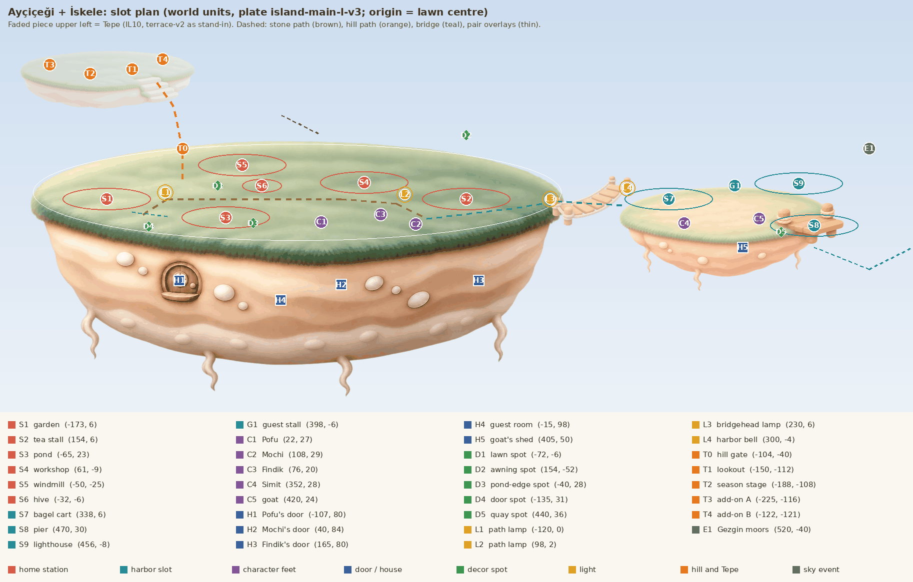

# Home layout: where everything goes on Ayçiçeği, from day one to Altın Ada

**Status:** proposal by the world designer, 2026-11-05. The spatial
companion of [home progression](home-progression.md) (what grows and when);
this file says **where** each thing stands, **how it looks** at each level,
**how it is revealed** and what changes at night and by season. Where the two
disagree about place, this file wins; about numbers, home progression and
`PofuCore` win. Ayçiçeği is the **showcase island**: section 9 lists every
asset it needs, in production order.

Decisions it builds on: island level 1 to 10 and station caps are in
`PofuCore` (PR #182); the diorama look is
[ADR-0018](../adr/0018-visual-system-v1.md); residents of healed islands do not
move to Ayçiçeği: their island fills with its own returning life and an
apprentice who stays, and the resident **visits home on their day** of the
week via Gezgin and works their favourite station (founder and lead,
2026-11-05); seasons follow the real calendar plus a small weekly theme.

## 1. Rules of the ground

1. **The plate never changes shape.** The lawn polygon of `island-main-l-v3`
   is a test invariant (`IslandFootprintTests`) and every slot is authored
   for it. Growth paints *on* the lawn and the earth body, or adds pieces
   *beside* it (the harbor islet, the Tepe). So home progression's "the
   island widens" (IL4) and "the back terrace rises" (IL6, IL8) become a low
   grassy knoll painted under the existing workshop and windmill slots, not
   new land.
2. **Slots are sockets, never free placement.** Each has a fixed anchor in
   world units (points at camera scale 1; origin = the lawn's centre; +x
   right, +y toward the viewer). The anchors already in
   `IslandLayout.swift` are kept exactly.
3. **The back is hidden, the gaps are gold.** The camera looks down at
   about 17°, so anything behind a tall station is covered by it. Only three
   back gaps are visible: x −122…−82 (between garden and windmill), the
   middle band y −10…10 (x −115…−20, between windmill and pond), and the
   front lip strip y 30…40. New slots use only these; everything else is on
   the earth face, on the harbor islet or on the Tepe.
4. **Homes live in the earth.** Pofu's round door already sits in the
   body. Every resident who lives here gets a round door in the earth face
   (no lawn space, a warm window at night), so the island reads as a
   village under a garden.
5. **Nothing new appears off camera.** Every reveal pans or cuts to its slot
   first (section 4), then plays; the player always sees the change happen.

## 2. The map

*Markers over the graded plate; the harbor islet (`harbor-island-s`) and
the rope bridge (`bridge-east`) are drawn at their planned place; the faded
piece upper left is the Tepe (`terrace-v2` as a stand-in). Plate pixel to
world: x = (px − 766) / 3.096, y = (py − 414) / 3.096.*

| Zone | World box | What it is |
|---|---|---|
| Home lawn | ellipse ±240 × ±43.7 | the five home stations, Pofu, Mochi, Fındık, the hive |
| Earth face | x −200…200, y 45…150 | four round doors (houses), roots, the guest window |
| Bridge | x 236…300, y 8…12 | `bridge-east`, the walk from home to the harbor (IL3) |
| Harbor islet (İskele) | centre (395, 14), lawn ±100 × ±24 | bagel cart, pier, lighthouse, guest stall, Simit, the goat |
| Hill path | (−104, −12) → (−130, −104) | stone steps behind the windmill's left (IL9) |
| Tepe | centre (−172, −112), lawn ±75 × ±18 | lookout, season stage, two add-on sockets (IL10) |
| Sky east | (520, −40) | where Gezgin moors beside the pier |

The harbor reconciles two older docs: archipelago system 1A.2 made İskele
a district of home on one pan, home progression has "the rope bridge to
İskele". Both hold: one camera pan, one rope bridge, the islet on the right
at x 295…495. Code today puts the harbor isle at (265, 320) on the map; it
moves (section 11).

## 3. Every slot

Coordinates are footprint centres (stations) or feet (characters). "Opens"
is the island level (IL) or event. Looks per level for stations are in
home progression §4.2; here only what the slot itself adds.

### 3.1 Stations

| Id | Slot | World | Opens | Notes on look and place |
|---|---|---|---|---|
| S1 | garden | (−173, 6) | IL1 (built) | left tip; L5's giant sunflower turns with the sun; the Su pair's stream enters from the right |
| S2 | tea stall | (154, 6) | IL2 | right tip, faces the bridge; the awning carries decor spot D2 |
| S3 | pond | (−65, 23) | IL4 | front left, flat, never hides anything; frogs on the lily pads |
| S4 | workshop | (6, −15) | IL6 | back centre-left; its lit doorway stands left of Pofu's head, clear of it (experience v1, wave 2); IL6 paints a low knoll under it (the "back terrace") |
| S5 | windmill | (−90, −25) | IL8 | back left, tallest, beside the garden (a sliver shows at Home); IL8 paints a knoll; storks perch on the cap in spring |
| S6 | hive | (−32, −6) | IL9 + Arı done | small (±18 wide), in the middle band in front of the windmill's right foot; bees fly the garden-pond-tea loop (code) |
| S7 | bagel cart | (338, 6) | IL3 | harbor, left end, first thing over the bridge |
| S8 | pier | (470, 30) | IL5 | harbor front right, runs off the lip toward the viewer; the ferry moors at L3 |
| S9 | lighthouse | (456, −8) | IL6 | harbor back right, the frame's right bookend; beam at L4 |

### 3.2 Characters, houses and the guest

| Id | Who or what | World | Opens | Night |
|---|---|---|---|---|
| C1 | Pofu (feet) | (22, 27) | day 1 | sleeps inside H1; the door window glows (`generatedPlate.window`) |
| C2 | Mochi | (108, 29) | IL2 | goes in at H2 after dusk |
| C3 | Fındık | (76, 20) | IL6 | stays late at the bench at L4+ (lamp on), then H3 |
| C4 | Simit | (352, 28) | IL3 | curls up in the cart's kiosk (L5) or under the umbrella |
| C5 | the goat | (420, 24) | IL3 | H5, a shed door in the harbor islet's face |
| —  | the frogs | on S3's lily pads | IL4 | the dusk choir, then quiet |
| H1 | Pofu's door | (−107, 80) | exists | the plate's round door |
| H2 | Mochi's door | (40, 84) | IL2 | rose, tulip-glass sign (`door-mochi`) |
| H3 | Fındık's door | (165, 80) | IL6 | sage green, gear sign, a wrench on a nail |
| H4 | guest room | (−15, 98) | first main island healed | sky blue, cloud-whale sign; lit only on a visit night |
| H5 | goat's shed | (405, 50) | IL3 | harbor face, a plank door |
| G1 | guest stall | (398, −6) | first visit | harbor, where Gezgin lands the visitor; shows their island's goods |

### 3.3 Decor spots, paths and lights

| Id | Slot | World | Opens | Family |
|---|---|---|---|---|
| D1 | lawn spot | (−72, −6) | IL7 | seat or ground piece (bench, kite, hammock), middle band |
| D2 | awning spot | (154, −52) | IL7 | hang line on the tea stall's awning (paper lanterns) |
| D3 | pond-edge spot | (−40, 28) | IL7 | on the pond's right rim (toy sailboat, paper boat) |
| D4 | door spot | (−135, 31) | IL7 | front lip left of Pofu's door (mailbox, pumpkin lantern) |
| D5 | quay spot | (440, 36) | İskele complete | harbor lip beside the pier (decor set 4) |
| P1 | stone path | (−140, 20) → (−118, 6) → (−10, 6) → (90, 10) → (118, 24) | IL2 | garden to tea stall, behind the pond and behind Pofu |
| P2 | bridge | (118, 24) → (236, 8) → (300, 12) | IL3 | the path continues onto `bridge-east` |
| P3 | hill path | (−104, −12) → (−104, −40) → (−130, −104) | IL9 | stone steps up the back gap to the Tepe |
| L1 | path lamp | (−120, 0) | IL6 | `path-lamp`; warm pool on P1 at dusk |
| L2 | path lamp | (98, 2) | IL6 | between Fındık and the tea stall |
| L3 | bridgehead lamp | (230, 6) | IL6 | lights the bridge |
| L4 | harbor bell | (300, −4) | IL3 | `harbor-bell` on the bridge's harbor end |
| L5 | festoon | windmill cap → workshop eave → tea awning | IL8 | a line of `decor-lanterns` strung between stations (replaces "lanterns along the terraces": the back rim is hidden) |
| T0 | hill gate | (−104, −40) | IL9 closed, IL10 open | `hill-gate`, a soft glow behind it (code) |

### 3.4 The Tepe (IL10)

| Id | Slot | World | Opens | What |
|---|---|---|---|---|
| T1 | lookout | (−150, −112) | IL10 | Pofu's bench and a small telescope; Mehtap's moon telescope replaces the telescope (add-on) |
| T2 | season stage | (−188, −108) | IL10 | a low round grass dais where the season set's centrepiece and the season visitor appear |
| T3 | add-on A | (−225, −116) | edition | Fanus, the glass greenhouse (three levels) |
| T4 | add-on B | (−122, −121) | edition | Çömlek, the kiln (three levels) |

Why the Tepe is up and left: it is the only side where nothing tall stands
in front of it (the garden is low until L5, the windmill is to its right),
and from the Home framing a pan up-left reads as "climbing".

## 4. Island level by level: what appears and how

Every reveal uses one grammar, so the player learns it once: **camera**
(eases to the slot in 0.6 s, holds), **beat** (the slot's art draws in:
pencil sketch, then a painted cross-fade in 0.8 s, a dust or petal puff),
**sound** (one sting under two seconds plus the slot's own sound), **then
back** (the camera returns to where the player was). A level-up banner is
native glass; the world change is painted. Skippable by a tap; never at
night's quiet hours (the beat waits for the next visit).

| IL | What appears (slots) | Reveal beat | Sound | Look change of the land |
|---|---|---|---|---|
| 1 | S1 garden (built), H1, C1 | first morning: the camera rises from the clouds to Pofu's door; he steps out | wind, bees | none |
| 2 | S2 slot, P1 path, C2 Mochi, H2 | stones pop in one by one from the garden to the tea corner (P1), Mochi's door appears in the earth with a knock | kettle whistle; a soft knock | the path |
| 3 | P2 bridge, harbor islet, S7, C4, C5, H5, L4 | the camera pans right; the fog bank rolls back; the bridge unrolls plank by plank; the bell rings once | gulls, the bell | the harbor joins the frame (one more pan stop) |
| 4 | S3 pond slot, frogs | the pond's hollow fills with a ripple; a frog hops onto a pad | frogs at dusk | none (the plate does not widen) |
| 5 | S8 pier slot, fireflies | planks slide out from the harbor lip; first calm night shows fireflies over S3 | a creak, crickets | stepping stones across S3's rim (plate edit) |
| 6 | S4 + S9 slots, C3 Fındık, H3, L1-L3 | the knoll under the workshop swells up; Fındık's door; at the next dusk the three lamps light in order | a hammer tap; a lamp "tink" ×3 | workshop knoll (plate edit) |
| 7 | D1-D4 spots, decor set 1 | four sockets glint once (a sparkle on each spot), the bench arrives first | the island's short melody on arrival | flower borders along P1 and the front lip (plate edit) |
| 8 | S5 slot, L5 festoon | the windmill knoll rises; birds circle; at dusk the festoon lights from the windmill to the tea stall | wind in sails; birds | windmill knoll (plate edit) |
| 9 | P3 hill path, T0 gate (closed), S6 hive slot (with Arı) | steps rise out of the back gap; the gate stands with a glow behind it | a low chime | the hill path |
| 10 | Tepe, T0 open, T1-T4 | the full-bloom ceremony (home progression §5): lanterns light garden → lighthouse, residents gather, the giant sunflower's golden head opens, the gate swings, the camera climbs to the Tepe | the island melody in full | the Tepe |

**The capped sketch** (home progression §3 rule 4) lives on the same
sockets: a capped station shows its next level as a faint pencil sketch
beside it; an unopened slot shows nothing until its IL (no empty plots, no
padlocks), except the very next one, which shows a faint sketch outline so
"Ada 6'da" has a place to point to.

## 5. Residents at home and the visiting day

Home residents live here: Pofu, Mochi, Fındık, the frogs, Simit and the
goat. Each works one station slot (two at L5); idle residents wander P1.

The residents of healed main islands **visit every day** (founder decision,
2026-11-05; [experience v1 §5](../design/experience-v1.md#5-visitors-someone-comes-every-day)).
One visitor a day is drawn when the day starts and stays until the first
visit after their day ends, so nothing is missed. Their own island keeps its
returned life and an apprentice; the resident comes home for the day **with
one reason**: a gift, a help, a festival, news, a stay-over or just sitting.
Gezgin lands them at the pier (before the harbor, they drift down to the
front-lip spot V1 under a dandelion seed), they open the guest stall (G1)
with their island's goods, and on a festival or an invitation they work their
favourite station in a **guest slot** (V2; it never displaces anyone; +50 %
at that station that day). A stay-over lights the guest room (H4). A missed
day costs nothing, and hearts count visits, not streaks.

The table below is a **weighting**, not a schedule: each resident is likelier
on their own weekday (about six to one against another day), but any healed
island's resident may come on any day. Before any island is healed, Gezgin's
postcard comes instead. About one day in eight is a quiet day once two
islands are healed: Pofu hands over a letter and the player invites a resident
they have met; the invitation never expires and never costs anything.
Slots: `PofuWorld/Layout/VisitorSlots.swift`; the draw:
`PofuCore/Game/VisitorSchedule.swift`.

| Day | Theme (always on) | Likeliest visitor once healed | Favourite station | At the guest stall |
|---|---|---|---|---|
| Pazartesi | Toprak: a watering can by the garden | Sumi (Koke) | garden S1 | moss stools, raked thank-you letters |
| Salı | Su: the pond's little fountain runs | Damla (Çağlayan) | pond S3 | a glass of falling water |
| Çarşamba | Emanet: a parcel on Pofu's step | Boncuk (Emanet) | workshop S4 | polished found things on tags |
| Perşembe | Mektup: the mailbox flag is up | Yosun (Gezgin) | pier S8 | a satchel of letters |
| Cuma | Işık: one extra lantern on the bridge | Tuli (Revontuli) | lighthouse S9 | a jar of painted aurora |
| Cumartesi | Bal: honey on the tea tray | the bees' keeper (Arı) | hive S6 | honey jars |
| Pazar | Ay: the telescope is out at dusk | Nane (Mehtap) | windmill S5 (dusk) | a star chart |

Before an island is healed, its day keeps only the small theme touch, so the
week has a rhythm from day one. The order is the story order (Koke first);
if the story order changes, visitors move with their islands, not days.
Open question 3 (is one visitor a day too many?) is answered: one a day, with a
quiet day about one in eight.

## 6. Light: day, dusk and night

Light is code first (art plan, "Day and night: code first"); painted lit
overlays only where a shape changes. Emitters, in the order they light at
dusk (a 6-second cascade, garden to lighthouse, once per evening on screen):

| Light | Slot | From | Night look |
|---|---|---|---|
| door windows | H1-H5 | as each opens | warm small squares; H4 only on visit nights |
| path lamps | L1-L3 | IL6 | warm pools on P1 and the bridge |
| tea stall string lights | S2 L4 | tea L4 | dotted warm line (`tea-stall-1-lit` method) |
| festoon | L5 | IL8 | lantern sway (decor set 1 effect reuses it) |
| pond floating lanterns | S3 L5 | pond L5 | `pond-5-lit`, reflections in code |
| windmill cap lanterns | S5 L4 | windmill L4 | `windmill-5-lit` |
| workshop doorway | S4 | workshop L1 | `workshop-1-lit` (queued) |
| lighthouse lamp and beam | S9 L2, L4 | lighthouse L2/L4 | lamp-room lit edit; beam sweeps the cloud sea |
| fireflies | over S3, D1 | IL5, summer and calm nights | particles |
| hill gate glow | T0 | IL9 | a soft warm glow behind the closed gate |
| Tepe telescope lamp | T1 | IL10 | a tiny lamp; the last dark star is found here at Altın Ada |

Night never hides a slot: every station keeps a readable rim light (L5's
warm rim at dusk), and the residents go in, so the lawn is calm.

## 7. Seasons (real calendar) on the same sockets

| Season | Land and slots (code first) | Visitor and its place | Season set (where it goes) |
|---|---|---|---|
| Spring | blossom on the garden arch; lawn flowers; Hıdırellez ribbon tree on T2 (5-6 May) | stork pair on S5's cap | ribbon tree T2, tulip pots D4, kite D1, nest D2 |
| Summer | warmer grade, long dusk, fireflies | sea turtle under S8 | hammock D1, ice-cream cart G1 (on non-visit days), beach umbrella D3, paper boat on S3 |
| Autumn | leaves drift from the garden; lanterns on calm evenings | crane on T2 (or the lawn before IL10) | pumpkin lanterns D4, chestnut stove D1, scarf on the giant sunflower S1, leaf pile D3 |
| Winter | snow on roofs, path and lip; S3 freezes, frogs skate | snow owl in S9's lamp room | sled D1, snowman Pofu D3, salep pot D2, star string L5 |

Before IL10 the season stage does not exist; the set's centrepiece takes D1
and the visitor uses the lawn. Seasons change the **grade and particles**
first; painted season edits only where shape changes (snow caps on roofs:
one overlay per station, after review).

## 8. Tam Çiçek, the Tepe and Altın Ada

- **Tam Çiçek (IL10, about day 60):** the ceremony of section 4; the Tepe
  stays. The island hums (+25 %). The four pairs' scenes keep running:
  Çay ve simit (Simit crosses P2 with a tray to S2), Su (a stream from S3 to
  S1 along y 18), Değirmen (a belt from S5's hub to S4's gear sign), Liman
  (the ferry loops under S9's beam).
- **Mastery L6-L10:** small touches on the same sockets (home progression
  §9); L10 is a golden painted edit per station.
- **Altın Ada (all eight at L10, about nine months):** the plate's rim and
  the lawn lip turn gold at dusk (a code grade on the plate band, no new
  plate), the telescope on T1 finds the last dark star, and if Mehtap's
  finale is near, Nane's star trail ends over Ayçiçeği.

## 9. The showcase: every asset Ayçiçeği needs, in production order

**Now** = system and slot settled; in `batch-33-home-showcase-pilot` (P) or
`batch-33-home-showcase` (B). **Queued** = already in the art queue.
**After** = waits for a concept review (named); listed so nothing is
forgotten. Guides: `station` = station guide, `decor` = decor guide, `face`
= matched to the plate's round door, `none` = a single object.

| # | Id | Kind | Guide | Levels / slot | When | Notes |
|---|---|---|---|---|---|---|
| 1 | pier-2…5, lighthouse-2…5 | station | edits | S8, S9 L2-L5 | Queued (queue row 1) | harbor ladders |
| 2 | decor-lanterns, decor-sailboat, decor-mailbox | prop | decor | D2, D3, D4; L5 festoon | Queued (queue row 1) | decor set 1 with the bench |
| 3 | workshop-1-lit | station | edit | S4 | Queued | doorway glow |
| 4 | path-lamp | prop | decor | L1-L3, IL6 | Now (P) | the post family |
| 5 | hive-1 | station | station | S6 L1, IL9 | Now (P) | straw skep |
| 6 | material-moss | prop | none | material 1 | Now (P) | the material family |
| 7 | door-mochi | prop | face | H2, IL2 | Now (P) | the door family |
| 8 | hive-2…hive-5 | station | edits | S6 L2-L5 | Now (B) | lavender, box, landing board, honey stand |
| 9 | material-water, -keepsake, -light, -wax, -seaglass | prop | none | materials 2-6 | Now (B) | shown in the level-up card and on Gezgin's back |
| 10 | door-findik, door-guest | prop | face | H3 (IL6), H4 | Now (B) | |
| 11 | hill-gate, hill-gate-open | prop | station | T0, IL9 / IL10 | Now (B) | |
| 12 | guest-stall | prop | decor | G1 | Now (B) | empty top; goods are per visitor (#24) |
| 13 | harbor-bell | prop | decor | L4, IL3 | Now (B) | |
| 14 | goat-work | char | edit | C5 at S8 | Now (B) | rope coil |
| 15 | frog-1, frog-sing | char | edit | S3 residents, IL4 | Now (B) | the dusk choir |
| 16 | lighthouse-2-lit | station | edit | S9 L2 | After the harbor ladders | lamp-room glow (if L2's edit does not already carry it) |
| 17 | plate edits: il2-path, il5-stones, il6-knoll, il7-borders, il8-knoll, il9-hill-path | world | edits of the plate | IL2-IL9 | After `x-home-il5` (batch 34) | one edit per IL that changes land; the lawn outline must not move |
| 18 | door-goat (H5) and the harbor islet at home scale | prop, world | face | H5, islet | After `x-home-il5` | the islet may need a re-scaled lawn |
| 19 | tepe-plate, tepe-lookout, tepe-stage | world, prop | station | T1, T2, IL10 | After `x-home-tam-cicek` | `terrace-v2` is the stand-in |
| 20 | pair overlays: pair-stream, pair-belt (tray = `simit-kitten-work`, ferry = `harbor-ferry-1`) | prop | none | §8 | After `x-home-tam-cicek` | |
| 21 | L3 style variants (tea, workshop, windmill, bagel cart, lighthouse) | station | recolor edits of L3-L5 | 15 jobs | After a style sheet review | a choice must carry through L4 and L5; recommend recolor edits (`edit_mode: recolor`) over code masks |
| 22 | decor set 4 (rope coil, fishing rod, buoy, crate stack) | prop | decor | D5 + home spots | After the harbor is built in code | |
| 23 | visitors at home: sumi, damla, boncuk, tuli, yosun, nane (base + work pose) | char | edits | guest slots | After batch 26 and batch 34 | 12 jobs; the bees' keeper after Arı's concept |
| 24 | guest-stall goods, one per visitor | prop | none | G1 | with #23 | 7 small sprites |
| 25 | season visitors (stork pair, sea turtle, crane, snow owl) | char | none | §7 | before each first season | winter first if seasons ship before March |
| 26 | season sets (16 pieces) | prop | decor | §7 | before each first season | |
| 27 | heart-3 outfits (Mochi scarf, İznik apron, Simit's bell, goat's hat, Fındık's goggles) | char | edits | residents | After phase C (residents) | |
| 28 | gezgin-f1-docked, gezgin-f2-docked (sprites) | world | none | E1 | After batch 34 | |
| 29 | golden L10 edits (8 stations + hive) | station | edits | mastery | last | |

Code, not art: every glow, beam, bee, firefly, leaf, snowflake, the cascade,
the festoon line, the gold rim of Altın Ada, the Tam Çiçek ceremony.

## 10. The future islands as they look in the game

Same diorama, same camera and scale as home: each is a **plate like
Ayçiçeği** (a shallow top over a rounded banded body, the island at about
85 % of the width, the sea of clouds below), with its own top material,
palette and landmark, Pofu and Mochi small at the front for scale. Stuck
and healed are the same layout; only the state changes. These paragraphs
are the prompts of `batch-34-islands-in-game`.

**Gezgin, form 1 (early).** At the home harbor, game camera: İskele on the
left third with its pier; Nazlı moored alongside it like a ferry, about
three times the islet's width: a soft grey-blue cloud-whale fading to cream,
thin and pale, head low, heavy-lidded kind eye. On her back a mossy patch
the size of a cottage lot: a short bench, a mooring post whose rope runs to
the pier, a tuft of grass, an empty honey-wood lantern hook and beside it a
faint scar shaped like a switched-off bulb. Pofu and Mochi wait on the pier
with a bag. Morning. Her "stuck" is her tiredness; she brightens a little
per healed island (a material tucked on her back each time).

**Gezgin, form 2 (end of Book One).** The same whale at the same pier,
golden hour: fuller and healthy, eye open. Her back is a lush small island:
three round trees, a young sunflower from a pocket of Ayçiçeği's soil, a
pool with a short fall into a second pool (all on her back, nothing falls
off), the five materials tucked among the plants, Ihlamur's old lantern lit
on the hook, the scar glowing soft gold. Pofu and Mochi on the bench.

**Çağlayan (simplified, warm).** Noon. The top is warm pale cream stone in
two low rounded terraces with moss fringes and ferns (not green: the
cluster's delta), the body honey-and-cream stone. Back centre: a low round
rock knoll, about a windmill high, with a **short** fall from a spout into
a wide round pool; a stream runs to a stone basin on the front lip, so the
water never leaves the island. Left: a small stone mill hut with a
waterwheel and a lamp window (Balaban's mill). Right: three saucer pools
stepping down with leaf boats and stepping stones. Damla, a small round
brown-and-cream otter, holds a tulip glass. **Stuck:** the fall is paused
mid-air, a clear still curtain like soft glass with droplets hanging like
beads in the sun; pools half full with dry rims, the wheel still, the lamp
out, the boats aground, Damla with an empty glass looking up, puzzled. A
sunny paused picture, not a void. **Healed:** the fall pours with a small
mist rainbow, the stream runs, the wheel turns, the window glows, the boats
float, dragonflies, Damla floats on her back with a full glass. Mochi's fear
of the drop becomes the stepping stones over the big pool.

**Revontuli.** Night. A floe: deep snow on top, a thick rounded body of
milky blue-white ice glowing faintly from inside, short rounded icicles for
roots. A small sauna on stilts with a warm window (left back), one snowy
spruce (right back), a fishing hole with a stool (front left), a tall post
with the aurora's lantern (centre back). Tuli, a round white arctic fox
whose tail tip is a soft paintbrush. **Stuck:** a starry milky-blue sky
with no aurora, the lantern dark, Tuli's tail plain white, the sauna still
warm (Ayaz sleeps under its stone), gentle snow. **Healed:** soft green and
violet aurora curtains across the sky, the lantern pale gold, Tuli's tail
coloured and painting a stroke into the air, the hole reflecting it.

**Emanet.** Late afternoon. Warm cobblestones with tufts of grass, a honey
body with a band of weathered teal planks. Back centre the lost-and-found
office: a tall crooked house on short stilts built of lost things (an
upturned umbrella roof, a teacup water tank, a top-hat chimney, a spoon
ladder) with a counter window; long low shelves on the right, a hand-cart
on the left, a post of eight hooks at the far right with the eighth empty.
Boncuk, a round magpie with a soft teal sheen. **Stuck:** soft heaps of
unsorted things everywhere, empty shelves, blank tags, a dark window,
Boncuk on the top of the biggest heap with a duster, comic. **Healed:**
everything on the shelves with cream tags, the cart loaded with parcels,
the window warm, Boncuk polishing a cup at the counter in golden light.

**Mehtap.** Blue hour. Pale silvery-cream moonstone with soft craters as
shallow pools, its two ends rising gently like a crescent cradle; a body
fading from silver to pale gold. A small round observatory dome (centre
back), a moon pool (front left), a tall perch with a lantern (right), a
bench and a board with a pinned star chart. Nane, a tiny round grey-and-
cream owl. **Stuck:** the dome closed and dark, the pool dull pewter, the
chart blank, few stars, Nane asleep in a ball by her unlit lantern.
**Healed:** the dome open with a telescope, seven faint stars joining into
a trail that ends in one bright new star, mirrored in a silver pool, the
chart drawn, Nane awake with her lantern lit.

## 11. Code follow-ups (when the build reaches them)

1. `IslandLayout`: add anchors for S6-S9, G1, H2-H5, D1-D5, L1-L4, T0-T4
   with the values above; move the harbor from the map isle (265, 320) to
   the home frame (islet centre (395, 14), bridge at x 236…300); widen the
   canvas to x −560…560 so the pier and Gezgin fit.
2. `IslandFootprintTests`: cover every new slot at its tallest art; the
   S6 hive and D1 bench share the middle band and must not touch.
3. `IslandFraming`: one more pan stop at the harbor; the Tepe is reached by
   a pan up from the gate, not counted in `stationRow`.
4. `WorldEmitter`: door windows H2-H5, path lamps, the festoon, the gate
   glow, the Tepe lamp.
5. Story: the visiting-day roster (section 5) as `ResidentID` visits in
   `PofuCore` with the guest slot; home progression §6's "a small resident
   from each main island moves in" is superseded by it.

## 12. Open questions (recommendation first)

1. **Doors in the earth face for every resident.** (a) Recommended: yes;
   no lawn space, a village feel, warm windows at night. (b) Small houses
   on the lawn: there is no room without hiding stations.
2. **The harbor as an islet on a bridge, one pan to the right.**
   (a) Recommended: yes, reusing `harbor-island-s` and `bridge-east`.
   (b) Paint the pier straight off the home plate's right tip: no islet,
   but no room for the lighthouse and the guest stall.
3. **One visitor a day.** (a) Recommended: one visitor on their own day,
   seven in all by the year's end. (b) A visitor only at the weekend: calmer,
   but home feels emptier in the long tail.
4. **The Tepe up and left behind the garden.** (a) Recommended: as drawn.
   (b) Behind the windmill in the middle: more central, but the windmill
   hides its foot.
5. **Çağlayan's fall stays on the island.** (a) Recommended: a short fall
   into its own pool. (b) A long fall into the clouds as before: grander,
   but it read as scary.
