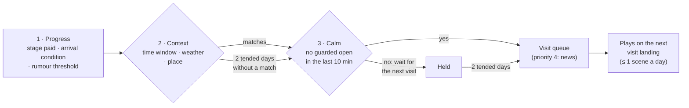

# Story Delivery: the App, the Game and the Story on One Axis

> **Superseded in part (2026-11-05):** the [game plan](game-plan.md) wins where they disagree (the Pofu and Mochi duo, main islands and fillers, no fixed days); beat triggers and the app–game–story axis still hold.

_Status: **proposal**, 2026-11-03. Written by the agent as game designer
in answer to the founder's input of 2026-11-03 (below). Nothing here is
dialogue: every line is a **placeholder ID with an intent**; humans write
the words under the [narrative-craft pipeline](../research/narrative-craft.md#4-the-human-in-the-loop-pipeline).
Reads with the [lore bible](lore-bible.md), [island curation](../archive/island-curation.md)
(the arc template), the [archipelago system](../archive/archipelago-system.md)
(stages, rounds, rumours, the web), the [app–game boundary](app-game-boundary.md)
(intents, the visit queue, A15–A26), [game design v2](game-design.md)
(A1–A14), [UI system v2](../archive/ui-system-v2.md) (surfaces) and
[Pofu's voice](../brand/pofu-voice.md) (where Pofu speaks)._

> **Founder (translated):** "We must get the app–game–story axis right.
> Maybe Pofu hints at the story now and then; story progress could come
> through quests, achievements and upgrades; a character could accompany
> us in the story, like the little companion who travels with you in
> Genshin."

> **Design loops 1 and 2 are folded in (pending the founder's
> agreement on this change):** the travelling duo of Pofu and Mochi
> (§3.6, superseding §3.3's "Pofu alone"), Çağlayan as the falls that
> remember (§5) and the hour rule ([lore §1](lore-bible.md#below-the-waterline)).
> Sources: [loop 1 §2](design-loop/loop-1.md#2-the-big-story-book-one),
> [loop 2 §2](design-loop/loop-2.md#2-the-big-story-what-loop-2-adds).

## 0. The answer in one paragraph

Story lives in **the game**, is **earned by the app**, and only **echoes
at the gate**. The gate (shield, Hop!) may carry at most one tiny,
present-tense remark a day about how the world *is* ("the water is
running on Çağlayan"), never a tease, a question or a lore noun the
player has not seen; everything with words and pictures plays on Home
and the islands, at most **one scene a day**, and the **Seyir defteri**
(Pofu's log) keeps it all. There is no separate quest system: **a
stage's cost is the resident's request**, said in her voice, paid in
rounds that resisting earned. Achievements are **stamps** in the log:
cumulative, quiet, never a streak. A beat fires when three locks open:
**progress** (a stage paid, an arrival condition met), **context** (a
time of day, weather or place that suits the scene) and **calm** (not in
the ten minutes after a guarded app was opened); context and calm relax
after two tended days, so nobody ever misses a beat. On the companion:
**Pofu is the Paimon.** The player has no avatar; Pofu is already the
one who travels with you, reacts, and holds the map. Adding a talking
guide would make Pofu a protagonist you watch and give the game a second
voice to nag with. The recommendation is **Pofu alone as the voice**,
plus a **wordless lantern moth** as a pilot: a compass you can see (it
flutters toward the rumour, rests where a beat waits), which can never
nag because it never speaks.

## 1. Reference study: story in short sessions and through systems

Claims marked _(play)_ come from playing the games, not from a source.
Sources are in section 9.

| Work | How story is delivered | The system that carries it | Attachment without pressure? | Pofu takes / rejects |
|---|---|---|---|---|
| **Genshin Impact: Paimon** | A floating companion who talks for the silent Traveler, explains, names objectives and reacts. Her design, personality and movement were tailored so players read her as the guide (Wikipedia). Running gag: "emergency food" | Quest log and every cutscene; she voices the objective _(play)_ | Mixed: she is a mascot and a meme, and also one of the most criticised parts of the game for over-explaining (PC Gamer's Davenport, via Wikipedia) | **Takes:** one constant face across every place; the companion *reacts* to what you discover. **Rejects:** the companion as narrator of objectives. A guide who explains is the first character players learn to skip |
| **Animal Crossing: New Horizons** (Isabelle, Tom Nook) | Isabelle's morning announcement: short, skippable, the island's state plus one small item of news _(play)_. Tom Nook's requests turn development into chapters: build the museum, Blathers moves in; houses, villagers arrive; the island rating, then K.K. Slider's concert as the credits _(play)_ | Requests, real-day construction ("come back tomorrow") _(play)_ | Yes: the day's news is small and done; construction waits overnight, so there is nothing to grind | **Takes:** the morning bubble *is* Isabelle (state, one news item, done); chapters end in a ceremony (our feast). **Rejects:** debt and Nook Miles as obligation |
| **Spiritfarer** | Each spirit's relationship is its requests: a dish, a house, a place to visit; hugs are a wordless affection verb; the Everlight is one tool that becomes many (Wikipedia; PC Gamer) | Requests that send you back to known islands; the boat grows with each spirit | Deep, but built on farewells | **Takes:** requests *are* characterisation (what you are asked for tells you who is asking); one wordless affection gesture (the boop). **Rejects:** goodbyes and death (ADR-0017; curation §5: nobody leaves) |
| **Stardew Valley** | Community Center bundles: deposit sets of items, a room is restored, the Junimos reward you (Bundles wiki). Heart events: cut-scenes that fire when friendship, place, time and weather all match (Hearts wiki; event preconditions in Modding: Event data) | Bundles (material → repair → scene); event preconditions | Mostly, though birthdays and seasonal crops create calendar pressure, and an event can be missed for a season _(play)_ | **Takes:** the precondition model (progress × place × time × weather) is exactly our trigger; bundles prove "material in, a place healed, a scene out". **Rejects:** missable events and calendar pressure |
| **Neko Atsume** | Cats come while you are away; after many visits a cat leaves a **memento**, kept in an album and on that cat's page (Wikipedia; GameSkinny) | Absence + an album | Yes: you are never asked for anything; gifts thank you for what you already did | **Takes:** absence is productive; keepsakes tell the story back. **Rejects:** random drops (A17: every reward is deterministic) |
| **Pokémon Sleep** | Professor Neroli's research on Pokémon sleep frames the game; your real sleep powers Snorlax, whose Drowsy Power draws Pokémon to sleep nearby; the Sleep Style Dex records them (Bulbapedia; pokemon.com) | A health behaviour as input, a dex as the album | Yes for the frame; the encounters are random | **Takes:** a real behaviour (calm) is the story's engine and a researcher-like frame makes it legible; our log is the dex. **Rejects:** random encounters and rarity |
| **Finch** | You set small self-care goals; finishing them gives your bird energy; the bird goes on an adventure and comes back with what it found (Engadget; Paste) | Goals → energy → the companion's journey | Strong (estimated D1/D7 54 % / 37 %, [competitive analysis](../research/competitive-analysis.md)); the bird is fine if you skip a day | **Takes:** the companion's story is told back to you, fuelled by your real behaviour. **Rejects:** turning the app itself into a to-do list |
| **Cozy Grove** | One or two ghost requests a day; when a ghost is helped, colour returns to the grey island; the game says, warmly, that you are done for today. Spry Fox designed for about 20 minutes a day and compared it to a weekly TV release, not a binge (Vice) | Daily caps; restoration grade | Yes on mobile; console critics found the cap frustrating (Nintendo Life, GameSpew) | **Takes:** a cap said kindly is the guardrail's best friend (A24 "Bugünlük yeter"); grey to colour is our wound to bloom. **Rejects:** nothing structural; the cap is right for us |
| **Duolingo Stories** | Short voiced stories with comprehension checks, a reward for practice (Duolingo blog; Engadget) | Lessons unlock stories | The stories, yes; the owl's streak reminders are the canonical nag | **Takes:** a story as a short, finished episode that rewards practice. **Rejects:** quizzes inside story, and everything about the owl's notifications |

### 1.1 What creates attachment without pressure

1. **Absence is productive** (Neko Atsume, Pokémon Sleep, Finch). The
   story moved while you were away, because you were away. Pofu already
   works this way (seeds grow only while away, A9, A20).
2. **The character needs you lightly and is fine without you.** Finch's
   bird, Pofu (ADR-0017). Nobody waits, ages or gets sad on a timer.
3. **Requests are characterisation, not chores** (Spiritfarer, Tom
   Nook). What Damla asks for is how we learn who she is.
4. **Preconditions make deterministic events feel like luck** (Stardew).
   A scene that happens on the first rainy morning feels like the world
   chose the moment.
5. **The album tells the story back** (Neko Atsume, the Pokédex, Finch's
   journeys). Collected pages are the memory of the relationship.
6. **A kind stop** (Cozy Grove). "That is enough for today" said by a
   character is a gift, not a wall.
7. **The anti-pattern is a voice that asks.** Paimon explaining what you
   already saw and the owl's reminders are the same failure: the
   companion becomes the nag. Pofu's companion design starts from here.

## 2. The axis: where story lives

Three domains, one rule each:

| Domain | Job | Story's role |
|---|---|---|
| **The app** (gate, utility) | Stop the reflex; answer glances; configure | **Echo only.** The world's current state may be seen or mentioned in passing; story never asks for anything here |
| **The game** (Home, islands, rounds) | A finite, earned visit or play set | **Story lives here.** Scenes, requests, arrivals, feasts |
| **The archive** (Seyir defteri, map, den) | Remembering | **Story is kept here.** Replays, stamps, rumours heard, keepsakes |

### 2.1 Levels of story

| Level | What it is | Length | Example (placeholder) |
|---|---|---|---|
| **L0 None** | No story content at all | — | Settings |
| **L1 Echo** | Wordless world state you can see: the falls pouring, a spring by the pond, a cup on the shelf | Ambient | The Hop! backdrop shows the rainbow over home |
| **L2 Remark** | One present-tense line about how the world is now. No question, no promise, no "waiting for you", only things the player has already seen | 1 line | `[SH-W-CAG-1: Pofu notes the water is running on Çağlayan today]` |
| **L3 Moment** | A wordless or one-line beat: an object arrives, a resident reacts | 3–10 s | The leaf boat washes up on the pier |
| **L4 Scene** | A staged beat with lines (lore bible §7 shape) | ≤ 45 s, ≤ 6 lines | Stage 3's turn |
| **L5 Ceremony** | Arrival, bloom, feast | ≤ 60 s, skippable after beat 2 | Çağlayan's arrival (archipelago §3.2) |
| **Archive** | Replay of anything already seen | User-paced | A page of the log |

### 2.2 Surfaces × story allowed

| Surface (intent) | Max level | Allowed | Never | Budget |
|---|---|---|---|---|
| **Shield** (gate; Apple renders it) | **L2** | One world remark in the subtitle, present tense, about an island the player has; title stays the gate ladder's | A tease, a question, a pending beat ("Damla has something for you"), a lore noun the player has not met, the myth, any line on reach #6 or later, when wellbeing < 25, after a pass > 60 min | ≤ 1 a day across shield and Hop! together |
| **Hop!** (gate) | **L2** + L1 backdrop | The backdrop shows the world as it is (gifts, weather, the rainbow); the bubble may carry the day's remark if the shield did not | A scene, a request, a rumour, navigation into the story (A22) | Shared with the shield |
| **Skipped state** | L2 + L3 | Pofu's proud beat; a seed hops; may echo the world ("a drop more on the falls") as a remark | A request reminder | Shared |
| **The minute** (≤ 60 s) | **L3** | The queue's news as a line or moment; a visitor; the toy | A scene, a stage build on a wonder island, a ceremony, a rumour rung | 1 moment |
| **Home, visit state** | **L5** | Morning bubble (the daily diff, a rumour rung), arrivals, visitors, feasts, thread moments | More than one L4/L5 a visit; any beat between bedtime and 06:00 | 1 scene or ceremony a **day**; 1 rumour a visit (archipelago §9.3) |
| **Home, settled state** | L2 on tap | One idle line when tapped (voice §5.13) | Anything unprompted | 1 line a visit |
| **Night Home** (bedtime–06:00) | L2 | The quiet late-night line (lore §7.4 shape): sleepy, sends you to bed | Progress, scenes, rumours, arrivals (A21) | 1 line a night |
| **Island view** | **L4** | The stage scene when the player taps "Aç" (open the stage); resident line on tap; the toy | Unprompted scenes on entering | Stage scenes are player-caused and never deferred (§4.5) |
| **Island game round** | L3 at set end | A set-end moment (a pool fills) and the learning card (A24) | Dialogue mid-round; a cliffhanger at "Bugünlük yeter" | 1 moment a set |
| **Map, Söylentiler** | L1 + archive | Silhouettes in fog, rumour lights, the moth; heard rumours as a list in Pofu's words | A date, a countdown, "soon" (§9.3) | — |
| **Seyir defteri** (log) | Archive | Every beat seen, replayable; stamps; letters; keepsake cards | Empty slots for future story (except the current island's five stage sketches) | — |
| **Den** | L1 + L2 on tap | Keepsakes, the wheel, letters; one line per object on tap | — | — |
| **Today sheet** | **L0** | Utility only | Story | — |
| **Weekly recap** | L1 | One painted header showing the week's most changed place | Lore text, recaps of plot | 1 a week |
| **Widgets, Lock Screen, Live Activity** | **L1** | The island as it is (A18) | Any line (voice §4.3), "new chapter", silhouettes of what is coming | — |
| **Notifications** | **L0** | — | Anything story (A3, A16) | — |
| **Settings, repair, onboarding permissions, paywall** | **L0** | — | Story as a sales lever: the paywall never uses a cliffhanger ("find out what happens on Gezgin") | — |

Why the gate gets L2 at all, and not L0: the founder's instinct is
right that a tiny sign of the world at the door makes the stake real
(Hop!'s backdrop already does this wordlessly). The danger is a remark
that **pulls** into Pofu instead of **pushing** back to life. So the
remark states, never invites; it is behind a flag and measured (§8, Q3).

**Technical note.** The shield extension cannot reason about story. The
app precomputes the day's eligible remark ID into the App Group's shared
state (the same path as `ShieldCopy`'s inputs), and the extension only
shows it on reach #1–#5. With no eligible remark, it shows the normal
ladder.

## 3. The companion

### 3.1 What Paimon actually does, mapped to Pofu

| Paimon's function | Who does it in Pofu today | Gap |
|---|---|---|
| A voice for a silent protagonist | The player has **no avatar**; Pofu is the one on screen | None: Pofu *is* the companion, the player is the keeper |
| Reacts to discoveries | Pofu's arrival and stage lines (voice §5.14) | None |
| Names the objective | The island sheet and the resident's request card | None, and we want none spoken |
| Points the way | The map, rumours, the sunflower (M3, long arc) | **Small:** "where should I look today?" is not always legible without words |
| Constant face across places | Pofu stays on Home; islands have residents | **Real:** Pofu does not visibly go with you to the islands |
| Comic relief | Pofu's body humour | None |

So the founder's wish has two real gaps: **wayfinding without words**
and **Pofu travelling with you**. Neither needs a second voice.

### 3.2 Three options

| | **A. Pofu alone** | **B. A tiny wordless companion: the lantern moth** | **C. A rotating resident buddy** |
|---|---|---|---|
| What | Pofu is the companion. He appears on the island you visit (a sprite on a socket by the vapur's landing) and points with his body | A small moth (working name **Pervane**; in Turkish poetry the *pervane* is the moth that circles the candle) lives at the calm lantern, sleeps in the sunflower by day and "hears" the islands; it **never speaks** | The newest island's resident travels with Pofu for that arc (Damla during Çağlayan), then hands over |
| Wayfinding | Pofu looks toward the thing; one line on tap | The moth flutters toward the fog side where a rumour came from, rests on the map where a beat waits, circles the stage you can open | The buddy stands by her own island's next step |
| Voice | One | One (the moth is mute) | Two at once, changing every two weeks |
| Lore fit | Perfect: "Pofu is the hamster who stepped off" | Strong: real moths hear (many have tympanal ears tuned to bats), moths come to quiet light, and our light is the calm lantern; "islands come in to quiet" gets a creature that hears them first | Good: reinforces arcs; already half-exists as visitors and cameos |
| Cost | Pofu at island scale: 2–3 pose edits of R1, one socket per island | One painted sprite sheet (rest, wings open) + code flutter (the flock-on-a-spline engine, archipelago §3.3); no lines, no translation | A travel pose per resident; lines for two voices per beat; scheduling |
| Nag risk | Low (rules in §3.5) | **None by construction**: it cannot say anything | Medium: a second voice per beat doubles the chatter; leaving the buddy for the next is a small goodbye every arc |
| Risk | Pofu becomes an explainer if we lean on him for wayfinding | Two cute things compete for the eye; it can read as an attention cue (a glow that begs) | Dilutes Pofu; breaks curation's "nobody leaves" in spirit |

### 3.3 Recommendation

**A, with B as a two-item pilot. Not C** (residents already visit and
cameo through the web, archipelago 1A.4; that is C's good part, for
free).

- **Pofu is the Paimon.** He goes with you: when you open an island,
  Pofu is there (stepping off the vapur on the first visit of a day,
  already sitting by the pools after that). He is the constant face; the
  player is the keeper. This keeps one voice, the one humans are already
  writing, and keeps attachment concentrated where the product needs it
  (the gate's face is the story's face).
- **The moth is the compass, not a character.** Pilot it as two items
  (the sprite and the map behaviour) in Rehearsal mode. It ships only if
  a cold viewer, shown a morning with a rumour, looks where the moth
  goes within 3 seconds without reading anything. If not, cut it; Pofu's
  gaze does the job.
- **Do not give the moth a name in the game before the founder hears
  it.** Pofu may call it something once, as a joke; writers decide (§8).

### 3.4 Personality sketches (for writers, not lines)

**Pofu as companion** (adds to lore bible §3, changes nothing):

- **On an island he is a guest.** He takes his shoes off, metaphorically:
  sits where the resident tells him, eats what he is given, is very
  polite and slightly too curious.
- **He notices one thing and says it.** Never two. He points at it with
  his whole body first (ears, then nose, then paw).
- **He is a bad tour guide on purpose.** He gets the name of the thing
  wrong, the resident corrects him (watch the tic counted in lore §9).
- **He never knows what comes next.** He did not read ahead. He is as
  surprised as the player; a guide who knows the plot is a narrator.
- **When the visit is done he gets busy with something else** (the
  "done" signal of app-game boundary §6.2 works on islands too: he turns
  to watch the boats).

**The moth** (behaviour only):

- Dozes on the calm lantern at home; the brighter the lantern, the more
  it wanders. When calm is low it simply sleeps there, never leaves, never
  looks sad (calm resetting is the gate's consequence, not the moth's).
- In the morning after a rumour, it sits on the side of the island the
  sound came from; on the map it rests on the fog where the next
  silhouette will appear.
- On an island with a stage ready to open, it circles that spot once
  **when you arrive**, then lands. It never loops, never glows brighter
  over time, never moves while the app is in the background.
- Hidden second answer (the toy rule, archipelago §3.1): boop it five
  times and it lands on Pofu's nose; Pofu goes cross-eyed.

### 3.5 Rules so the companion never nags

1. **Speaks only when the user acts** (lore §0): a tap, a visit, a
   build. Never on a timer, never in a notification, never on a widget.
2. **Never asks you to come back,** never mentions what is waiting,
   never says "don't forget", "still", "again", or a time ("tomorrow").
3. **One story line per visit** (plus the voice budget's lines); **one
   scene a day.**
4. **A hint is said once.** A tutorial line never repeats after the
   action was done once. If a hint is ignored three times, that hint
   type goes silent for good; only the moth and the world remain.
5. **Requests never age.** A resident asks once, on her noticeboard; she
   never asks twice, never looks impatient, and never says "still
   waiting".
6. **Silence is the default** in the settled state and on night Home
   (one line, on tap).
7. **The story voice never talks about screen time.** The gate's lines
   are the gate's; Damla never mentions your phone, and the world never
   contains one (lore §6.11).
8. **A setting for less talk.** Settings → Pofu → "Az konuşsun" (quiet
   Pofu): idle lines off, stage and arrival lines kept, shield remarks
   off. The default is normal talk; the setting is offered once, in the
   first weekly recap's quiet row.
9. **No knowledge the player lacks.** Pofu never names an island,
   resident or object the player has not met (no spoilers, no pull).

### 3.6 The duo: Pofu and Mochi (loop 1, supersedes 3.3's "Pofu alone")

The founder asked for a travelling pair that talks, like Kratos and
Atreus. A second voice is safe only if it is bounded:

- **Who:** Pofu (the constant face, still the Paimon of §3.3) and
  **Mochi**, who cannot hear the islands and comes "to carry the tea".
  Why her, and not Fındık, Simit or the moth:
  [loop 1 §2.2](design-loop/loop-1.md#22-the-duo-pofu-and-mochi). The
  moth stays the wordless compass of §3.3.
- **Where the duo speaks:** the vapur ride (the travel transition to an
  island, first visit of the day), arrivals, stage turns (S3), blooms and
  feasts. **Never** on the shield, Hop!, widgets or notifications.
- **Budget:** at most **one duo exchange a day**, two to four lines,
  always skippable, kept in the Seyir defteri (§4.4). **Mochi never speaks
  outside an exchange.** The "Az konuşsun" setting also silences duo
  exchanges except arrivals and blooms.
- **Beats:** `DUO-01`…`DUO-13` (loop 1) and `DUO-02b` (loop 2), each an
  ID, an intent and a subtext; humans write the words; the `pofu-story`
  skill's device rule applies (no two consecutive exchanges on the same
  device).
- **Trigger** (the three locks of §4.5): progress = the island's beat;
  context = the vapur ride or the island view; calm = none (the duo never
  rewards or reproaches calm).

**Mochi as a travel companion** (sketch for writers, not lines):

- **Terse and practical.** She asks "açık mı, demli mi?", never
  "nasılsın"; on the vapur she pours before she sits, and she does not
  sit for long until Çömlek.
- **She watches Pofu, not the wonder.** Where he looks at the island, she
  looks at him (the pool, the fog, the lantern).
- **Her tell, inverted.** She turns a glass's waist toward you; when hurt,
  she turns it away (`DUO-05`).
- **She hides one thing and lies about nothing.** At the midpoint (Olta)
  she tells less than she knows, and Pofu lets her.

## 4. Progression through systems

### 4.1 Quests: the stage cost is the request

Pofu does not get a quest log. Each wonder island's five stages already
cost material and seeds (archipelago §7.4); that cost is presented as
**the resident's request**, on her **noticeboard** (a wall decor spot by
her station), in her voice: one request open per island at a time.

| Request kind | Where | Cost | Rule |
|---|---|---|---|
| **Stage request** (the arc) | The island's noticeboard | Material + seeds (stage cost) and a tended-day floor | Exactly one per stage; its card shows the want ("I want to try the second pool") and a painted progress jar, never a number on Home |
| **Web request** (goods) | The asking island's board | One good from an earlier island (1A.4) | Only stage 4–5 extras, decor and gifts to home; backward only; at most 3 open across the archipelago |
| **Home request** | The çay ocağı's board | A good from any island the player has | Feeds visitors' tea and feasts' flavour, never the arc |
| **Wish** (existing) | Bubble | Behaviour Pofu already sees | ≤ 1 a day, "Not today" free (game design §8) |

**The open-requests list** lives in the log (one page, "Ricalar"), so
the player can see them without a quest UI on Home. It shows at most
the island boards' current cards; nothing is overdue because nothing has
a date.

### 4.2 Achievements: stamps (*pullar*)

Stamps are small painted postal stamps in the log, fitting the vapur,
Yosun's mail and the letters (M4). They mark **firsts and meanings**,
not volumes.

| Rule | Why |
|---|---|
| **Cumulative only;** no consecutive days, no tiers ("10, 50, 100"), no percentages | A19, and tiers are a grind |
| **Never awarded for opening Pofu** or time in Pofu | A9 |
| **Quiet:** no pop-up, no confetti; the stamp is inked when the log is next opened, with a soft stamp sound. If the visit queue has no other news, Pofu may mention it once | A15's three beats; rationed bounces (design language) |
| **Deterministic and visible:** no hidden-count FOMO; a stamp's condition is shown once earned, not before | A17 |
| **Not shareable as a brag** in year one; never on the shield or widgets | A8, A18 |
| **About twenty in year one,** written as moments, not metrics | Restraint |

Examples (names are placeholders for writers):

| Stamp (intent) | Condition |
|---|---|
| `[STAMP-first-calm-night]` | The first calm night (game design §5) |
| `[STAMP-first-catch]` | The first Hop! that caught a reach ("Yakaladım!") |
| `[STAMP-midnight-no]` | A skip between 00:00 and 03:00 (once) |
| `[STAMP-boat-home]` | The first toy leaf boat washes up on the pier |
| `[STAMP-sneeze]` | Pofu's first sneezed seed (M5) |
| `[STAMP-full-glass]` | Çağlayan's arc completes (the feast) |
| `[STAMP-first-rain-rainbow]` | The first morning rainbow at home |
| `[STAMP-every-resident-tea]` | Every resident the player has has drunk tea at the çay ocağı once |

Rejected stamps, as a test for writers: "7 days in a row", "100 skips",
"played 50 rounds", "opened Pofu at 7 am five times".

### 4.3 Upgrades unlock places, places host beats

| Upgrade | Unlocks | Kind of beat |
|---|---|---|
| A wonder island stage | The stage scene and the plate edit | **Core arc** (always) |
| Harbor pier (first planks, day 2) | The vapur can dock: bottles, letters, postcards | Rumour objects, M4 letters |
| Çay ocağı (any level) | Visitors and feasts | Core feast; never gated on a level |
| Çay ocağı L3 | A second table: two visitors on web days | Side beat |
| Workshop L3 (Fındık) | Fındık offers to fix the wheel; Pofu: "Kalsın." (M2 rung) | Side beat |
| Emanet's gift (den shelf) | Keepsakes displayed in the den | Archive |

**Rule:** the core arc never waits on a home upgrade. Upgrades open
**side beats** and places; an arc's five stages and its feast depend
only on that island's own requests (curation's backward-only rule).

### 4.4 The Seyir defteri (Pofu's log) collects the story

The log is a painted notebook on Pofu's table in the den, also reachable
from the map's sheet. Crafted paper skin over native navigation
(UI system v2, layer C).

| Section | Holds |
|---|---|
| **Islands** | One chapter per island the player has: its five stage pages (each the plate edit as a painting, the scene replayable), its feast, its keepsake card. The current island shows its **five frames as faint pencil sketches**, inked one by one: the arc's progress bar on paper |
| **Söylentiler** | Rumours heard, in Pofu's words (the map's list is the same data) |
| **Mektuplar** | M4's old letters, Yosun's notes |
| **Ricalar** | The open requests (§4.1) |
| **Pullar** | Stamps earned |
| **Öğrendiklerimiz** | Learning cards from sets |

Rules: replays earn nothing; no empty slots for anything not yet
arrived (no silhouettes of future islands, no "?" stamps); one page is
added per beat seen; it opens on the newest page.

### 4.5 How a beat triggers: three locks

| Lock | What it checks | Relaxes |
|---|---|---|
| **1. Progress** | A stage paid; an arrival's cumulative conditions; a rumour's third; a thread's precondition (e.g. stage 3 seen) | Never: progress is the player's |
| **2. Context** | A time window (morning 06–11, day, dusk), simulated weather (archipelago 1A.5), a place (Home, harbor, the island) | After 2 tended days the window widens to any daytime visit |
| **3. Calm** | No guarded app opened in the previous 10 minutes; not inside Hop! or the minute; not night | After 2 tended days, any daytime visit |

**Two kinds of beats:**

- **Player-caused** (tapping "Aç" on a stage, a set ending, the toy):
  plays **at once**, on the island. Causality beats context: a reward
  delayed from the tap that earned it feels broken. Only the *extra* of
  a stage may wait for context (the bloom's morning rainbow, §5).
- **World-caused** (rumours, arrivals, visitors, feasts, threads): go
  through the three locks and the visit queue as the news beat (A15:
  at most three beats a visit; one news beat a visit).

**Daily caps:** one L4/L5 world beat a day; a stage scene the player
caused that day does not count against it but pushes world scenes to the
next day. One open mystery rung a day (lore §5).

**Why calm is a lock, not a reward.** A scene played seconds after an
Instagram open is wasted and, worse, chains the feed to Pofu. The lock
never punishes: the beat is only held, never lost, and after two tended
days it plays anyway.

### 4.6 Pacing with earned rounds

Numbers from archipelago §4.2 and §7.3–7.4 (illustrative, for the
economy pass):

| | Stage 2 | Stage 3 | Stage 4 | Stage 5 | Total |
|---|---|---|---|---|---|
| Material (water drops) | 20 | 40 | 60 | 80 | 200 |
| Rounds at ≈ 4 drops a round | 5 | 10 | 15 | 20 | 50 |
| Sets of five | 1 | 2 | 3 | 4 | 10 |
| Tended-day floor since arrival | 2 | 5 | 9 | 14 | — |

- **A typical player** (one set a day): material never binds; the **day
  floors** pace the story. The arc takes 14–15 tended days for anyone who
  plays most days. Bingeing rounds cannot rush it (A22).
- **A heavy scroller** (the 2-round baseline only, ≈ 8 drops a day): 25
  tended days. Slower, never stopped.
- **A resister** earns more rounds, so the story flows at the floor's
  pace even when sets are skipped. **Story is the dividend of quiet**,
  which is the product's thesis said with the economy.
- Set-end moments (A24) are **L3** and draw from a small pool per stage
  (the pool fills, a boat bobs, Damla refills her glass); they are not
  plot. Plot moves only at stages, arrivals, feasts and threads.

## 5. One full arc: Çağlayan, beat by beat

Days are tended days (cumulative, 1A.6). The arc follows curation §2's
rework (the fall has stopped; a leaf boat from home was blocking the
spring), revised by the design loops into **the falls that remember**:
water that has gone round the sky shows what it passed, so every pool you
clear becomes a live window onto another island in that island's own
hour; the island itself is always noon (the hour rule). Want (Damla):
catch the whole fall in her glass, to keep the pictures; need: let it go
round. Line IDs are placeholders: `[ID: speaker, intent]`. Rows marked
**(loop)** are the revisions.

| # | Beat (level) | Trigger: progress · context · calm | Surface and UI moment | Who | Placeholder | Log page / stamp |
|---|---|---|---|---|---|---|
| R1 | **Rumour 1, a sound** (L2) | ⅓ of the arrival condition (≈ day 2) · first visit after 06:00 · calm lock | Home visit, morning bubble (queue news). The fog's east edge shimmers; the moth sits on the east rail | Pofu | `[CAG-R1: Pofu asks if you heard water in the night]` | Söylentiler 1 |
| R2 | **Rumour 2, an object** + the myth, once (L3) | ⅔ (≈ day 3) · the vapur's first run (needs the harbor planks) · day | Harbor: a bottle on the pier, half full of dry travertine sand. Tap it: the one spoken premise line (lore §1, ASK 1) | Pofu | `[MYTH-1: Pofu says islands come in when it is quiet]`, `[CAG-R2: Pofu shakes the bottle; sand, no water]` | Söylentiler 2 |
| R3 | **Rumour 3, a sight** (L1) | All but the release (≈ day 3) · dusk · none | Map's outer ring: the lighthouse beam catches a mist rainbow; also visible on Home's sky at dusk. No bubble | — | (wordless) | Söylentiler 3 |
| A | **Arrival** (L5) | Day 4 conditions · arrives in the night (A21) · first visit after 06:00, calm lock | Archipelago §3.2 choreography: morning bubble "See it" → cloud pass → **a thin trickle runs over the lowest rim and stops** → Damla with an empty glass → the toy glows → first page card with the lore hook → "Oyna" (free tutorial round). Gift: a spring bubbles up by home's pond | Pofu, Damla | `[CAG-A1: Pofu, delighted, refers to last night's water]`, `[CAG-A2: Damla, the want: catch it all]`; **(loop)** the pools are milky (the water "forgot"); `[CAG-S0b: Damla complains the island is always noon]`; the vapur ride there carries `DUO-02` | Islands › Çağlayan p1 (sketch inked) |
| S1 | **Stage 1, Meet** (L3) | The first set on Çağlayan ends · — · — | Set-end card → the first pool fills; a shy trickle returns, stops. "Bugünlük yeter" | Damla | `[CAG-S1: Damla, encouraged, refills the glass]` | p1 complete |
| Q2 | **Request for stage 2** (card) | Stage 1 seen | Damla's noticeboard: the stage-2 card (want in her voice; a painted jar fills with drops) | Damla | `[CAG-Q2: Damla wants to try the second pool]` | Ricalar |
| V1 | **Visitor** (L3) | Day 5–7, Çağlayan awake (web rule) · day · calm | Home: Damla at the çay ocağı; Mochi's order question | Mochi, Damla | `[CAG-V1: Mochi asks how she takes it; Damla answers about water]` | — |
| S2 | **Stage 2, First help** (L4) | 20 drops + 15 seeds, ≥ 2 days · **player taps "Aç"** · — | Island view: the plate edit (the spring behind the rim is found; a second pool); the game adds curved stones. Pofu on the island, sitting on the rim | Damla, Pofu | `[CAG-S2a: Damla finds the spring]`, `[CAG-S2b: Pofu, a body joke about wet fluff]`; **(loop)** the first pool clears and becomes a window: today's awake island, in its own hour | p2 |
| T1 | **Toy thread** (L3) | A leaf boat dropped over the falls ≥ 3 tended days ago · morning · calm | Harbor: the boat washes up on the home pier, no note. **(loop)** In between, the player can watch it in the pools, passing other islands | — | (wordless) | `[STAMP-boat-home]` |
| S3 | **Stage 3, the Turn** (L4) | 40 drops + 25 seeds, ≥ 5 days · player taps "Aç" · — | A leaf boat **from home's pond** is wedged in the spring. If the player has used the toy, it is **their** boat (deterministic from the toy log). The need spoken once: she thought she stopped the fall by trying to catch it. She laughs at herself. Locks appear in the game | Damla, Pofu | `[CAG-S3a: Damla's need, said lightly]`, `[CAG-S3b: Pofu recognises the boat; no guilt, a shrug]` | p3 |
| Q4 | **Request for stage 4** + **first web request** | Stage 3 seen | Damla's board asks for drops; the stage-4 extra (the mill race) asks home for **planks from the harbor** | Damla | `[CAG-Q4: Damla wants a mill "for no reason"]` | Ricalar |
| S4 | **Stage 4, Gathering** (L4) | 60 drops + 35 seeds, ≥ 9 days · player taps "Aç" · — (planks are an extra: the mill wheel turns faster with them) | The mill under the falls turns, grinding nothing. Pofu watches it a beat too long (M2 rung, wordless) | Damla, Pofu | `[CAG-S4: Damla says it just likes turning]` (Pofu silent) | p4 |
| S5 | **Stage 5, Bloom** (L5) | 80 drops + 50 seeds, ≥ 14 days · **player taps "Aç"** · — | The full fall pours off the rim into the clouds, longer than the island is tall, with a mist rainbow. Damla catches a glass and **gives it to Pofu**. **(loop)** Every pool clears at once: every hour of the sky in one island. In the deepest pool, for one breath, a far night window whose light goes out (rung 1); Pofu's ears flatten; Mochi sees water | Damla, Pofu, Mochi | `[CAG-S5a: Damla's want turns into need]`, `[CAG-S5b: Pofu, one line]`, `DUO-03` (wordless or one line) | p5 |
| B+ | **The bloom's extra** (L3) | Stage 5 seen · **the first morning after a calm night** · calm | Home: the first morning rainbow over Ayçiçeği (the permanent gift). Pofu points; no line needed. **(loop)** The spring by the pond becomes the square's çeşme; its basin shows Çağlayan's fall, the only place at home that shows another hour | — | (wordless; optional `[CAG-B: Pofu points]`) | `[STAMP-first-rain-rainbow]` |
| F | **Feast** (L5) | Stage 5 seen, ≥ 1 day after · **forced light rain on home** (the answer: the clouds rain on every island) · calm lock | Home, çay ocağı under rain: lore §7.3 shape. Damla's glass fills drop by drop; she sets it before Pofu | Mochi, Damla, Pofu | `[CAG-F1..F6: the feast scene]` | Feast page; keepsake card: **the glass that never empties**; `[STAMP-full-glass]` |
| TH | **Thread** (L3) | Feast seen · dusk · calm | Map: the rainbow points north at dusk toward the fog (a later island; curation §2) | — | (wordless) | Söylentiler |
| SE | **Seasonal** (L1) | Every autumn | Leaves float in the boats; Damla fishes them out | — | (wordless) | — |
| EP | **Late secret** (L4) | A later island (after Mehtap) · a full-moon night's following morning | The fall froze for one night; or (M2 payoff, a late season) Pofu brings his wheel and it becomes the water wheel | Pofu | `[CAG-EP: lore §5 M2 line, by humans]` | Epilogue page |

**What the player feels across the arc:** a sound, a bottle, a light
(days 2–3); the wow (day 4); the island answers their play (every set);
a little joke at their own boat's expense (≈ day 9); the island needs
home (≈ day 13); the fall pours and the glass is given away (≈ day 18);
the next morning, a rainbow at home they caused by sleeping calmly; then
tea in the rain.

**Collisions handled:** Gezgin arrives on day 8 and Revontuli on day 13,
inside this arc. Their arrivals are world L5 beats and take the day's
slot; Çağlayan's stage scenes are player-caused and play when tapped;
its feast waits for the next free day with rain. One open mystery rung a
day (lore §5).

## 6. Consequences for code and content

| Area | Change |
|---|---|
| `PofuCore` (Game) | A `StoryBeat` model: id, level, locks (progress predicate, context window, calm lock), relax-after (2 tended days), kind (player- or world-caused), log page; a `BeatScheduler` that feeds the visit queue's news slot and enforces the daily caps. Deterministic, unit-tested with the existing clock and event log |
| Shield remark | A daily eligible remark ID written to shared state; `ShieldCopy` reads it on reach #1–#5 only; a flag to turn it off |
| Narrative files | Beat lines as Yarn nodes (`content/narrative/`), one node per placeholder ID; triggers stay in Swift (narrative-craft §1.3 stage 0/1) |
| UI | The noticeboard (a wall decor spot), the request card, the log (crafted paper skin), the stamp ink moment, Pofu at island scale |
| Art | Pofu island poses (2–3 edits of R1); the moth pilot (2 items); stamp sheet (≈ 20, one batch after a 3-stamp pilot); the log's paper skin |
| Measurement | Opens of Pofu within 10 min of a shield remark versus days without one (§8 Q3); log opens per week; replays per user |

## 7. Self-critique

- **The moth may be decoration pretending to be design.** Pofu's gaze
  and the map may already be enough; that is why it is a pilot with a
  pass/fail test, not a decision.
- **"Pofu is the Paimon" can be a way of saying no to the founder.** It
  is not: it delivers his two real needs (a face that travels with you,
  wayfinding) at a fraction of the cost, and names the thing he may not
  want (a second voice). He should see option B's sketch before deciding.
- **The three locks add hidden logic.** A player may wonder why the
  feast did not happen today. The relax rule bounds the wait at two
  tended days; if dogfood shows confusion, drop the context lock for
  feasts first.
- **Stage scenes ignore the calm lock.** A player could build a stage
  right after scrolling. Accepted: they chose to play, and causality
  matters more.
- **Shield remarks are the riskiest idea here.** They put story on the
  product's most important surface. They are flagged, capped, measured,
  and the first thing to cut.
- **Stamps may still become a checklist** for completionists. Mitigated
  by no hidden slots and no counts; watch log opens.
- **Lore conflicts are inherited, not solved** (§8 Q5, Q6).

## 8. Open questions, with recommendations

| # | Question | Recommendation |
|---|---|---|
| 1 | Pofu alone, a wordless moth, or a talking guide? | **Pofu alone as the voice; the moth as a 2-item pilot** with the 3-second look test. A talking guide only if the founder, after seeing B, still wants one; then it must be mute on the gate and capped like Pofu |
| 2 | The moth's name | Writers call it Pervane; the game names it only through one Pofu joke, decided by a human |
| 3 | Shield world remarks: ship them? | **Yes, behind a flag**, ≤ 1 a day, reach #1–#5. Kill them if Pofu opens within 10 minutes of a remark exceed days without one by 10 % in the dogfood |
| 4 | Pofu on every island visit (art cost)? | **Yes**: the cheapest way to give the founder his travelling companion; 2–3 pose edits reused on every island's socket |
| 5 | Arrival: pouring (lore §7.1) or a trickle that stops (curation §2)? | **The trickle** (curation's rework makes stage 5 the payoff); lore §7.1 needs a human rewrite to match |
| 6 | Keepsake: a jar of falls water (archipelago §11.3) or the glass that never empties (curation §2)? | **The glass**: it is Damla's tell, the feast's object, and Mochi's world |
| 7 | Stamps: about twenty, or none? | **About twenty**, pilot three (first catch, first calm night, boat home) |
| 8 | Should story progress depend on resisting? | **Yes, via rounds**, with the baseline so nobody stops; the tended-day floors keep the pace equal for most |
| 9 | Where does the log live? | **The den's table, plus a row on the map's sheet**; never on Home's chrome (five-item rule, boundary §6.3) |
| 10 | "Az konuşsun" (quiet Pofu) setting | **Yes**, offered once after the first weekly recap |
| 11 | Do triggers live in Yarn or Swift? | **Swift** (`BeatScheduler`, testable, deterministic); Yarn picks lines inside a beat |

## 9. Sources

- Paimon: [Wikipedia, "Paimon (Genshin Impact)"](https://en.wikipedia.org/wiki/Paimon_(Genshin_Impact)) (design as guide; PC Gamer criticism); [GameRevolution on "emergency food"](https://www.gamerevolution.com/?p=661805).
- Cozy Grove: [Vice, "Cozy Grove is OK telling players to log off"](https://www.vice.com/en/article/bvx9vw/cozy-grove-is-ok-telling-players-to-log-off-its-delightful); [Nintendo Life review](https://nintendolife.com/reviews/switch-eshop/cozy_grove); [GameSpew review](https://www.gamespew.com/2021/04/cozy-grove-review/).
- Finch: [Engadget](https://www.engadget.com/apps/this-self-care-virtual-pet-is-helping-me-get-my-act-together-160027169.html); [Paste](https://www.pastemagazine.com/article/finch-app-mental-health-virtual-pet-self-care).
- Neko Atsume: [Wikipedia](https://en.wikipedia.org/wiki/Neko_Atsume); [GameSkinny, mementos](https://www.gameskinny.com/culture/neko-atsume-mementos-list-guide-cats-can-show-love-too/).
- Pokémon Sleep: [Bulbapedia, Professor Neroli](https://bulbapedia.bulbagarden.net/wiki/Professor_Neroli); [Pokémon.com announcement](https://www.pokemon.com/us/pokemon-news/pokemon-sleep-and-pokemon-go-plus-coming-summer-2023).
- Duolingo Stories: [Duolingo blog](https://blog.duolingo.com/duolingo-stories-the-journey-to-android/); [Engadget](https://www.engadget.com/2019-10-29-duolingo-stories-ios.html).
- Spiritfarer: [Wikipedia](https://en.wikipedia.org/wiki/Spiritfarer); [PC Gamer](https://www.pcgamer.com/spiritfarer-is-a-serene-boat-adventure-about-compassion-in-the-face-of-death); [Game Developer](https://gamedeveloper.com/design/inside-the-thoughtful-design-of-thunder-lotus-i-spiritfarer-i-).
- Stardew Valley: [Bundles](https://stardewvalleywiki.com/Bundles); [Friendship and heart events](https://stardewvalleywiki.com/Friendship); [Modding: Event data (preconditions)](https://stardewvalleywiki.com/Modding:Event_data).
- Animal Crossing: New Horizons: [Wikipedia](https://en.wikipedia.org/wiki/Animal_Crossing:_New_Horizons); specifics marked _(play)_.
- Moth hearing: [Wikipedia, "Tympanal organ"](https://en.wikipedia.org/wiki/Tympanal_organ).
