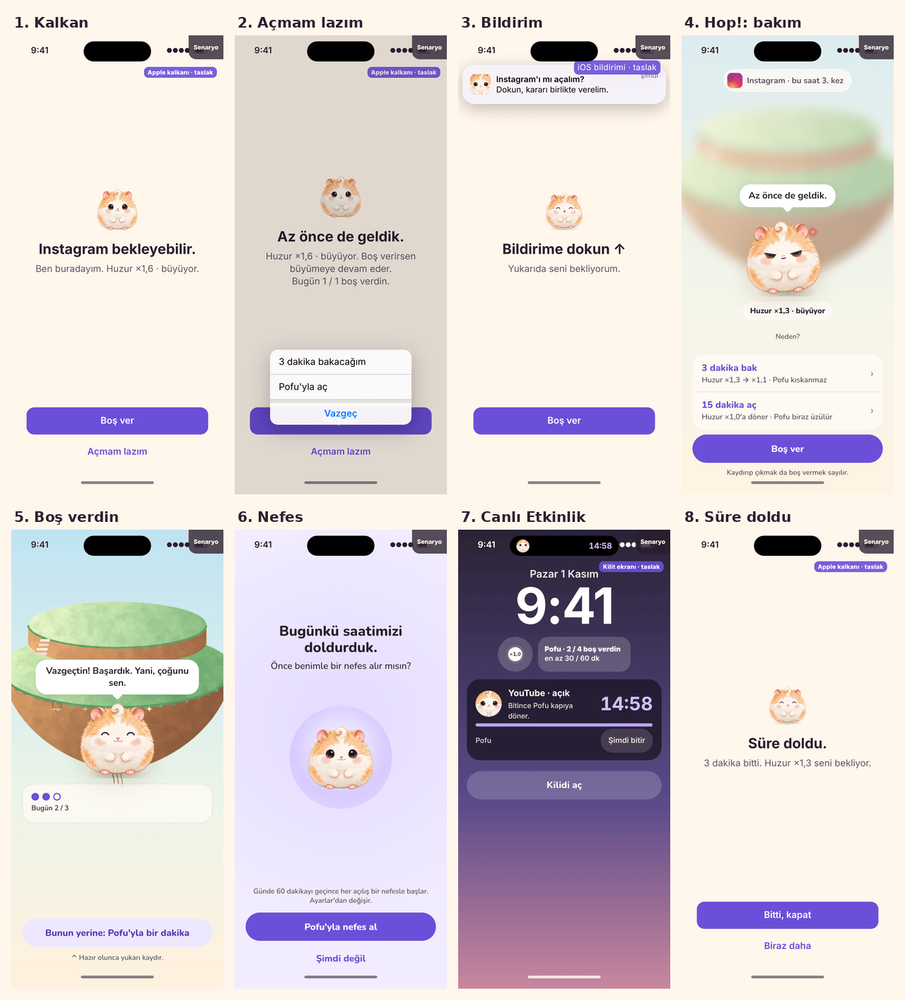
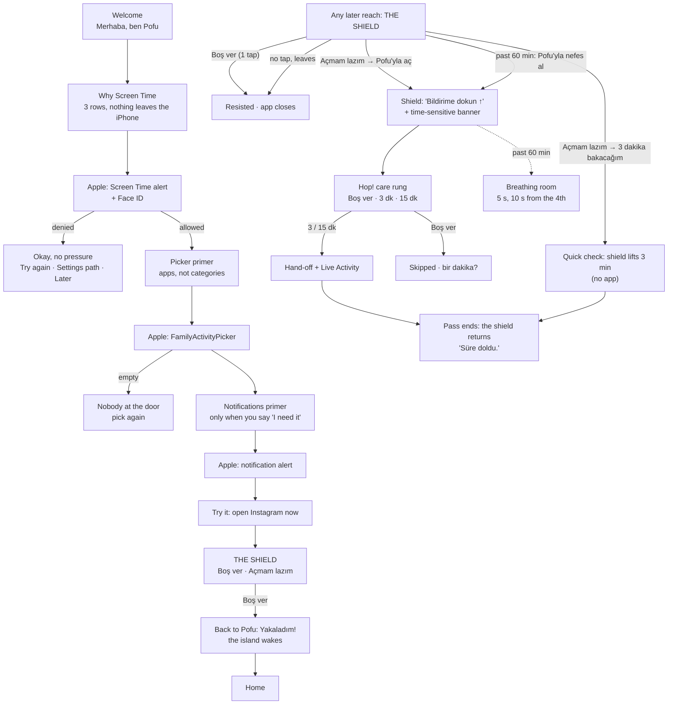
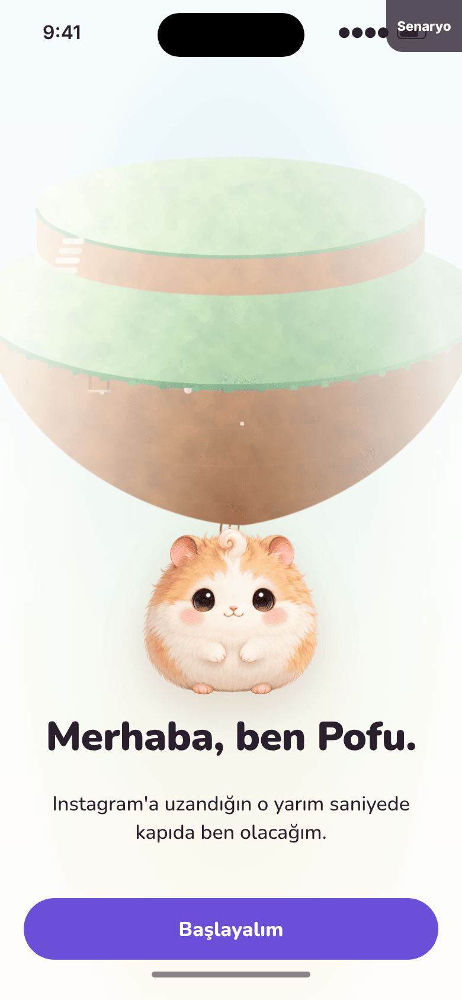
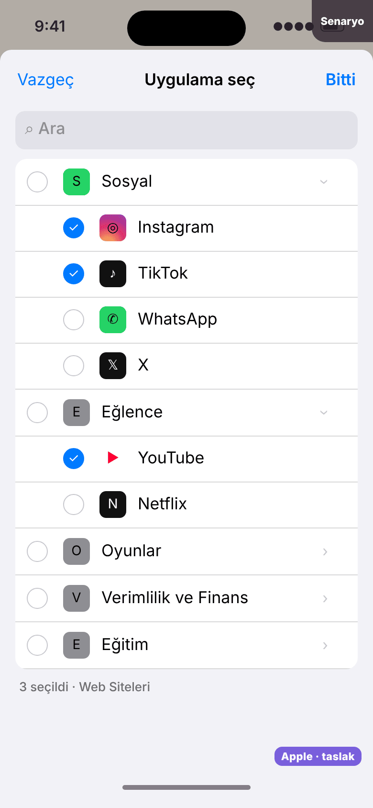
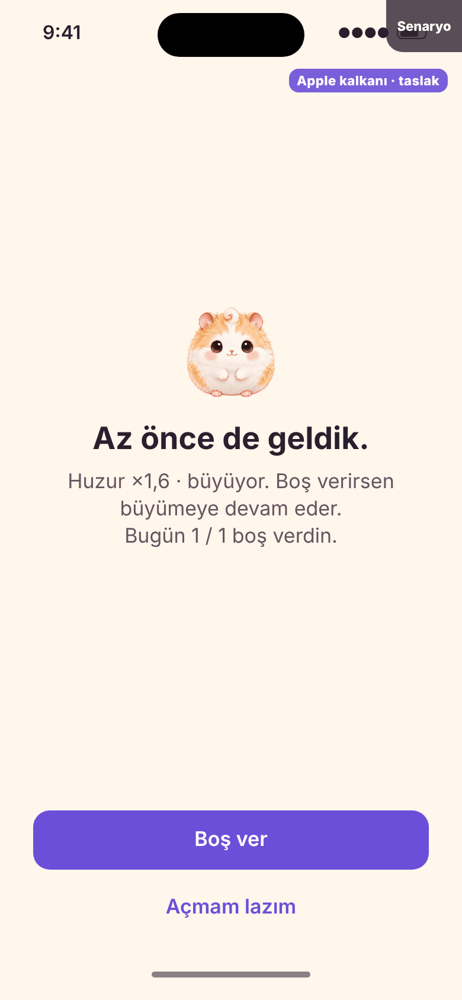
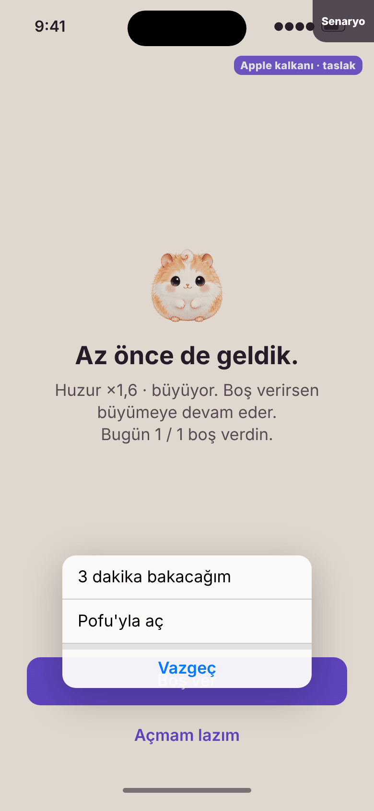
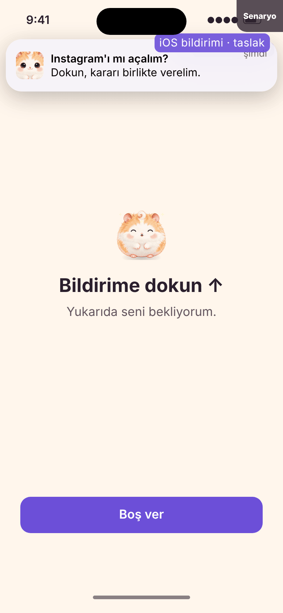
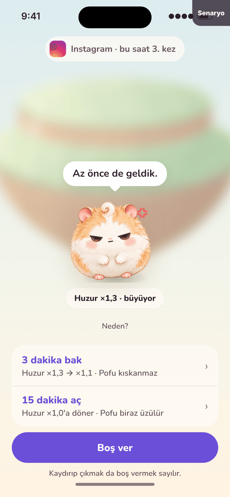
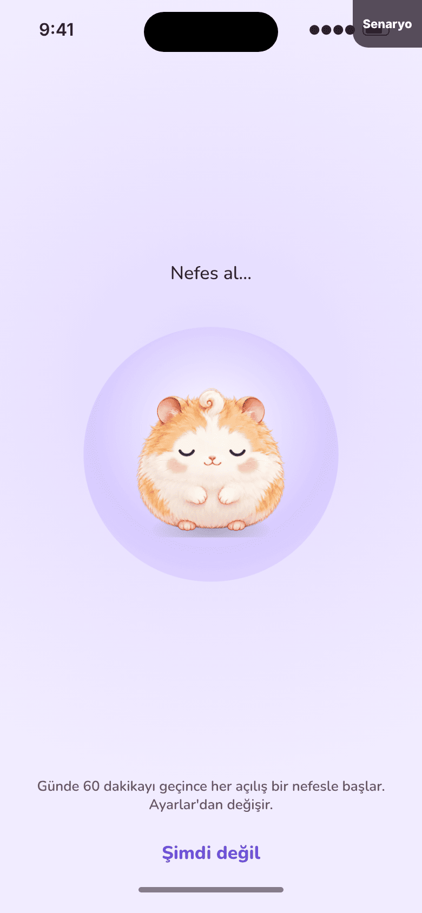
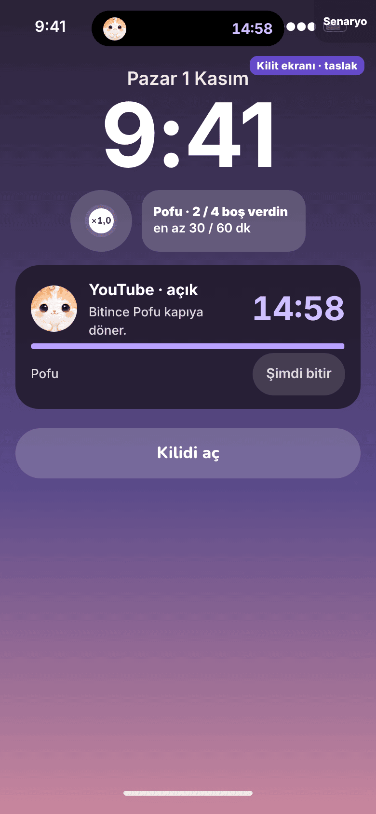

# The Gate v2: Day 1 with Screen Time

_Status: proposal for the lead and the founder. Last updated: 2026-11-01._
_Scope: everything the founder lives with from the first day of the paid
membership: onboarding with Screen Time, Pofu on Apple's shield, the way
from the shield to Hop!, the pass, the glance surfaces, setup health, and
the first seven days of the dogfood._
_Builds on: [vision](../vision.md), [the app and the game](../app-game-boundary.md)
(accepted direction), [game design v2](../game-design.md) (care rung,
quick check, breathing break v2), ADR-0012, ADR-0013, ADR-0015, ADR-0017,
ADR-0018, the [decision audit](../decision-audit.md) (U1, U6, the PNAS
findings), the [design language](../../design/design-language.md),
[review 01](../../design/review-01.md), the
[interaction spec](../../design/interaction-spec.md), the app in `App/`,
and open PR #34 (`feat/screen-time-gate`)._
_Prototype (Turkish, phone-first, no network):
[`design/prototypes/gate-v2/`](../../../design/prototypes/gate-v2/index.html).
Check: `node design/prototypes/gate-v2/tools/check.js`._



## 0. The answer in one page

The product is the half second at the door of Instagram. With Screen Time,
that door is **Apple's shield**, not our app. So v2 designs the shield as
the gate and treats Hop! as the place you go only when you want to open.

| # | Decision | Why |
|---|---|---|
| 1 | **The shield is the gate; Hop! is the exception.** Resisting is one tap on the shield ("Boş ver"), with no app launch and no notification: about one second. Hop! runs only on the open path. | The PNAS one sec follow-up: the dismiss option had the strongest effect. The cheapest possible "no" is the product. |
| 2 | **Honest secondary button: "Açmam lazım"** ("I need it"), with Apple's submenu (iOS 26.4+): **"3 dakika bakacağım"** lifts the shield on the spot (quick check), **"Pofu'yla aç"** goes to Hop! through a notification. Past the daily hour, the only way through is **"Pofu'yla nefes al"**. | Friction proportional to risk: the legitimate quick check costs two taps and no app; the 15-minute open (the binge risk) goes through Pofu; the hard limit cannot be bypassed from the shield. PR #34's "Pofu'yla konuş" hides what the button does. |
| 3 | **A shield that speaks**: Pofu's current mood as the icon, a copy ladder by reach count, time of day, pass expiry, bedtime and the daily hour, and **today's tally on the shield itself** ("Bugün 5 / 7 boş verdin"). | A static shield goes blind in two days. The tally is the one metric the founder needs, shown at the only moment it can change a decision, so there is no dashboard to stare at. |
| 4 | **Every reach is counted, including the ones without a tap.** A shield the user leaves without tapping, and an open request never followed up, count as resisted reaches. | PR #34 counts only button taps; the north-star metric (half of reflexive opens resisted) would be wrong in both directions. |
| 5 | **Onboarding ends on the real shield.** "Şimdi Instagram'ı aç." The first "Boş ver" wakes the island. No naming step. 55 s to a working, verified gate. | The setup failure of 2026-11-01 (U1) taught us: verification is part of setup, not a later chore. |
| 6 | **No mandatory intent question.** The care rung shows the cost on the choices themselves; reasons are optional chips that only change Pofu's tone. | The PNAS follow-up: the deliberation message was not effective. A question costs seconds and buys nothing measurable. |
| 7 | **The shield returning is the expiry signal.** No pass-expiry push in the live build; a Live Activity counts down while a pass from Hop! runs. | One honest cue at the right moment, no push (app-game boundary §7.3). |

Apple forced three things (section 1): the shield cannot open Pofu (so the
open path needs a notification, and a notification can be filtered by
Focus or turned off), the shield's layout and font are fixed (so
everything Pofu says must fit a title, a subtitle and two button labels),
and a Live Activity cannot be started from an extension (so a quick check
started on the shield has no countdown; the shield's return is its
ending).

## 1. Apple's constraints, researched

What `ManagedSettingsUI` and `ManagedSettings` allow, from Apple's
documentation (2026) and developer reports. "Verify" marks what must be
checked on the iPhone on membership day 1 (section 15).

### 1.1 The shield (`ShieldConfiguration`)

| Element | What we control | What we do not |
|---|---|---|
| Background | `backgroundColor` (any `UIColor`, can be dynamic) and `backgroundBlurStyle` | Images, gradients, layout, animation |
| Icon | One `UIImage`, drawn centered above the title (about 60 pt, per PR #34's measurement; verify) | Size, position, animation, accessibility label (verify) |
| Title | Text and color (`ShieldConfiguration.Label`) | Font, weight, size, alignment, line count; Dynamic Type is the system's |
| Subtitle | Text and color; newlines are kept (verify) | Same as the title |
| Primary button | Label text and color, background color | Shape, size, a second line, an icon |
| Secondary button | Label text and color; from **iOS 26.4**, `secondaryButtonSubmenuItems`: up to **three** strings shown as a submenu, plus a system Cancel | Background, style, more than three items |
| Content | The configuration is computed by our extension when the shield is shown, from `Application` (token, and usually `bundleIdentifier` and `localizedDisplayName`), the clock, and App Group files it can read | Network; heavy work (the extension has a few megabytes); live updates while it is on screen, except by redrawing (below) |

### 1.2 The shield's buttons (`ShieldActionDelegate`)

| Fact | Consequence |
|---|---|
| Actions: `primaryButtonPressed`, `secondaryButtonPressed`, `first/second/thirdSecondarySubmenuItemPressed` (iOS 26.4+) | Three explicit choices on the shield itself |
| Responses: `.close` (close the app), `.defer` (defer the response; developers use it to have the shield rebuilt, verify that it redraws), `.none`, and from **iOS 26.5** `.openParentalControlsApp` ("open your parental controls app that is responsible for shielding") | `.defer` lets us show a "tap the notification" state without throwing the user to the Home Screen. `.openParentalControlsApp` may finally open Pofu directly; whether it works with `.individual` authorization is unknown: **spike on day 1**. If it works, the notification step disappears and the rest of this design stands. |
| **The shield cannot open the app** on iOS 26.4 and earlier. Apps post a local notification instead; one sec's developer calls this confusing and lists its failure modes: notifications must be on, exempt from Apple Intelligence prioritization delays, and allowed during Focus. | The notification is `timeSensitive` (needs the Time Sensitive capability), the shield shows a waiting state, and opening Pofu by hand within 10 minutes also starts Hop!. |
| The action extension can write the App Group and change `ManagedSettingsStore` (verify on device; common practice) | A quick check can lift the shield right there, with no app round trip. |
| The action extension does not see the app's name; the configuration extension does | PR #34's shield directory (configuration extension writes token → name) is right; writes from that extension may be sandboxed (App Group `UserDefaults` and plain files reportedly work; SQLite does not). |

### 1.3 Other surfaces

| Surface | Constraint | Consequence |
|---|---|---|
| Authorization (`AuthorizationCenter.requestAuthorization(for: .individual)`) | A system alert, then Face ID or passcode; text is Apple's. After a denial, a repeat request may not show the alert again (verify); the user re-enables it in iOS Settings, Screen Time. | Prime it; handle denial with the Settings path and a retry. |
| `FamilyActivityPicker` | Apple's UI, opaque tokens; we cannot preselect or style it; categories are one tap away from shielding every app inside them (WhatsApp under Social) | A pre-explanation screen: "pick apps, not whole categories". If any category is picked, say what it means. |
| DeviceActivity | Callbacks when cumulative use crosses thresholds; schedules at least 15 minutes long (PR #34 uses `warningTime` for shorter passes) | Guarded minutes are known in steps ("en az 30 dk"), and the copy says "en az". |
| Live Activity | Started only by the app in the foreground (no push needed); `Text(timerInterval:)` counts down by itself; `staleDate` lets the widget draw an "ended" state without the app running; ending it needs the app (or a `LiveActivityIntent`) | Passes granted in Hop! get one; quick checks from the shield do not. |
| Widgets | Need an App Group to read shared state; reload budget | The App Group exists from day 1 (PR #34). Widgets ship with the membership build. |
| Notifications | Permission prompt is Apple's; Focus filters `.active`; `.timeSensitive` breaks through if the user allows it | Ask once, primed, in onboarding, because the open path depends on it. |

### 1.4 What the best apps do (2026)

From the apps' own help pages, forum posts by their developers, and their
public screenshots. Details I could not verify first-hand are marked.

| App | Shield | The way through | What to take | What to avoid |
|---|---|---|---|---|
| **Apple Screen Time** | "Time Limit", "You've reached your limit on Instagram", OK / Ignore Limit with a submenu (One More Minute, Remind Me in 15 Minutes, Ignore Limit for Today) | One tap on the shield | The submenu pattern is native and familiar; `secondaryButtonSubmenuItems` exposes exactly it | "One more minute" is so cheap that people learn to tap it blind (one sec wrote a guide to turning it off) |
| **one sec** | Shortcuts intervention (breath, then "I don't want to open" first) for the reach; Screen Time shields for blocks and re-interventions; unlock via a notification | Notification → app → breath | The dismiss-first layout (the PNAS evidence) | Its developer calls the notification step "artificial" and confusing; Focus and notification summaries break it |
| **Opal** | Branded shield (gem, "Instagram is blocked", the session's name) (unverified detail) | Notification or opening Opal; strict sessions | A calm, branded shield; strictness as an option | A blocker's voice ("blocked") reads as punishment, the vision's failure mode |
| **ScreenZen** | Shield, then a wait inside the app with a growing delay | Delay grows with repeated opens | Escalation by repetition | Waits people resent and look away from (our breath is 5–10 s and user-started) |
| **Brainrot / Jomo** | Mascot or friendly shield, unlock through the app, earned time | Spend earned time | A character on the shield | Currency for screen time (ADR-0015 rejects it) |

**The gap we take:** nobody uses the shield's text as a live, personal,
non-repeating line with today's tally, and nobody uses the iOS 26.4
submenu to give a quick check its own cheap, honest path while keeping the
long open behind the companion.

## 2. The day-1 flow



## 3. Onboarding with Screen Time (target 55 s)

The rule from the boundary doc holds: the welcome and the demo are
**world** frames; everything that configures is **native**. Each screen
has one primary action at the bottom, Pofu's line as `title2`, and a back
chevron (except the welcome).

| Step | Screen | Time |
|---|---|---|
| O1 | Welcome | 4 s |
| O2 | Why Screen Time | 8 s |
| O3 | Apple's alert + Face ID | 5 s |
| O4 | Picker primer | 4 s |
| O5 | Apple's picker | 15 s |
| O6 | Notifications primer + Apple's alert | 6 s |
| O7 | Try it | 10 s |
| O8 | "Yakaladım!" | 3 s |
| | **Total** | **≈ 55 s** |

**Naming is out of onboarding.** "Pofu" is the name in every surface the
user sees before he has a reason to rename (the shield, the notification,
the Live Activity); a keyboard step costs 6–10 s and invites a name the
shield then has to carry. Renaming lives in Settings → Pofu.

### O1. Welcome (world)

- **Anatomy:** the home island asleep in morning mist, full bleed; Pofu
  (hero) at 38 % width; display title; one line; primary button.
- **Copy:** "Merhaba, ben Pofu." / "Hi, I'm Pofu." · "Instagram'a uzandığın
  o yarım saniyede kapıda ben olacağım." / "In the half second you reach
  for Instagram, I'll be at the door." · Button **"Başlayalım"** / "Let's
  start".
- **Motion:** Pofu breathes (content period 3.6 s); the mist drifts
  (ambient, 30 fps). Button appears with `settle` 300 ms after the first
  frame.

### O2. Why Pofu needs Screen Time (native)

- **Anatomy:** Pofu 96 pt on a blush stage disc; title; three rows (SF
  Symbol 28 pt + text); a footnote about the next screen; primary.
- **Copy:**
  - Title: "Kapıda durabilmem için" / "So I can stand at the door"
  - `hand.raised`: "Seçtiğin uygulamaları açınca önce ben görünürüm." /
    "When you open an app you picked, I show up first."
  - `eye.slash`: "İçeride ne yaptığını göremem. Hiçbir şey bu iPhone'dan
    çıkmaz." / "I can't see what you do in there. Nothing leaves this
    iPhone."
  - `switch.2`: "İstediğin an kapatırsın." / "You can turn me off any
    time."
  - Footnote: "Sıradaki ekran Apple'ın: **Devam**'a dokun, sonra Face ID."
    / "The next screen is Apple's: tap **Continue**, then Face ID."
  - Button: **"Ekran Süresi'ne izin ver"** / "Allow Screen Time".
- **Why these three:** Apple's alert says the app "may see your activity
  data, restrict content, and limit the usage of apps". Each row answers
  one fear that sentence creates, in advance, with the truth (tokens are
  opaque; usage arrives only as thresholds).

### O3. Apple's alert, and a denial

The alert and Face ID are Apple's. The prototype mocks them (marked
"taslak") with approximated Turkish; the real labels are recorded on day 1.

**Denied (O3b, native):**
- Title: "Tamam, zorlamam." / "Okay, no pressure."
- Body: "Ekran Süresi izni olmadan kapıda duramam. Fikrin değişirse
  buradayım." / "Without Screen Time I can't stand at the door. If you
  change your mind, I'm here."
- Primary **"Tekrar dene"** / "Try again" (requests again).
- If the second request returns denied without an alert: the screen
  switches to the Settings path, written as steps: "Ayarlar → Ekran Süresi
  → Ekran Süresi Erişimi olan uygulamalar → Pofu" (labels verified on day
  1), with **"Ayarlar'ı aç"**.
- Quiet: **"Şimdilik geç"** / "Not now" → Home with the island asleep and
  the native repair banner (section 9). One reminder the next evening,
  then never (boundary §7.3).
- Small link at the bottom: "Kestirmeler ile kur (gelişmiş)" / "Set up
  with Shortcuts (advanced)": the Live Pofu guide, for the user who will
  not grant Screen Time. Never promoted.

### O4. Picker primer (native)

- **Anatomy:** title; a schematic of Apple's picker (native drawing, not a
  screenshot: the picker's look changes by iOS version) with the "Sosyal"
  row's chevron highlighted and Instagram checked; two tip rows; primary.
- **Copy:**
  - Title: "Seni en çok hangileri çekiyor?" / "Which ones pull you in
    most?"
  - Tip 1: "Kategorinin yanındaki oka dokun, uygulamayı tek tek işaretle."
    / "Tap the arrow next to a category and tick the app itself."
  - Tip 2: "Tüm 'Sosyal'i seçersen WhatsApp'ta da kapıda olurum." / "Pick
    all of 'Social' and I'll stand at WhatsApp's door too."
  - Line: "Önerim: Instagram, YouTube, TikTok." / "My suggestion:
    Instagram, YouTube, TikTok."
  - Button: **"Uygulamaları seç"** / "Choose apps".

### O5. Apple's picker, and what can go wrong

- **Empty selection on Done (O5b):** "Kapıda kimse yok. En az bir uygulama
  seç, gerisini sonra eklersin." / "Nobody at the door yet. Pick at least
  one app; add the rest later." · **"Tekrar seç"** · quiet "Sonra seçerim"
  (Home with the repair banner).
- **A whole category picked (O5c):** an inline note, not a blocker:
  "Bütün bir kategori seçtin. İçindeki her uygulamada, mesajlaşma dahil,
  kapıda olurum." / "You picked a whole category. I'll be at every app in
  it, messaging included." · **"Böyle kalsın"** · quiet "Düzelt" (reopens
  the picker).
- **More than five apps:** no warning. His choice.

### O6. Notifications, primed (native)

- **Copy:**
  - Title: "Gerçekten açman gerektiğinde" / "When you really need it"
  - Body: "Kapıda **Açmam lazım** dersen sana bir bildirimle cevap veririm.
    Sadece bunun için yazarım; seni geri çekmek için asla." / "Say **I
    need it** at the door and I'll answer with a notification. That's the
    only time I write, never to pull you back."
  - Button **"Bildirimlere izin ver"** / "Allow notifications"; quiet
    "Bildirimsiz devam et" / "Continue without".
- **Without notifications** the gate still works: "Boş ver" and the quick
  check need none; "Pofu'yla aç" then shows "Pofu'yu kendin aç" on the
  shield (section 5.5). Settings shows the gap (section 9).
- Apple's alert follows; the prototype mocks it.

### O7. Try it (world)

- **Anatomy:** the island still misted; Pofu `excited` looking toward the
  top of the screen; a small native card listing the picked apps
  ("Instagram · YouTube · TikTok, kapıdayım"); one line; **no primary**;
  quiet "Sonra denerim".
- **Copy:** Title "Hadi dene." / "Try it." · "Şimdi Instagram'ı aç. Kapıda
  beni göreceksin. **Boş ver**'e dokun, sonra bana dön." / "Open Instagram
  now. You'll see me at the door. Tap **Skip it**, then come back to me."
- **Detection:** on return, the inbox has a `shieldShown` and a
  `shieldResisted` record → O8. A shown shield with no tap also passes
  (he saw it). No record within the visit → "Kalkanı göremedim. Instagram
  açılınca beni gördün mü?" · **"Gördüm"** (pass; log a missing record) ·
  **"Görmedim"** (setup health, section 9).

### O8. "Yakaladım!" (world)

- The mist lifts (`gentle`, 2.0 s), the first sunflower opens, Pofu
  `proud` hops once, the first bead fills. `.success` haptic on the bead.
- **Copy:** "Yakaladım!" / "Got you!" · "Kapıdayım. İlk vazgeçişin bu.
  Gerisi kendiliğinden işler." / "I'm at the door. That was your first
  skip. The rest runs by itself." · Button **"Tamam"**.
- Then Home (settled: nothing to do).

## 4. Hop!-free resisting: the numbers

| Path | Taps | Time | App launched |
|---|---|---|---|
| Shield → **Boş ver** | 1 | ≈ 1 s | No |
| Shield → leave (swipe home) | 0 | ≈ 1 s | No |
| Shield → Açmam lazım → **3 dakika bakacağım** | 2 | ≈ 2 s | No |
| Shield → Açmam lazım → Pofu'yla aç → banner → Hop! → **Boş ver** | 4 | ≈ 3 s (skip path budget) | Pofu |
| … → Hop! → **15 dk aç** | 4 | ≈ 4 s + hand-off | Pofu, then Instagram |

## 5. The shield

### 5.1 Anatomy

```
┌──────────────────────────────┐
│                              │   background: canvas color, opaque
│          [ Pofu ]            │   icon: Pofu's current mood (180 × 180 px)
│                              │
│      Günaydın. Önce ben.     │   title: Pofu's line (≤ 26 chars TR)
│  Güne akışla başlamayalım.   │   subtitle line 1: context (≤ 60 chars)
│  Huzur ×1,4 · bugün 2 / 3    │   subtitle line 2: the tally (≤ 32 chars)
│                              │
│  ┌────────────────────────┐  │
│  │        Boş ver         │  │   primary: violet fill
│  └────────────────────────┘  │
│        Açmam lazım           │   secondary: violet text, submenu
└──────────────────────────────┘
```

### 5.2 Palette

Colors are fixed per state, never the user's wallpaper or the app behind.
`backgroundBlurStyle` is `nil`: the shield is opaque, so the feed never
peeks through (PR #34 sets a blur under an opaque color, which does
nothing).

| Role | Day, light | Day, dark | Bedtime (always) |
|---|---|---|---|
| Background | `cream-100` #FFF6EC | `night-950` #15111C | `night-950` #15111C |
| Title | `ink-900` #2A1F2D (14.8:1) | `cream-100` (17.4:1) | `cream-100` at 92 % |
| Subtitle | `ink-600` #66555F (6.5:1) | `mist-300` #B8A8B1 (8.2:1) | `mist-300` |
| Primary fill / label | `violet-600` / white (5.6:1) | `violet-300` / `night-950` (8.6:1) | `violet-500` #8F74F0 / `night-950` |
| Secondary label | `violet-600` (5.2:1) | `violet-300` | `mist-300` (quieter at night) |
| Breathing state | background `lavender` #F1ECFF / #1E1828 | | |

Colors are `UIColor { traits in … }` so light and dark follow the system,
except bedtime, which is fixed dark (the night Hop! is dark too).

### 5.3 The icon: Pofu's mood

The extension bundles six pre-rendered 180 × 180 px PNGs (≈ 25 KB each,
from the approved art; no fur detail is lost at 60 pt). The app writes a
**shield context** to the App Group on every state change (section 14);
the extension reads it and picks:

| Icon | When |
|---|---|
| `pofu` (curious) | Default |
| `pofu-proud` | Three or more skips today and resisted share ≥ 50 % |
| `pofu-jealous` | Third reach in an hour, at most 3 times a day, never after two in a row (game design §12 guardrails), never for a stated quick-check user (it is unknown on the shield, so never more than this) |
| `pofu-breathe` | Past the daily hour (breathing state), and bedtime (eyes closed reads as sleepy) |
| `pofu-relieved` | The shield that returns at a pass's end |
| `pofu-unwell` desaturated | Wellbeing < 25: Pofu is tired, never a guilt picture; the line stays kind |
| `pofu-excited` (looking up) | Waiting for the notification tap |

### 5.4 Buttons

| State | Primary | Secondary | Submenu (iOS 26.4+) |
|---|---|---|---|
| Default | **Boş ver** / Skip it | **Açmam lazım** / I need it | 1 "3 dakika bakacağım" / "Just 3 minutes" · 2 "Pofu'yla aç" / "Open with Pofu" |
| Quick check not allowed (a quick check ended < 20 min ago, chain rule) | Boş ver | **Pofu'yla aç** | none |
| Past the daily hour | Boş ver | **Pofu'yla nefes al** / Breathe with Pofu | none |
| Bedtime | **İyi geceler** / Goodnight | Açmam lazım | same as default |
| Waiting for the notification | Boş ver | none | — |
| A pass just ended (≤ 2 min) | **Bitti, kapat** / Done, close it | Biraz daha / A bit more | same as default |
| iOS < 26.4 | Boş ver | Pofu'yla aç | — |

- **"Açmam lazım"** is honest (it is the way to open), first person, and
  carries a small claim of need; it fits on one line at every Dynamic Type
  size we can test (verify at AX5).
- **Quick check first in the submenu** because it is the legitimate case
  (reply to a DM); the 15-minute open is one level deeper, behind Pofu.
- **"Bitti, kapat"** at expiry is logged as `passEndedClosed`, never as a
  skip: closing an app whose time is up is not a resisted reach.

### 5.5 What each button does (records and responses)

| Action | Extension does | Response | Record |
|---|---|---|---|
| Primary | Records; if waiting, removes the delivered notification and the request | `.close` | `shieldResisted` (expiry: `passEndedClosed`) |
| Submenu 1, quick check | Lifts the shield from this token for 3 min in `ManagedSettingsStore`, schedules the restore (PR #34's `LiveShieldEnforcer` + warning trick), halves calm via the record | `.none` once the store change removes the shield (verify; else `.defer`) | `quickCheckStarted(app, 3)` |
| Submenu 2 / "Pofu'yla aç" / "Pofu'yla nefes al" | Records an open request; posts the notification (5.7) | **`.defer`** to redraw into the waiting state (verify; fallback `.close`) | `openRequested` |
| No tap, the user leaves | (nothing runs) | — | the configuration extension's `shieldShown`; resolved later as a **silent leave** (section 12) |

If notifications are denied, submenu 2 still records the request and the
waiting state says so: title "Pofu'yu kendin aç" / "Open Pofu yourself",
subtitle "Bildirimler kapalı. 10 dakika içinde açarsan seni beklerim." /
"Notifications are off. Open me within 10 minutes and I'll be waiting."

### 5.6 The copy system

**Structure.** Title = Pofu speaking (≤ 26 characters in Turkish).
Subtitle line 1 = context or the stake (≤ 60, at most two lines on the
shield), line 2 = the tally (≤ 32), joined by a newline. Button labels ≤
18, submenu items ≤ 22. The prototype's check enforces these limits for
every context and app. The app name is the system's `localizedDisplayName`;
unknown → "Bu" / "This".

**Rules.**
1. Pick the first matching context in the order of the table.
2. Each context has two or three variants, chosen by
   `(dayOfYear + reachesToday) % count`; the same title never shows twice
   in a row (the context file remembers the last one).
3. Tease the app, never the person; at most 3 jealous lines a day, then
   kind (game design §12).
4. The tally line appears from the second reach of the day: "Bugün 5 / 7
   boş verdin." It never shows a percentage, a streak, or a comparison.
5. Never "engellendi", "blocked", "limit", "penalty". One "!" per shield
   at most.

| # | Context | Title TR / EN | Subtitle line 1 TR / EN |
|---|---|---|---|
| 1 | Waiting for the notification | "Bildirime dokun ↑" / "Tap the notification ↑" | "Yukarıda seni bekliyorum." / "I'm waiting up there." |
| 2 | A pass just ended (≤ 2 min, same app) | "Süre doldu." / "Time's up." | "{n} dakika bitti. Huzur ×{c} seni bekliyor." / "{n} minutes are up. Calm is waiting at ×{c}." |
| 3 | Past the daily hour | "Bugünkü saatimiz doldu." / "We've had our hour today." | "Açmadan önce benimle bir nefes: 5 saniye." / "One breath with me first: 5 seconds." (10 s from the 4th) |
| 4 | Bedtime | "Şşş, geç oldu." / "Shh, it's late." · "Gece yarısı akışı mı?" / "A midnight scroll?" | "{App} da uyuyor. (Uyumuyor. Ama uyumalı.)" / "{App} is asleep too. (It isn't. But it should be.)" |
| 5 | 3rd+ reach this hour (jealous allowed) | "Yine mi {App}?" / "{App} again?" · "Hı. {App}. Anladım." / "Oh. {App}. I see." | "Bu saat {k}. kez. Onda olup bende olmayan ne?" / "{k}th time this hour. What does it have that I don't?" |
| 5b | 3rd+ reach, kind | "Buradayım." / "I'm here." | "Bu saat {k}. kez. Huzur yine büyür, acele yok." / "{k}th time this hour. Calm grows back; no rush." |
| 6 | 2nd reach this hour | "Az önce de geldik." / "We were just here." · "Bir daha mı?" / "Once more?" | "Huzur ×{c} · büyüyor. Boş verirsen büyümeye devam eder." / "Calm ×{c} · growing. Skip it and it keeps growing." |
| 7 | First reach this hour, 06–11 | "Günaydın. Önce ben." / "Morning. Me first." · "Güne akışla mı başlıyoruz?" / "Starting the day with the feed?" | "Güne akışla başlamayalım. Huzur ×{c}." / "Let's not start the day with the feed. Calm ×{c}." |
| 8 | First reach, 11–17 | "Hop! Bir saniye." / "Hop! One second." · "{App} bekleyebilir." / "{App} can wait." | "Ben buradayım. Huzur ×{c} · büyüyor." / "I'm right here. Calm ×{c} · growing." |
| 9 | First reach, 17–bedtime | "Akşam akışı mı?" / "Evening scroll?" · "Günün en zor saati." / "The hardest hour." | "Bu saatler en zoru. Huzur ×{c}, neredeyse dolu." / "These hours are the hardest. Calm ×{c}, almost full." (the "almost full" clause only ≥ ×1.8) |
| 10 | Wellbeing < 25 (overrides 6–9) | "Biraz yorgunum." / "I'm a bit tired." | "Birlikte biraz ara verelim mi?" / "Shall we take a little break together?" |
| — | Tally (line 2, from the 2nd reach) | | "Bugün {r} / {n} boş verdin." / "Today: skipped {r} of {n}." |

The engine is a pure function, `ShieldCopy.make(context:) ->
ShieldCopy.Text`, in `PofuCore`, unit-tested for every row in both
languages, including length limits.

### 5.7 The notification

| Field | Value |
|---|---|
| Title | "{App}'ı mı açalım?" / "Opening {App}?" (unknown: "Açalım mı?" / "Open it?") |
| Body | "Dokun, kararı birlikte verelim." / "Tap and we'll decide together." Past the daily hour: "Dokun, önce bir nefes alalım." / "Tap and we'll take a breath first." |
| Interruption level | `.timeSensitive` (the user asked for it one second ago; Focus would otherwise hide it). Needs the Time Sensitive Notifications capability on the app and the action extension. |
| Relevance score | 1.0 |
| Sound | None: the phone is in his hand and the shield points at the banner. |
| Thread / identifier | `pofu.gate` / `pofu.gate.request` (replaces the previous one) |
| Lifetime | Removed when Hop! starts, when "Boş ver" is tapped in the waiting state, or at the next foreground after 10 min |
| Tap | Opens Pofu; the delegate routes `pofu.gate.request` to Hop! (not "any `.active`", which PR #34 uses; that stays only as the fallback for a user who opens Pofu by hand within 10 min) |

Turkish suffix: "{App}'ı" needs vowel harmony ("Instagram'ı", "YouTube'u",
"TikTok'u"); the copy engine takes the accusative from a small table for
known apps and falls back to "Açalım mı?" for unknown names.

## 6. From the shield to Hop! (v2)

### 6.1 The landing

Hop! opens directly on the **care rung**: the shield was the pause, and
the intent question is gone (decision 6).

```
┌──────────────────────────────┐
│ (world, blurred, dimmed 30 %)│
│  ◯ Instagram · bu saat 2. kez│   app chip (glass)
│                              │
│   ╭──────────────────────╮   │
│   │ Az önce de geldik.   │   │   bubble: one line, optional
│   ╰──────────────────────╯   │
│          [ Pofu ]            │   Pofu 154 pt, mood
│     Huzur ×1,6 · büyüyor     │   calm chip
│                              │
│ ┌──────────────────────────┐ │
│ │ 3 dakika bak             │ │   care row 1 (quiet button)
│ │ Huzur ×1,6 → ×1,3        │ │
│ ├──────────────────────────┤ │
│ │ 15 dakika aç             │ │   care row 2 (quiet button)
│ │ Huzur ×1,0'a döner · Pofu│ │
│ │ biraz üzülür             │ │
│ └──────────────────────────┘ │
│ ┌──────────────────────────┐ │
│ │         Boş ver          │ │   primary, 52 pt
│ └──────────────────────────┘ │
│ Kaydırıp çıkmak da boş       │   footnote
│ vermek sayılır.              │
└──────────────────────────────┘
```

- **The cost is on the choice.** Each open row says what it does to calm
  and to Pofu; there is no separate "cost" paragraph to read.
- **Quick check row** hidden by the 20-minute chain rule; then row 2 reads
  "15 dakika aç".
- **Optional reason chips** (collapsed under "Neden?" / "Why?", one tap
  to expand): "Mesaja cevap", "Bir şeye bakacağım", "Sıkıldım". A chip
  only changes Pofu's line ("Mesaj mı? Tamam, kıskanmam.") and is logged.
  Never required.
- **VoiceOver focus** lands on "Boş ver", whose label includes the
  context: "Boş ver. Instagram, bu saat ikinci kez."
- **Timing:** notification tap → Hop! first frame ≤ 800 ms on a warm
  launch, ≤ 1.5 s cold (measure on day 1). "Boş ver" is live from the
  first frame. The skip path is ≤ 3 s from the shield tap.

### 6.2 Skipped

- Pofu `proud` hops; the bead drops into the day's row (`pop`); while the
  skip gift lasts (5 a day), one seed hops into the jar (`hop`), shown,
  not counted aloud. `.success` haptic.
- **Copy:** "Vazgeçtin! Başardık. Yani, çoğunu sen." / "Skipped! We did
  that. Mostly you." · tally "Bugün 6 / 8".
- **Secondary** (≤ 3 a day, not at bedtime): **"Bunun yerine: Pofu'yla bir
  dakika"** / "Instead: a minute with Pofu".
- Hint: "Hazır olunca yukarı kaydır." / "Swipe up when you're ready."
- After 4 s without a touch Pofu turns back to his garden (`gentle`);
  the hint stays. Terminal.

### 6.3 A minute with Pofu

As specified in the boundary doc §3.3: the cover becomes the world, a soft
ring fills over 60 s, the visit queue plays (or the fur-brushing care
moment), and Pofu ends it: "Bu kadar. Telefonu bırakalım mı?" / "That's
it. Phone down?". Earns nothing. The prototype shows the fur-brush
version.

### 6.4 The hand-off

- Quick check: "Tamam, 3 dakika. Huzuru ben sıcak tutarım." / "Okay, 3
  minutes. I'll keep the calm warm." (`.selection` haptic; Pofu nods.)
- Open: "15 dakika. Kapıda beklerim." / "15 minutes. I'll wait at the
  door." (no sulk on a stated reason; a `pout` line at most once a day
  otherwise).
- The shield lifts for that token, the Live Activity starts, the app
  opens through its URL scheme. Unknown app: "Instagram'ı kendin aç;
  kapıyı 15 dakikalığına açtım." / "Open it yourself; I've opened the
  door for 15 minutes."

### 6.5 The breathing break v2 (past 60 guarded minutes)

The shield's secondary becomes "Pofu'yla nefes al"; the notification lands
in the breathing room, its own scene (boundary §11): lavender, Pofu inside
a calm orb, no world.

| Phase | Anatomy and copy |
|---|---|
| Waiting | Title "Bugünkü saatimizi doldurduk." / "We've had our hour today." · line "Önce benimle bir nefes alır mısın?" / "Breathe with me first?" · Pofu eyes open in the orb · primary **"Pofu'yla nefes al"** · quiet **"Şimdi değil"** / "Not now" (a skip). First time only, a footnote: "Günde 60 dakikayı geçince her açılış bir nefesle başlar. Ayarlar'dan değişir." / "Past 60 minutes a day, every open starts with a breath. Change it in Settings." |
| Breathing | Pofu closes his eyes; the orb grows over 2 s ("Nefes al…" / "Breathe in…") and shrinks over 3 s ("…ve ver." / "…and out."); from the 4th over-limit open, 4 s and 6 s. No numbers, no countdown. "Şimdi değil" stays. |
| Done | "Çok güzel." / "Nicely done." · primary **"İyiyim, boş ver"** / "I'm good, skip it" · two quiet buttons **"3 dk bak"** · **"15 dk aç"** |

Haptics: soft impact on the tap that starts the breath; none during;
`.success` (light) at "Çok güzel". Reduce Motion: the orb's size stays,
its glow fades in and out; the words carry the rhythm.

## 7. Pass life

### 7.1 The Live Activity (passes granted in Hop!)

Started by the app in the foreground at the hand-off; no push needed.
`ContentState`: app name, pass kind (quick check or open), start, end,
calm before. Countdown with `Text(timerInterval:)`; `staleDate` = end.

| Presentation | Anatomy |
|---|---|
| Lock Screen | Painted Pofu 44 pt (ADR-0018's widget rule; the vector glyph below that, as in the Dynamic Island) · "Instagram · hızlı bakış" / "Instagram · quick look" · large timer `2:41` (`numeral`) · a thin bar draining · footer "Bitince Pofu kapıya döner." / "When it ends, Pofu goes back to the door." · button **"Şimdi bitir"** / "End now" (`LiveActivityIntent`: ends the pass, restores the shield, logs `passEnded`) |
| Dynamic Island, compact | Leading: Pofu glyph; trailing: `2:41` monospaced |
| Expanded | Leading Pofu 36 pt; center "Instagram"; trailing timer; bottom bar and **"Şimdi bitir"** |
| Minimal | Pofu glyph in a progress ring |
| Stale (ended, app not running) | "Süre doldu · Pofu kapıda" / "Time's up · Pofu's at the door", bar empty, no button |

Colors: `surface.raised` night tint, `accent` for the bar; never red, and
the last minute does not change color (no countdown anxiety). Ended by the
app at its next run (`dismissalPolicy: .after(end + 2 min)`).

Quick checks started on the shield have no Live Activity (Apple: started
only from the foreground app). The shield's return is their ending.

### 7.2 The expiry moment

There is no push in the live build. Within about a minute of the end
(measure on day 1), DeviceActivity restores the shield over the open app,
and the shield shows context 2: "Süre doldu." with **"Bitti, kapat"**.
That screen is the moment; it is calm, honest, and does not count as a
skip.

### 7.3 The shield coming back

If he taps "Biraz daha", it is a new reach with the chain rule (a quick
check within 20 min counts as a full open, so the submenu offers only
"Pofu'yla aç"). If he leaves, nothing else happens.

## 8. Today and glance

| Surface | Content | App Group |
|---|---|---|
| **Home's Today card** (exists) | One line: "Bugün 8 / 11 boş verdin" · beads · "en az 30 / 60 dk" | No |
| **Today sheet** (glass, medium detent) | Header: Pofu mood 28 pt + "Keyfi yerinde" · **beads** (one per reach, filled = resisted) and "8 / 11 boş verdin · hedef: yarısı ✓" · **guarded time** "En az 30 dk / 60" as four 15-minute segments (honest steps) · **calm** "Huzur ×1,6 · büyüyor" · **"Pofu'da bugün: 3 dk"** · from day 3: "En zor saat: 22–23" · footer "Bu sayılar iPhone'dan çıkmaz." | No |
| **Small widget** | Painted plate, Pofu 64 pt in today's mood, "8 / 11" (`numeral`), "boş verdin", calm ring in the corner | **Yes** |
| **Medium widget** | + guarded time segments and calm | **Yes** |
| **Lock Screen, circular** | Calm ring, "×1,6" | **Yes** |
| **Lock Screen, rectangular** | "Pofu · 8 / 11 boş verdin" and "en az 30 / 60 dk" | **Yes** |
| **Lock Screen, inline** | "Pofu 8/11" | **Yes** |
| **Live Activity** | Section 7.1 | No (state travels in `ContentState`) |
| **Shield context** | Mood, calm, tallies, daily-hour state, last title | **Yes** (already in PR #34's group) |

Widgets answer and never ask (A18): no seeds waiting, no call to action. A
widget tap opens the Today sheet over the settled world. Reload policy: the
app reloads timelines when it ingests records; the shield action extension
asks for a reload after a skip (verify that WidgetKit allows it from that
extension; otherwise the widget catches up at the next app run and the
timeline's hourly entry).

## 9. Setup health and repair

Health is computed on every foreground and shown natively (boundary §11:
errors are never painted).

| State | Detection | Home | Repair |
|---|---|---|---|
| **Screen Time access revoked** | `AuthorizationCenter.authorizationStatus != .approved` | Native banner, top band: "Kapıda değilim · Ekran Süresi izni kapalı" + **Düzelt**. Pofu sits at his door looking out (indicator only). | Sheet: status rows (Ekran Süresi izni ✗, Seçili uygulamalar 3 ✓, Bildirimler ✓); **"İzni yeniden ver"**; if no alert appears, the Settings steps and **"Ayarlar'ı aç"** |
| **Nothing picked** | Selection empty | "Kapıda kimse yok · Uygulama seç" | The picker primer, then the picker |
| **Notifications off** | `authorizationStatus == .denied` | Not on Home (the gate works). In Guarded apps: "Açmam lazım → bildirim gelmez. Hızlı bakış yine çalışır." | "Ayarlar'ı aç" |
| **Time-sensitive off / Focus** | `timeSensitiveSetting == .disabled` after an abandoned request | One line in Guarded apps: "Odak modunda bildirimim gelmeyebilir." | Steps to allow Pofu in Focus |
| **Requests abandoned twice today with notifications off** | Ledger | One-time card in Today: "Açmak istediğinde sana ulaşamadım." | Same as above |
| **Shield silent** | Thresholds rose by ≥ 30 min with no `shieldShown` and no pass | Banner "Kalkanı görmüyorum" | Re-apply shields; then the picker |

The banner never interrupts Hop! or a minute, and is never a push.

## 10. The first 7 days of the founder's dogfood

| Day | What he sees | Where the numbers are | We never |
|---|---|---|---|
| 0 (membership day) | Onboarding, the real shield, "Yakaladım!", the island wakes. Evening bubble: bedtime ("Genelde kaçta yatarsın?"). | The shield's tally from the 2nd reach | A naming step, a paywall, a second ask |
| 1 | The morning visit (the night's growth). The shield's copy shifts with the hours; he meets "Az önce de geldik." | Shield tally; Home's Today card | A morning push |
| 2 | Bubble: "Beni ana ekrana koy, açmadan bakarsın." → the widget sheet with Lock Screen steps | Widgets from now on | — |
| 3 | Probably the first breathing break; explained once, in place | Today: "En zor saat" appears | Explaining it in advance |
| 4 | Nothing new in the gate. | | |
| 5 | Stage 3 on the island (world schedule) | | Announce it |
| 6 | Quiet day | | Invent news |
| 7 | **Weekly recap**: "Bu hafta 41 / 63 boş verdin. Hedef yarısıydı." · daily guarded time steps · quick checks vs. full opens · Pofu's own minutes · minutes taken | The recap; then the 7-day history | A streak, a comparison |
| 8 | **Live Pofu (Shortcuts) is offered from day 8 for the founder**, not day 3: the dogfood week measures the shield alone | | Doubled gates during the measured week |

**Developer readout** (Settings → Pofu → long-press the version, founder
only; iteration plan I11): per day, reaches (shield shown, deduplicated),
shield skips, silent leaves, abandoned requests, quick checks from the
shield, Hop! skips and opens, breaths and their outcomes, measured minutes
step, Pofu's own minutes, notification-to-Hop! latency (median), and the
boundary doc's §7.8 metrics. A table, not a chart; shareable as text for
the weekly report.

## 11. Edge cases

| Case | Behavior |
|---|---|
| A pass runs for Instagram; he opens YouTube | YouTube's shield (lifts are per token; category picks lift the whole category, as PR #34 does) |
| Two "Pofu'yla aç" taps within seconds | One request, one notification (fixed identifier) |
| Notification tapped after "Boş ver" in the waiting state | The request was cancelled: Pofu opens on the settled Home |
| Notification tapped after 10 min | Normal landing; no Hop! |
| He opens Pofu by hand within 10 min of a request | Hop! for that app (PR #34's fallback, kept) |
| Cold launch from the notification | Hop! from the ledger's request, no Home flash |
| Bedtime and past the daily hour | The breathing state wins; night palette and copy ("Şşş. Önce bir nefes.") |
| App name unknown | "Bu" / "This"; Hop! shows "Başka uygulama" and asks him to open it himself |
| A website shield (Safari) | The domain is the name: "youtube.com bekleyebilir." |
| Apple's own App Limit on the same app | Out of our control; the settings screen mentions it if both are on (verify which shield wins) |
| Midnight during a pass | The pass runs to its end; tallies roll over at midnight |
| iOS < 26.4 | No submenu; secondary is "Pofu'yla aç" |
| `.openParentalControlsApp` works (26.5+) | Submenu 2 opens Pofu directly; the waiting state and the notification are skipped; the notification stays as the fallback |
| Reinstall | Authorization may persist while the selection is lost → "Kapıda kimse yok" |
| The shield re-renders when he returns to the app from the switcher | Counted once per 10 s per token |

## 12. Metrics, defined

| Metric | Definition |
|---|---|
| **Reach** | A `shieldShown` (deduplicated: same token within 10 s, and not a redraw after `.defer`), or a soft-gate check-in not within 5 s of a shield for the same app |
| **Resisted** | Shield "Boş ver" + **silent leave** (shown, no action within 60 s, no open) + **abandoned request** (no Hop! within 10 min) + Hop! skip + breath "Şimdi değil" / "İyiyim, boş ver". Each kind is logged separately. |
| **Resisted share** | Resisted ÷ reaches, per day. Goal ½. |
| **Measured minutes** | The highest DeviceActivity step crossed today, shown as "en az {m} dk" |
| **Quick checks** | Shield submenu 1 + Hop! row 1; watched against full opens (game design §17) |
| **Time to Hop!** | Notification post → Hop! first frame, median and p90 |

## 13. Accessibility, haptics, motion

**Accessibility.**
- The shield: the system owns Dynamic Type and VoiceOver; we own length.
  Titles ≤ 26 characters, subtitles ≤ 2 lines, button labels ≤ 18
  characters, tested at AX5 on day 1. The icon carries no information that
  the text lacks.
- Hop!: Dynamic Type to AX5; care rows wrap to three lines, then stack;
  Pofu shrinks to 96 pt at AX3 and up; the primary stays pinned in the
  bottom inset. VoiceOver order: chip, line, Pofu ("Pofu, gururlu"), calm,
  rows, "Boş ver" (initial focus). Rows read their cost: "3 dakika bak.
  Huzur 1,6'dan 1,3'e iner."
- Breathing: `UIAccessibility.post(.announcement)` for "Nefes al" and "ve
  ver"; Reduce Motion keeps the timing, drops the scale.
- Live Activity: the timer reads "2 dakika 41 saniye kaldı".
- Color is never the only signal: filled beads also differ in shape
  (filled vs. ring), the calm ring has its number.

**Haptics** (interaction spec §6.1: confirm, never decorate).

| Moment | Feedback |
|---|---|
| Shield, notification | System (nothing we can add) |
| Hop! appears | `.impact(weight: .light, intensity: 0.6)` (0.35 at night), as today |
| Skip | `.success` |
| Quick check / open chosen | `.selection` |
| Breath started | `.impact(flexibility: .soft, intensity: 0.5)` |
| Breath done | `.success` at 0.6 |
| The minute ends | none |
| O8 "Yakaladım!" | `.success` on the bead |

**Motion** (design language §10 and interaction spec §7 tokens).

| Moment | Token |
|---|---|
| Hop! cover in / phase changes | `settle` |
| Pofu's reaction on skip | `squish` then `hop` |
| Bead drop, seed into the jar | `pop`, `hop` |
| Care rows, chips | `snappy` |
| Pofu turns back to his garden | `gentle` |
| Into the minute (the world un-blurs) | `camera` + `dof` |
| Mist lifting in O8 | `gentle`, 2.0 s |
| Breath orb | A time curve (sine ease, 2 s / 3 s), not a spring: it is a clock |
| Reduce Motion | 200 ms cross-fades; the orb glows instead of scaling |

## 14. Proposed changes to code

Each row is one engineering task. "PR #34" means a file on
`feat/screen-time-gate`; the rest are on `main`.

| # | Change | Files |
|---|---|---|
| E1 | **Shield copy engine**: `ShieldContext` (mood band, calm, reaches and skips today, reaches this hour, last title, daily-hour state with over-limit count, bedtime, open request, last pass end per token) and `ShieldCopy.make(context:language:)` with all of 5.3, 5.4 and 5.6; length-limit tests in TR and EN | New `Packages/PofuKit/Sources/PofuCore/ScreenTime/ShieldContext.swift`, `ShieldCopy.swift`, tests in `PofuCoreTests` |
| E2 | **Shield context file**: the app writes it to the App Group on every save; the extensions read it | New `PofuPersistence/ShieldContextStore.swift`; `App/AppModel.swift` (`save()`) |
| E3 | **Shield configuration** uses E1: mood icons (six 180 px PNGs in the extension bundle), day / dark / bedtime / breathing palettes, no blur, submenu items, records `shieldShown` | PR #34 `Extensions/ShieldConfiguration/ShieldConfigurationExtension.swift`, its `Localizable.xcstrings`; `project.yml` (resources) |
| E4 | **Shield action**: submenu handling; quick check lifts in the extension; open request answers `.defer` and draws the waiting state; primary in the waiting state removes the notification; expiry primary records `passEndedClosed`; notification copy and `.timeSensitive`; spike `.openParentalControlsApp` behind an availability check | PR #34 `Extensions/ShieldAction/ShieldActionExtension.swift`, its strings; `Config/Entitlements/PofuLive.entitlements` and `ScreenTimeExtension.entitlements` (`com.apple.developer.usernotifications.time-sensitive`) |
| E5 | **Records and ledger**: new kinds `shieldShown`, `quickCheckStarted`, `passEndedClosed`, `openRequestCancelled`; silent-leave and abandoned-request resolution into resisted check-ins; reach deduplication | PR #34 `PofuCore/ScreenTime/ScreenTimeRecord.swift`, `ScreenTimeLedger.swift`, `ScreenTimeGateTests.swift` |
| E6 | **Onboarding v2**: O1–O8, naming removed, denial and Settings path, picker primer, empty and category handling, notifications primer, the live demo with inbox detection | `App/Onboarding/OnboardingView.swift`; PR #34 `App/ScreenTime/ScreenTimeSetupView.swift` (split into the O-screens) |
| E7 | **Notification routing**: the delegate handles `pofu.gate.request` → `answerShieldRequest`; remove delivered gate notifications when Hop! starts; keep the 10-minute "opened by hand" fallback | `App/Support/PassExpiryReminder.swift` (rename the delegate to `PofuNotificationDelegate`), `App/RootView.swift`, `App/AppModel.swift` |
| E8 | **No expiry push in the live build** when the shield is on (the shield is the cue) | `App/Support/PassExpiryReminder.swift`, `App/AppModel.swift` |
| E9 | **Hop! v2**: care rung landing with cost-on-choice rows, optional reason chips, no intent rung, skipped state with the minute offer, the hand-off lines. Depends on `CareLedger`, `CalmAccrual`, `BreathRules` in `PofuCore` (ADR-0015, not yet implemented) | `App/Hop/HopView.swift`, `HopRungs.swift`, `HopOutcomes.swift`, `HopSession.swift` (origin `.shield`) |
| E10 | **Breathing room** | New `App/Hop/BreathRoom.swift` |
| E11 | **Live Activity + widgets**: a `PofuWidgets` extension (ActivityConfiguration, small and medium widgets, three Lock Screen families), `PassActivityAttributes`, `EndPassIntent` (`LiveActivityIntent`), App Group snapshot for widgets | New `Extensions/Widgets/`; `project.yml`; `App/AppModel.swift` (start and end) |
| E12 | **Today sheet** and the Today card line | New `App/Today/TodaySheet.swift`; `App/Home/HomeView.swift` |
| E13 | **Setup health**: states of section 9, the banner, the repair sheet, the Guarded apps rows | PR #34 `App/ScreenTime/ScreenTimeSettingsSection.swift`, `App/ScreenTime/ScreenTimeGate.swift`; `App/Home/HomeView.swift`; `App/Settings/SettingsView.swift` |
| E14 | **Daily hour setting** drives the ladder (steps must include it: 15, 30, 45, 60, …, the chosen hour) | PR #34 `PofuCore/ScreenTime/GuardedUsage.swift`, `ScreenTimeGate.activate()` |
| E15 | **Developer readout** | `App/Settings/SettingsView.swift`, new `App/Settings/DeveloperReadout.swift` |
| E16 | **Strings**: every TR/EN line in this document | `App/Resources/Localizable.xcstrings`, the extensions' catalogs |
| E17 | **Day-1 script additions** (section 15) | PR #34 `docs/local/membership-day-1.md` |

## 15. What I think is wrong in PR #34

The plumbing is good: versioned records, the App Group inbox, the shield
directory, lifts per token, reconciliation, the monitor restoring shields
with Pofu killed, and the honest "en az 15 dk". What is wrong is mostly
the experience on top of it, plus two metric holes.

1. **"Pofu'yla konuş" silently dead-ends when notifications are off.**
   Permission is asked unprimed, right after the picker closes
   (`ScreenTimeSetupView.savePicked`). Deny it, and the secondary button
   closes Instagram and nothing ever happens. Fix: prime in onboarding
   (O6) and give the shield a "Pofu'yu kendin aç" state (5.5).
2. **The notification is `.active`.** Focus hides it (he studies with
   Focus on), and notification summaries can delay it. Use
   `.timeSensitive` with its capability. The copy is redundant ("Pofu:
   Instagram hakkında Pofu'yla konuşmak için dokun") and the delivered
   notification is never removed after Hop! starts.
3. **Open requests that are never followed are not counted.** An
   `openRequested` without a Hop! is neither a reach nor a resist in
   `ScreenTimeIngestion`. That is precisely the friction effect we want to
   measure (one sec's 36 %). Count it as a resisted reach after 10
   minutes.
4. **Leaving the shield without a tap is not counted.** Only button taps
   create records, so reaches are undercounted and the resisted share is
   wrong. Record `shieldShown` in the configuration extension.
5. **The secondary label misleads.** "Pofu'yla konuş" is the way to open;
   calling it "talk" makes the first use a surprise and later a lie.
   "Açmam lazım" says what it is.
6. **The iOS 26.4 submenu is explicitly ignored** ("Pofu offers none").
   It is the native place for the quick check.
7. **`.close` on the secondary throws him to the Home Screen** while the
   banner arrives. Try `.defer` with a waiting-state shield.
8. **A static shield.** "Hop! Nereye?" asks a question nothing on the
   shield can answer ("Hop!" makes sense when Pofu hops in; here he is
   already standing there), the same text forever, a static icon, no
   night or expiry state. It will be invisible by day 3.
9. **At pass expiry, the returning shield says "Hop! Nereye?" and its
   primary counts as a resisted reach**, inflating the north star every
   time a pass ends. Needs the expiry state and `passEndedClosed`.
10. **The pass-expiry push still fires in the live build**, on top of the
    shield returning: two cues for one event, one of them a push.
11. **Onboarding has no demonstration** ("Kapıdayım" + "Tamam"), so the
    first shield arrives at a random later moment, and the step order
    adds naming (a keyboard) on the critical path.
12. **`backgroundBlurStyle` under an opaque `backgroundColor`** does
    nothing; drop it.
13. **The breath limit is hardcoded at 60** and the steps are fixed, so
    the Settings daily hour (15–180) cannot work with Screen Time.
14. **`answerShieldRequest()` runs on every `.active`.** As a fallback it
    is right, but as the primary route it means any open of Pofu within
    10 minutes becomes Hop!, including one from a widget tap. Route the
    notification through the delegate and keep the scene-phase path as
    the fallback, with a visible line ("Instagram'ı açmak istemiştin.").

### Day-1 cases to add to `docs/local/membership-day-1.md`

| # | Do | Record |
|---|---|---|
| 20 | Deny notifications in onboarding; tap the secondary on the shield | What happens; time to recover |
| 21 | Turn on a Focus that does not allow Pofu; tap the secondary | Whether the banner appears (`.active` vs `.timeSensitive`) |
| 22 | Return `.defer` from the secondary | Does the shield redraw with the new configuration? |
| 23 | Return `.openParentalControlsApp` (iOS 26.5+) | Does it open Pofu with `.individual` authorization? |
| 24 | Submenu items | Shown? Labels truncated in Turkish? Does a store change in the action extension remove the shield at once? |
| 25 | Swipe home from the shield, three times | Does the configuration extension write `shieldShown` each time? How often is it called for one open? |
| 26 | Dynamic Type at AX5 | Screenshot the shield in Turkish |
| 27 | Notification tap → Hop! | Milliseconds, warm and cold (screen recording at 60 fps) |
| 28 | The real Turkish text of Apple's Screen Time alert, the picker's category names, and the iOS Settings path to Screen Time access | Screenshots |

## 16. Open questions for the founder

1. **"Açmam lazım" or "Pofu'yla konuş"?** I recommend the honest label.
   It may feel blunter on the first day; it never lies.
2. **The quick check on the shield (two taps, no app).** It makes the
   legitimate DM reply fast. It also makes a 3-minute peek cheap. The
   chain rule and the halved calm limit it; the dogfood decides (watch
   quick checks per day against full opens).
3. **No naming in onboarding.** "Pofu" everywhere until you choose
   otherwise in Settings. Fine?

## 17. Self-critique

- **Four "verify" items carry the design**: `.defer` redrawing, the
  submenu, store changes from the action extension, and `shieldShown`
  being called once per reach. Each has a fallback (`.close`, the plain
  secondary, the notification path, counting only taps), so nothing here
  blocks day 1, but the experience degrades to roughly PR #34's.
- **The quick check from the shield may be too easy.** Apple's own "One
  More Minute" became a reflex for many people. Our version is three
  minutes, halves calm, and refuses a second within 20 minutes; if quick
  checks exceed half of opens in week 1, remove submenu item 1 and send
  everything through Pofu.
- **Counting silent leaves as resisted is generous.** Someone who leaves
  the shield and opens the app through Safari or a link is not resisting.
  It is the same rule Hop! already uses (swiping away counts as a skip),
  and both are logged separately so the readout can show the strict
  number too.
- **The tally on the shield could become pressure.** It shows counts, not
  a percentage, never a comparison or a run of days, and it starts at the
  second reach. If it reads as a score on the phone, keep it only in the
  Today card and the widget.
- **The shield's copy is short by necessity.** Pofu's personality has to
  survive in 26 characters plus a line; the rotating variants are the only
  defense against blindness, and they are an assumption until week 2.
- **Competitor details are partly second-hand.** Apple's and one sec's
  behavior are documented; Opal's, Brainrot's and Jomo's shields are from
  public screenshots and may have changed.

## 18. The prototype

[`design/prototypes/gate-v2/index.html`](../../../design/prototypes/gate-v2/index.html):
plain HTML, CSS and JS, Turkish on screen, no network. Open it in Safari
on the iPhone (it fills the screen; on a desktop it draws a 390 × 844
frame). Apple's UI (the Screen Time and notification alerts, Face ID, the
picker, the shield, the submenu, the banner, the Home Screen, the Lock
Screen and the Live Activity) is mocked and tagged "taslak"; its Turkish
labels are approximations until the day-1 screenshots exist.

**Try:** the whole onboarding (deny the Screen Time alert once to see the
denial path); in "Hadi dene", tap the line at the bottom (the home
indicator, which is also "swipe up"), open Instagram, tap **Boş ver**,
open Pofu. Then open Instagram again and again: the shield's line changes
with each reach and shows the tally. **Açmam lazım** → **3 dakika
bakacağım** → "Prototip: süreyi bitir" shows the expiry shield. **Açmam
lazım** → **Pofu'yla aç** shows the waiting shield and the banner; the
banner opens Hop!. The **Senaryo** corner (top right, prototype only)
sets the time of day, the daily hour, notifications, the submenu, a
revoked permission, dark mode, and the day of the dogfood (0–8).

**Verification:** `NODE_PATH=/opt/node-tools/node_modules node
design/prototypes/gate-v2/tools/check.js --shots` (Playwright, Chromium,
390 × 844, real touch through the DevTools protocol). It walks the whole
flow above, runs the shield copy engine over 15 contexts for three apps
against the length and tone limits, checks that every tap lands on the
intended element, that every control is at least 44 × 44 pt, that
nothing scrolls sideways, that no request leaves the page, and measures
the skip path from the banner tap (under 3 s including the harness's own
waits). All 135 checks pass.

| Welcome | Picker | Shield | Submenu | Waiting + banner | Hop! | Breath | Live Activity |
|---|---|---|---|---|---|---|---|
|  |  |  |  |  |  |  |  |

The prototype's text uses `ui-rounded` (SF Pro Rounded on the iPhone) with
Nunito as the stand-in elsewhere. The Baloo 2 file the prototypes share
is Google's Latin subset and has no ğ, ş or İ, so it is not used for
Turkish text here; the app's own subset must include Latin Extended-A, as
the design language already says.

## Sources

- Apple: [`ShieldConfiguration`](https://developer.apple.com/documentation/managedsettingsui/shieldconfiguration),
  [`secondaryButtonSubmenuItems`](https://developer.apple.com/documentation/managedsettingsui/shieldconfiguration/secondarybuttonsubmenuitems) (iOS 26.4),
  [`ShieldAction`](https://developer.apple.com/documentation/managedsettings/shieldaction),
  [`ShieldActionResponse`](https://developer.apple.com/documentation/managedsettings/shieldactionresponse),
  [`openParentalControlsApp`](https://developer.apple.com/documentation/managedsettings/shieldactionresponse/openparentalcontrolsapp) (iOS 26.5),
  [`ShieldConfigurationDataSource`](https://developer.apple.com/documentation/managedsettingsui/shieldconfigurationdatasource),
  [Family Controls](https://developer.apple.com/documentation/familycontrols).
- Developer forums: [opening the parent app from `ShieldActionDelegate`](https://developer.apple.com/forums/thread/766644),
  [one sec's request for `openParentApp`](https://developer.apple.com/forums/thread/820790),
  [`.defer` and shield buttons](https://developer.apple.com/forums/thread/730522),
  [App Group and storage in the shield extension](https://developer.apple.com/forums/thread/762431).
- one sec: [why target apps are connected to Screen Time](https://tutorials.one-sec.app/en/articles/10336706),
  [turning off "one more minute"](https://one-sec.app/it/blog/turn-off-one-more-minute-screen-time/),
  [notifications blocked during interventions](https://feedback.one-sec.app/p/notifications-blocked-by-reinterventionlock-during-intervention).
- Grüning, Riedel, Lorenz-Spreen (2023), [PNAS](https://pmc.ncbi.nlm.nih.gov/articles/PMC9974409)
  (via the decision audit).
