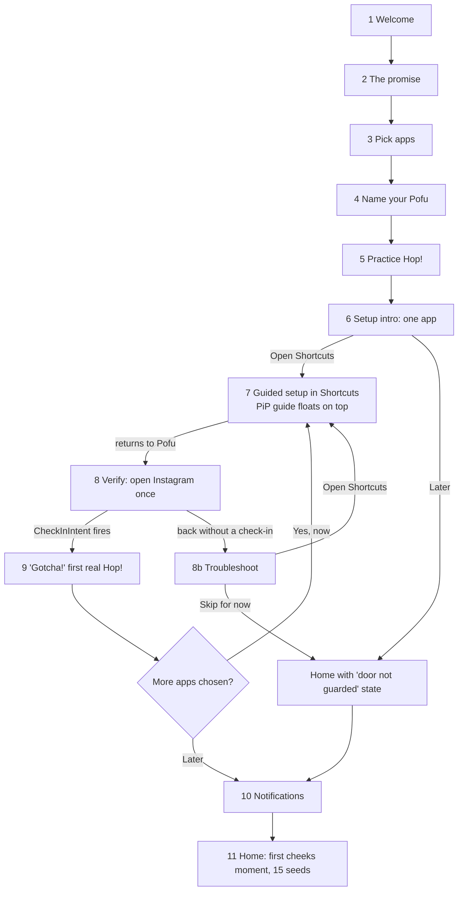
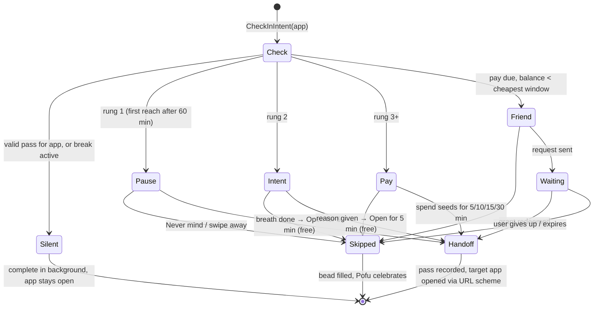
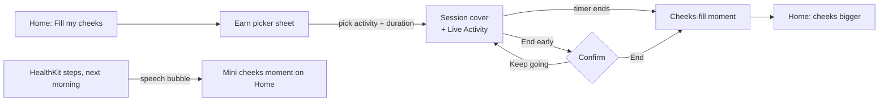
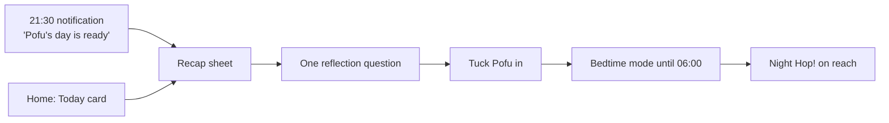
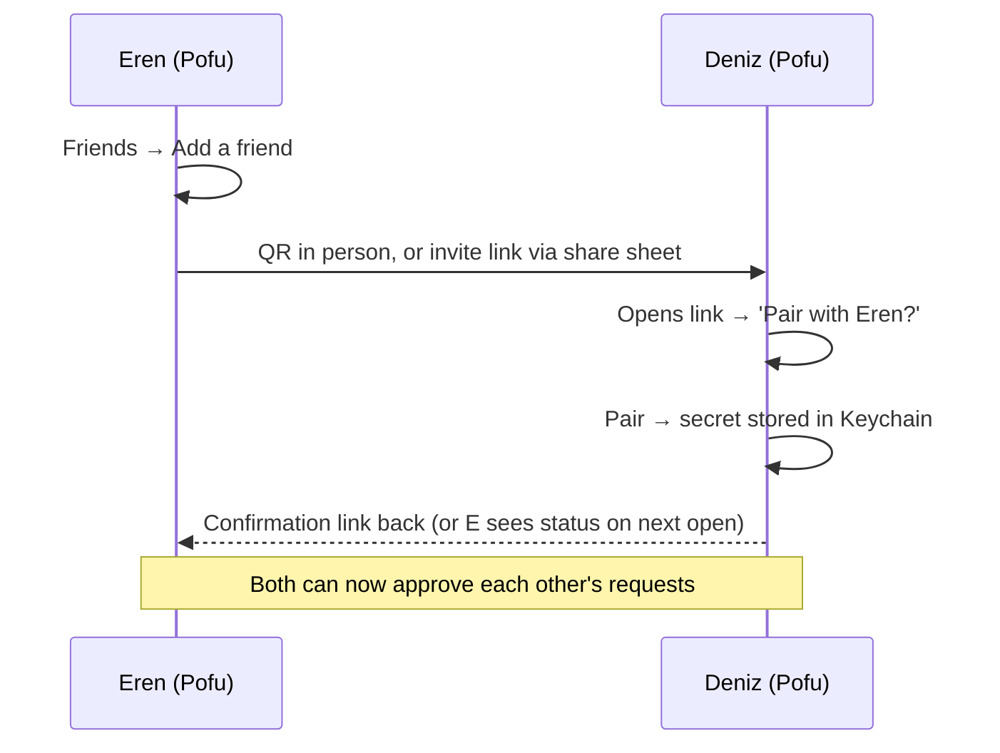
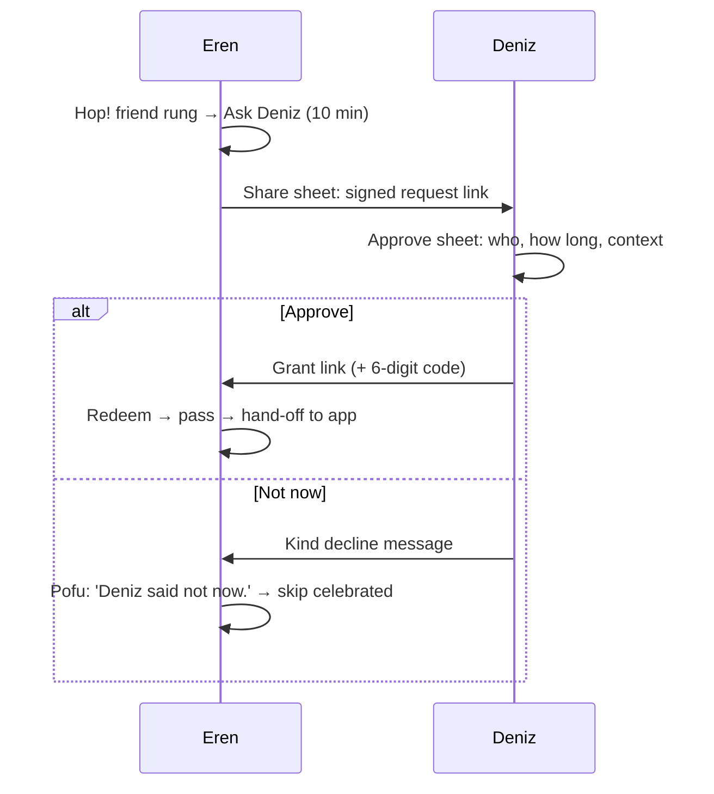
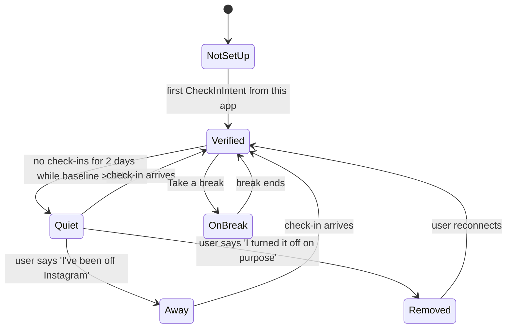

# User Flows

_Status: proposal v1, for founder review. Last updated: 2026-10-31._
_Companion docs: [information architecture](information-architecture.md),
[clickable prototype](../../../design/prototypes/ux/README.md),
[economy](../economy.md), [ADR-0008](../../adr/0008-hybrid-intervention-delivery.md)._

Every flow lists its states, edge cases, and copy. Copy is written natively
in English and Turkish; the Turkish column is not a translation of the
English one, and the two are allowed to differ in rhythm and joke. User-facing
names follow the [naming table](information-architecture.md#4-naming):
the currency is **seeds / çekirdek**, the intervention is **Hop!**.

## Voice rules (apply to every string below)

1. **Pofu speaks, the UI labels.** Pofu's lines are first person, short,
   warm ("I feel fluffier"). Buttons are plain verbs ("Never mind",
   "Open for 5 min"). Never mix the two in one element.
2. **No shame, ever.** Opening an app is never "giving in", "failing", or
   "breaking". Pofu is glad either way; it is just *more* glad when you skip.
3. **Numbers are honest and secondary.** Show raw counts before ratios
   ("7 of 11", then "64%"). No streak-loss threats.
4. **Rationed enthusiasm.** At most one exclamation mark per screen. "Hop!"
   counts.
5. **Turkish register:** spoken, friendly, inclusive "we" where natural
   (*açıyoruz*), *sen* not *siz*. Suffixes on app and person names go
   through the vowel-harmony helper (see IA §7).

---

## 1. First-run onboarding

**Goal:** a working soft gate on at least one app, verified, in under
four minutes, with the user having *felt* a Hop! before doing the chore of
setting it up.

**Success metric:** percentage of new users with one verified automation at
the end of day 1 (target ≥ 70% for the friends beta). This is the riskiest
step in the product: everything else is worthless without it.



### States and copy

| # | Screen | Pofu / title | Body | Actions |
|---|---|---|---|---|
| 1 | Welcome | EN: **Hi, I'm Pofu.** <br/>TR: **Selam, ben Pofu.** | EN: I'm a hamster who gets fluffier every time you pick real life over the feed. <br/>TR: Akış yerine hayatı seçtiğin her an biraz daha kabaran bir hamsterım. | EN: **Hi, Pofu** · TR: **Selam, Pofu** |
| 2 | The promise | EN: **Whenever you reach for a feed, I'll hop in.** <br/>TR: **Ne zaman bir akışa uzansan, araya ben gireceğim.** | EN: You always decide. I just make skipping the easy choice. <br/>TR: Karar hep senin. Ben sadece vazgeçmeyi kolaylaştırıyorum. | EN: **Sounds good** · TR: **Anlaştık** |
| 3 | Pick apps | EN: **Which ones pull you in?** <br/>TR: **Seni en çok hangileri içine çekiyor?** | Grid: Instagram, TikTok, YouTube, X, Snapchat, Reddit, Facebook, Other. Footnote EN: You can change these any time. TR: Bunları sonra da değiştirebilirsin. | EN: **Continue** · TR: **Devam** (disabled until ≥ 1) |
| 4 | Name | EN: **What should we call me?** <br/>TR: **Bana ne diyelim?** | Text field prefilled "Pofu". Suggestion chips EN: Pofu, Peanut, Mochi, Biscuit. TR: Pofu, Fıstık, Lokum, Pamuk. | EN: **That's me** · TR: **Bu benim** |
| 5 | Practice Hop! | EN: **Let's practice. Pretend you're opening Instagram.** <br/>TR: **Bir prova yapalım. Instagram'ı açıyormuş gibi yap.** | A fake app icon. Tapping it plays a real Hop! (pause rung, 2 s breath). | The user must tap **Never mind**. Then: EN: **That's it. That's the whole trick.** TR: **İşte bu. Bütün numara bu.** |
| 6 | Setup intro | EN: **Now let me stand at Instagram's door.** <br/>TR: **Şimdi Instagram'ın kapısında ben durayım.** | EN: iPhone only lets me appear if you invite me, in the Shortcuts app. It takes about a minute, once. I'll float in a little window and show you every tap. <br/>TR: iPhone, beni ancak sen Kestirmeler'den davet edersen gösteriyor. Bir kere, yaklaşık bir dakika sürüyor. Küçük bir pencerede yanında olup her dokunuşu göstereceğim. | EN: **Open Shortcuts** · TR: **Kestirmeler'i aç**. Secondary EN: **I'll do it later** · TR: **Sonra yaparım** |
| 7 | Guided setup | Picture in Picture guide (see below) | | |
| 8 | Verify | EN: **Last step: open Instagram once.** <br/>TR: **Son adım: Instagram'ı bir kere aç.** | EN: If I pop up, we're done. <br/>TR: Ben çıkarsam, tamamdır. | EN: **Open Instagram** · TR: **Instagram'ı aç** (opens `instagram://`). Secondary EN: **I'll test it later** · TR: **Sonra denerim** |
| 9 | First real Hop! | EN: **Gotcha! It works.** <br/>TR: **Yakaladım! Çalışıyor.** | EN: From now on, I'll be here every time Instagram opens. <br/>TR: Artık Instagram her açıldığında buradayım. | If more apps: EN: **Next: YouTube (1 min)** · TR: **Sırada YouTube var (1 dk)**; secondary EN: **Later** · TR: **Sonra**. Else EN: **Done** · TR: **Tamam** |
| 10 | Notifications | EN: **Can I tap your shoulder?** <br/>TR: **Arada bir omzuna dokunabilir miyim?** | EN: Only when a pass ends, when a friend answers, and once in the evening. Never to pull you back in. <br/>TR: Sadece iznin bittiğinde, bir arkadaşın cevap verdiğinde ve akşam bir kere. Seni geri çekmek için asla. | EN: **Sure** · TR: **Olur** → system prompt. Secondary EN: **Not now** · TR: **Şimdi değil** |
| 11 | Home arrival | EN: **This is my room. Here are 15 seeds to start.** <br/>TR: **Burası benim odam. Başlangıç için 15 çekirdek.** | Cheeks puff for the first time (the daily allowance). | — |

### The guided Shortcuts setup (step 7)

Why this design: one sec proves users can complete this setup, but every
extra second costs completion. The biggest failure mode is **losing the
user inside Shortcuts**: they forget the next step, switch back to Pofu to
reread, and give up. So the guide travels *with* them.

**Mechanism.** Tapping "Open Shortcuts" starts a **Picture in Picture**
video guide (AVKit PiP with a looping, chaptered video) and then opens the
Shortcuts app. The PiP window floats above Shortcuts and shows Pofu
pointing at each target. The PiP skip controls move between chapters, so
"next step" is one tap on the floating window. Fallback when PiP is
unavailable (Low Power Mode, or the user closes it): a Lock Screen and
Dynamic Island Live Activity showing the current step in text.

**Steps (iOS 26 wording to be verified on device):**

| Step | EN caption | TR caption |
|---|---|---|
| 1 | Tap **Automation** at the bottom. | Alttaki **Otomasyon**'a dokun. |
| 2 | Tap **+** to make a new automation. | Yeni otomasyon için **+**'ya dokun. |
| 3 | Scroll down and tap **App**. | Aşağı kaydır, **App**'e dokun. |
| 4 | Tap **Choose**, pick **Instagram**, then **Done**. Keep **Is Opened** on. | **Seç**'e dokun, **Instagram**'ı işaretle, **Bitti** de. **Açıldığında** açık kalsın. |
| 5 | Pick **Run Immediately** and turn **Notify When Run** off. Tap **Next**. | **Hemen Çalıştır**'ı seç, **Çalıştığında Bildir**'i kapat. **Sonraki**'ne dokun. |
| 6 | Tap **New Blank Automation**, search **Pofu**, and tap **Hop in**. | **Yeni Boş Otomasyon**'a dokun, **Pofu** diye ara, **Hop in**'e dokun. |
| 7 | Make sure it says **Instagram**, then tap **Done**. Come back to me. | **Instagram** yazdığından emin ol, **Bitti** de. Sonra bana dön. |

The App Intent is titled **"Hop in"** in Shortcuts in both languages, with
the app as a parameter; the automation for each app passes its own app,
which is what lets the hand-off return to the right app. An engineering
spike must confirm whether one automation with several apps can pass the
triggering app to the intent; if it can, steps 4–7 happen once for all apps.

**Return to Pofu.** When the user switches back, Pofu does not assume
success. It asks for the verification open (step 8), because a correctly
configured automation is invisible until it fires.

### Edge cases

| Case | Detection | Response |
|---|---|---|
| User returns without the intent ever firing after tapping "Open Instagram" | App went to background, returned within 30 s, no `CheckInIntent` invocation recorded | **8b Troubleshoot.** EN: **Hmm, I didn't feel a hop.** TR: **Hmm, bir hop hissetmedim.** Three picture cards of the likeliest causes: "Ask Before Running" was chosen (you saw a notification); the Pofu action is missing or set to another app; the automation is off. Actions: **Open Shortcuts**, **Try again**, **Skip for now**. |
| User picked "Ask Before Running" | Intent fires seconds late, after a notification tap | Works, but Hop! arrives late. Show once: EN: "Almost! Switch it to Run Immediately so I'm instant." TR: "Az kaldı! Hemen Çalıştır'a geçir ki anında geleyim." |
| User chose many apps | — | Set up the **first** app fully (with verification). Offer each next one as a one-minute task; never batch four setups into onboarding. |
| User skips setup entirely | Tapped "I'll do it later" | Home shows Pofu looking at a closed door. Speech bubble: EN: **I can't reach Instagram yet. One minute to fix?** TR: **Instagram'a henüz ulaşamıyorum. Bir dakikada halledelim mi?** One reminder notification the next evening, then never again; the bubble stays until done. |
| PiP is not available | AVKit reports unsupported | Live Activity step guide; Pofu shows the same steps as a swipeable card set when the user returns. |
| User's language is Turkish but Shortcuts is in English (or the reverse) | Locale of the guide vs. system | Captions follow the **system** language because they quote Shortcuts' UI labels; Pofu's own lines follow the app language. |
| Target app not installed | `canOpenURL` for its scheme fails | Gray it out in step 3 with EN: "Not on this iPhone" TR: "Bu iPhone'da yok". |

---

## 2. The "Hop!" intervention

The most important moment of the product. Design constraints:

- **A skip must be complete within ~3 s of tapping the app icon,** including
  the automation latency (≈ 0.5–1 s). So the skip action is live from the
  very first frame, before any animation finishes.
- **The way out is always in the same place.** "Never mind" is the large
  button at the bottom of every rung, in thumb reach. The thumb learns it;
  a reflex starts to land on *skip*.
- **Doing nothing is skipping.** Leaving Hop! without choosing is recorded
  as resisted (economy). Swiping home is a valid, celebrated answer.
- **Opening is never shamed.** The continue action is always visible and
  plainly labeled, just one size smaller and gated by the rung.

### Ladder and outcomes



### Timing budget (pause rung, skip path)

| t (s) | Event |
|---|---|
| 0.0 | User taps the Instagram icon. iOS opens Instagram; the automation runs. |
| ~0.7 | Pofu comes to the foreground. First frame already shows **Hop!**, Pofu, and **Never mind**. Haptic: `.rigid`. Pofu pops in on a bouncy spring (0.35 s). |
| ~1.5 | User taps **Never mind**. Haptic: `.success`. |
| 1.5–2.7 | Celebration: Pofu hops (squash, stretch, land), cheeks blush, a new filled bead drops into the row, the count rolls up. |
| 2.7 | Done. The screen settles with one gentle suggestion and the hint to swipe home. |

### Rung designs

All rungs share one layout so the eye and thumb never re-learn it:

```
 app chip:  [icon] Instagram · 2nd reach this hour
 headline:  Hop!  <rung-specific question>
 stage:     Pofu (+ rung-specific element: breath ring / reason chips / price cards)
 secondary: [ Open for 5 min ]   (gated: fills like a progress bar while locked)
 primary:   [      Never mind      ]
 footnote:  Swiping away counts as skipping.
```

| Rung | Headline EN / TR | Stage | Continue action | Notes |
|---|---|---|---|---|
| **Pause** | **Hop! One breath first.** / **Hop! Önce bir nefes.** | Pofu inflates as you breathe in (2.5 s) and deflates as you breathe out (2.5 s). Caption: "Breathe in…" / "Nefes al…" then "…and out." / "…ve ver." | **Open for 5 min** / **5 dakikalığına aç**, enabled when the breath ends; the button fills like a progress bar meanwhile. | Pause length is a setting (3, 5, 8 s). |
| **Intent** | **Hop! What's this one for?** / **Hop! Bu seferki ne için?** | Six reason chips (below). After a choice, Pofu answers in one line. | **Open for 5 min**, enabled once a reason is chosen. | The reason is logged and reflected back in the recap. |
| **Pay** | **Hop! This one costs seeds.** / **Hop! Bu sefer çekirdek lazım.** | Pofu holds its cheeks. Four window cards: 5, 10, 15, 30 min with current prices. Balance and "after" shown. Explainer: "3rd open in 3 hours, so prices are up a bit." / "3 saatte 3. açılış, fiyatlar biraz arttı." | **Spend 13 seeds** / **13 çekirdek harca** | Default selection: 10 min. Prices follow the economy exactly. |
| **Ask a friend** | **Hop! My cheeks are empty.** / **Hop! Yanaklarım bomboş.** | Friend avatar. EN: "Ask Deniz for 10 minutes?" TR: "Deniz'e soralım mı, 10 dakika?" Alternative: EN: "Or earn 5 seeds with a 10-minute focus." TR: "Ya da 10 dakikalık odakla 5 çekirdek kazan." | **Ask Deniz** / **Deniz'e sor** | See flow 6. If no friend is paired, see edge cases. |

**Intent reasons** (and Pofu's one-line answer):

| EN chip | TR chip | Pofu EN | Pofu TR |
|---|---|---|---|
| Reply to someone | Birine cevap vereceğim | Go reply. I'll keep it short for you. | Git cevapla. Kısa tutarız. |
| Look something up | Bir şeye bakacağım | Find it and come back to me. | Bul ve bana dön. |
| Post something | Paylaşım yapacağım | Post it, don't scroll it. | Paylaş, kaydırma. |
| Just bored | Sıkıldım | Bored is allowed. Be bored with me for a minute? | Sıkılmak serbest. Bir dakika benimle sıkılır mısın? |
| Pure habit | Alışkanlık işte | Thanks for being honest. That's the hard part. | Dürüstlüğün için sağ ol. Zor kısım buydu. |
| Need a break | Mola lazım | Fair. Want a better break? A minute outside? | Haklısın. Daha iyi bir mola? Bir dakika dışarı? |

### The skip celebration

| Element | Spec |
|---|---|
| Motion | Pofu crouches (squash 0.9), hops (stretch 1.08, 22 pt up), lands with a squish. 1.2 s total, interruptible. In the night variant: no hop, Pofu just smiles and closes its eyes. |
| Count | New bead drops into the row with a spring; the count rolls (7 → 8). |
| Headline | EN: **Skipped. That's 8 today.** TR: **Vazgeçtin. Bugün 8 oldu.** |
| Pofu line (rotating, never the same twice in a row) | EN: "Look at you. I feel fluffier already." / "Ooh. That was a good one." / "The wheel can spin without us." TR: "Bak sen şuna. Şimdiden kabardım." / "Oh, bu iyiydi." / "Çark bizsiz de döner." |
| Suggestion (one chip, optional) | EN: **Breathe for a minute** · **Start a focus** · **Put the phone down** TR: **Bir dakika nefes** · **Odaklanmaya başla** · **Telefonu bırak** |
| Exit | Home indicator hint: EN: "Swipe up when you're ready." TR: "Hazır olunca yukarı kaydır." |

Resisting does **not** earn seeds. Paying for skips would turn the gate into
a slot machine (open, skip, collect). Skips feed Pofu's vitality through the
resistance component instead, which the user sees as fluff, not a number.

### Hand-off

| Element | EN | TR |
|---|---|---|
| Line | **Enjoy. I'll tap your shoulder in 10.** | **Keyfini çıkar. 10 dakika sonra dürterim.** |
| Pass confirmation | Instagram · 10 min pass | Instagram · 10 dk izin |
| Live Activity (Dynamic Island) | Pofu's face + countdown "9:58" | Same |
| Pass-end notification | **Time's up.** Your 10 minutes on Instagram are done. | **Süre doldu.** Instagram'daki 10 dakikan bitti. |

Sequence: show the line for 0.6 s, open the target's URL scheme, start the
Live Activity. When Instagram's automation fires on that reopen, the intent
finds the valid pass and completes in the background in under 200 ms
(ADR-0008); if this cannot be made invisible, it is a launch-blocking bug.

The pass-end notification deliberately offers **no "5 more minutes" action**.
Extending from a notification would let the user skip Hop!, which is the
moment that does the work.

### Edge cases

| Case | Behaviour |
|---|---|
| User swipes away from any rung without choosing | Counted as skipped. No notification; the bead is visible next time. |
| User switches back to Instagram from the app switcher instead | Instagram becomes frontmost again, the automation fires again, the ladder climbs one rung. Honest consequence of a soft gate; this is the moment a hard shield (Phase 2) adds value. |
| Valid pass exists | Silent background completion; no Pofu, no flash. |
| User is in a focus session | Hop! variant with a line: EN: "We're focusing. 14 minutes left." TR: "Odaktayız. 14 dakika kaldı." Continue is labeled EN: **End focus and open** TR: **Odağı bitir ve aç**; the user keeps the seeds already earned. |
| User opens Instagram from a link in another app | Same Hop!, with an extra intent chip EN: "Opening a link" TR: "Bir linke bakacağım". |
| Two different protected apps in a row | Passes are per app; the ladder is shared (economy). The chip says "3rd reach this hour". |
| No seeds and no friend paired | Friend rung shows EN: **Hop! My cheeks are empty.** with: **Earn 5 seeds (10-min focus)**, **Pair a friend**, and **Emergency: 3 minutes** (proposal, see below). The ladder reset time is shown: EN: "Free again in 42 min." TR: "42 dakika sonra yine ücretsiz." |
| Bedtime window | Bedtime Hop! (flow 5). |
| Target app's URL scheme fails (app deleted) | EN: "I couldn't open Instagram. Is it still installed?" TR: "Instagram'ı açamadım. Hâlâ yüklü mü?" Pass is refunded. |
| VoiceOver | Focus lands on **Never mind** first. Breath has a text countdown. |
| Reduce Motion | No hop; a crossfade to the skipped state and a bead fade-in. |

**Proposal: one emergency pass a day.** The soft gate can always be
bypassed by deleting the automation. If Pofu ever leaves someone with *no*
honest way to open an app they truly need (no seeds, no friend), the
cheapest escape is to delete Pofu's automation, and many people never come
back from that. A free, logged, 3-minute emergency pass, once a day,
keeps the honest route open. Needs a decision because it changes the
economy's "only a friend past the budget" rule.

---

## 3. Earning: focus, honor activities, steps, and the cheeks



### Earn picker (sheet, medium detent)

- Title EN: **Fill my cheeks** TR: **Yanaklarımı doldur**
- Activities (chips with icons): Focus / Odak, Study / Ders, Walk / Yürüyüş,
  Workout / Spor, Chores / Ev işi, Creative / Üretmek, + Custom / + Özel.
- Duration chips: 15, 25, 45, 60, custom. Live preview under them:
  EN: "25 minutes ≈ 12 seeds" TR: "25 dakika ≈ 12 çekirdek".
- Primary EN: **Start** TR: **Başla**.
- After the paid membership, Focus shows a **verified** badge and the higher
  preview ("≈ 18 seeds, verified"): protected apps are shielded during the
  session, so the session proves itself (ADR-0004).

### Session (full-screen cover)

| Element | Spec |
|---|---|
| Pofu | Focused state: eyes calmly closed, slow breath, tuft still. |
| Timer | Large rounded numerals, counting down. |
| Seeds | "+9 so far" with a seed popping into Pofu's cheeks every 2 minutes (the economy's earning rate), so progress is felt, not just read. |
| End early | Text button EN: **End early** TR: **Erken bitir** → confirm EN: "End now? You keep 6 seeds." TR: "Şimdi bitirelim mi? 6 çekirdek senin." |
| System | Live Activity and Dynamic Island with Pofu's sleeping face and the timer; screen may lock. |

### The cheeks-fill moment

The signature animation of the economy. Seeds fly into Pofu's mouth, the
cheeks puff in steps, and the count rolls up.

| Beat | Time | Visual | Haptic |
|---|---|---|---|
| 1 | 0–0.4 s | Pofu opens its eyes, looks at the user. | — |
| 2 | 0.4–1.6 s | 3–7 seeds (not the literal count) arc from the timer into Pofu's mouth; each one squashes Pofu slightly ("nom"). | `.soft` tick per seed |
| 3 | 1.6–2.2 s | Cheeks puff to the new pouch level; happy-arc eyes; blush up. Count rolls: **+12**. | `.success` |
| 4 | 2.2 s → | Line EN: **Nom. My cheeks are full of good minutes.** TR: **Hamm. Yanaklarım güzel dakikalarla doldu.** Primary EN: **Done** TR: **Tamam** | — |

**Pouch levels** (the balance made visible on Home and in Hop!):

| Level | Balance | Look |
|---|---|---|
| Empty | 0–9 | Slim face, Pofu pats its cheeks. Never sad. |
| Snack | 10–39 | Slight puff. |
| Full | 40–89 | Clearly round cheeks. |
| Stuffed | 90+ | Comically round; Pofu can barely smile. |

The thresholds are chosen against prices: below 10 you cannot afford a
10-minute window at night; 40 covers a typical evening.

### Earning edge cases

| Case | Copy |
|---|---|
| Honor cap reached (120/day) | EN: **My cheeks can't fit more honor seeds today.** Verified sessions still count. TR: **Bugün güven çekirdeğine yanaklarımda yer kalmadı.** Doğrulanmış seanslar yine sayılır. Forfeited amount is shown, never silent. |
| Session under 2 minutes | Earns 0. EN: "Too short to count, but I saw that." TR: "Saymaya yetmedi ama gördüm." |
| App killed during a session | Session restores from its start date; whole minutes credited up to the end time. |
| Steps (later, HealthKit) | Morning speech bubble: EN: "You walked 8,214 steps yesterday. +16 seeds." TR: "Dün 8.214 adım yürüdün. +16 çekirdek." Tap for a small cheeks moment. HealthKit permission is asked the first time the user picks **Walk**, never in onboarding (ADR-0004). |

---

## 4. Spending: the passes store

Most spending happens inside Hop! (pay rung). The **Passes** sheet exists
for planned use ("I'll watch YouTube for 30 minutes after dinner") and to
show the rules openly.

| Element | EN | TR |
|---|---|---|
| Title | **Spend seeds** | **Çekirdek harca** |
| Balance | 42 seeds in my cheeks | Yanaklarımda 42 çekirdek |
| App picker | Instagram · YouTube · TikTok (protected apps only) | same |
| Window cards | 5 min · 7 / 10 min · 13 / 15 min · 19 / 30 min · 38 | 5 dk · 7 / … |
| Price rule | Each pass in the last 3 hours makes the next one 25% pricier. After 23:00, prices double. | Son 3 saatteki her izin, sonrakini %25 pahalılaştırır. 23.00'ten sonra fiyatlar iki katı. |
| Primary | **Get 10 min for 13 seeds** | **13 çekirdeğe 10 dk al** |
| Active passes | YouTube · 8:41 left | YouTube · 8.41 kaldı |

States: affordable, unaffordable (card shows EN: "need 6 more" TR: "6 tane
eksik" and a link to earn), night pricing (moon badge on cards), active pass
(countdown card with **End now**).

**Proposal: ending a pass early refunds unused whole minutes at base
price.** It rewards stopping, which is exactly the behaviour we want, and it
costs nothing a cheater could exploit (the refund is always less than what
was paid once escalation applies). Economy change; needs a decision.

**Later (Plus or seeds):** "Treats for Pofu's room" (decor). Whether decor
should be priced in seeds is an open question: it would give seeds a second
use and make saving feel good, but it also makes the economy harder to tune.

---

## 5. Daily recap, evening reflection, and bedtime



### Recap (sheet, large detent)

| Section | Content | EN | TR |
|---|---|---|---|
| Header | Date, Pofu in today's mood | **Pofu's day** · Saturday | **Pofu'nun günü** · Cumartesi |
| Hero | Beads + raw count + goal | **You reached 14 times and skipped 9.** Goal: half. Done. | **14 kez açmak istedin, 9'unda vazgeçtin.** Hedef: yarısı. Tamam. |
| When | Reaches by hour, a single-series bar chart, hardest hour labeled | Hardest hour: 22:00 | En zor saat: 22.00 |
| Why | Top reasons from the intent rung | "Just bored" ×4, "Pure habit" ×3 | "Sıkıldım" ×4, "Alışkanlık işte" ×3 |
| Seeds | Earned, spent, in cheeks | +36 earned · −20 spent | +36 kazandın · −20 harcadın |
| Reflection | One question, rotating; chips plus optional text | What pulled you most today? | Bugün seni en çok ne çekti? |
| Action | Starts bedtime | **Tuck Pofu in** | **Pofu'yu yatır** |

Tone: on a day below goal, the hero reads EN: "You reached 14 times and
skipped 4. Tomorrow's a new wheel." TR: "14 kez açmak istedin, 4'ünde
vazgeçtin. Yarın yeni bir gün." No red, no down arrows.

### Bedtime

- **Window:** 23:00–06:00 by default (economy), editable.
- **Home at night:** dimmed room, Pofu asleep; speech bubble EN: "Shh. I'm
  sleeping. You could too." TR: "Şşş. Uyuyorum. Sen de uyuyabilirsin."
- **Night Hop!:** deep plum background, no bright flashes, no hop
  animation, quieter haptic. Headline EN: **Shh, it's late.** TR:
  **Şşş, geç oldu.** Line EN: "The feed will still be there tomorrow. I
  promise." TR: "Akış yarın da orada olacak. Söz." Primary EN: **Goodnight,
  Pofu** TR: **İyi geceler, Pofu** (= skip). Secondary shows the night price:
  EN: "Open for 10 min · 20 seeds" TR: "10 dakikalığına aç · 20 çekirdek".
- **Tuck-in ritual (optional):** after the recap, Pofu curls up; one
  suggestion EN: "Phone face down, see you at 7?" TR: "Telefon ters, 7'de
  görüşür müyüz?" No alarm features; we do not compete with Clock.

---

## 6. Friend pairing and approval (ADR-0005)

### Pairing



| Screen | EN | TR |
|---|---|---|
| Add a friend | **Who keeps you honest?** Pick someone who'll say no kindly. | **Seni kim dürüst tutar?** Gerektiğinde nazikçe "hayır" diyebilecek birini seç. |
| Invite message (prefilled) | I'm using Pofu to scroll less. Will you be my Pofu friend? You'd approve my emergency minutes. | Pofu ile daha az kaydırmaya çalışıyorum. Pofu arkadaşım olur musun? Acil dakikalarımı sen onaylarsın. |
| Friend receives | **Pair with Eren?** You'll be able to approve each other's requests. You won't see anything else. | **Eren ile eşleşelim mi?** Birbirinizin isteklerini onaylayabileceksiniz. Başka hiçbir şey görmezsin. |
| Done | **You and Deniz are paired.** | **Deniz ile eşleştiniz.** |

Edge cases: friend does not have Pofu (the link opens a web page with an App
Store link and asks them to tap the link again after installing); invite
expires after 24 h; unpairing is one tap with a confirmation and is silent to
the other side until their next request fails.

### Request and approval



| Screen | EN | TR |
|---|---|---|
| Request (Eren) | **Ask Deniz for 10 minutes?** Toggle: "Share today's skips (9 of 14)". | **Deniz'e soralım mı, 10 dakika?** Seçenek: "Bugünkü vazgeçişlerimi paylaş (14'te 9)". |
| Prefilled message | Pofu's out of seeds. Can I have 10 minutes of Instagram? | Pofu'nun çekirdeği bitti. 10 dakika Instagram'a izin verir misin? |
| Waiting | **Waiting for Deniz…** This request is valid for 15 minutes. **Enter code** · **Never mind** | **Deniz bekleniyor…** Bu istek 15 dakika geçerli. **Kodu gir** · **Boş ver** |
| Approve (Deniz) | **Eren wants 10 minutes of Instagram.** Today: skipped 9 of 14. Second ask today. **Give 10 min** · **Give 5 min** · **Not now** | **Eren 10 dakika Instagram istiyor.** Bugün: 14'te 9 vazgeçiş. Bugünkü ikinci isteği. **10 dk ver** · **5 dk ver** · **Şimdi olmaz** |
| Decline presets | "Not now. You've got this." · "Go for a walk first?" · "Call me instead." | "Şimdi olmaz. Sen yaparsın." · "Önce bir yürü?" · "Onun yerine beni ara." |
| Granted (Eren) | **Deniz said yes.** 10 minutes, starting now. | **Deniz izin verdi.** 10 dakika, şimdi başlıyor. |
| Declined (Eren) | **Deniz said not now.** "You've got this." That counts as a skip. | **Deniz şimdi olmaz dedi.** "Sen yaparsın." Bu da vazgeçiş sayılır. |

Edge cases: the grant link is opened on the wrong device (rejected: "This
code is for Eren's Pofu."); the code is mistyped (3 attempts, then a new
request); the request expires (15 min, ADR-0005); the friend approves after
the requester already skipped (grant stays valid for its window, no
pressure to use it).

---

## 7. Settings, setup health, and a deleted automation

### Settings (sheet, large detent, grouped list)

| Group | Rows |
|---|---|
| Pofu | Name · Neighbors (later) · Language |
| Protected apps | One row per app with health status · Add an app |
| Hop! | Pause length (3 / 5 / 8 s) · Free pass length (5 min) · Emergency pass (if adopted) |
| Bedtime | Window (23:00–06:00) · Evening recap time (21:30) |
| Friends | Deniz · Add a friend |
| Take a break | 1 hour · Until tomorrow |
| Screen Time shields | (after the paid membership) Schedules, budget enforcement |
| Plus | Plus · Buy Pofu a simit |
| Privacy and data | What stays on this iPhone · Export · Reset Pofu |

### Setup health

Per protected app, one of:



**Detecting a deleted automation.** Before the paid membership we cannot
see app usage, only Hop! check-ins. So "quiet" is relative to the user's own
baseline: an app that normally produces three or more reaches a day and
produces none for two days is probably disconnected. After the paid
membership, DeviceActivity threshold events reveal usage without check-ins,
which turns "probably" into "certainly" (ADR-0008).

**The nudge (speech bubble on Home, not a notification):**

| EN | TR |
|---|---|
| **I haven't heard from Instagram since Tuesday. Did we lose touch?** | **Salı'dan beri Instagram'dan ses yok. Bağlantımız mı koptu?** |
| **Let's reconnect** (1 min, opens the guide for that app) | **Yeniden bağlayalım** |
| **I've been off Instagram** → celebration: "Wait, really? That's huge." | **Instagram'a hiç girmedim** → "Gerçekten mi? Bu çok büyük." |
| **I turned it off on purpose** → "Okay. I'm here if you want me back." | **Bilerek kapattım** → "Tamam. İstersen buradayım." |

Asked at most twice (day 2 and day 5 of silence), then only shown in
Settings. Pofu never sends a push notification about a disconnected app:
that would read as surveillance.

### Consequences of a deleted automation (must be handled in the domain)

1. **Pofu must not look healthier because it is blind.** Without check-ins,
   resistance has no attempts (scores 1) and usage is estimated from passes
   (none). A user who deletes the automation would see Pofu *thrive*. Rule:
   while any protected app is **Quiet** or **Removed**, that app's days are
   treated as *unknown*, and vitality holds its last value instead of
   rising. Pofu's pose on Home becomes "curious, looking at the door".
   (Economy change; proposed.)
2. **Passes already granted remain valid** until they expire.
3. **The ladder state is kept**; it decays naturally with the cooldown.
4. **Nothing is deleted or punished.** History and seeds are untouched.

**Take a break** exists so nobody needs to delete the automation to get a
day off. During a break the intent completes silently, reaches are logged as
"on break" (not attempts), and Pofu says EN: "Break time. See you
tomorrow." TR: "Mola zamanı. Yarın görüşürüz."

---

## 8. Open questions for the founder

1. **No tab bar** (single home + sheets). Agree?
2. **Seeds / çekirdek** as the currency name, with 1 seed = 1 minute.
3. **Neighbors / komşular** for the other species; first neighbor free at
   100 skips.
4. **No paywall in onboarding;** offer Plus after the first weekly recap.
5. Economy proposals: **daily emergency pass**, **refund on early pass end**,
   **vitality holds while blind**, **skips never earn seeds**.
6. Should the skip action be the visually primary button (our proposal), or
   should Hop! present both choices with equal weight to avoid feeling
   manipulative? We think "the way out is always in the same place" is
   honest because opening is never hidden; your gut matters here.
